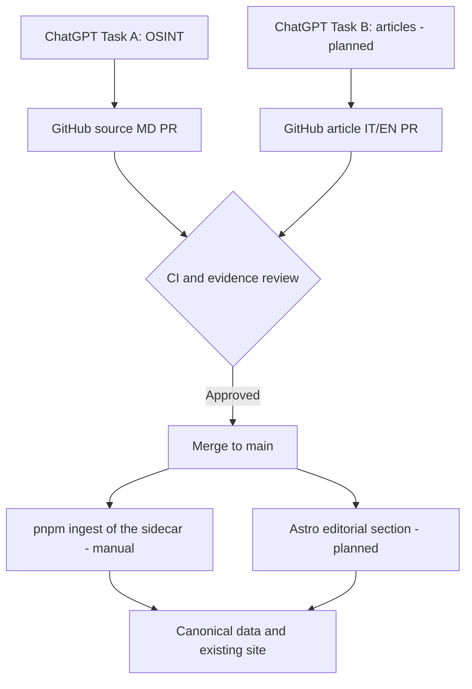

# Our Enemies Monitor

**Evidence-based mapping of foreign interference, hybrid threats, geopolitical pressure and strategic dependencies affecting Europe.**

Our Enemies Monitor is an independent, open-source and open-data OSINT (open-source intelligence) research and visualization project. Its purpose is to make complex events and relationships easier to explore through a chronological timeline, interactive network graphs, geographic views, actor profiles, and traceable documentary evidence.

The project is being designed as a **multilingual, continuously maintained knowledge base**, with GitHub as the versioned source of truth and AI-assisted research workflows contributing proposed updates.

> **Important distinction:** "Enemies" is the name of the research project, not a legal or investigative designation applied to everyone it mentions. An appearance in the database does not imply wrongdoing, hostile intent, foreign control or complicity. A commercial dependency, political disagreement, shared interest or network connection does not by itself demonstrate an illicit operation or coordination.

## Status

**Phase: M1–M5 technical milestones implemented; M6 ChatGPT research design adopted, with Task A manually proven and scheduled. The deterministic sidecar ingest (`pnpm ingest`) is implemented; the Task A sidecar output and the article section are pending. M5 evidence-review items remain tracked, and incremental data candidates remain quarantined.**

**Live site:** https://amattis96.github.io/our-enemies-monitor/ (Italian) · https://amattis96.github.io/our-enemies-monitor/en/ (English, machine-translated, not yet reviewed).

The initial research corpus has a cutoff of **21 October 2026** and covers **2007–2026**, with earlier context where relevant. These are curated records, not an exhaustive census of all incidents in Europe.

| Baseline component | Records |
| --- | ---: |
| Distinct timeline entries | 147 |
| Graph nodes | 353 |
| Graph edges (all types) | 444 |
| Direct entity-to-entity relationships | 153 |
| Open investigative hypotheses | 22 |
| Additional externally verified records pending timeline integration | 4 |

**Update of 11 November 2026 (Fonte_09):** a first incremental source adds 30 candidate events and 50 web references (22 October–11 November 2026), 10 new hypotheses (H23–H32), 18 entities and 14 sourced relationships. They are pending timeline integration and editorial review, are not part of the baseline counts above, and the 30 items are not 30 independent attacks. Current totals in `data/`: 181 events, 458 relationships, 32 hypotheses, 106 sources.

The graph includes contextual and event-participation edges. **Not every edge represents financing, operational control or attribution.** These counts describe the structure of the current research corpus and must not be used as a quantitative measure of hostility.

## Research scope

The research examines both **documented hostile activities** and **non-hostile strategic exposures** relevant to European security and autonomy:

- Military aggression, sabotage, cyber operations and intelligence activities.
- Foreign information manipulation and interference (FIMI), elections and political influence.
- Financial networks, intermediaries, lobbying, sanctions and covert funding.
- Critical infrastructure, energy, logistics, satellites, cloud services and industrial supply chains.
- Critical raw materials, semiconductors, dependencies and economic coercion.
- Cross-border consequences of geopolitical crises and European institutional responses.

The geographic scope includes EU member states, other European countries, Ukraine and Europe's strategic neighbourhood, together with relevant connections to the wider world.

## Planned ways to explore the data

| View | Purpose |
| --- | --- |
| **Timeline** | Browse events by date, period, category and evidence status. |
| **Geographic atlas** | Explore affected locations, targets and attributed origins without conflating them. |
| **Network graph** | Follow typed relationships between people, organizations, companies, states and events. |
| **Actor and case profiles** | Examine claims, source documents, dates, disputed details and subsequent developments. |
| **Strategic dependencies** | Trace relevant supply chains, chokepoints and infrastructure exposure. |
| **Updates and corrections** | See newly added material and changes to existing assessments. |

**Internationalization:** English and Italian are intended as initial interface languages, followed by major European languages and progressively broader EU-language coverage. Translations will not alter canonical entity IDs or the meaning and provenance of an attribution.

## Research corpus

The initial corpus consists of **Fonte_00–Fonte_08**. These source documents are the historical and analytical foundation of the project; they are **not** substitutes for primary-source verification of each individual claim.

| Source | Role |
| --- | --- |
| `Fonte_00` | Initial consolidated dossier and evidentiary vocabulary. |
| `Fonte_01` | Actors, political influence, financing and intermediary networks. |
| `Fonte_02` | Information manipulation, elections and society. |
| `Fonte_03` | Hybrid warfare, sabotage, cyber and security. |
| `Fonte_04` | Industry, energy, technology and strategic dependencies. |
| `Fonte_05` | Global strategies, geopolitical convergence and consequences for Europe. |
| `Fonte_06` | Deduplicated chronology, available as Markdown and CSV with `TL-*` identifiers. |
| `Fonte_07` | Relationship graph, hypotheses and additional evidence, available as Markdown, CSV and GraphML with `G-*` / `H*` identifiers. |
| `Fonte_08` | Strategic consolidation, methodological constraints and requirements for the future portal. |

The baseline currently includes machine-readable CSV files for timeline entries, nodes, edges, hypotheses and additional evidence, as well as a GraphML export. Preserve their identifiers and original files when importing them into a normalized model.

**Source provenance:** some research-document citations refer to search-session IDs rather than permanent public URLs. Before publishing sensitive allegations or identifying a person's responsibility, the relevant original document must be recovered, checked and linked explicitly.

## Evidence and attribution policy

The baseline defines five **evidence levels**. These describe the support for a *specific statement or relationship*, not an entity's overall reputation.

| Level | Meaning | Publication rule |
| --- | --- | --- |
| **E1** | Primary act, judgment, official decision, directly verified fact or technical observation. | Describe exactly what the source establishes. |
| **E2** | Formal attribution by a government, intelligence service or institution. | Attribute explicitly to the issuing authority; do not present it as a criminal conviction. |
| **E3** | Strong independent forensic research, original investigation or corroborated analysis. | Preserve methodology, scope and unresolved issues. |
| **E4** | Allegation, complaint or interested-party statement not publicly corroborated. | Label as an allegation, with source and limits. |
| **E5** | Hypothesis, correlation or scenario. | Keep separate from factual graph edges; never render as an established link. |

Separately, each claim or relationship should record its **evidence status** (such as established, corroborated, disputed, unverified or refuted) and, where appropriate, independent assessments of **attribution confidence** and **impact confidence**.

Guiding principles:

1. **Connection is not causation.** Shared narratives, proximity in a graph and coinciding interests do not establish operational coordination.
2. **Event, perpetrator, sponsor and impact are distinct claims.** Each needs its own evidence.
3. **Institutional attribution is not a court verdict.** Record the exact decision or statement and its date.
4. **A finding may change.** Corrections, acquittals, new evidence and retractions must remain visible and versioned.
5. **The public graph must not imply guilt by association.** Context and participation edges must be distinguishable from control and financing edges.
6. **No false precision.** Unknown dates, figures, ownership shares and causal links should remain unknown.
7. **Counterevidence matters.** Actively seek credible alternative explanations and contradictory findings.

## Technical architecture

The repository is the durable source of truth. A **static-first portal** is built by a deterministic TypeScript pipeline from validated canonical records in `data/`. The historical files under `sources/original/` stay unchanged; the canonical layer preserves their exact IDs, provenance and original values.

| Component | Technology |
| --- | --- |
| Runtime and tooling | Node.js 26, pnpm 12, TypeScript 7, Biome 2, Vitest 5 |
| Data model and validation | Zod 4 schemas, exported as JSON Schema |
| Canonical data | One JSON file per record in `data/`, versioned in Git |
| Public web app | Astro 7 static site with React 19 islands, Tailwind CSS 4 |
| Network graphs | Cytoscape.js |
| Search | Pagefind static index |
| Atlas | Static country-level SVG maps (d3-geo, Natural Earth) |
| Languages | Italian (canonical) and English, translation status tracked per record |
| Publishing | GitHub Actions, GitHub Pages, portable static output |

No database, graph database, map tile server or paid service is needed to build or mirror the site.

**Working with the data:**

```bash
pnpm install
pnpm check        # lint, typecheck, tests, data validation, schema freshness
pnpm validate     # validate data/ only
pnpm build        # build the static site into web/dist (with search index)
pnpm preview      # serve the built site locally
pnpm check:links  # verify every internal link of the built site
pnpm ingest <Fonte_XX.proposals.json>  # dry run of an M6 sidecar ingest (--write to create candidates)
```

**Full design, data model, validation rules and milestones:** [docs/ARCHITECTURE.md](docs/ARCHITECTURE.md). Contributor and agent rules: [AGENTS.md](AGENTS.md).

## M6: ChatGPT-scheduled research without paid model APIs

**Adopted workflow:** two complementary **ChatGPT product scheduled tasks**,
not Claude/Anthropic API automation. Research and writing occur in ChatGPT;
GitHub provides versioning, review and CI; TypeScript/Astro performs
deterministic ingestion, indexing, website generation and publication.

- **Task A: incremental OSINT (active).** Daily at **01:00 Europe/Rome**.
  Inspect the last *merged* source plus open PRs, re-scan with at least
  72 hours of overlap, verify evidence, deduplicate, and open a PR adding
  a new immutable Markdown `sources/incremental/Fonte_XX*.md` only when
  relevant findings exist. No changes to canonical `data/` and no auto-merge.
  The manual POC created [PR #3](https://github.com/amattis96/our-enemies-monitor/pull/3)
  with Fonte_10; **unattended scheduled GitHub permissions are not yet proven**.
- **Task B: in-depth investigations (planned).** Independent research from
  hypotheses, network evidence and strategic questions, producing
  citation-linked articles in Italian and English. A suggested two-week
  cadence is **not** yet configured.
- **GitHub Actions (existing):** CI, evidence diff, build and GitHub Pages
  deployment. **Planned:** article publishing. No live model APIs are involved.
- **Ingest (implemented, run manually):** each source PR will carry a
  structured `Fonte_XX.proposals.json` sidecar next to the Markdown;
  `pnpm ingest` validates it, deduplicates against existing records and other
  sources, and writes only `needs_review` candidates (withheld from the site)
  for a reviewed `agent/*` PR. Task A does not emit the sidecar yet.
- **Safeguards:** original/incremental sources stay immutable once merged;
  no invented links or certainty, no automated promotion to `reviewed`,
  source-specific approvals and M5 publication gates remain in place.

The previous weekly Anthropic/Claude API workflow has been retired.
**Detailed contracts, task states and instructions for local coding agents:**
[docs/M6_CHATGPT_OSINT_WORKFLOW.md](docs/M6_CHATGPT_OSINT_WORKFLOW.md).



## Data model and temporal integrity

The planned normalized data model separates:

- **Entity:** a person, government, agency, company, institution or strategic asset.
- **Event:** a dated incident or decision, potentially spanning a period.
- **Claim:** a precise statement made or supported by one or more sources.
- **Evidence:** the underlying document, investigation or technical observation.
- **Relationship:** a typed and sourced connection between entities or events.
- **Hypothesis:** an open research question, not an established relationship.
- **Exposure:** a measured strategic or economic dependency.
- **Assessment:** a dated analytical judgment with explicit limitations.
- **Correction:** a later amendment, refutation, judgment or retraction.

At minimum, distinguish **when an event happened** from **when it was reported, attributed or entered into the dataset**. Retroactive attribution must not rewrite the date of the underlying event.

## Development roadmap

- [x] Establish the initial research baseline and consolidated analysis.
- [x] Produce timeline CSV, graph CSV/GraphML and hypothesis register.
- [x] Import the 15 original source files into GitHub without losing identifiers or provenance.
- [x] Publish permissive licenses for code and original project data.
- [x] Define and validate normalized schemas and import the baseline into canonical data (M1).
- [x] Add an M5 publication gate for candidates and unsourced named-person relationships (site and exports).
- [x] Add a reproducible publication audit command (`pnpm audit:publication`) and [M5 evidence work queue](docs/M5_EVIDENCE_AUDIT.md).
- [x] First-pass source matching on 36 sensitive relationships (35 referenced, 1 restricted) and 30 Fonte_09 case/reconciliation decisions.
- [x] Stage 20 atomic claims and 26 durable source metadata entries, guarded by `pnpm audit:m5`.
- [ ] Complete human evidentiary sign-off and integrate/reject Fonte_09 proposals in controlled reviewed changesets.
- [x] Build the interactive timeline, graph and profile pages (M2, Italian MVP).
- [x] Build the geographic atlas and strategic-dependency views (M3).
- [x] Introduce multilingual navigation (Italian/English) with tracked translation status (M3).
- [ ] Review the English machine translations.
- [x] Set up agent-specific research branches, CI checks, evidence diffs and pull requests (M4).
- [x] Implement the M4 contribution/review/CI mechanism and GitHub Pages deployment; retire its legacy paid Anthropic research job in favor of the M6 design.
- [x] Configure daily 01:00 Europe/Rome ChatGPT OSINT Task A and prove manual GitHub source PR write (Fonte_10, PR #3).
- [ ] Verify the first unattended daily ChatGPT OSINT execution and GitHub PR permissions.
- [x] Implement deterministic, validated and idempotent source-to-canonical ingestion without model API calls (M6: `pnpm ingest` + proposals sidecar contract).
- [ ] Update ChatGPT Task A to emit the `Fonte_XX.proposals.json` sidecar and ingest Fonte_10 once merged (M6).
- [ ] Schedule independent ChatGPT Task B and implement source-linked IT/EN articles and editorial pages (M6).
- [x] Publish the public portal and its correction policy (changes page, contribution rules).
- [x] Import the first incremental source, Fonte_09 (cut-off 11 November 2026), as pending records.
- [ ] Final editorial approval of the 36 person-link assessments (35 now referenced, one still restricted) and of all contested Fonte_09 claims. No record is automatically promoted to reviewed.

## Contributing and corrections

The project welcomes **documented additions, competing interpretations, corrections and technical contributions**. See [CONTRIBUTING.md](CONTRIBUTING.md): use the correction or new-evidence issue forms, or open a pull request; every data pull request gets an automatic evidence diff and needs the maintainer's review. Proposed updates should include the primary sources, the precise affected records, what is known versus inferred, and any conflicting evidence.

Please do not submit unsupported allegations, personal data without a legitimate research basis, or speculative links as confirmed relationships. Preserve an individual's legal or procedural status accurately. Publication and republication of third-party materials must respect their licenses and applicable law.

## Independence and limitations

This project is an analytical and research tool, **not an official EU, NATO, intelligence, judicial or fact-checking body**. It does not certify the truth of every underlying research document. Its evidence levels are editorial classifications, not judicial findings or scientifically calibrated probabilities.

The corpus is selective, may contain inaccuracies, and requires primary-source auditing before unqualified public presentation of sensitive claims. A missing relationship is not proof of absence, and an unverified hypothesis is not an established fact.

## Licensing: software and open research data

Our Enemies Monitor is intended to be **freely reproducible, forkable, redistributable, self-hostable and reusable for independent research**, including commercial uses.

- **Software:** [MIT License](LICENSE) (`SPDX: MIT`). Covers project-owned executable code, scripts, web app and automation workflows. Redistributors must retain the MIT copyright and license notices.
- **Original research, datasets and documentation:** [CC0 1.0 Universal Public Domain Dedication](LICENSE-DATA.md) (`SPDX: CC0-1.0`). To the extent the project's contributors hold the relevant rights, original analytical text, project-created structured records, compilations, annotations, original translations and documentation are dedicated to the public domain worldwide, with no mandatory attribution or share-alike condition.

CC0 covers the project's own rights only. **Third-party newspaper articles, source excerpts, images, external datasets, basemaps and other externally authored materials are not automatically relicensed.** Their original copyrights, licenses, privacy rights and other legal restrictions remain applicable. See [LICENSE-DATA.md](LICENSE-DATA.md) for the scope and exclusions.

Anyone may fork the repository, publish an independently hosted mirror, and build new analyses on project-created data. Retaining provenance, citations, warnings, corrections and modification history is **strongly encouraged for research integrity**, without adding restrictions to the CC0-dedicated material.

This project does not guarantee that an external mirror is accurate, current or endorsed by its original authors.

---

*Our Enemies Monitor: investigate the links, preserve the evidence, distinguish what is known from what is inferred.*
