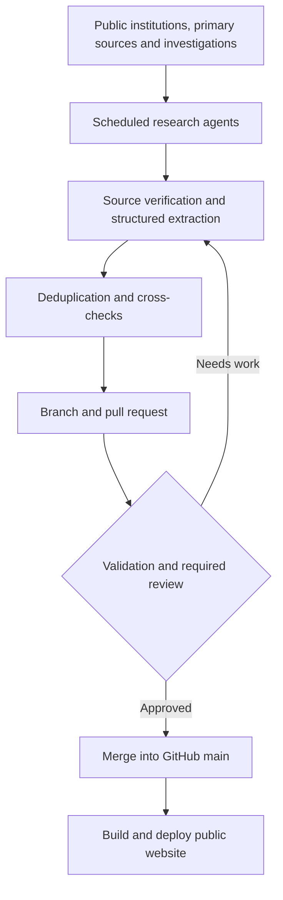

# Our Enemies Monitor

**Evidence-based mapping of foreign interference, hybrid threats, geopolitical pressure and strategic dependencies affecting Europe.**

Our Enemies Monitor is an independent, open-source and open-data OSINT (open-source intelligence) research and visualization project. Its purpose is to make complex events and relationships easier to explore through a chronological timeline, interactive network graphs, geographic views, actor profiles, and traceable documentary evidence.

The project is being designed as a **multilingual, continuously maintained knowledge base**, with GitHub as the versioned source of truth and AI-assisted research workflows contributing proposed updates.

> **Important distinction:** "Enemies" is the name of the research project, not a legal or investigative designation applied to everyone it mentions. An appearance in the database does not imply wrongdoing, hostile intent, foreign control or complicity. A commercial dependency, political disagreement, shared interest or network connection does not by itself demonstrate an illicit operation or coordination.

## Status

**Phase: documentary baseline imported into GitHub; normalized-data migration, public website and automated update workflows planned.**

The initial research corpus has a cutoff of **21 October 2026** and covers **2007–2026**, with earlier context where relevant. These are curated records, not an exhaustive census of all incidents in Europe.

| Baseline component | Records |
| --- | ---: |
| Distinct timeline entries | 147 |
| Graph nodes | 353 |
| Graph edges (all types) | 444 |
| Direct entity-to-entity relationships | 153 |
| Open investigative hypotheses | 22 |
| Additional externally verified records pending timeline integration | 4 |

The graph includes contextual and event-participation edges. **Not every edge represents financing, operational control or attribution.** These counts describe the structure of the current research corpus and must not be used as a quantitative measure of hostility.

## Research scope

The research examines both **documented hostile activities** and **non-hostile strategic exposures** relevant to European security and autonomy:

- Military aggression, sabotage, cyber operations and intelligence activities.
- Foreign information manipulation and interference (FIMI), elections and political influence.
- Financial networks, intermediaries, lobbying, sanctions and covert funding.
- Critical infrastructure, energy, logistics, satellites, cloud services and industrial supply chains.
- Critical raw materials, semiconductors, dependencies and economic coercion.
- Cross-border consequences of geopolitical crises and European institutional responses.

The geographic scope includes EU member states, other European countries, Ukraine and Europe's strategic neighbourhood, together with relevant connections to the wider world.

## Planned ways to explore the data

| View | Purpose |
| --- | --- |
| **Timeline** | Browse events by date, period, category and evidence status. |
| **Geographic atlas** | Explore affected locations, targets and attributed origins without conflating them. |
| **Network graph** | Follow typed relationships between people, organizations, companies, states and events. |
| **Actor and case profiles** | Examine claims, source documents, dates, disputed details and subsequent developments. |
| **Strategic dependencies** | Trace relevant supply chains, chokepoints and infrastructure exposure. |
| **Updates and corrections** | See newly added material and changes to existing assessments. |

**Internationalization:** English and Italian are intended as initial interface languages, followed by major European languages and progressively broader EU-language coverage. Translations will not alter canonical entity IDs or the meaning and provenance of an attribution.

## Research corpus

The initial corpus consists of **Fonte_00–Fonte_08**. These source documents are the historical and analytical foundation of the project; they are **not** substitutes for primary-source verification of each individual claim.

| Source | Role |
| --- | --- |
| `Fonte_00` | Initial consolidated dossier and evidentiary vocabulary. |
| `Fonte_01` | Actors, political influence, financing and intermediary networks. |
| `Fonte_02` | Information manipulation, elections and society. |
| `Fonte_03` | Hybrid warfare, sabotage, cyber and security. |
| `Fonte_04` | Industry, energy, technology and strategic dependencies. |
| `Fonte_05` | Global strategies, geopolitical convergence and consequences for Europe. |
| `Fonte_06` | Deduplicated chronology, available as Markdown and CSV with `TL-*` identifiers. |
| `Fonte_07` | Relationship graph, hypotheses and additional evidence, available as Markdown, CSV and GraphML with `G-*` / `H*` identifiers. |
| `Fonte_08` | Strategic consolidation, methodological constraints and requirements for the future portal. |

The baseline currently includes machine-readable CSV files for timeline entries, nodes, edges, hypotheses and additional evidence, as well as a GraphML export. Preserve their identifiers and original files when importing them into a normalized model.

**Source provenance:** some research-document citations refer to search-session IDs rather than permanent public URLs. Before publishing sensitive allegations or identifying a person's responsibility, the relevant original document must be recovered, checked and linked explicitly.

## Evidence and attribution policy

The baseline defines five **evidence levels**. These describe the support for a *specific statement or relationship*, not an entity's overall reputation.

| Level | Meaning | Publication rule |
| --- | --- | --- |
| **E1** | Primary act, judgment, official decision, directly verified fact or technical observation. | Describe exactly what the source establishes. |
| **E2** | Formal attribution by a government, intelligence service or institution. | Attribute explicitly to the issuing authority; do not present it as a criminal conviction. |
| **E3** | Strong independent forensic research, original investigation or corroborated analysis. | Preserve methodology, scope and unresolved issues. |
| **E4** | Allegation, complaint or interested-party statement not publicly corroborated. | Label as an allegation, with source and limits. |
| **E5** | Hypothesis, correlation or scenario. | Keep separate from factual graph edges; never render as an established link. |

Separately, each claim or relationship should record its **evidence status** (such as established, corroborated, disputed, unverified or refuted) and, where appropriate, independent assessments of **attribution confidence** and **impact confidence**.

Guiding principles:

1. **Connection is not causation.** Shared narratives, proximity in a graph and coinciding interests do not establish operational coordination.
2. **Event, perpetrator, sponsor and impact are distinct claims.** Each needs its own evidence.
3. **Institutional attribution is not a court verdict.** Record the exact decision or statement and its date.
4. **A finding may change.** Corrections, acquittals, new evidence and retractions must remain visible and versioned.
5. **The public graph must not imply guilt by association.** Context and participation edges must be distinguishable from control and financing edges.
6. **No false precision.** Unknown dates, figures, ownership shares and causal links should remain unknown.
7. **Counterevidence matters.** Actively seek credible alternative explanations and contradictory findings.

## Proposed technical architecture

The repository is the durable source of truth. A **static-first React portal** is proposed, with a deterministic pipeline that turns approved, typed research records into frontend datasets. The historical files under `sources/original/` stay unchanged; a separately maintained canonical data layer will preserve exact IDs, citations, classifications and corrections.

**Proposed stack (not yet implemented):**

| Component | Technology |
| --- | --- |
| Public web app | React, TypeScript, Next.js static export |
| Source import and validation | Python, Pydantic, CSV / Markdown / GraphML importers |
| Canonical data | Validated JSON/JSONL, versioned in Git |
| Build-time relational/search index | SQLite + FTS5, fully rebuildable |
| Network graphs | Cytoscape.js |
| Interactive maps | MapLibre GL JS + GeoJSON |
| Timeline and quantitative charts | vis-timeline and Apache ECharts |
| Optional future online backend | PostgreSQL, optional PostGIS / pgvector |
| Publishing | GitHub Actions, portable static output for any host |

A dedicated graph database or mandatory paid semantic search service is **not needed** for the baseline corpus. Optional embedding-based retrieval must support discovery only, never establish attribution or causal claims.

**Full rationale, proposed tree, import rules, CI checks, public read models and Claude Code implementation milestones:** [docs/ARCHITECTURE.md](docs/ARCHITECTURE.md).

**Current status:** the original source files, licenses, README and design proposal are committed; the framework and data pipeline remain to be implemented.

## AI-assisted weekly updates

The target workflow is to use independent research agents, potentially built with ChatGPT, Codex, Claude or API-based automation, to propose **small, reviewable changes** instead of rewriting the whole corpus.

The automation should:

- Detect **new evidence, genuinely new events and material developments** in existing cases.
- Resolve entities and aliases against existing IDs and deduplicate sources.
- Record original URLs, publisher, publication date, observation date, quoted or summarized support and source retrieval metadata.
- Check for contrary evidence and identify sources that merely republish the same claim.
- Propose additions or corrections with explicit provenance, evidence level and review status.
- Preserve prior interpretations and append an audit trail rather than silently overwriting history.
- Request human review for serious allegations about identifiable people, contested attribution and promotions of investigative hypotheses into factual assertions.
- Generate translations **after** the canonical-language content has been approved.

The precise ability of any scheduled assistant to write to GitHub depends on its configured integrations, permissions and environment. Recurring jobs and direct GitHub writes should not be assumed to be available together by default.

### Pull request and deployment policy

- Research agents should write on **dedicated branches**, not directly to `main`.
- Checks should validate schema, identifiers, references, evidence metadata, chronology and the separation of hypotheses.
- A successful check does **not** replace substantive editorial review.
- Merges to `main` may trigger a static-site build and automated deployment.
- A self-hosted installation may instead pull approved changes and run its build script; a `git pull` alone is insufficient when the website requires compilation.

## Data model and temporal integrity

The planned normalized data model separates:

- **Entity:** a person, government, agency, company, institution or strategic asset.
- **Event:** a dated incident or decision, potentially spanning a period.
- **Claim:** a precise statement made or supported by one or more sources.
- **Evidence:** the underlying document, investigation or technical observation.
- **Relationship:** a typed and sourced connection between entities or events.
- **Hypothesis:** an open research question, not an established relationship.
- **Exposure:** a measured strategic or economic dependency.
- **Assessment:** a dated analytical judgment with explicit limitations.
- **Correction:** a later amendment, refutation, judgment or retraction.

At minimum, distinguish **when an event happened** from **when it was reported, attributed or entered into the dataset**. Retroactive attribution must not rewrite the date of the underlying event.

## Development roadmap

- [x] Establish the initial research baseline and consolidated analysis.
- [x] Produce timeline CSV, graph CSV/GraphML and hypothesis register.
- [x] Import the 15 original source files into GitHub without losing identifiers or provenance.
- [x] Publish permissive licenses for code and original project data.
- [ ] Define and validate normalized schemas for events, claims and relationships.
- [ ] Audit sensitive claims against stable primary-source references.
- [ ] Build the interactive timeline, map, graph and profile pages.
- [ ] Introduce multilingual navigation and translation review.
- [ ] Set up agent-specific research branches, CI checks and pull requests.
- [ ] Enable scheduled research, editorial review and automatic deployment.
- [ ] Publish the public portal and its correction policy.

## Contributing and corrections

The project aims to welcome **documented additions, competing interpretations, corrections and technical contributions**. Until contribution templates and governance rules are established, proposed research updates should include the primary sources, precise affected records, a statement of what is known versus inferred, and any relevant conflicting evidence.

Please do not submit unsupported allegations, personal data without a legitimate research basis, or speculative links as confirmed relationships. Preserve an individual's legal or procedural status accurately. Publication and republication of third-party materials must respect their licenses and applicable law.

## Independence and limitations

This project is an analytical and research tool, **not an official EU, NATO, intelligence, judicial or fact-checking body**. It does not certify the truth of every underlying research document. Its evidence levels are editorial classifications, not judicial findings or scientifically calibrated probabilities.

The corpus is selective, may contain inaccuracies, and requires primary-source auditing before unqualified public presentation of sensitive claims. A missing relationship is not proof of absence, and an unverified hypothesis is not an established fact.

## Licensing: software and open research data

Our Enemies Monitor is intended to be **freely reproducible, forkable, redistributable, self-hostable and reusable for independent research**, including commercial uses.

- **Software:** [MIT License](LICENSE) (`SPDX: MIT`). Covers project-owned executable code, scripts, web app and automation workflows. Redistributors must retain the MIT copyright and license notices.
- **Original research, datasets and documentation:** [CC0 1.0 Universal Public Domain Dedication](LICENSE-DATA.md) (`SPDX: CC0-1.0`). To the extent the project's contributors hold the relevant rights, original analytical text, project-created structured records, compilations, annotations, original translations and documentation are dedicated to the public domain worldwide, with no mandatory attribution or share-alike condition.

CC0 covers the project's own rights only. **Third-party newspaper articles, source excerpts, images, external datasets, basemaps and other externally authored materials are not automatically relicensed.** Their original copyrights, licenses, privacy rights and other legal restrictions remain applicable. See [LICENSE-DATA.md](LICENSE-DATA.md) for the scope and exclusions.

Anyone may fork the repository, publish an independently hosted mirror, and build new analyses on project-created data. Retaining provenance, citations, warnings, corrections and modification history is **strongly encouraged for research integrity**, without adding restrictions to the CC0-dedicated material.

This project does not guarantee that an external mirror is accurate, current or endorsed by its original authors.

---

*Our Enemies Monitor: investigate the links, preserve the evidence, distinguish what is known from what is inferred.*
