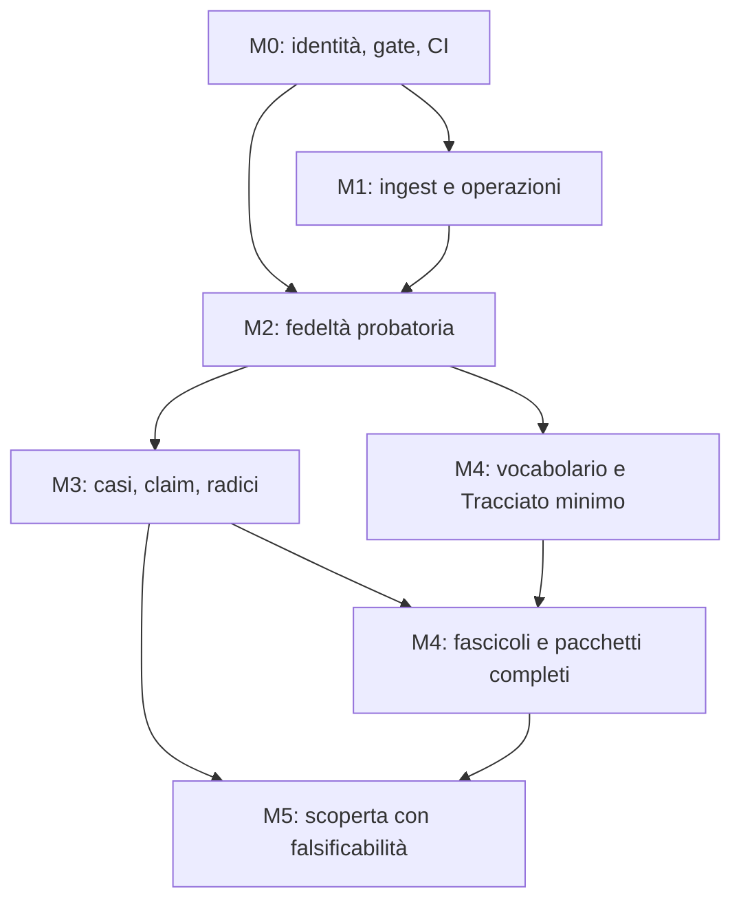

# Our Enemies Monitor | Consolidated Findings

**Campagna:** audit Claude Fable 5.2, novembre 2026  
**Documento:** consolidamento critico e piano decisionale, non istruzione esecutiva  
**Data:** 14 novembre 2026 (Europe/Rome)  
**Baseline comune dei quattro audit:** `d1f6a97601409f00f2bdefc47533b7b2f75d47ff`  
**Commit che archivia i quattro rapporti:** `fddecce4584811d3a262007ca119b3c7798a1499`  
**Branch analizzato:** `main`  
**Stato:** **proposte da verificare e approvare**; nessun intervento applicativo o cambiamento alle automazioni autorizzato da questo documento.

> **Scopo.** Ricondurre quattro analisi indipendenti a una mappa di problemi, dipendenze, decisioni ed esperimenti. Non sommare indiscriminatamente le raccomandazioni e non trasformare automaticamente una correlazione in una prova, un caveat in una smentita fattuale o una PR fusa in un'approvazione editoriale.

## 0. Documenti di origine e regole di lettura

I seguenti documenti sono le **fonti dirette di questa sintesi**. I codici A–D e le sezioni citate nel seguito rimandano a essi; le metriche numeriche restano quelle misurate dai rispettivi autori sul commit comune, salvo verifica esplicita contraria.

| Codice | Rapporto | Contributo principale |
| --- | --- | --- |
| **A** | [Deep Intelligence & Knowledge Discovery](FABLE_A_Deep_Intelligence_Knowledge_Discovery.md) | Catena probatoria, genealogia delle fonti, inferenze improprie, ipotesi, casi e riconciliazione testo–grafo |
| **B** | [Systemic Security, Architecture & Autonomous Operations](FABLE_B_Systemic_Security_Architecture_Automations.md) | Privilegi, CI, invarianti di pubblicazione, ingestione M6, gestione delle tre automazioni |
| **C** | [Investigative Visualization & Cognitive UX](FABLE_C_Investigative_Visualization_Cognitive_UX.md) | Verifiche delle viste dopo M7, percorsi investigativi, Tracciato, Fascicolo del caso, Filiera, ricerca strutturata |
| **D** | [AI Interoperability & Semantic Knowledge](FABLE_D_AI_Interoperability_Semantic_Knowledge.md) | Semantica delle esportazioni, retrieval che preserva le negazioni, vocabolario, pacchetti probatori, benchmark |

**Contratti operativi da mantenere:** [AGENTS.md](../../../AGENTS.md), [ARCHITECTURE.md](../../ARCHITECTURE.md), [M5_EVIDENCE_AUDIT.md](../../M5_EVIDENCE_AUDIT.md), [M6_CHATGPT_OSINT_WORKFLOW.md](../../M6_CHATGPT_OSINT_WORKFLOW.md), [CHATGPT_SCHEDULED_TASKS.md](../../CHATGPT_SCHEDULED_TASKS.md).

### 0.1 Classificazione del supporto

- **V — verificato nel consolidamento:** un percorso di codice o un fatto GitHub è stato confrontato anche direttamente con il repository/API; non significa che sia stata riprodotta l'intera dimostrazione dell'audit.
- **R — riportato dall'audit:** conteggio, esperimento o comportamento riprodotto da Fable, ma **non** rieseguito integralmente in questo consolidamento.
- **P — proposta o rischio plausibile:** manca ancora la prova di un difetto effettivo oppure si tratta di una soluzione candidata.
- **D — decisione richiesta:** non si tratta di un bug risolvibile senza definire una policy editoriale, di sicurezza o di prodotto.

La parola «dimostrato» nei rapporti originali è preservata **come loro classificazione**, senza equipararla automaticamente a una verifica indipendente completa.

### 0.2 Controlli incrociati effettuati

| Rilievo | Riscontro nel consolidamento | Limite |
| --- | --- | --- |
| Il filtro di pubblicazione dei record usa `review.status !== "needs_review"` | **V**: [`src/site/publication.ts`](https://github.com/amattis96/our-enemies-monitor/blob/d1f6a97601409f00f2bdefc47533b7b2f75d47ff/src/site/publication.ts#L9-L16) | Il comportamento su dataset avversariali è riprodotto da B, non rieseguito qui |
| Il grafo esportato non include `caveat` nel tipo di arco | **V**: [`src/site/read-model.ts`](https://github.com/amattis96/our-enemies-monitor/blob/d1f6a97601409f00f2bdefc47533b7b2f75d47ff/src/site/read-model.ts#L130-L160) | La quantità di caveat rischiosi proviene da A/D |
| Le regole severe di evidence-diff dipendono da `agent/*` | **V**: [`.github/workflows/ci.yml`](https://github.com/amattis96/our-enemies-monitor/blob/d1f6a97601409f00f2bdefc47533b7b2f75d47ff/.github/workflows/ci.yml#L38-L61) | La presenza di regole di protezione aggiuntive va verificata con privilegi adeguati |
| La CI usa `cancel-in-progress: true` | **V**: stesso workflow, `concurrency` | La cronologia precisa dei tempi è documentata da B |
| L'ingest legge tutti gli altri sidecar archiviati | **V**: [`src/cli/ingest.ts`](https://github.com/amattis96/our-enemies-monitor/blob/d1f6a97601409f00f2bdefc47533b7b2f75d47ff/src/cli/ingest.ts#L56-L71) | La riproduzione dell'esclusione reciproca è in B `V8 |
| L'hash della traduzione dipende dai testi italiani | **V**: [`src/pipeline/translations.ts`](https://github.com/amattis96/our-enemies-monitor/blob/d1f6a97601409f00f2bdefc47533b7b2f75d47ff/src/pipeline/translations.ts#L26-L45) | Un hash sull'inglese non prova da solo la fedeltà semantica |
| Le PR #11, #3 e #10 sono state fuse il 13 novembre alle 04:01:07, 04:01:21 e 04:01:25 UTC | **V**: cronologia merge GitHub; [PR #11](https://github.com/amattis96/our-enemies-monitor/pull/11), [#3](https://github.com/amattis96/our-enemies-monitor/pull/3), [#10](https://github.com/amattis96/our-enemies-monitor/pull/10) | Non attribuire con certezza ogni azione a Task C senza il suo log |
| Identità amministrativa condivisa, approvazione del code owner aggirata | **R / da verificare**: B `V1; le PR risultano attribuite allo stesso account | L'endpoint di branch protection restituisce `403` all'integrazione consultata: `enforce_admins` e required reviews non sono stati ricontrollati direttamente |

**Regola di aggiornamento:** un nuovo commit dopo la baseline non invalida automaticamente gli audit, ma ogni intervento deve ricontrollare i file e i dati sul `main` corrente. I numeri del presente documento **non** sono KPI aggiornati automaticamente.

---

## 1. Sintesi esecutiva: che cosa è emerso davvero

### 1.1 Le cinque conclusioni trasversali

1. **L'affidabilità del processo precede l'espansione funzionale.** B ha rilevato che controlli formalmente esistenti possono essere aggirati per combinazioni di identità, permessi, nome del ramo e stati editoriali. La pubblicazione è corretta solo se l'intera catena di autorizzazione, non il singolo schema, mantiene le proprie invarianti. [B ``1, 4, 6–8]
2. **Il limite principale del patrimonio probatorio è la granularità delle affermazioni e il collegamento alle fonti primarie.** A rileva 429/458 relazioni che citano soltanto sintesi interne; 40/41 riferimenti `F*`/`P*` non sono citati direttamente dai record. Il problema è la **tracciabilità record → affermazione → documento originario**, non l'assenza totale di bibliografia. [A ``4.1, 7–10; D ``3–4]
3. **Il grafo e le esportazioni possono essere più assertivi dei documenti da cui derivano.** In un percorso Kerimov → SpaceX i singoli archi esistono, ma la composizione non prova il finanziamento tra gli estremi. Il caveat cruciale è assente da `graph.json`. La prossimità topologica non è causalità. [A `4.4; C ``3, 5; D ``3, 6]
4. **Il sistema conosce molti eventi, ma conosce poco la loro evoluzione come “casi”.** Pagamenti e sentenze, intrusioni e attribuzioni, notizie e rettifiche sono record separati privi di un contenitore investigativo condiviso. Questo altera sia le statistiche di rete sia la comprensione umana. [A `4.5; C ``5–6; D `3]
5. **Per migliorare AI e UX non serve introdurre subito un server o un modello predittivo.** Un vocabolario esplicito, pacchetti di evidenze, caveat completi, casi e claim granulari abilitano contemporaneamente nuove visualizzazioni, interrogazioni e controlli di falsificabilità, conservando Git come fonte di verità. [A `7; C ``9–11; D ``10–14]

### 1.2 Decisione architetturale suggerita, ma non ancora adottata

Evolvere **incrementalmente** da «record con descrizione e fonti» a:

```text
Fonti con radici e derivazioni
            │
            ▼
Claim atomici e temporalizzati (chi afferma cosa, base, posizione, prove)
            │
            ├── Casi (fasi di un'unica vicenda, senza fondere procedimenti distinti)
            ├── Relazioni tipizzate e limiti di inferenza
            │
            ▼
Proiezione pubblica deterministica, con revisione umana
            │
            ├── Tracciati, fascicoli, filiere, domande strutturate
            └── Vocabolario, catalogo, pacchetti probatori e feed per AI
```

**Non** è un via libera a migrare automaticamente i 1.000+ record o generare claim dagli eventi della baseline: la migrazione editoriale deve essere selettiva, documentata e verificata su atti primari. **Non** richiede un database a grafo esterno, LLM in produzione o servizi a pagamento.

---

## 2. Registro consolidato degli interventi

Gli ID `CF-###` sono **stabili per il consolidamento** e indipendenti dagli ID `TL-*`, `G-*`, `H*` e `ART-*` del progetto. Una riga può combinare più proposte dei quattro audit. `P0` indica prerequisiti di affidabilità, non un ordine di implementazione automatico.

| ID | Intervento / problema da risolvere | Convergenze | Stato | Priorità | Dipendenze |
| --- | --- | --- | --- | --- | --- |
| **CF-001** | Separare identità degli agenti, reviewer e approvatore; verificare branch protection | B V1/P1, B `8 | R+D | **P0** | Accesso amministrativo GitHub |
| **CF-002** | Applicare controlli CI e vincoli ai **percorsi modificati**, non al prefisso del ramo | B V3/P2–P3 | V+P | **P0** | CF-001 per garanzia non scavalcabile |
| **CF-003** | Rafforzare la transizione `needs_review → pubblicabile` e la semantica `imported_unreviewed` | B V4/V7/P3–P4; A `4.3 | V+R+D | **P0** | Policy sulla baseline esistente |
| **CF-004** | Merge seriali con CI effettivamente conclusa; eliminare annullamenti e verifiche su basi obsolete | B V2/P7, `8 | V+R | **P0** | CF-001–002 |
| **CF-005** | Correggere deduplicazione, idempotenza, perdita citazioni e validazione dei sidecar M6 | B V8/P6; A `4.7 | V+R | **P0** | Prima di aumentare l'ingestione |
| **CF-006** | Proteggere meglio attribuzioni su persone e coerenza fonte primaria / `primary_url` | B V5/S4/P4; A `4.2 | R+D | **P0** | CF-002–003, decisione probatoria |
| **CF-007** | Controllare transizioni degli articoli, link reali al corpus e deriva IT/EN | A `4.1/P12; B V6–V7; D `8 | V+R | **P0–P1** | CF-002–003 |
| **CF-008** | Allineare istruzioni degli agenti, osservabilità e responsabilità delle automazioni A/B/C | B V11/`7–8/P9–P11 | R+P | **P1** | CF-001–005 |
| **CF-009** | Collegare claim e record alle fonti primarie realmente pertinenti | A `4.1/P4; D `4 | R | **P1** | Workflow di revisione umana |
| **CF-010** | Genealogia delle fonti e conteggio delle radici indipendenti | A `4.7/P5; B S2–S3; C N3; D `6 | R+P | **P1** | CF-009, nuovo schema additivo |
| **CF-011** | Esportare caveat e dichiarare i **limiti di inferenza**, senza confondere negazione e relazione | A `4.4/P2–P3; C ``3, 5; D ``3, 6, 12 | V+R+D | **P1** | Correzione esportazione prima della classificazione |
| **CF-012** | Rendere osservabile e decidere il trattamento delle ipotesi trattenute | A `4.3/P1; C `9; D `3/T5 | V+R+D | **P1** | CF-003; nessuna fuga di contenuti non revisionati |
| **CF-013** | Introdurre l'identità di **caso** distinta dalle sue fasi/eventi | A `4.5/P6; C `5.2; D `3 | R+P | **P2** | Regole editoriali di raggruppamento |
| **CF-014** | Introduzione incrementale di **claim atomici**, basi non ordinali, confutazioni e date di conoscenza | A ``3, 7/P8–P9; B V9; C `6; D ``4, 6 | R+D | **P2** | CF-009–011, ADR di modello |
| **CF-015** | Riconciliare menzioni testo–grafo come **coda di verifica**, non come generatore di archi | A `4.6/P7; C `3 | R+P | **P1** | Revisore umano, falsi positivi misurati |
| **CF-016** | Correggere UI mobile e costruire il **Tracciato** con caveat completi | C ``2, 5.1, 10–11; A `4.4; D `6 | R+P | **P1** | CF-011 |
| **CF-017** | Fascicolo del caso, Filiera, Matrice dei ruoli e confronto delle campagne | C ``5–6, 9–11; A `4.5 | R+P | **P2** | CF-013 per i casi; classificazioni approvate |
| **CF-018** | Domande investigative strutturate, copertura e tavolo delle ipotesi | C ``4–5, 11; A ``4.8–4.9, 5 | R+P | **P2** | CF-011–015 |
| **CF-019** | Vocabolario leggibile dalle macchine e catalogo con freschezza distinta per livelli | D ``1, 4, 9, 11–12; A `4 | R+P | **P1** | CF-011–012 |
| **CF-020** | Pacchetti per record, collegamenti JSON/HTML, feed e citazioni per commit | D ``6–7, 10–14; C `5.5 | R+P | **P2** | CF-009–011, CF-019 |
| **CF-021** | Benchmark di correttezza, controlli negativi e monitoraggio delle regressioni semantiche | A ``4.5, 11; B `11; C `12; D ``9, 13–14 | R+P | **P1** | Prima e dopo ogni evoluzione |
| **CF-022** | Allargare gli ID `S##`/`H##`; gestire errori silenziosi e sopravvivenza delle fonti esterne | B V10/V12/P8/P12; D `14 | V+R | **P1** | Migrazione retrocompatibile, test |

**Interpretazione della priorità:** P0 = rischio operativo o probatorio prima di scalare l'automazione; P1 = correzione/abilitatore ad alto valore, realizzabile in parallelo dopo i gate; P2 = estensione del modello o dell'esperienza con dipendenze editoriali. Non assegnare punteggi numerici di certezza a persone, mandanti o ipotesi.

---

## 3. Approfondimento delle dipendenze decisive

### 3.1 CF-001–004 | Fiducia nelle approvazioni e nel deployment

**Problema.** Il rapporto B descrive l'uso della stessa identità GitHub per agenti e manutentore e segnala merge avvenuti nonostante `REVIEW_REQUIRED`. I merge rapidi del 13 novembre e la CI fallita sono riscontrabili. In codice: `evidence-diff` usa `agent/*` per decidere la severità; `publishedDataset` considera eleggibile qualunque stato diverso da `needs_review`.

**Perché è sistemico.** Una validazione perfetta non basta se la stessa identità può modificarla, disabilitarla e fondere la propria PR. Viceversa, una revisione umana formale non è prova che ogni claim sia stato verificato.

**Decisioni da prendere prima di implementare:**
1. Quale identità GitHub e quale token possono creare PR, ma **non** approvarle o fonderle?
2. Chi può approvare una modifica al codice, una fonte archiviata, un candidato canonico, un articolo, una sua traduzione?
3. Che cosa significa davvero `imported_unreviewed` per la **baseline storica già pubblica**? Non si può nasconderla in blocco senza decidere esplicitamente la retrocompatibilità editoriale.
4. Quali check sono realmente **required** nella branch protection, non solo eseguiti in CI?

**Target verificabili:**
- Controlli obbligatori associati alla **HEAD corrente** della PR; impossibilità di self-approval e nessun bypass amministrativo per gli agenti.
- Ogni PR su `src/`, `data/`, `content/articles/`, `.github/` e impostazioni di pubblicazione subisce regole coerenti indipendentemente dal nome del ramo.
- Una PR che cambia `reviewed`, `human_approved` o la visibilità non è unibile senza autorizzazione umana verificabile.
- Un nuovo record senza provenienza o approvazione, pur schema-valido, non diventa pubblico; le eccezioni della baseline sono esplicite.
- Nessun merge successivo finché i controlli del commit precedente su `main` sono falliti, annullati o ancora da verificare.

**Cautela:** l'accesso attuale non consente di ricontrollare via API la branch protection. La configurazione segnalata da B va confermata dall'amministratore, senza presumere che un semplice flag in CI risolva il modello dei privilegi.

### 3.2 CF-005, CF-008, CF-022 | Ingestione e automazioni: il collo di bottiglia reale

**Osservato nei rapporti:**
- A produce fino a sette PR di ricerca alla settimana; C esegue review/merge soltanto il venerdì; B scrive il venerdì alle 03:00, due ore prima del controllo C delle 05:00.
- La baseline di A avanza dalla **fonte fusa**, non dalla PR aperta. L'overlap minimo di 72 ore è necessario per aggiornamenti tardivi, ma con merge settimanale le finestre quotidiane si sovrappongono sempre più.
- L'ingestione `pnpm ingest --write` dopo il merge non è coperta da un task schedulato. Fonte_10 e Fonte_11 non dispongono dei sidecar previsti dalle nuove istruzioni. [B `7]
- L'importer attuale considera tutti gli altri sidecar: B mostra che due proposte dello stesso evento possono escludersi reciprocamente. Sono inoltre riportati il marcatore di idempotenza imitabile nelle note, la perdita di nuove citazioni su duplicati e la possibilità che un sidecar malformato blocchi altri processi. [B V8]

**Consolidamento delle correzioni:**
1. Riparare la logica di confronto con un **ordine deterministico totale** (non solo «codice minore», che non basta a stabilire cosa sia stato già ingerito) e verificare l'idempotenza su due fonti sovrapposte.
2. Distinguere `duplicate` da «contiene nuove citazioni o claim». Mai perdere arricchimenti senza segnalarli al revisore.
3. Usare marcatori tecnici non falsificabili da note di testo libero oppure rifiutare sequenze riservate; riportare gli ID di destinazione.
4. Validare tutti i sidecar prima del merge e gestire gli errori di altri sidecar senza perdere l'audit della fonte corrente.
5. Predisporre un percorso **di recupero versionato** per fonti storiche senza sidecar, senza riscrivere i Markdown già archiviati.
6. Estendere compatibilmente i formati `S##`, `Fonte_##`, `H##` e successivamente gli altri ID prima dell'esaurimento. B stima l'esaurimento dei 99 codici Fonte in febbraio 2027 **solo nello scenario di una fonte al giorno**, non come scadenza certa.
7. Uniformare le istruzioni: `.github/agent/research-prompt.md` e i documenti operativi devono descrivere il flusso M6 attuale e non lo stato M6 precedente.
8. Registrare almeno esito, cutoff di partenza, fonte proposta e PR di ogni esecuzione, distinguendo una **scansione negativa** da un fallimento. Evitare rumore da commit senza valore.

**Cadenze: non modificarle adesso.** I modelli B `8 (riordino del venerdì, revisione tecnica quotidiana, ingestione deterministica che **apre** una PR senza unirla, revisione editoriale separata) sono opzioni da confrontare **dopo CF-001–005**. Aumentare subito la frequenza del revisore attuale potrebbe moltiplicare merge non sufficientemente controllati.

**Alternative da valutare con misure:**
- Riordinare C e B per far lavorare B su `main` appena integrato.
- Separare revisione delle sole fonti (eventualmente più frequente) da revisione editoriale e del codice.
- Automatizzare esclusivamente la **creazione** di PR di candidati `needs_review` dopo un ingest deterministico, mai il loro merge o l'approvazione.
- Dare priorità a rettifiche urgenti senza inventare una scorciatoia verso `reviewed`.

**Criterio di scelta:** misurare per 2–4 cicli *cutoff lag*, tempo PR aperta → merge, PR merge → sidecar ingestito, backlog per categoria, CI success rate, duplicati evitati, tempo fino alla verifica umana. Non ottimizzare per numero di fonti prodotte.

### 3.3 CF-009–014 | Affidabilità semantica prima degli algoritmi

**Fonti primarie.** Il rapporto A trova **429/458** relazioni con sole citazioni a sintesi interne; 40 dei 41 riferimenti `F*`/`P*` senza aggancio diretto. La prima iniziativa non è aggiungere documenti indiscriminatamente, ma collegare quelli già disponibili **alle precise proposizioni che effettivamente sostengono**. Il fatto che un riferimento compaia in bibliografia non prova la singola frase. [A `4.1]

**Origini indipendenti.** Per `EXT-005` tre riferimenti (dichiarazione del ministero francese, Reuters, ripubblicazione Reuters) non rappresentano tre conferme indipendenti. La genealogia deve conservare `publisher`, `derived_from`, `relies_on` e il rapporto con l'atto primario, preferibilmente senza assegnare una confidenza numerica arbitraria. [A `4.7; D `6]

**Evidenza non ordinale.** E1–E4 descrivono **tipi** differenti di supporto, non una scala continua di verità: E2 attribuzione istituzionale ed E3 analisi indipendente non implicano un ordinamento universale di affidabilità. `evidence_status`, che nel corpus studiato coincide perfettamente con il livello, non va eliminato impulsivamente: prima definire se dovrà rappresentare una **dimensione separata** (contestato, confutato, consolidato), con migrazione compatibile dei JSON pubblici. [A `4.2; B V9]

**Caveat e percorsi.** Il caso `G-0087` consente di documentare un collegamento societario **senza** autorizzare l'inferenza di un flusso di finanziamento Kerimov → SpaceX. La correzione minima è inserire `caveat` e il suo significato contestuale in ogni proiezione del grafo. Una regola successiva deve classificare la **componibilità dei predicati**, non trasformare automaticamente l'intero arco in `polarity: negative`. [A `4.4; C `5.1; D `6.3]

**Le ipotesi scomparse.** A e D riportano 11 delle 22 ipotesi della baseline trattenute dopo il collegamento a eventi `EXT-*` non pubblici. Il codice applica condizioni anche alle referenze degli eventi. Prima di cambiare il filtro decidere se pubblicare il **sottografo precedente** senza i nuovi riferimenti in attesa, preservando la semantica revisionata del testo, oppure mantenere la quarantena rendendone motivi e conteggi espliciti. Il test «un candidato non riduce ciò che è già pubblico» è desiderabile ma deve consentire rimozioni deliberate e rettifiche approvate. [A `4.3; D `3]

**Unità investigativa.** Il «caso» deve legare fasi dello stesso episodio senza fonderle: pagamento → indagine → attribuzione → sentenza; oppure intrusione → identificazione dell'attore. La mancanza di tale unità fa sì che il modello statistico di co-partecipazione rilevi soprattutto lo stesso caso registrato più volte. [A `4.5; C `5.2]

**Claim atomici.** Un candidato minimo, da definire con un'ADR e su un piccolo campione verificato:
- soggetto/caso/evento; `aspect` (fatto, autore, sponsor, movente, impatto, status);
- proposizione e lingua canonica;
- `asserted_by` e data dell'asserzione, separata da quella dell'evento;
- `stance`: sostiene, contesta, nega, ritratta, non stabilito;
- base probatoria **non ordinale**;
- fonti con locator preciso, ruolo (supporta, contesta), derivazione, ed eventuale claim superato;
- `review.status`, visibilità e provenienza.

La stessa struttura deve poter rispondere a «secondo chi?», «quando lo si è saputo?», «che cosa è cambiato?» e «quale fonte primaria sostiene proprio questa proposizione?».

**Antipattern da evitare:** migrazione completamente automatica di eventi in claim; moltiplicazione di archi a partire dalle sole menzioni; link prediction e community detection su un corpus nel quale 147 predicati diretti sono quasi tutti unici. [A `7.2]

### 3.4 CF-015–018 | Nuova conoscenza resa leggibile

**Riconciliazione testo–grafo.** A trova 134 menzioni candidate senza arco in 74 eventi e 33 entità isolate; `VIGINUM` compare in più descrizioni senza un collegamento modellato. Questa è una **coda di valutazione**, non 134 archi mancanti certi: il matcher dell'appendice A restituisce persino un totale differente (111), e nomi generici producono falsi positivi. Ogni proposta deve ricevere l'esito `documented-role`, `context-only`, `false-positive` o `needs-evidence`. [A ``4.6, 9, 11]

**Tracciato.** Presentare il percorso fra due attori come elenco ordinato che mostra singoli predicati, fonte, caveat, **punti in cui non è lecito comporre i nessi**. Nessun titolo «X è collegato a Y» senza precisare «percorso di relazioni documentate, non responsabilità/finanziamento degli estremi». È adatto anche a mobile e lettori di schermo. La UI attuale presenta un fascicolo fuori viewport a 375 px, secondo l'osservazione di C. [C ``2, 5.1, 10]

**Fascicolo del caso.** Corsie per `fatto`, `scoperta`, `attribuzione`, `decisione giudiziaria`, `risposta`, con precisione della data visibile e assenze esplicite. C usa `TL-0015` e `TL-0092` sul caso Gill, e `TL-0025`/`TL-0054` sulla Electoral Commission. Prima del rendering occorre approvare quali eventi appartengono allo stesso caso. [C `5.2]

**Filiera.** Gli stadi delle terre rare `X-004`, `X-002`, `X-003` e `X-001` sono visualizzabili in sequenza. Una freccia di processo non autorizza però a comparare direttamente quote mondiali e percentuali della domanda UE: ogni blocco deve mostrare **denominatore, periodo, fonte e comparabilità**. [C `5.3]

**Matrice dei ruoli / Domande.** Preferire viste che rendano leggibili «RU compare come attribuito, controparte, contesto, ecc.» e interrogazioni parametrizzate con risultati, link e limiti; evitare un chatbot come soluzione iniziale. Le classi di ruolo devono essere **approvate editorialmente** e non inferite dal solo colore della bacheca. [C ``5.4–5.5]

**Indicatore di successo UX:** non gradimento astratto, ma quota di utenti che distinguono correttamente fatto/attribuzione, riconoscono il limite di una catena, individuano una fonte primaria e non deducono causalità dalla prossimità visiva.

### 3.5 CF-019–021 | Interoperabilità AI che non amplifica gli errori

D trova JSON, schema, manifest e CORS già disponibili. La mancanza centrale non è l'accesso ai byte, ma il **contratto di interpretazione**. Uno schema che espone `E2` senza spiegare che significa «attribuzione istituzionale, non condanna» permette un consumo tecnicamente valido ma semanticamente scorretto.

**Primo livello, statico e additivo:**
1. `data/v1/index.json`: catalogo, licenza e versione, ultima fonte archiviata, ultima evidenza integrata, ultimo evento pubblico, data ultimo deploy.
2. `data/v1/vocabulary.json`: definizioni di livello, tipo di relazione, stato, ruoli; **regole di composizione e inferenze vietate**; lingua canonica.
3. Metadati `description` negli schemi; link dalle pagine al JSON; semantica JSON-LD minima dove giustificata.
4. `graph.json` e altre viste con caveat e metadati compatibili, senza esporre record soggetti a quarantena.
5. Conteggi e motivi dei record trattenuti: per default **aggregati**; l'esportazione di ID individuali va valutata contro rischi su persone e ipotesi sensibili.

**Secondo livello, dopo la prima cura probatoria:**
- pacchetti per record con claim, caveat, fonte originaria, contestazioni e `cite_as` con commit immutabile;
- `articles.json` con legami alla proiezione canonica;
- feed delle modifiche **semantiche**, non solo diff di file;
- eventualmente export NDJSON snello per retrieval, ma mai una versione «senza provenance» spacciata per equivalente completa;
- MCP **read-only locale** solo se aggiunge ergonomia reale; il server pubblico non è necessario alla scala attuale.

**Rischio sperimentalmente mostrato in D:** una ricerca lessicale su «Kerimov finanzia SpaceX» può mettere al primo posto la frase che **nega** proprio quell'inferenza. Non è un fallimento del retrieval in sé: il documento corretto viene recuperato, ma uno snippet troncato o una sintesi che ignora `caveat` ne possono capovolgere il significato. Non impostare `traversable: false` solo perché compare la parola «non». La rappresentazione corretta deve distinguere:
- negazione del **claim richiesto**;
- relazione esistente con **limite alla transitività**;
- smentita di un soggetto;
- fatto non ancora stabilito;
- fonte che riferisce una posizione altrui.

**Benchmark prima dell'intervento.** D propone 20 domande, con esempi su Kerimov/SpaceX, Christine Lee, Nathan Gill, incendio di Marywilska, `H06`/`H08` e cronologia dei dati. Va prima misurata la baseline su uno o più sistemi di retrieval con condizioni ripetibili, senza spacciarla per già misurata: D ha eseguito simulazioni e verifiche di endpoint, **non** un test comparativo su ChatGPT/Claude/Gemini. [D ``9, 13–14]

---

## 4. Correzioni, tensioni e punti da non conciliare artificialmente

| Tema | Apparente contraddizione o rischio di lettura | Risoluzione proposta |
| --- | --- | --- |
| **18 vs 44 caveat negativi** | A conta 18 relazioni dirette con caveat che **negano un'inferenza**; D segnala 44 caveat contenenti una **negazione testuale** | **Non confrontare né sommare.** Definire criteri espliciti: negazione grammaticale, smentita attribuita, assenza di prova, non transitività e inferenza vietata. Ricampionare e annotare i casi; non mappare ogni `non` a un arco negativo |
| **Pubblicazione di `imported_unreviewed`** | La baseline storica è deliberatamente pubblica, ma B dimostra che il medesimo stato può rendere pubblico un **record nuovo** senza revisione | Separare policy per baseline importata e record creati successivamente. L'eccezione storica deve essere verificabile, non una stringa fornita dal contributore |
| **«Non è possibile ingerire Fonte_10/11»** | B evidenzia l'assenza di sidecar e il divieto di riscrivere fonti immutabili | Non è impossibile in senso assoluto: serve un processo di **backfill/estrazione separato**, con proposte versionate e supervisione umana. Non alterare i Markdown originali |
| **Ordinamento E1–E4** | Tabelle e controlli parlano di livelli «raised»; A rileva che i tipi di supporto non formano un ordinamento universale | Conservare i codici compatibili, ma cessare di usare la posizione nella scala come misura automatica di verità. Definire dimensioni indipendenti e una migrazione esplicita |
| **P1 identità / branch protection** | B dichiara privilegi e bypass verificati, ma la connessione attuale non può leggere la configurazione | Prendere il rilievo **molto seriamente**, senza fingere una seconda conferma. Primo controllo operativo: verifica da account proprietario di ruleset, required reviews/checks, admin bypass, identità dell'app |
| **Hash della traduzione** | B dimostra che un testo EN può cambiare con `source_hash` invariato | Un secondo hash EN prova la **modifica**, non che la traduzione sia fedele. Servono glossario, confronti semantici per campi sensibili e review editoriale |
| **«Zero record reviewed» e articoli pubblicati** | Gli audit segnalano zero record canonici `reviewed`, ma esistono articoli editoriali approvati | Non confondere `data/*.json` e `content/articles/`. Sono pipeline e stati di pubblicazione distinti |
| **Ipotesi trattenute** | «Un candidato non deve ridurre il pubblico» sembra scontrarsi con la quarantena M5 | Mantenere visibile solo la versione precedentemente approvata e non i nuovi contenuti, oppure esplicitare l'esclusione. Una rettifica approvata può legittimamente ridurre il pubblico |
| **Dati più accessibili alle AI** | Pacchetti e `withheld` possono facilitare anche estrazione di ipotesi non pubbliche o dati sensibili | Tutte le esportazioni devono derivare **dalla stessa proiezione pubblica**. Statistiche degli elementi trattenuti sì; loro testo, dettagli e identificativi sensibili soltanto dopo decisione documentata |
| **Fonte primaria e E1** | Un evento istituzionale riportato da un giornale può essere un fatto processuale reale, ma la fonte primaria potrebbe non essere stata acquisita | Distinguere «tipo di fatto» da «documento effettivamente esaminato». Nessuna ri-etichettatura automatica di centinaia di record |
| **Modello statistico sul grafo** | A trova co-partecipazioni sopra il caso atteso, ma le più forti duplicano fasi dello stesso caso | Prima modellare i casi e applicare controlli nulli/negativi; non pubblicizzare come «nuovi nessi» coppie già note |
| **Sicurezza dell'archivio pubblico** | Una fonte Markdown fusa è visibile sul sito, pur non essendo canonica | Distinzione archivio/canonico già prevista: aggiungere segnali chiari di proposta e di provenienza, senza affermare che ogni fonte fusa sia già editorialmente verificata |

Queste tensioni richiedono un'**ADR** o un criterio editoriale prima di implementare la proposta corrispondente. Evitare «soluzioni» che riscrivano silenziosamente il significato dei dati esistenti.

---

## 5. Roadmap proposta in milestone verificabili

Le milestone rappresentano **sequenze di dipendenza**, non settimane stimate né autorizzazioni a produrre commit. L'indicazione `S/M/L` misura la complessità relativa, non una promessa temporale.

### M0 — Hardening della catena di fiducia

**Obiettivo:** dimostrare che una PR o un record non acquisiscono maggiore autorità attraverso scorciatoie di ruolo, ramo o stato.

**Scope:** CF-001, CF-002, CF-003, CF-004, CF-006, parte di CF-007.

**Lavoro:**
- Accertare impostazioni GitHub e separare identità/privilegi, required reviews e required checks.
- Rendere i controlli severi per ogni percorso sensibile e prevenire merge su `main` obsoleto/CI pendente.
- Testare i casi avversariali B R1–R5, R7, R15–R17.
- Conservare la baseline visibile soltanto con una regola esplicita, senza consentire lo stesso stato ai nuovi record.
- Proteggere transizioni di review/approval degli articoli mediante processo verificabile.

**Criterio di uscita:** nessun test avversariale noto pubblica contenuti nuovi non approvati; l'identità del revisore è distinta dall'autore; ogni merge passa verifiche obbligatorie sull'HEAD corretta; una CI rossa ferma i merge successivi.

**Complessità:** M, con prerequisiti amministrativi esterni al codice. **Gate per aumentare qualsiasi automazione.**

### M1 — Ingestione affidabile e operazioni osservabili

**Obiettivo:** rendere utilizzabili i sidecar senza perdere evidenze o bloccare il sistema per sovrapposizioni normali.

**Scope:** CF-005, CF-008, CF-022, parte di CF-021.

**Lavoro:** test delle condizioni B R9–R14; ordine di ingest deterministico, report dei conflitti, marcatori non imitabili, validazione sidecar in CI; piano retrocompatibile per gli identificativi; backfill revisionato per fonti senza sidecar; istruzioni allineate; registrazione degli esiti delle automazioni e del deploy.

**Criterio di uscita:** due sidecar sullo stesso evento non si annullano; un duplicato con fonti nuove è esplicitamente riconciliato o segnalato; un sidecar malformato è intercettato prima del merge; ingest duplicato è idempotente; esiste un percorso verificabile da fonte fusa a PR di candidati `needs_review`, senza approvazione automatica.

**Complessità:** M. Solo dopo M0–M1 valutare se cambiare le cadenze A/B/C.

### M2 — Fedeltà probatoria delle proiezioni

**Obiettivo:** impedire che archi, schede o esportazioni permettano inferenze più forti dei dati.

**Scope:** CF-009, CF-011, CF-012, CF-015, parte di CF-006 e CF-019.

**Lavoro:**
- Ripristinare `caveat` e qualificazioni nelle proiezioni pubbliche.
- Audit con cause dei trattenuti; ADR sulla visibilità delle ipotesi collegate a candidati.
- Coda testo–grafo revisionabile, **senza generazione automatica di archi**.
- Pilot editoriale di collegamento diretto di fonti primarie alle affermazioni più sensibili.
- Vocabolario minimo delle basi probatorie e delle non-inferenze.

**Criterio di uscita:** nessun arco esportato perde un caveat esistente; la query Kerimov → SpaceX mostra il divieto di inferire il finanziamento; le ipotesi nascoste sono contabilizzate e spiegabili senza rivelare contenuti in quarantena; le citazioni primarie del pilot sostengono la frase specifica.

**Complessità:** M per software, L per revisione massiva delle fonti. Non accelerare il lavoro editoriale per ottenere un KPI di copertura.

### M3 — Modello semantico additivo

**Obiettivo:** rappresentare casi, claim e genealogia senza demolire gli ID e i formati storici.

**Scope:** CF-010, CF-013, CF-014, parte di CF-007/CF-018.

**Lavoro:** ADR per `Case` e `Claim`, mapping dei predicati in ruoli canonici, `derived_from` delle fonti, ancoraggi documento/paragrafo, stato e data delle asserzioni, controclaim; esperimento su un campione di casi con fonti primarie disponibili.

**Criterio di uscita:** sul campione si distinguono con query strutturate fatto, autore attribuito, smentita e sentenza; due fasi dello stesso caso non diventano due «conferme indipendenti»; gli export v1 mantengono compatibilità oppure la rottura è esplicitamente versionata; nessuna migrazione auto-inventa prove o date.

**Complessità:** L, soprattutto editoriale. Consigliato introdurre prima campi additivi e claim solo su casi verificati.

### M4 — Esperienza investigativa e API semantica

**Obiettivo:** rendere immediatamente leggibile e interrogabile ciò che è stato verificato.

**Scope:** CF-016–CF-020.

**Lavoro:** fix mobile; Tracciato; Filiera con denominatori; Fascicolo del caso; Matrice dei ruoli; domande strutturate; `vocabulary.json`, catalogo e indicatori di freschezza; link HTML↔record; pacchetti probatori; feed di cambiamenti.

**Criterio di uscita:** i compiti utente C `12 si completano con meno passaggi e **senza incremento delle inferenze errate**; l'AI può recuperare l'intero pacchetto probatorio di un record senza perdere caveat né scambiare una data di commit per l'ultimo evento integrato; tutte le nuove viste usano la stessa proiezione di pubblicazione.

**Complessità:** M–L. Fix mobile e vocabolario base possono essere anticipati rispetto alle viste dipendenti da nuovi claim.

### M5 — Misurazione e capacità investigative avanzate

**Obiettivo:** valutare metodologie di scoperta **solo quando i dati permettono di falsificarle**.

**Scope:** CF-015, CF-018, CF-021 e ricerca futura.

**Lavoro:** benchmark di domande per AI, campioni di utenti su compiti investigativi, genealogia delle citazioni, controlli negativi sui «forbidden edge», confronto co-partecipazione su **casi** anziché eventi, misure longitudinali di precisione/falsi positivi; eventuali embeddings **solo** per deduplicazione e ricerca.

**Criterio di uscita:** ogni metodo nuovo migliora una misura predefinita, produce piste da verificare e non propone come fatti collegamenti vietati o privi di supporto. Nessuna community detection, graph prediction o simulazione di shock presentata come prova o previsione senza dati idonei.

**Complessità:** M per benchmark, L per metodi di scoperta e data curation.

### Dipendenze sintetiche



---

## 6. Backlog iniziale con condizioni di accettazione

Le righe sono **unità di lavoro candidate**, non issue già create. Si suggeriscono PR separate per evitare che una modifica di sicurezza sia nascosta dentro una revisione di contenuto.

| Lotto | CF | Intervento delimitato | Prova di completamento |
| --- | --- | --- | --- |
| **K01** | 001–002 | Audit dei privilegi e blocco su path/approvazioni | Evidenza della branch protection e PR canarino rifiutata senza secondo reviewer |
| **K02** | 003 | Gate baseline vs record nuovi | Test B R1/R2: un nuovo `imported_unreviewed` non entra nel pubblico; baseline storica invariata |
| **K03** | 004 | Merge queue/CI sequenziale e protezione base aggiornata | Test B R15/R16 e CI di `main` verde dopo ogni merge |
| **K04** | 005 | Sidecar overlapping e marker idempotenti | Test B R9–R12; nessuna citazione nuova persa in silenzio |
| **K05** | 006–007 | Policy per persone e revisioni editoriali IT/EN | Test su URL inattinente, manipolazione EN e articolo `reviewed` senza approvazione |
| **K06** | 008, 022 | Istruzioni sincronizzate, ID estesi e log delle esecuzioni | Validazione su `S100` in contratto evoluto; scansione negativa/fallita distinguibili |
| **K07** | 011 | Caveat completo su grafo e bacheca | Parità tra record canonico pubblico e ogni export; test su `G-0087` |
| **K08** | 012 | Audit delle ipotesi trattenute + ADR | Lista motivi riproducibile; decisione documentata su `H02`/`H08`/`H20` |
| **K09** | 009–010 | Pilot fonti primarie e genealogia | Campione di claim con link puntuale, radici distinte e controevidenze |
| **K10** | 015 | Coda testo–grafo senza scritture | Precisione campionata e classificazione esplicita di ogni menzione proposta |
| **K11** | 016 | Tracciato, UI mobile e cautele non transitive | Test C: percorso fra due attori comprensibile senza attribuzioni improprie |
| **K12** | 013–014 | ADR e pilot su Case/Claim | Due casi complessi ricostruiti; nessuna trasformazione inferenziale automatica |
| **K13** | 017–018 | Fascicolo, Filiera, ruoli e domande | Test C `12; denominatori e periodi visibili su ogni misura |
| **K14** | 019 | Vocabolario e catalogo/freschezza | Test D A1–A5; distinzione fra fonte archiviata, evento canonico e deploy |
| **K15** | 020 | Pacchetti per record, JSON-LD minimo, feed | Test D A6/A9/A11/A14/A15; nessun record trattenuto esposto |
| **K16** | 021 | Benchmark trasversale OSINT/AI/UX | Baseline prima dell'intervento; confronto dopo; errori di attribuzione e relazioni inventate in calo |

**Quick wins indipendenti a basso rischio, se isolati:** aggiungere `caveat` a `graph.json` con test di parità; correggere il fascicolo mobile; aggiungere definizioni agli schemi; rendere visibili **conteggi** dei trattenuti; allineare la documentazione M6; correggere `history.ts` perché distingua un errore di buffer da un checkout senza Git. Anche questi passano da PR e CI.

---

## 7. Esperimenti da preservare e ripetere

| Esperimento | Fonte | Baseline riportata | Che cosa prova / non prova |
| --- | --- | --- | --- |
| Catena delle fonti | A E1 | 429/458 relazioni solo `S00–S09`; 40/41 `F*`/`P*` non citate direttamente | Prova un limite di collegamento strutturato; **non** prova che nei Markdown manchino atti primari |
| Ipotesi trattenute | A E3 / D T5 | 11 ipotesi baseline non pubbliche | Prova un effetto del filtro al commit audit; resta da decidere se è voluto |
| Co-partecipazione vs modello nullo | A E5 | 15 coppie con ≥2 eventi, media casualizzata 4,5 | Il segnale individua prevalentemente più fasi dello stesso caso, **non** nuove operazioni coordinate |
| Testo–grafo | A E6 | 134 menzioni candidate; appendice semplificata 111 | Un elenco per revisori, non 134 nuovi fatti |
| Traduzione marcatori di cautela | A `4.10 | 10 segnalazioni su 1.346 testi, nessuna perdita reale alla lettura | È un controllo lessicale limitato; non sostituisce la revisione IT/EN |
| Dedup due sidecar e marker | B T6–T8 | Duplicazione reciproca; falso `already_applied` | Test unitari da fissare prima di eseguire ingest reali |
| Ricerca che tronca la negazione | D `6.2/T9 | Query Kerimov/SpaceX restituisce per primo un record che nega l'inferenza | Rileva un rischio di sintesi; non dimostra che un particolare LLM abbia già sbagliato |
| Query da AI esterne | D `9.3 | **Nessuna baseline di modelli reali** | Misurare prima di annunciare benefici di MCP, embeddings o pacchetti |
| Compiti di comprensione UX | C `12 | Compiti qualitativi sul sito; nessun test su utenti reali | Necessario per non confondere preferenza estetica con correttezza inferenziale |

**Condizione per esperimenti futuri:** registrare commit, selezione di record, criteri del matcher, seed quando casualizzato, numero di casi, risultati e falsi positivi. Evitare `p = 0`: con 500 randomizzazioni e nessun superamento osservato si riporta un limite empirico, non probabilità matematica nulla.

---

## 8. Decisioni aperte che richiedono il manutentore

| ID | Decisione | Opzioni reali | Cosa serve per decidere |
| --- | --- | --- | --- |
| **ADR-01** | Identità tecnica e autonomia di merge | Bot/App non-admin; approvazione umana distinta; diversi ruoli di reviewer | Audit dei permessi GitHub e limiti del connettore ChatGPT |
| **ADR-02** | Stato della baseline `imported_unreviewed` | Eccezione esplicita per baseline; migrazione revisionata progressiva | Definizione della politica editoriale retrocompatibile |
| **ADR-03** | Trattenimento delle ipotesi che citano candidati | Proiezione dei soli riferimenti pubblici; quarantena con motivazione; campo `pending_events` | Esempi H02/H08/H20 e regola sulla fuoriuscita di note |
| **ADR-04** | Semantica di E1–E4 e `evidence_status` | Conservare con definizione corretta; separare tipo della fonte / stato della proposizione | Campione verificato di relazioni E1/E2/E3 |
| **ADR-05** | Fonte primaria e indipendenza | URL puntuale, locator, radici, ruolo dei comunicati e ripubblicazioni | Pilot con atti originali; non assegnare origini per semplice dominio |
| **ADR-06** | Caso e claim come dati | Campi additivi; collezioni autonome; piano di versionamento export | Due casi campione e test di compatibilità |
| **ADR-07** | Chi valida e pubblica una traduzione | Doppio hash + glossary + review umana, con differenti severità | Campione di varianti EN e policy per accuse su persone |
| **ADR-08** | Cadenza A/B/C e operazioni non presidiate | Riordino; revisione fonti quotidiana; ingest-PR deterministica; rettifiche urgenti | M0/M1 chiusi, misure del backlog e verifica permessi |
| **ADR-09** | Visibilità delle informazioni trattenute | Solo conteggi aggregati; ID e ragioni anonime; nessuna informazione pubblica | Minaccia di deanonymization e policy su dati personali |
| **ADR-10** | Compatibilità `data/v1` | Campi additivi v1; nuovo endpoint v2 per claim/pacchetti | Contratto pubblico per consumatori esterni |

Le ADR **non sono approvazioni implicite**. Registrare per ciascuna decisione finale, motivazione, alternative respinte, migrazione e criteri per la rettifica.

---

## 9. Cosa NON fare ora

1. **Non** aumentare automaticamente la frequenza dei merge senza separare ruoli, test e check required.
2. **Non** trattare `E1 > E2 > E3 > E4` come graduatoria matematica di credibilità.
3. **Non** classificare tutte le relazioni con una negazione testuale come archi falsi o non percorribili.
4. **Non** generare nuovi archi, persone collegate o claim fattuali dalle sole menzioni o da un modello di embedding.
5. **Non** usare il numero di fonti come misura di indipendenza quando più riferimenti derivano dalla medesima dichiarazione.
6. **Non** migrare automaticamente la baseline in affermazioni atomiche con finte date, sponsor o motivi.
7. **Non** considerare una fonte archiviata su `main` come record canonico o un articolo fuso come articolo editorialmente approvato.
8. **Non** introdurre subito Neo4j/RDF completo, API ospitate o MCP remoto per problemi risolvibili con proiezioni statiche addizionali.
9. **Non** pubblicare record trattenuti in pacchetti AI, feed o `withheld.json` soltanto perché un nuovo endpoint è «tecnico».
10. **Non** misurare successo con il volume delle PR o la bellezza del grafo; misurare tracciabilità, correttezza delle attribuzioni, ritardo controllato e false inferenze evitate.

---

## 10. Definizione di completamento del programma

Il consolidamento può considerarsi implementato **solo** quando esistono prove che:

- l'identità dell'autore di una PR non coincide automaticamente con un approvatore privilegiato e i gate sono **effettivamente richiesti**;
- il comportamento pubblico dei record è invariabile rispetto all'introduzione non approvata di un candidato;
- due fonti sovrapposte possono essere importate in ordine deterministico, senza perdere nuove evidenze, e tutte le modifiche a `data/` restano `needs_review` fino a decisione editoriale;
- l'utente e l'AI ricevono i caveat e i limiti specifici della relazione, non soltanto una dichiarazione generale di prudenza;
- fonti primarie, reinterpretazioni e ripubblicazioni sono distinguibili almeno nei casi investigativi prioritari;
- i nuovi percorsi visuali riducono le conclusioni errate su un benchmark progettato **prima** delle modifiche;
- una domanda investigativa produce record, fonti, date, controdeduzioni e limiti, senza invenzioni di responsabilità;
- il documento finale può essere aggiornato tramite ID `CF-###` senza perdere traccia delle decisioni respinte, degli esperimenti negativi e delle revisioni.

### Registro di manutenzione suggerito

A ogni intervento futuro aggiornare lo stato dei soli `CF-###` toccati in una issue, PR o eventuale tracker separato, con:

```yaml
finding_id: CF-011
status: proposed # proposed | accepted | in_progress | implemented | rejected | superseded
baseline_commit: d1f6a97601409f00f2bdefc47533b7b2f75d47ff
decision_ref: null
implementation_pr: null
verification_ref: null
notes: "Rileggere caveat e test di non transitività prima di modificare il grafo"
```

Questa è una **struttura suggerita**, non un file o un registro già presente.

---

## 11. Provenienza e limiti del consolidamento

- Il presente documento deriva dai quattro audit **A–D** sul medesimo commit del 14 novembre 2026. Le sezioni di Fable possono contenere test in memoria o osservazioni browser non ripetuti qui; quando viene riportato un numero, il lettore deve poterne ricostruire il metodo dal rapporto corrispondente.
- Sono stati confrontati direttamente alcuni file del repository e la cronologia GitHub dei merge; **non** sono stati eseguiti ex novo `pnpm check`, `pnpm ingest`, test browser, audit amministrativi o una verifica completa delle 1.000+ schede.
- Le impostazioni esatte di branch protection non sono state leggibili tramite il connettore disponibile. La segnalazione di B sull'identità condivisa va trattata come rischio prioritario e verificata prima di proporre modifiche ai permessi.
- L'analisi non stabilisce responsabilità geopolitiche, penali o finanziarie nuove. I riferimenti a persone e società sono **esempi di struttura dati e limiti di inferenza**, non accuse formulate da questo documento.
- I quattro audit sono fonti tecniche interne di lavoro, **non** sostituiscono i documenti primari per la pubblicazione di informazioni investigative.
- Nessuna modifica alle sorgenti storiche `sources/original/` o ai documenti incrementali immutabili è necessaria per questa roadmap. Qualunque futura modifica deve rispettare `AGENTS.md`, gli schemi, M5/M6 e il requisito di tracciabilità delle rettifiche.

**Conclusione operativa:** prima assicurare i gate e rendere affidabile l'ingestione; poi ristabilire la fedeltà delle affermazioni e la catena delle fonti; infine esporre la stessa conoscenza in forme investigative e machine-readable. La scoperta più promettente non è un singolo algoritmo, ma l'introduzione di una semantica probatoria condivisa e verificabile lungo tutta la pipeline.
