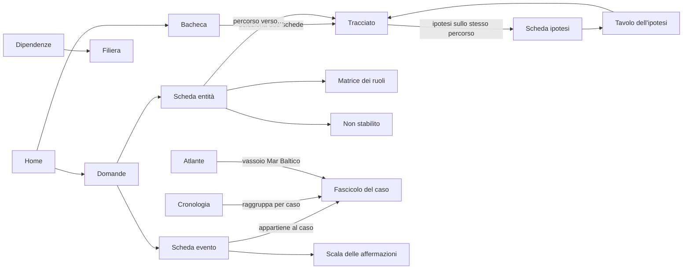
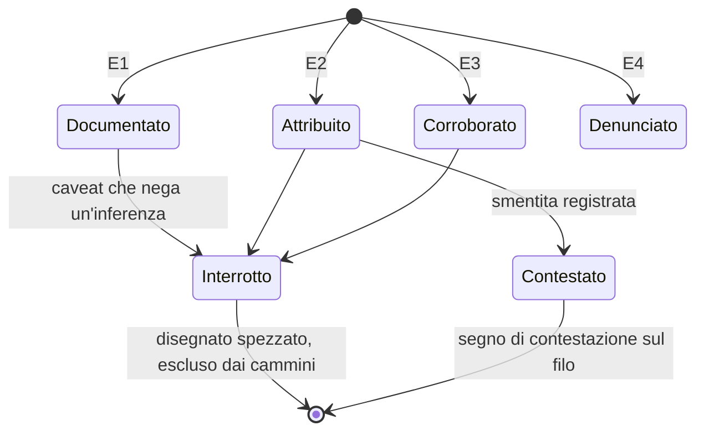

# FABLE C — Advanced Investigative Visualization & Cognitive UX

**Progetto:** Our Enemies Monitor · **Branch:** `main` · **Commit analizzato:** `d1f6a97601409f00f2bdefc47533b7b2f75d47ff` · **Data analisi:** 14 novembre 2026
**Sito esaminato:** https://amattis96.github.io/our-enemies-monitor/ (versione pubblicata, in italiano, tema scuro)

Etichette usate in tutto il documento, come richiesto dall'incarico:

- **[OSSERVATO]** — problema visto nell'interfaccia pubblicata, nel browser.
- **[DEDOTTO]** — limite cognitivo ricavato eseguendo un compito investigativo, o dalla lettura del codice.
- **[PROPOSTA]** — possibilità progettuale; non esiste oggi.
- **[DATI]** — richiede informazioni che il modello non contiene.
- **[DA VALIDARE]** — ipotesi sul comportamento degli utenti, da verificare con persone reali.

Nessun file del repository è stato modificato. L'unico file creato è questo rapporto, non tracciato e non committato.

---

## 1. Executive summary

Dopo M7 il portale è visivamente maturo e, soprattutto, prudente: timbri di evidenza con glifo e codice, predicati letterali, note sui limiti di lettura in ogni vista, ipotesi su una bacheca separata. Le criticità dell'MVP elencate in `docs/design/AUDIT.md` risultano in gran parte risolte e non vengono riproposte qui.

Il limite che resta non è estetico. **Ogni vista mostra record; nessuna vista risponde a una domanda.** I sette compiti investigativi dell'incarico sono stati eseguiti sul sito pubblicato: nessuno si completa in una sola vista, e tre non si possono completare affatto con ciò che è pubblicato.

Le cinque scoperte principali:

1. **La catena fra due attori si ricostruisce solo a mano, e la bacheca la presenta senza le cautele.** [OSSERVATO] Per andare da Kerimov a SpaceX servono cinque fascicoli aperti uno dopo l'altro. Il fascicolo della bacheca mostra predicato, livello e identificativo, non il caveat. Il secondo anello della catena ha come caveat «Non dimostra denaro Kerimov verso SpaceX»: sulla bacheca è un filo come gli altri.

2. **La stessa filiera è spezzata in schede indipendenti.** [OSSERVATO] Estrazione (60%), raffinazione (91%), magneti (94%) e domanda UE (98%) delle terre rare sono quattro schede in ordine di identificativo: `X-004`, `X-002`, `X-003`, `X-001`. Sono gli stadi di un'unica catena, e il collo di bottiglia è visibile solo a chi li riordina mentalmente.

3. **Il tempo di un caso non esiste.** [OSSERVATO] I pagamenti a Nathan Gill (2018–2019) e la sua condanna (novembre 2025) sono due voci di cronologia distanti sette anni, senza collegamento. Lo stesso vale per l'intrusione nella Electoral Commission (2021–2022) e la sua attribuzione (2024). «Come è cambiato un giudizio» non è una domanda a cui l'interfaccia sappia rispondere.

4. **Il colore del filo può dire il falso.** [DEDOTTO] Il danneggiamento dei cavi baltici da parte di tre navi è classificato nella famiglia «Economia e dipendenze», perché la classe originale è `supply`. Sulla bacheca un presunto sabotaggio ha il colore di una fornitura.

5. **Su telefono il fascicolo della bacheca esce dallo schermo.** [OSSERVATO] A 375 px il pannello del fascicolo risulta posizionato oltre il bordo destro dell'area visibile.

Le proposte a più alto valore investigativo, in ordine:

| # | Proposta | Che cosa rende visibile |
| --- | --- | --- |
| 1 | **Tracciato** — la catena fra due attori come registro verticale di passaggi | Dove una catena documentata si interrompe e che cosa non autorizza a concludere |
| 2 | **Fascicolo del caso** — corsie per fatto, scoperta, attribuzione, giudizio, risposta | Il ritardo fra un fatto e il suo accertamento; l'evoluzione di un giudizio |
| 3 | **Filiera** — gli stadi di una dipendenza in sequenza, con i vuoti dichiarati | Il collo di bottiglia e ciò che non è documentato |
| 4 | **Matrice dei ruoli** — attori per ruoli, al posto del nodo molto connesso | Che «Russia» compare con 16 ruoli diversi, non con 22 colpe |
| 5 | **Domande** — interrogazioni strutturate con risultato verificabile | Risposte a domande trasversali che oggi richiedono decine di pagine |

Le prime tre non richiedono dati nuovi: usano record già pubblicati. Tutte sono realizzabili con l'architettura statica attuale, senza nuove librerie.

---

## 2. Stato effettivo delle interfacce dopo M7

Verifica eseguita in due modi distinti. **Nel browser:** sito pubblicato, viewport emulato a 1440 × 900 e a 375 × 812, italiano, tema scuro. **Nel codice:** `web/src/islands/EvidenceBoard.tsx`, `src/site/board-layout.ts`, `src/site/read-model.ts`, `docs/design/IMPLEMENTATION_PLAN.md`. Dove un'affermazione viene solo dal codice è indicato.

| Vista | Che cosa fa oggi | Verificato |
| --- | --- | --- |
| Bacheca delle evidenze `/network/` | 142 schede e 153 fili nella vista predefinita (partecipazione agli eventi esclusa). Filtri per famiglia di relazione e livello E1–E4. Colore del filo = famiglia, tratteggio = livello, freccia di direzione. Clic su una scheda apre il fascicolo: predicato, livello, identificativo, famiglia. «Isola il vicinato» mostra i soli vicini diretti. Vista Elenco come alternativa. Collegamento `?focus=<ID>`. | Browser |
| Layout della bacheca | Calcolato a build time con d3-force a seme fisso, in due passate: stabile fra una visita e l'altra. Dimensione delle schede fissa per tipo, non proporzionale alle connessioni. | Codice |
| Bacheca delle ipotesi | Separata, 20 schede e 11 fili, intestazione «Ipotesi E5 — non sono fatti documentati». | Browser |
| Scheda entità | Relazioni dirette in tabella con predicato, caveat, collegamento alla fonte primaria, livello, codici delle fonti. Eventi con ruolo. Ipotesi aperte. Avviso per le persone. | Browser |
| Scheda evento | Data con precisione, valutazione nel corpus, temi, paesi, fonti, tabella «Attori e ruoli», nota sui limiti. | Browser |
| Scheda ipotesi | Domanda, soggetti, limite attuale, prove necessarie, priorità, stato, eventi collegati. | Browser |
| Cronologia | Elenco dal più recente, barra di densità per anno come filtro, filtro per tema e testo, voci `EXT` tratteggiate. Nessun filtro per livello di evidenza (scelta motivata: gli eventi integrati non hanno livello). | Browser |
| Atlante | Mappa a coroplete per numero di eventi nel paese, commutazione Europa/Mondo, vassoio «Fuori mappa» con 45 eventi a geografia sovranazionale, tabella dei ruoli dello Stato. | Browser |
| Dipendenze | 14 schede con barra di misura, «cosa misura», «conseguenza e cautela», indicatore originale. Avviso esplicito: i valori non sono confrontabili. Nessun grafico comparativo. | Browser |
| Ricerca | Pagefind a testo libero e tavolozza ⌘K. | Solo codice |
| Registro delle ipotesi | 11 ipotesi pubbliche su 32, raggruppate per priorità. | Browser |

**Già risolto, da non riproporre:** assenza di distinzione visiva fra livelli di evidenza; ipotesi mescolate ai fatti; intestazione mobile ingombrante; tabelle che traboccano; grafo che «salta» a ogni filtro; nodi dimensionati per grado; mappa senza eventi sovranazionali.

**Non verificato:** navigazione da tastiera, lettori di schermo, versione inglese, tema chiaro, dispositivi reali, tempi di caricamento. Il viewport è emulato nel pannello del browser.

**Difetto osservato su mobile.** A 375 px, con `?focus=KERIMOV`, il riquadro della bacheca occupa da 16 a 359 px; il fascicolo misura 299 px di larghezza e risulta posizionato fra 367 e 666 px. In uno screenshot appare parzialmente visibile e tagliato sul bordo destro («Apri la scheda comple…»). Va riverificato su un dispositivo reale, ma il fascicolo è l'unico punto in cui la bacheca mostra i predicati.

---

## 3. Limiti cognitivi e investigativi riscontrati

### 3.1 I sette compiti, eseguiti sul sito

| # | Compito | Percorso reale | Esito |
| --- | --- | --- | --- |
| 1 | Ricostruire la catena documentata fra due attori (Kerimov → SpaceX) | Bacheca, fascicolo Kerimov → GVA Capital → Roman Sobachevskiy → HAL9001 → Tomales Bay → SpaceX: cinque fascicoli. I caveat sono su cinque schede entità diverse | **Possibile, ma l'utente deve tenere a mente cinque archi e cinque cautele.** La cautela decisiva non è sulla bacheca |
| 2 | Distinguere un collegamento economico da uno operativo | Colore del filo e legenda | **Possibile**, salvo le classificazioni fuorvianti (§3.3) |
| 3 | Identificare le fonti indipendenti di un'attribuzione | Scheda entità → codici `S01`, `S03` → scheda della fonte | **Non possibile.** I codici rimandano a documenti di sintesi del corpus; non c'è modo di sapere quante origini distinte sostengono l'affermazione |
| 4 | Riconoscere un'informazione contestata | Scheda evento `TL-0059`: «Attribuzione istituzionale contestata dalla Russia» | **Solo sulla scheda evento.** In cronologia, bacheca e atlante la contestazione non compare |
| 5 | Confrontare due campagne simili (Doppelganger e Paperwall) | Due schede entità in due schede del browser | **Solo a memoria.** Nessuna vista affiancata; i predicati sono tutti diversi fra loro |
| 6 | Capire come un giudizio è cambiato nel tempo | Cronologia: due voci scollegate; pagina `/changes/` per le modifiche ai file | **Non possibile** come vista. La storia del giudizio va ricostruita leggendo |
| 7 | Trovare un'ipotesi senza scambiarla per un fatto | Registro e bacheca delle ipotesi | **Ben risolto.** Ma l'ipotesi non mostra che cosa è già documentato intorno a essa |
| 8 | Da un evento alle sue conseguenze documentate | Scheda evento: solo attori e ruoli | **Non possibile.** Nessun evento rimanda ad altri eventi |

### 3.2 Dove l'utente fa il lavoro che il software potrebbe fare

- **Composizione di cammini.** [DEDOTTO] La bacheca mostra i vicini diretti. Oltre il primo passo l'utente memorizza identificativi e riapre fascicoli.
- **Riordino.** [OSSERVATO] Le dipendenze sono in ordine di identificativo; gli stadi di una filiera vanno riconosciuti e ordinati a mente.
- **Allineamento temporale.** [OSSERVATO] Fatto, attribuzione e sentenza dello stesso caso sono voci distinte, ordinate per data insieme a tutte le altre.
- **Somma delle cautele.** [DEDOTTO] Ogni vista ha una nota generale sui limiti, corretta. La cautela specifica di un arco sta invece in una cella di tabella, su un'altra pagina.
- **Conteggio delle fonti.** [DEDOTTO] Due codici accanto a una relazione sembrano due conferme; sono due documenti dello stesso corpus.

### 3.3 Segnali visivi che possono indurre conclusioni errate

| Segnale | Che cosa suggerisce | Che cosa è in realtà | Tipo |
| --- | --- | --- | --- |
| Filo color «Economia e dipendenze» fra una nave e i cavi baltici | Un rapporto commerciale | `DANNEGGIAMENTO_DA_ANCORA`, classe originale `supply` | [DEDOTTO] dai dati |
| Un filo fra `SOB` e `GVA` | Un collegamento | `COLLEGAMENTO_SOCIETARIO_SEPARATO`, con caveat che nega l'inferenza | [OSSERVATO] |
| Scheda «Federazione Russa» con molti fili | Centralità, quindi responsabilità | 22 partecipazioni con 16 ruoli diversi: attribuzione, contesto, parte di un trattato, esportatore | [DEDOTTO] |
| Vicinanza di due schede | Affinità | Effetto del calcolo delle forze | [OSSERVATO]; la nota sui limiti lo dichiara, ma è sotto la bacheca |
| Coroplete dell'atlante | Paesi «più colpiti» | Numero di eventi il cui testo nomina il paese; gli Stati Uniti sono il primo luogo | [OSSERVATO]; la nota lo dichiara |
| Timbro E1 su una relazione | Documento primario letto | In 49 relazioni dirette su 84 non c'è alcun URL primario | [DEDOTTO] dai dati |
| Barra piena al 98% accanto a una al 91% | Due misure confrontabili | Universi diversi | [OSSERVATO]; avviso presente e ben fatto |

---

## 4. Analisi dei capitoli C1–C6

### C1. Analisi cognitiva

Il §3 riporta i percorsi. La diagnosi è una sola: **l'unità dell'interfaccia è il record, l'unità del ragionamento investigativo è la relazione fra record.** Catena, caso, filiera, confronto e cambiamento nel tempo sono tutti oggetti composti, e nessuno ha una vista.

Il carico di memoria misurato sul compito 1: cinque identificativi di entità, cinque predicati, cinque livelli, quattro caveat e un divieto di inferenza scritto in una sesta pagina (l'ipotesi `H06`). Sono sedici elementi da tenere insieme, contro i quattro o cinque che una persona gestisce senza supporto. [DA VALIDARE] la cifra esatta del limite; il divario resta ampio in ogni caso.

### C2. Evoluzione del grafo

Limiti espressivi della bacheca attuale:

| Limite | Evidenza |
| --- | --- |
| Solo vicinato diretto | «Isola il vicinato» filtra agli archi incidenti alla scheda selezionata (`EvidenceBoard.tsx`) |
| Nessuna dimensione temporale | Nessuna relazione diretta della baseline ha date di validità |
| Predicati non aggregabili | 147 predicati distinti su 167 relazioni dirette: ogni filo è un caso a sé |
| Coppie con più relazioni | Una sola (`MED`–`VOL`: politica e finanziaria): la sovrapposizione di livelli è rarissima nei dati |
| Negazioni disegnate come legami | 18 relazioni dirette hanno un caveat che nega un'inferenza |
| Assenza non rappresentabile | I nove «forbidden edge» di Fonte_09 esistono solo come testo |

**Indicazione controintuitiva.** Con 167 relazioni dirette e predicati quasi tutti unici, una rete più ricca (multilivello, comunità, ponti) non ha materiale su cui lavorare. Il rapporto A lo mostra con un modello nullo: l'unico segnale strutturale è la duplicazione dei casi. Conviene quindi **togliere compiti al grafo**, non aggiungerne: la bacheca resta una mappa di orientamento, e i compiti di ragionamento passano a viste non spaziali.

Rappresentazioni valutate:

| Rappresentazione | Giudizio | Motivo |
| --- | --- | --- |
| Vista ego-centrica ad anelli (distanza = numero di passi) | **Adottare** | Dà alla posizione un significato dichiarato; sostituisce la prossimità arbitraria |
| Percorso progressivo fra due attori (Tracciato) | **Adottare, prioritaria** | Risolve il compito 1; porta i caveat dentro il cammino |
| Matrice attori × ruoli | **Adottare** | Disinnesca l'effetto «nodo centrale» |
| Fili «interrotti» per le negazioni | **Adottare** | Rende visibile l'assenza di nesso |
| Grafo multilivello per famiglia | Rinviare | Livelli quasi vuoti: 18 relazioni finanziarie, 23 di controllo |
| Comunità e ponti | Sconsigliata | Le comunità coinciderebbero con i domini editoriali; i ponti sarebbero i quattro Stati più documentati |
| Grafo temporale animato | Sconsigliata oggi | Mancano le date; con 59 eventi datati al solo anno l'animazione inventerebbe un ordine |
| Confronto fra due sottoreti come grafi | Sconsigliata | Meglio una tabella allineata (C6, Confronto) |

**Come impedire che il layout induca conclusioni.** [PROPOSTA]

- Nella vista ad anelli la posizione ha una regola sola e scritta in legenda: anello = numero di passi dal soggetto, settore = famiglia di relazione.
- La nota «la vicinanza non dimostra coordinamento» si sposta dentro la bacheca, come etichetta fissa nell'angolo.
- Un arco con caveat negativo si disegna spezzato, con un segno di interruzione al centro, e non partecipa a «Isola il vicinato».
- Verifica di stabilità a build time: due esecuzioni del layout con seme diverso; se una coppia di schede è vicina in una e lontana nell'altra, la vicinanza non significa nulla, e si può dichiararlo con un dato invece che con una frase.
- Correzione delle famiglie fuorvianti: il colore dovrebbe derivare dal significato del predicato, non dalla classe originale. [DATI] richiede una revisione editoriale delle classi.

### C3. Esplorazione spazio-temporale

Che cosa consentono i dati, onestamente:

| Dimensione | Disponibile | Non disponibile |
| --- | --- | --- |
| Luogo | Paese, per 127 eventi; 45–54 eventi senza paese | Coordinate, città, rotte |
| Tempo dell'evento | Giorno per 65 eventi, mese per 57, anno per 59 | Ora; ordine interno all'anno |
| Tempo dell'attribuzione | Solo come evento separato o come testo nella nota | Campo dedicato |
| Origine attribuita | Arco di partecipazione con ruolo (`OFFICIAL_ATTRIBUTION`) | Distinzione strutturata fra esecutore e mandante |
| Destinazione dell'impatto | Arco con ruolo (`TARGET`, `AFFECTED_COUNTRY`) | Entità del danno |

Conseguenze per il progetto:

- **Nessuna linea di movimento sulla mappa.** Un arco curvo da Mosca a Varsavia disegnerebbe un percorso che nessuna fonte documenta. I ruoli vanno mostrati come stati di un paese, non come frecce.
- **Nessuna animazione continua.** Con un terzo degli eventi datati al solo anno, un cursore temporale che avanza per mesi collocherebbe 59 eventi in una posizione inventata.

Rappresentazioni proposte:

1. **Fascicolo del caso** (§5.2): il tempo visto dal caso, non dal calendario.
2. **Atlante a tre letture** [PROPOSTA]: la stessa mappa commutabile fra «dove è avvenuto», «a chi è attribuito», «chi ha attribuito o sanzionato». Tre coroplete distinte, mai sovrapposte. Per l'evento `TL-0059`: Polonia nella prima, Federazione Russa nella seconda, Polonia nella terza. Si vede subito che la seconda lettura dipende da chi pubblica attribuzioni.
3. **Banda di precisione** [PROPOSTA]: in cronologia un evento datato al mese occupa la larghezza del mese, uno datato all'anno la larghezza dell'anno, come fascia e non come punto. Due eventi «simultanei» con precisione diversa smettono di sembrare coincidenti.
4. **Striscia delle sequenze per asset** [PROPOSTA]: per un'infrastruttura come i cavi baltici, una riga con i sette eventi che la riguardano dal 2022 al 2026, ciascuno con il proprio verdetto. Il vassoio «Fuori mappa» contiene già 4 eventi «Mar Baltico»: è il luogo naturale da cui aprirla.

### C4. Dipendenze strategiche

Che cosa c'è nei dati: 14 esposizioni, ognuna con una o due misure, un perimetro («cosa misura») e una cautela. Non ci sono: legami fra esposizioni, fornitori alternativi, elasticità, scorte, tempi di sostituzione.

| Tecnica | Applicabile oggi | Motivo |
| --- | --- | --- |
| **Sequenza di stadi con vuoti dichiarati** (Filiera) | Sì | Quattro esposizioni sono già stadi della stessa catena |
| **Coppia prima/dopo** | Sì | Gas russo: quasi 40% (2021) → circa 10% (2025). GNL: meno del 20% → quasi 45% |
| Sankey | No | Richiede flussi con la stessa unità e lo stesso universo; l'avviso della pagina dice che non è così |
| Indice di concentrazione | No | Serve la ripartizione fra tutti i fornitori; il corpus dà solo la quota del primo |
| Propagazione di shock | No come previsione | Mancano elasticità e scorte |
| Sostituibilità | No | Nessun dato sui fornitori alternativi |
| **Scenario dichiarato** | Sì, come esercizio | Solo se ogni parametro inventato è marcato come tale |

Regola di presentazione [PROPOSTA]: tre trattamenti visivi distinti e mai mescolati nello stesso grafico.

| Natura del dato | Trattamento |
| --- | --- |
| Quantità documentata | Barra piena, valore con qualificatore («circa», «oltre»), periodo, fonte |
| Dipendenza qualitativa | Etichetta testuale, senza barra |
| Ipotesi di scenario | Riquadro separato, tratteggiato, intestazione «Esercizio: parametri scelti dal lettore», senza esportazione come dato |

### C5. Ricerca investigativa

Oggi: ricerca a testo libero su pagine (Pagefind) e filtri per vista. Non esiste modo di chiedere qualcosa che attraversi le collezioni.

Le cinque domande dell'incarico, rispetto ai dati:

| Domanda | Rispondibile con i dati pubblici? | Come |
| --- | --- | --- |
| Operazioni che condividono gli stessi intermediari | In parte | Entità presenti in due o più eventi con ruoli non istituzionali. Rischio: i risultati sono casi duplicati (rapporto A) |
| Casi con nuova attribuzione dopo l'evento | No, in forma strutturata | La data dell'attribuzione è nel testo della nota («Attribuzione UK nel 2024») [DATI] |
| Dipendenze che coinvolgono lo stesso fornitore | Sì | 8 esposizioni su 14 riguardano la Cina; il fornitore però non è un campo [DATI] |
| Relazioni sostenute solo da attribuzioni istituzionali | Sì | `evidence_level = E2`: 68 relazioni nel dataset canonico |
| Ipotesi con nuove evidenze nell'ultimo trimestre | Sì nei dati, **no sul sito** | Sono proprio le 11 ipotesi trattenute dal cancello di pubblicazione (rapporto A) |

Confronto fra tre modelli di interrogazione:

| Modello | Vantaggi | Limiti | Compatibilità statica |
| --- | --- | --- | --- |
| **Domande strutturate** (modello + parametri) | Risultato riproducibile, citabile con un URL, verificabile riga per riga | Copre solo le domande previste | Piena: filtri su JSON già pubblicati |
| **Esplorazione guidata** (percorsi redazionali) | Insegna a leggere le evidenze; adatta ai nuovi lettori | Richiede cura editoriale | Piena |
| **Linguaggio naturale** | Nessuna barriera d'ingresso | Risposte non riproducibili; rischio di affermazioni non presenti nei dati; servirebbe un modello a runtime | Nessuna senza un servizio esterno |

Raccomandazione: domande strutturate, con il testo della domanda in linguaggio naturale come etichetta e i parametri come menu. Un'interfaccia conversazionale è in contrasto con il principio del progetto per cui ogni affermazione pubblicata è tracciabile a una fonte: una risposta generata non lo è. [DA VALIDARE] se gli utenti trovano i modelli di domanda sufficienti.

### C6. Nuovi paradigmi

Sei proposte che non derivano dall'elenco dell'incarico. Schema comune: domanda nuova, informazione resa visibile, dati, interazioni, distorsione possibile, verifica.

**N1. Mappa del non detto.** Una vista che elenca ciò che il corpus dichiara di non sapere o di non poter concludere.

| Aspetto | Contenuto |
| --- | --- |
| Domanda | «Che cosa, su questo attore, è stato esplicitamente escluso o lasciato aperto?» |
| Reso visibile | I 18 caveat negativi, i 43 verdetti divisi degli eventi («mandante non provato»), i limiti delle ipotesi |
| Dati | Esistenti come testo; meglio con un campo strutturato [DATI] |
| Interazioni | Dalla scheda di un'entità: sezione «Non stabilito»; dalla bacheca: fili interrotti |
| Distorsione | L'elenco può sembrare un'insinuazione («non provato» letto come «probabile»). Serve una formulazione neutra |
| Verifica | Compito: «esiste un legame finanziario documentato fra Kerimov e SpaceX?». Misura delle risposte errate con e senza la sezione |

**N2. Orologio della conoscenza.** Un selettore di data che mostra lo stato del sito a quel giorno.

| Aspetto | Contenuto |
| --- | --- |
| Domanda | «Che cosa affermava il progetto su questo caso il 1° ottobre?» |
| Reso visibile | La differenza fra quando un fatto è avvenuto e quando il corpus lo ha registrato o corretto |
| Dati | Storia Git, già letta a build time per `/changes/` |
| Interazioni | Sulla scheda di un record: linea delle versioni, con i campi cambiati evidenziati |
| Distorsione | La data di registrazione nel progetto non è la data in cui il fatto è diventato noto al mondo |
| Verifica | Compito: «quando è stata aggiunta la fonte primaria a questa relazione?» |

**N3. Glifo delle radici.** Accanto a ogni affermazione, un piccolo segno che distingue quante fonti la citano e quante origini distinte ci sono.

| Aspetto | Contenuto |
| --- | --- |
| Domanda | «Questa attribuzione è confermata da più parti o ripetuta da più parti?» |
| Reso visibile | Che tre riferimenti possono essere una dichiarazione ufficiale e due rilanci d'agenzia |
| Dati | Genealogia delle fonti [DATI]; oggi ricavabile solo dal testo del campo editore |
| Interazioni | Passaggio del puntatore o tocco: elenco delle radici e delle derivazioni |
| Distorsione | Una sola radice ufficiale può valere più di tre radici giornalistiche: il glifo conta, non pesa |
| Verifica | Compito: scegliere fra due affermazioni quella meglio corroborata |

**N4. Confronto affiancato.** Due campagne, attori o casi in colonne, con le stesse righe.

| Aspetto | Contenuto |
| --- | --- |
| Domanda | «In che cosa Doppelganger e Paperwall sono simili, e su quale base?» |
| Reso visibile | Le celle vuote: per Paperwall non esiste un'attribuzione statale, per Doppelganger sì |
| Dati | Esistenti; le righe (operatore, attribuzione, piattaforme, risposta) richiedono predicati raggruppati [DATI] |
| Interazioni | Scelta di due record; URL condivisibile |
| Distorsione | Allineare due casi suggerisce che siano comparabili |
| Verifica | Compito: «quale delle due ha un'attribuzione istituzionale?» |

**N5. Carta della copertura.** Una griglia tema × anno, e tema × paese, che mostra dove il corpus ha materiale e dove no.

| Aspetto | Contenuto |
| --- | --- |
| Domanda | «L'assenza di eventi in Grecia è un fatto o un vuoto della ricerca?» |
| Reso visibile | 11 Stati membri mai presenti; 19 eventi per tutto il periodo 2007–2019 contro 53 per il 2026 |
| Dati | Esistenti per i conteggi; le finestre di ricerca senza esito non sono archiviate [DATI] |
| Interazioni | Clic su una cella: eventi corrispondenti, oppure «nessuna ricerca registrata» |
| Distorsione | Una cella piena può sembrare «zona calda» invece che «zona ben documentata» |
| Verifica | Domanda di comprensione: «il sito dice che in Ungheria non è successo nulla?» |

**N6. Tavolo dell'ipotesi.** La scheda di un'ipotesi come piano di lavoro.

| Aspetto | Contenuto |
| --- | --- |
| Domanda | «Che cosa manca, esattamente, per chiudere questa ipotesi?» |
| Reso visibile | A sinistra ciò che è documentato intorno ai due soggetti (il Tracciato); al centro il vuoto; a destra le prove necessarie come elenco con stato |
| Dati | Esistenti; lo stato di ciascuna prova richiesta va aggiunto [DATI] |
| Interazioni | Ogni prova necessaria collega le altre ipotesi che richiedono lo stesso tipo di documento |
| Distorsione | Un elenco di prove mancanti può sembrare un elenco di prove esistenti ma nascoste |
| Verifica | Compito: «l'ipotesi H06 è sostenuta da qualche documento?» |

---

## 5. Nuove visualizzazioni proposte

### 5.1 Tracciato

Un registro verticale dei passaggi fra due attori. Non è un grafo: è una lista ordinata, leggibile da un lettore di schermo e stampabile.

```text
TRACCIATO   Suleiman Kerimov  →  SpaceX            5 passaggi · cammino più breve documentato

┌─ 1 ──────────────────────────────────────────────────────────────────────────────┐
│ GVA Capital  — gestisce asset sanzionati →  Suleiman Kerimov                      │
│ ■ E1 Atto primario · Finanziamento · G-0088 · fonte primaria: OFAC, 12 giu 2025   │
│ Cautela: Accertamento OFAC 2025                                                   │
└───────────────────────────────────────────────────────────────────────────────────┘
        ╎
        ╎   ⚠  QUI LA CATENA SI INTERROMPE
        ╎   Il passaggio seguente non trasferisce il legame precedente.
        ╎
┌─ 2 ──────────────────────────────────────────────────────────────────────────────┐
│ Roman Sobachevskiy  — collegamento societario separato →  GVA Capital             │
│ ◆ E3 Corroborato · Finanziamento · G-0087                                         │
│ Cautela: Non dimostra denaro Kerimov verso SpaceX                                 │
└───────────────────────────────────────────────────────────────────────────────────┘
        │
┌─ 3 ─  Roman Sobachevskiy — firma documenti societari → HAL9001   ◆ E3 · G-0086    ┐
┌─ 4 ─  HAL9001 — LP investe fondo → Tomales Bay              ◆ E3 · G-0085         ┐
│       Cautela: ~$10 milioni nel fondo intermediato                                │
┌─ 5 ─  Tomales Bay — fondi partecipano capitale → SpaceX     ◆ E3 · G-0084         ┐
│       Cautela: Nessun diritto decisionale operativo dimostrato                    │

────────────────────────────────────────────────────────────────────────────────────
CHE COSA QUESTO TRACCIATO NON DICE
 Anello più debole: E3 (4 passaggi su 5).
 Ipotesi aperta sullo stesso percorso: H06 — «NESSUNA prova nel corpus; vietata la
 catena per semplice vicinanza Sob-GVA».
 Cinque relazioni documentate in fila non sono una relazione documentata fra gli estremi.
```

Il blocco finale è la parte essenziale. Il rapporto A ha mostrato che il cammino più breve fra questi due attori coincide con l'inferenza che il corpus vieta: il Tracciato trasforma quel rischio in un'informazione esplicita.

### 5.2 Fascicolo del caso

Corsie orizzontali per natura dell'atto, tempo sull'asse orizzontale, precisione mostrata come larghezza.

```text
CASO   Pagamenti a Nathan Gill

             2018      2019   ···   2024      2025                    2026
FATTO        ▓▓▓▓▓▓▓▓▓▓▓▓▓▓▓                                    TL-0015 pagamenti (anno)
SCOPERTA                                                        — non registrata —
ATTRIBUZIONE                                                    — non registrata —
GIUDIZIO                                        ▓▓ nov          TL-0092 condanna (mese)
RISPOSTA                                                        — non registrata —

 Distanza fatto → giudizio: circa 6–7 anni
 Valutazione di TL-0015: «Accertato penalmente nel 2025»
```

```text
CASO   Cavi e infrastrutture sottomarine del Baltico      (asset: CABLES)

             2022        2023        2024           2025        2026
FATTO        ▌26 set     ▌8 ott      ▓nov  ▌25 dic  ▓▓▓▓▓▓
             Nord Stream Balticconn. Yi Peng Estlink 2  serie 2025
VERDETTO     contestata  intento     dolo   mandato
             la respons. non verif.  non    statale
                                     verif. non provato
RISPOSTA                                                         ▓▓▓▓ Toolbox UE (anno)
```

Le corsie vuote non si nascondono: «non registrata» è un'informazione. I due esempi usano solo record pubblici (`TL-0015`, `TL-0092`; `TL-0041`, `TL-0046`, `TL-0066`, `TL-0069`, `TL-0086`, `TL-0095`).

### 5.3 Filiera

```text
FILIERA   Magneti alle terre rare                      quota della Cina · IEA 2024

  ESTRAZIONE        RAFFINAZIONE       MAGNETI            DOMANDA UE
  ┌──────────┐      ┌──────────┐       ┌──────────┐       ┌──────────┐
  │ 60%      │ ───▶ │ 91%      │ ───▶  │ 94%      │ ───▶  │ 98%      │
  │ mondiale │      │ mondiale │       │ mondiale │       │ importaz.│
  └──────────┘      └──────────┘       └──────────┘       └──────────┘
    X-004             X-002              X-003              X-001
                      ▲ collo di bottiglia: salto di 31 punti fra estrazione e raffinazione

  ⚠ Le prime tre misure sono quote della produzione mondiale; la quarta è la quota della
    domanda UE coperta da importazioni. Sono stadi consecutivi, non la stessa grandezza.
  ░ Non documentato nel corpus: fornitori alternativi, scorte, tempi di sostituzione.
```

```text
PRIMA / DOPO   Gas nell'UE

  Quota russa della domanda          quasi 40% (2021)  ●━━━━━━━━━━━━━━━━━━▶ ●  circa 10% (2025)   X-011
  Quota del GNL nell'offerta         meno del 20%      ●━━━━━━━━━━━━━━━━━━▶ ●  quasi 45%          X-012
                                                                              (periodi non indicati dalla fonte)
```

L'ordine degli stadi è un'informazione editoriale che oggi non esiste nel modello [DATI]: basta un campo che raggruppi le esposizioni in una filiera e ne indichi la posizione.

### 5.4 Matrice dei ruoli

```text
RUOLI NEGLI EVENTI   Federazione Russa · 22 eventi

  Attribuita da un'istituzione     ■■■■■■■■■   9   (official attribution, intelligence attribution, …)
  Parte in conflitto               ■■■         3   (warring actor, aggressor)
  Contesto, non attribuzione       ■■          2   (context war, political context not attribution)
  Controparte / parte di trattato  ■■■■        4   (treaty party, partner, counterpart, exporter)
  Indicata in sentenza             ■           1   (stato mandante secondo sentenza)
  Altro                            ■■■         3
```

Sostituisce l'impressione «22 fili» con «9 attribuzioni istituzionali, 1 sentenza, 12 altri ruoli». Il raggruppamento dei predicati in classi di ruolo è una classificazione editoriale [DATI]; i conteggi sopra sono indicativi e vanno ricalcolati su una classificazione approvata.

### 5.5 Domande

```text
DOMANDA   Quali relazioni sono sostenute solo da un'attribuzione istituzionale?

  Famiglia: [ tutte ▾ ]   Riguarda: [ qualsiasi attore ▾ ]   Con fonte primaria: [ indifferente ▾ ]

  68 relazioni (dataset canonico) · scarica CSV · copia collegamento

  SOGGETTO            PREDICATO LETTERALE                  OGGETTO            CHI ATTRIBUISCE   FONTE PRIMARIA
  Medvedchuk          finanzia e dirige indirettamente     Voice of Europe    Consiglio UE      sì
  Federazione Russa   direzione attribuita da DOJ          SDA                DOJ               no
  …
```

Ogni domanda è un URL. Il risultato è una tabella, non una frase.

---

## 6. Esempi concreti sui dati reali

Riepilogo dei casi usati, con ciò che si vede oggi e ciò che si vedrebbe.

| Caso | Record | Oggi | Con la proposta |
| --- | --- | --- | --- |
| Kerimov → SpaceX | `G-0088`, `G-0087`, `G-0086`, `G-0085`, `G-0084`, `H06` | Cinque fascicoli; la cautela decisiva è su un'altra pagina | Tracciato con interruzione segnalata al secondo passaggio |
| Incendio di Marywilska | `TL-0059`, `G-0223`, `G-0224` | «Contestata dalla Russia» solo nella scheda evento; l'arco riporta «official attribution, E2» | Scala delle affermazioni: fatto accertato; mandante attribuito dalla Polonia; smentita russa |
| Nathan Gill | `TL-0015`, `TL-0092` | Due voci a sette anni di distanza | Fascicolo del caso, due corsie |
| Electoral Commission e APT31 | `TL-0025`, `TL-0054` | Due voci; il legame è nel testo «Attribuzione UK nel 2024» | Fascicolo del caso: fatto 2021–22, attribuzione 2024 |
| Cavi baltici | 7 eventi su `CABLES` | Sparsi in cronologia; 4 nel vassoio «Fuori mappa» | Striscia per asset con verdetto per episodio |
| Terre rare | `X-004`, `X-002`, `X-003`, `X-001` | Quattro schede non adiacenti nell'ordine logico | Filiera in quattro stadi |
| Gas | `X-011`, `X-012` | Due barre per scheda | Coppia prima/dopo |
| Federazione Russa | 22 partecipazioni | Scheda con molti fili | Matrice dei ruoli |
| Navi e cavi | `NEWNEW`, `YIPENG`, `EAGLES` → `CABLES` | Fili color «Economia e dipendenze» | Famiglia corretta dopo revisione delle classi |
| Doppelganger e Paperwall | `DOPP`: 3 relazioni E2 di controllo; `PAPER`: 2 relazioni E3 di informazione | Due schede distinte | Confronto affiancato: Doppelganger ha un'attribuzione istituzionale, Paperwall no |

**Scala delle affermazioni** per `TL-0059`, come esempio di ciò che la scheda evento potrebbe mostrare:

```text
Incendio di Marywilska 44 · maggio 2024 · Polonia

  CHE COSA È SUCCESSO   Distruzione del centro commerciale        accertato
  CHI LO HA ESEGUITO    —                                         non indicato nel record
  CHI LO HA ORDINATO    Servizi russi                             ▲ E2 attribuzione del governo polacco
                        ↳ smentita: la Federazione Russa nega
  PERCHÉ                —                                         non indicato nel record
  CON QUALE EFFETTO     —                                         non indicato nel record
```

Oggi queste informazioni sono in una frase («il governo polacco attribuisce l'ordine ai servizi russi, che negano») e in una nota. La struttura a cinque righe richiede di scomporre il testo [DATI]; per i 43 eventi con verdetto diviso è un lavoro editoriale circoscritto.

---

## 7. Schemi di navigazione

Come le nuove viste si collegano a quelle esistenti:



Stato di un arco nella bacheca, con la negazione come stato a sé:



Vista ego-centrica ad anelli, schema:

```text
                         2 passi
              ┌───────────────────────────┐
              │        1 passo            │
   FINANZIA-  │    ┌──────────────┐       │  CONTROLLO
   MENTO      │    │              │       │
        IPI ──┼────┤   KERIMOV    │       │
        GVA ──┼────┤              │       │
   Heritage ──┼────┤              │       │
              │    └──────────────┘       │
      SOB ╌╌╌╌┤  (filo interrotto)        │  INFLUENZA
              └───────────────────────────┘
   Regola unica: anello = numero di passi; settore = famiglia. La distanza non misura altro.
```

---

## 8. Specifiche funzionali delle proposte più promettenti

### 8.1 Tracciato

| Voce | Specifica |
| --- | --- |
| Ingresso | Da una scheda entità («Percorso verso…» con ricerca), dalla bacheca (selezione di due schede), da una scheda ipotesi |
| Calcolo | Cammino più breve sulle sole relazioni dirette pubbliche; ricerca in ampiezza sul grafo già scaricato (`graph.json`, 153 archi): istantanea nel browser |
| Alternative | Fino a tre cammini; se non esiste alcun cammino, messaggio esplicito «Nessuna catena documentata fra questi due attori» |
| Contenuto di ogni passaggio | Soggetto, predicato letterale, oggetto, timbro di evidenza, famiglia, identificativo, caveat, collegamento alla fonte primaria se presente |
| Interruzione | Un passaggio il cui caveat nega un'inferenza è preceduto dal segnale di interruzione. Richiede un indicatore strutturato; in attesa, un elenco curato degli identificativi [DATI] |
| Riepilogo | Livello più debole del cammino; ipotesi aperte fra gli stessi estremi o sugli stessi nodi; frase fissa sulla non transitività |
| Hub | I cammini che attraversano uno Stato o un'istituzione sovranazionale sono mostrati per ultimi e marcati «attraverso un attore molto documentato» |
| URL | `/trace/?from=KERIMOV&to=SPACEX` |
| Senza JavaScript | Pagina statica con il modulo; per le coppie di ogni ipotesi il tracciato può essere generato a build time |
| Dati mancanti | `graph.json` non contiene il caveat: va aggiunto |
| Criterio di accettazione | Per le coppie delle ipotesi `H06`, `H07`, `H15` il tracciato mostra l'interruzione e l'ipotesi collegata |

### 8.2 Fascicolo del caso

| Voce | Specifica |
| --- | --- |
| Unità | Un caso raggruppa eventi che sono fasi dello stesso fatto. Richiede un identificativo di caso sugli eventi [DATI]. Il registro M5 ne assegna già uno ai 30 candidati di Fonte_09 |
| Corsie | Fatto, scoperta, attribuzione, giudizio, risposta. La corsia di un evento è una classificazione editoriale [DATI]; in via provvisoria si ricava dal tema (`justice`, `eu_nato_response`) e va marcata come provvisoria |
| Tempo | Asse orizzontale; ogni voce è una fascia larga quanto la sua precisione |
| Corsie vuote | Sempre visibili, con «non registrata» |
| Verdetto | Sotto ogni voce la valutazione originale del corpus, per intero |
| Ingresso | Dalla scheda evento («Fa parte del caso…»), dalla cronologia (raggruppamento per caso), dall'atlante |
| Mobile | Le corsie diventano un elenco verticale con l'etichetta della corsia come intestazione; l'asse temporale si riduce alle date |
| Criterio di accettazione | Per il caso Gill la distanza fra fatto e giudizio è leggibile senza aprire altre pagine |

### 8.3 Filiera

| Voce | Specifica |
| --- | --- |
| Dati | Campo che assegna un'esposizione a una filiera e a una posizione [DATI] |
| Stadi | Riquadri in sequenza con valore, qualificatore, periodo, perimetro |
| Collo di bottiglia | Evidenziato solo quando due stadi consecutivi hanno la stessa unità e lo stesso universo; altrimenti nessuna evidenziazione e avviso sul cambio di grandezza |
| Vuoti | Riga «Non documentato nel corpus» con le voci mancanti |
| Scenario | Opzionale, in un riquadro separato e tratteggiato; nessun valore di scenario compare nelle esportazioni |
| Schede singole | Restano, per le esposizioni che non appartengono a una filiera |
| Criterio di accettazione | Un lettore individua lo stadio più concentrato delle terre rare senza leggere le quattro schede |

---

## 9. Requisiti informativi e lacune del modello dati

| Proposta | Realizzabile con i dati pubblici | Dato mancante | Onere |
| --- | --- | --- | --- |
| Tracciato | Sì | Caveat in `graph.json`; indicatore di caveat negativo | Basso |
| Vista ad anelli | Sì | — | Basso |
| Fili interrotti | Sì | Indicatore di caveat negativo (18 relazioni) | Basso |
| Matrice dei ruoli | In parte | Classi di ruolo per i predicati di partecipazione | Medio |
| Fascicolo del caso | In parte | Identificativo di caso; corsia dell'evento | Medio |
| Filiera | In parte | Raggruppamento e ordine delle esposizioni | Basso (14 record) |
| Prima/dopo | Sì | Periodo mancante in alcune misure | Nullo |
| Domande | Sì per 3 su 5 | Data dell'attribuzione; fornitore come campo | Medio |
| Scala delle affermazioni | No | Affermazioni distinte per aspetto, con chi afferma e chi nega | Alto |
| Glifo delle radici | No | Genealogia delle fonti | Alto |
| Orologio della conoscenza | Sì | — (storia Git) | Medio, per il calcolo a build time |
| Carta della copertura | Sì per i conteggi | Registro delle ricerche senza esito | Basso |
| Tavolo dell'ipotesi | In parte | Stato di ogni prova richiesta | Medio |
| Atlante a tre letture | Sì | Classi di ruolo (come la matrice) | Medio |

Tre lacune ricorrono in più proposte e coincidono con quelle indicate nel rapporto A: il caso come unità, l'affermazione come unità, la negazione come dato. Colmarle una volta abilita sei viste.

Un vincolo esterno: 11 ipotesi su 22 della baseline non sono pubbliche, fra cui tre critiche. Il Tavolo dell'ipotesi e la quinta domanda del §C5 lavorerebbero su un insieme dimezzato finché il cancello di pubblicazione le trattiene.

---

## 10. Accessibilità, responsive e performance

| Proposta | Accessibilità | Mobile | Performance |
| --- | --- | --- | --- |
| Tracciato | Ottima: è una lista ordinata; il segnale di interruzione è testo, non solo colore | Naturale: colonna unica | Trascurabile |
| Fascicolo del caso | Buona se accompagnato da una tabella equivalente; le corsie sono intestazioni | Elenco verticale per corsia | Trascurabile |
| Filiera | Buona: sequenza di riquadri con testo completo | Stadi impilati, freccia verticale | Trascurabile |
| Matrice dei ruoli | Ottima: è una tabella con barre | Tabella impilata, già disponibile nel design system | Trascurabile |
| Vista ad anelli | Richiede l'alternativa in elenco, come la bacheca attuale | Difficile sotto i 400 px: proporre l'elenco per primo | Bassa: sottografo piccolo |
| Domande | Ottima: moduli e tabelle | Buona | Filtri su file JSON già pubblicati; a dimensioni attuali nessun indice necessario |
| Fili interrotti | Il tratto spezzato va descritto nell'etichetta dell'arco e nella vista Elenco | Come oggi | Nulla |
| Atlante a tre letture | Tre tabelle equivalenti | Come l'atlante attuale | Nulla: tre colorazioni della stessa mappa |

Osservazioni sull'esistente:

- **Fascicolo della bacheca su telefono.** [OSSERVATO] Vedi §2. Finché non è corretto, su mobile la bacheca non mostra i predicati; il Tracciato, essendo una lista, sarebbe l'alternativa naturale.
- **Dimensione del testo sulle schede.** [OSSERVATO] A 375 px il testo più piccolo delle schede misura circa 12 px dopo l'adattamento iniziale. Leggibile, al limite.
- **Scorrimento orizzontale.** [OSSERVATO] Assente a 375 px sulle pagine visitate.
- **Non misurato:** tempi di caricamento, fluidità dello spostamento sulla bacheca, comportamento con lettore di schermo.

Tutte le proposte prioritarie sono testo strutturato. È una scelta, non un ripiego: le viste non spaziali sono le più accessibili e anche le meno esposte a letture indebite.

---

## 11. Priorità per valore investigativo e complessità

| # | Proposta | Valore investigativo | Complessità | Dati nuovi | Rischio di lettura errata | Priorità |
| --- | --- | --- | --- | --- | --- | --- |
| 1 | Tracciato | Molto alto: risolve il compito più frequente e disinnesca l'inferenza per vicinanza | Bassa | Minimi | Basso, se il riepilogo finale è obbligatorio | **1** |
| 2 | Caveat nel fascicolo della bacheca e fili interrotti | Alto | Molto bassa | Minimi | Molto basso | **1** |
| 3 | Correzione del fascicolo su mobile | Alto su telefono | Molto bassa | Nessuno | — | **1** |
| 4 | Filiera e coppie prima/dopo | Alto per le dipendenze | Bassa | 14 record da raggruppare | Medio: confronto fra universi diversi | **2** |
| 5 | Fascicolo del caso | Molto alto | Media | Identificativo di caso | Medio: raggruppamenti discutibili | **2** |
| 6 | Matrice dei ruoli | Alto | Media | Classi di ruolo | Basso | **2** |
| 7 | Domande strutturate | Alto | Media | Parziali | Basso | **3** |
| 8 | Sezione «Non stabilito» | Alto | Bassa | Indicatore di negazione | Medio: effetto insinuazione | **3** |
| 9 | Tavolo dell'ipotesi | Medio–alto | Media | Stato delle prove richieste | Medio | **3** |
| 10 | Vista ad anelli | Medio | Media | Nessuno | Basso | **4** |
| 11 | Atlante a tre letture | Medio | Media | Classi di ruolo | Medio | **4** |
| 12 | Carta della copertura | Medio | Bassa | Parziali | Medio | **4** |
| 13 | Scala delle affermazioni | Molto alto | Alta | Affermazioni per aspetto | Basso | **5**, dipende dal modello |
| 14 | Glifo delle radici | Alto | Alta | Genealogia delle fonti | Medio | **5**, dipende dal modello |
| 15 | Orologio della conoscenza | Medio | Media–alta | Nessuno | Medio | **5** |
| 16 | Confronto affiancato | Medio | Media | Predicati raggruppati | Medio | **5** |

Sconsigliate allo stato attuale dei dati: grafo temporale animato, rilevamento di comunità, Sankey delle dipendenze, indice di concentrazione, mappa con linee di movimento, interfaccia conversazionale.

---

## 12. Esperimenti e test con utenti

Le proposte vanno confrontate sull'**accuratezza delle conclusioni**, non sul gradimento. Un'interfaccia investigativa fallisce quando l'utente esce con una convinzione che i dati non sostengono.

### 12.1 Misure

| Misura | Come si rileva |
| --- | --- |
| Accuratezza | Risposta corretta a una domanda con risposta nota nei dati |
| **Inferenze indebite** | Risposte che affermano un legame non documentato. È la misura principale |
| Calibrazione | Fiducia dichiarata (1–5) confrontata con la correttezza |
| Tempo | Secondi fino alla risposta |
| Carico | Numero di pagine aperte; scala breve di sforzo percepito |
| Tracciabilità | L'utente sa indicare il record che sostiene la risposta |

### 12.2 Compiti di prova

| # | Compito | Risposta attesa | Confronto |
| --- | --- | --- | --- |
| E1 | «Esiste un legame finanziario documentato fra Kerimov e SpaceX?» | No: esiste una catena di relazioni distinte, con un'interruzione esplicita, e un'ipotesi aperta | Bacheca attuale contro Tracciato |
| E2 | «Chi attribuisce l'incendio di Marywilska, e l'attribuzione è contestata?» | Governo polacco; sì, dalla Russia | Scheda evento attuale contro Scala delle affermazioni |
| E3 | «Quanti anni sono passati fra i pagamenti a Gill e la condanna?» | Circa sei–sette | Cronologia attuale contro Fascicolo del caso |
| E4 | «Qual è lo stadio più concentrato della filiera delle terre rare?» | La domanda UE di magneti (98%), oppure i magneti (94%) a parità di grandezza: la risposta corretta cita il cambio di universo | Schede attuali contro Filiera |
| E5 | «La Russia è responsabile di tutti gli eventi in cui compare?» | No: 16 ruoli diversi | Scheda e bacheca attuali contro Matrice dei ruoli |
| E6 | «Il sito dice che in Ungheria non è avvenuto nulla?» | No: non ha dati | Atlante attuale contro Carta della copertura |
| E7 | «I danni ai cavi baltici sono un rapporto commerciale?» | No | Bacheca attuale, prima e dopo la correzione delle famiglie |
| E8 | «Trova le relazioni basate solo su un'attribuzione istituzionale che riguardano Voice of Europe.» | Elenco da `E2` | Navigazione attuale contro Domande |

### 12.3 Protocollo

- **Disegno.** Confronto fra soggetti: metà dei partecipanti usa l'interfaccia attuale, metà il prototipo, sugli stessi compiti in ordine variato.
- **Partecipanti.** Tre profili: giornalisti o analisti, ricercatori, lettori informati non specialisti. Da 5 a 8 per profilo e per condizione per una prima lettura qualitativa; un numero maggiore per stime quantitative.
- **Prototipi.** Per Tracciato, Fascicolo del caso e Filiera bastano pagine statiche costruite sui record reali di questo rapporto: non serve sviluppo nel sito.
- **Dopo ogni compito.** Risposta, fiducia, e la domanda aperta: «Che cosa ti ha convinto?». La risposta rivela se la convinzione viene dal contenuto o dalla forma (colore, vicinanza, quantità di fili).
- **Prova di contro-lettura.** A fine sessione si mostrano due schede vicine sulla bacheca senza alcun filo e si chiede se sono collegate. Misura quanto la prossimità viene letta come relazione.

### 12.4 Ipotesi da validare

1. Il Tracciato riduce le inferenze indebite su E1 rispetto alla bacheca. [DA VALIDARE]
2. Il segnale di interruzione viene letto come «qui il legame non passa» e non come «qui c'è qualcosa di nascosto». [DA VALIDARE]
3. La sezione «Non stabilito» non aumenta il sospetto verso l'attore. [DA VALIDARE] È il rischio principale della proposta N1.
4. Le corsie vuote del Fascicolo del caso sono comprese come «non registrato» e non come «non avvenuto». [DA VALIDARE]
5. La Filiera non induce a confrontare percentuali di universi diversi più di quanto facciano le schede attuali. [DA VALIDARE]
6. I modelli di domanda coprono la maggior parte delle domande che gli utenti formulano spontaneamente. [DA VALIDARE] Raccolta preliminare: chiedere a ciascun partecipante tre domande che vorrebbe porre al sito, prima di mostrargli qualunque interfaccia.

### 12.5 Criterio di adozione

Una vista entra nel sito se, sul proprio compito, riduce le inferenze indebite senza peggiorare l'accuratezza, e se l'alternativa testuale produce gli stessi risultati della vista grafica. Una vista che aumenta la fiducia senza aumentare l'accuratezza va scartata, per quanto risulti gradita.

---

## Appendice — Limiti di questa analisi

- Il sito è stato esaminato in un browser con viewport emulato (1440 × 900 e 375 × 812), in italiano e con tema scuro. Non sono stati provati dispositivi reali, la versione inglese, il tema chiaro, la tastiera né i lettori di schermo.
- Il comportamento del fascicolo su mobile è stato misurato una volta e appare in modo diverso in uno screenshot e in una misura successiva: va riprodotto su un telefono.
- `docs/design/` è stato letto solo per `IMPLEMENTATION_PLAN.md`; lo stato «dopo M7» deriva da quel documento, dal codice della bacheca e dall'osservazione diretta. `COMPONENTS.md`, `PAGES.md`, `CONCEPT.md` e `AUDIT.md` non sono stati letti per intero: è possibile che alcune proposte siano già previste lì come lavoro rinviato.
- I conteggi della Matrice dei ruoli al §5.4 sono un raggruppamento indicativo dei 16 predicati; non sono una classificazione approvata.
- Nessun utente reale è stato coinvolto. Tutte le affermazioni sul comportamento dei lettori sono ipotesi.
