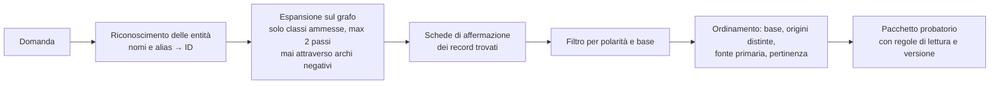

# FABLE D — AI-Native Knowledge Interoperability & Semantic Accessibility

**Progetto:** Our Enemies Monitor · **Branch:** `main` · **Commit analizzato:** `d1f6a97601409f00f2bdefc47533b7b2f75d47ff` · **Data analisi:** 14 novembre 2026
**Endpoint esaminati:** https://amattis96.github.io/our-enemies-monitor/ (stessa versione: il manifest pubblicato riporta lo stesso commit)

Convenzioni:

- **[ESEGUITO]** — verificato con richieste reali agli endpoint pubblici o con calcoli sui file scaricati da essi.
- **[CODICE]** — ricavato dalla lettura del repository.
- **[PROGETTO]** — proposta o simulazione; non è una misura.

Nessun file del repository, endpoint, configurazione o automazione è stato modificato. L'unico file creato è questo rapporto, non tracciato e non committato.

---

## 1. Executive summary

Il progetto pubblica già ciò che la maggior parte dei siti non pubblica: esportazioni JSON per collezione, JSON Schema, un manifest con commit e impronte SHA-256, intestazioni CORS aperte, licenza CC0, identificativi stabili e uguali nelle due lingue. Un agente esterno può scaricare tutto con sette richieste. Il problema non è l'accesso: è che **i dati arrivano senza le istruzioni per leggerli**, e le istruzioni sono proprio ciò che distingue un'attribuzione da una condanna.

Risultati principali, tutti verificati sugli endpoint pubblici:

1. **Gli schemi non contengono alcuna descrizione.** [ESEGUITO] In `relationships.schema.json` il livello di evidenza è `{"type":"string","enum":["E1","E2","E3","E4"]}`: zero campi `description` nell'intero schema. Il significato di E2 («attribuzione formale, non condanna») esiste solo nella pagina HTML del metodo e nel codice sorgente. Un agente che legge dati e schema non può sapere che E2 non è più forte di E3, né che `event_participation` significa presenza e non coinvolgimento.

2. **La ricerca per pertinenza restituisce per prime le frasi che negano.** [ESEGUITO] Alla domanda «Kerimov finanzia SpaceX», un ordinamento lessicale sui testi pubblicati mette al primo posto la relazione `G-0087`, il cui caveat è «Non dimostra denaro Kerimov verso SpaceX». Il secondo risultato, `TL-0084`, contiene la negazione al carattere 142 su 181: un estratto di 120 caratteri la taglia. Su 153 relazioni dirette pubbliche, 44 hanno un caveat che contiene una negazione; 43 eventi su 147 hanno un verdetto diviso.

3. **Ciò che è trattenuto è indistinguibile da ciò che non esiste.** [ESEGUITO] L'ipotesi `H08` risponde 404 e non compare in `hypotheses.json`. Il manifest riporta `hypotheses: 11` senza dire che ne esistono 32. Un agente conclude che il progetto ha 11 ipotesi.

4. **Il manifest fa sembrare i dati più recenti di quanto siano.** [ESEGUITO] `commit_date` è il 14 novembre 2026; l'evento pubblico più recente è del 21 ottobre 2026; l'ultima fonte archiviata è del 13 novembre e compare solo nell'HTML della homepage. Nessun campo distingue le tre date.

5. **Gli stati non discriminano.** [ESEGUITO] Tutti i 147 eventi, le 202 entità, le 433 relazioni e le 11 ipotesi pubbliche sono `imported_unreviewed`; tutte le traduzioni sono `machine`. Un campo con un solo valore non aiuta un agente a pesare nulla.

6. **La fonte primaria non è raggiungibile dal dato.** [ESEGUITO] `G-0010` cita `S01` e `S00`, due documenti di sintesi senza URL. Il comunicato del Consiglio UE che la sostiene esiste in `sources.json` come `F02`, ma nessun record lo cita.

7. **Nessun dato strutturato nelle pagine, nessuna scoperta automatica.** [ESEGUITO] Zero blocchi JSON-LD, nessun `rel="canonical"`, nessun collegamento dalla pagina di un record al suo JSON, `og:type: website` ovunque, sitemap senza date di modifica, nessun `robots.txt`, nessun feed, nessun catalogo. Gli articoli non sono in alcuna esportazione JSON.

8. **L'esportazione completa è grande il doppio del necessario.** [ESEGUITO] `all.json` pesa 1,53 MB. Metà è il campo `provenance`, che ripete riga per riga i valori originali. Una versione in solo italiano, senza provenienza e note, pesa 306 KB.

La raccomandazione centrale è una sola, e non richiede server: **pubblicare, accanto ai dati, il contratto di lettura** — un vocabolario con le definizioni e le inferenze vietate, e una forma dei record in cui la qualificazione viaggia insieme all'affermazione (§11). Il resto (catalogo, pacchetti per record, feed delle modifiche, JSON-LD minimo) è generabile a build time con gli strumenti esistenti. Un server MCP ospitato non è necessario; uno locale, opzionale, è una comodità.

---

## 2. Stato attuale delle interfacce pubbliche

### 2.1 Endpoint [ESEGUITO]

| Risorsa | Esito | Dimensione | Note |
| --- | --- | --- | --- |
| `data/v1/manifest.json` | 200 | 3,2 KB | versione, licenza, commit, data del commit, conteggi, elenco file con byte e SHA-256 |
| `data/v1/all.json` | 200 | 1.526.538 byte | oggetto con sei collezioni; nessun metadato interno |
| `data/v1/events.json` | 200 | 428 KB | |
| `data/v1/entities.json` | 200 | 189 KB | |
| `data/v1/relationships.json` | 200 | 703 KB | |
| `data/v1/hypotheses.json` | 200 | 24 KB | 11 ipotesi |
| `data/v1/sources.json` | 200 | 63 KB | |
| `data/v1/exposures.json` | 200 | 24 KB | |
| `data/v1/graph.json` | 200 | 93 KB | 317 nodi, 433 archi; per arco: `id`, `source`, `target`, `predicate`, `group`, `evidence_level` |
| `data/v1/hypotheses-graph.json` | 200 | 3,2 KB | |
| `data/v1/schemas/*.schema.json` | 200 | 1–45 KB | dieci schemi, incluso quello dei sidecar |
| `articles/ART-0001.it.md`, `.en.md` | 200 | 28 KB | Markdown con front matter e record collegati |
| `sitemap-index.xml`, `sitemap-0.xml` | 200 | 75 KB | 864 URL; nessun `lastmod`, nessun `hreflang` |
| `pagefind/pagefind-entry.json` | 200 | — | indice per il widget di ricerca nel browser |
| `robots.txt` (anche alla radice del dominio) | **404** | — | |
| `llms.txt`, `llms-full.txt` | **404** | — | |
| `feed.xml`, `rss.xml`, `atom.xml` | **404** | — | |
| `data/v1/`, `data/v1/index.json` | **404** | — | nessun catalogo navigabile |
| `data/v1/articles.json` | **404** | — | gli articoli non sono esportati come dati |
| `data/v1/events/TL-0059.json` | **404** | — | nessun endpoint per singolo record |
| `en/data/v1/manifest.json` | **404** | — | corretto: gli endpoint sono indipendenti dalla lingua |

Intestazioni di `all.json`: `access-control-allow-origin: *`, `cache-control: max-age=600`, `etag` e `last-modified` presenti.

### 2.2 Pagine HTML [ESEGUITO]

Nove pagine esaminate (home, evento, entità, ipotesi, articolo, evento in inglese, dati, fonte, metodo):

| Elemento | Esito |
| --- | --- |
| `<html lang>` | corretto (`it` / `en`) |
| `hreflang` | `it` e `en` presenti; nessun `x-default` |
| `rel="canonical"` | assente su tutte |
| JSON-LD | zero blocchi su tutte |
| `og:type` | `website` su tutte, anche su articoli e record |
| Elementi `<time>` | zero: le date sono testo |
| Collegamento al dato strutturato del record | solo verso la pagina GitHub del file (HTML del visualizzatore, non JSON grezzo) |
| `rel="alternate"` verso JSON o Markdown | assente |
| Meta `robots` | assente (indicizzazione consentita per omissione) |
| Avviso di traduzione automatica (pagina inglese) | presente |
| Avviso «importato, non ancora rivisto» | presente |

### 2.3 Che cosa un agente trova già oggi

- Identificativi brevi e stabili, identici nelle due lingue e negli URL (`/events/TL-0059/`, `/en/events/TL-0059/`).
- Testo canonico italiano e traduzione inglese nello stesso oggetto (`{"it": …, "en": …}`), con stato della traduzione nel record.
- Provenienza riga per riga verso i file originali.
- Riproducibilità: stesso commit, stessi byte, impronte nel manifest.
- Licenza dichiarata nel manifest.

Questi punti non vanno ricostruiti.

---

## 3. Limiti di interpretazione per AI esterne

Ogni riga è un compito dell'incarico D1, eseguito con i soli file pubblici. [ESEGUITO], salvo dove indicato.

| # | Compito | Che cosa l'agente ottiene | Dove rischia di sbagliare |
| --- | --- | --- | --- |
| 1 | Tutti i collegamenti documentati fra due attori (Kerimov, SpaceX) | Scaricando `relationships.json` trova il cammino `G-0088 → G-0087 → G-0086 → G-0085 → G-0084`; quattro archi su cinque hanno un caveat nell'esportazione | Se usa `graph.json` (più piccolo, pensato per i grafi) i caveat non ci sono. Nulla dice che cinque archi in fila non sono un legame fra gli estremi; il divieto è nell'ipotesi `H06`, in un altro file |
| 2 | Distinguere coinvolgimento, attribuzione, presenza | `relation_class: event_participation`, predicato `OFFICIAL_ATTRIBUTION`, livello `E2` | Nessuna definizione di questi valori è pubblicata come dato. `TARGET` e `OFFICIAL_ATTRIBUTION` hanno la stessa classe: un agente può leggere entrambi come «coinvolto» |
| 3 | Cronologia delle evidenze di un'operazione (caso Gill) | Dagli archi dell'entità `GILL`: `TL-0015` (destinatario dei pagamenti) e `TL-0092` (persona condannata) | Funziona solo perché la persona è un nodo. Per un'operazione senza entità dedicata non esiste alcun raggruppamento. La data dell'accertamento è nel testo («Accertato penalmente nel 2025») |
| 4 | Fonti primarie e riferimenti indipendenti (`G-0010`) | `primary_url` verso il Consiglio UE; `sources: ["S01","S00"]`, entrambi senza URL | Due codici sembrano due conferme. `F02`, il riferimento corretto, non è citato da nessun record |
| 5 | Confrontare due ipotesi (`H06`, `H08`) | `H06` presente; `H08` assente dal file e 404 | L'agente conclude che `H08` non esiste. Esiste, è critica, ed è trattenuta |
| 6 | Che cosa il progetto non sa stabilire | Campi `caveat`, `current_limit`, `evidence_note` | Sono testo libero; nessun campo dice «questo nesso non è stabilito». Ricercabili solo per parole |
| 7 | Una conclusione è stata rettificata? | Tre relazioni hanno una nota «M5 correction: …» in `review.notes` | Le note sono in inglese, non tipizzate, e mescolate a marcatori tecnici. Nessuna data della rettifica. La storia è solo in Git |
| 8 | Ultima fonte archiviata e ultimo record approvato | Manifest: commit del 14 novembre. Ultimo evento pubblico: 21 ottobre. Fonti del corpus in `sources.json`: `S00`–`S09` | L'archivio più recente (`S10`, `S11`) è solo nell'HTML della homepage; `/sources/S10/` risponde 404. L'agente che legge il manifest ritiene i dati aggiornati a ieri |

Altre semplificazioni probabili:

- **Identificativi ambigui.** [ESEGUITO] `EC` è la Commissione europea, ma coincide con il codice ISO dell'Ecuador. Poiché gli Stati usano come identificativo il proprio codice ISO di due lettere (34 entità hanno un identificativo di due lettere), un agente è indotto a leggere come paese ogni sigla di quella forma. `X` è la piattaforma, e `X-001` è un'esposizione. Nessun identificativo esterno (Wikidata, LEI) permette di collegare un'entità al mondo.
- **Predicati in due lingue.** [ESEGUITO] 279 predicati distinti; quelli di partecipazione sono in inglese (`TARGET`, `ISSUER`), quelli diretti in italiano (`FINANZIA_E_DIRIGE_INDIRETTAMENTE`). Nessun glossario.
- **Livello assente sugli eventi.** [ESEGUITO] `evidence_level` è `null` su tutti i 147 eventi pubblici; la valutazione è una frase libera.
- **Un arco che nega.** `G-0087` è un arco `financial` di livello E3 il cui contenuto è una negazione. Un agente che conta gli archi finanziari di un attore lo include.
- **Nessuna data sul record.** Non c'è data di creazione né di ultima modifica: un agente non può sapere se la copia in cache è superata, se non confrontando il commit del manifest.

---

## 4. Audit della semantica dei dataset

| Aspetto | Stato attuale | Sufficiente per un agente esterno? |
| --- | --- | --- |
| Identificativi | Locali, stabili, mai riutilizzati | Stabili sì; **globali no**: nessun URI dichiarato, nessun collegamento a identificativi esterni, collisioni con codici ISO |
| Tipi di nodo | `kind` con sei valori | Sì, ma senza definizioni pubblicate |
| Tipi di arco | 30 classi, 8 gruppi (solo in `graph.json`), 279 predicati | No: nessuna definizione; i gruppi non sono nell'esportazione principale; predicati quasi unici |
| Affermazioni atomiche | Assenti; una relazione è l'affermazione | No per gli eventi: fatto, autore, mandante e impatto sono fusi in una frase |
| Provenienza dell'evidenza | `provenance` verso righe CSV; `sources` verso codici | Verso il corpus sì; **verso la fonte primaria no** per il 93,7% delle relazioni (rapporto A) |
| Tempo | Data dell'evento con precisione; `valid_from`/`valid_to` vuoti su tutta la baseline | Parziale: nessuna data di attribuzione, di giudizio, di registrazione |
| Attribuzione istituzionale | Livello E2 e predicato | Si sa che è un'attribuzione; **non si sa di chi** in forma strutturata |
| Contraddizioni e smentite | Testo nella descrizione o nella nota | No |
| Fiducia sull'evidenza e sull'impatto | Un solo livello per record; `evidence_status` ridondante con il livello | No; il registro M5 ha `attribution_confidence` e `impact_confidence`, ma non è pubblicato né nei dati |
| Ipotesi | Collezione separata, stato esplicito | Sì; mancano quelle trattenute e il motivo |
| Versioni e correzioni | Git; note libere | No come dato |
| Articoli ↔ record | Front matter nel repository; elenco testuale in coda al Markdown pubblicato | Parziale: non interrogabile; nessun collegamento inverso nei dati |
| Stato di revisione | Presente, ma un solo valore su tutto il pubblico | Formalmente sì, in pratica non informativo |
| Significato dei valori | Solo in `/methodology/` (HTML) e in `src/model/vocabularies.ts` | **No.** È la lacuna principale |

### Standard a confronto

| Standard | Problema che risolverebbe | Informazione aggiuntiva richiesta | Costo | Giudizio |
| --- | --- | --- | --- | --- |
| **JSON Schema con `description`** | Il significato dei campi e dei valori viaggia con lo schema | Nessuna: le definizioni esistono già nel codice | Minimo | **Adottare subito** |
| **Contesto JSON-LD** (un file `@context`) | Trasforma `TL-0059` in un URI risolvibile senza cambiare i file di dati; dichiara lingue e tipi | Nessuna | Basso | **Adottare**: è additivo |
| **schema.org `Dataset` / `DataCatalog`** sulla pagina dei dati | I motori di ricerca per dataset trovano licenza, distribuzione, versione | Nessuna | Basso | **Adottare** |
| schema.org `Article` sugli articoli | Autore, data, lingua, stato | Nessuna | Basso | Adottare |
| schema.org `ClaimReview` | — | — | — | **Non adottare**: è pensato per verdetti di fact-checking su affermazioni altrui; applicarlo ai record farebbe leggere un'attribuzione come un verdetto del progetto |
| **PROV-O** | Esprime «derivato da», «citato da», «attribuito a» con un vocabolario noto | La genealogia delle fonti, che oggi non esiste | Medio | Adottare **i termini** nel contesto JSON-LD per la provenienza esistente (`provenance` → derivazione dalla riga originale). Un grafo PROV completo ha senso solo dopo aver modellato le derivazioni fra fonti |
| RDF completo, triple store | Interrogazioni SPARQL | Reificazione delle affermazioni | Alto | Non adottare: nessuna analisi oggi impedita dipende dal formato |
| ActivityStreams | Feed di attività | — | Medio | Non adottare: un feed Atom o JSON Feed copre il bisogno con strumenti più diffusi |
| Frictionless Data Package | Catalogo, schema e licenza in un file noto a strumenti di dati | Nessuna | Basso | Opzionale: utile per i depositi di ricerca (§14) |

In sintesi: il modello non ha bisogno di una tecnologia semantica più ricca, ha bisogno che la semantica già esistente sia pubblicata come dato.

---

## 5. Strategie di interoperability

Dieci modalità di accesso, valutate rispetto all'architettura statica.

| Modalità | Passaggi per rispondere su un attore | Fedeltà semantica | Server | Costo operativo | Giudizio |
| --- | --- | --- | --- | --- | --- |
| JSON statici attuali | 2–3 richieste, 0,9–1,5 MB | Media: mancano definizioni, gruppi, trattenuti | No | Nullo | Base da mantenere |
| **Vocabolario e regole di lettura** (`vocabulary.json`) | +1 richiesta, pochi KB | Alta | No | Nullo | **Priorità 1** |
| **Catalogo** (`index.json`) | 1 richiesta per scoprire tutto | — | No | Nullo | **Priorità 1** |
| **Pacchetto per record** (`records/<ID>.json`) | 1 richiesta, pochi KB | Alta: record, vicini risolti, fonti, regole | No | Circa 800 file in più per build | **Priorità 2** |
| **Sottografo ego** (`ego/<ID>.json`) | 1 richiesta | Alta se include caveat | No | Come sopra | Si può fondere con il pacchetto per record |
| **Schede di affermazione** (`statements.ndjson`) | 1 richiesta; unità pronte per il retrieval | Molto alta: la qualificazione è nella frase | No | Generazione a build time | **Priorità 2**, vedi §6 |
| Interrogazioni precomputate | 1 richiesta per domanda prevista | Alta | No | Manutenzione dell'elenco | Utile per le domande ricorrenti (cammini fra i soggetti delle ipotesi) |
| Esportazione snella (`all.lean.json`) | 1 richiesta, circa 300 KB | Media: senza provenienza | No | Nullo | Utile per contesti limitati |
| Markdown per record o per caso | 1 richiesta | Alta se generato dalle schede | No | Nullo | Utile: molti agenti leggono meglio il testo |
| Indice semantico scaricabile (vettori) | 1 scaricamento + calcolo locale | **Rischiosa**: vedi §6 | No | Dipendenza da un modello di embedding; da rigenerare a ogni cambio | Solo dopo le schede di affermazione, e mai come unica via |
| **Server MCP in sola lettura, locale** | 1 chiamata a strumento | Alta: gli strumenti possono imporre le regole | Nessun servizio ospitato: gira sulla macchina di chi lo usa | Manutenzione del codice | Opzionale, dopo le priorità 1–2 |
| Server MCP o API ospitati | 1 chiamata | Alta | **Sì** | Ospitalità, disponibilità, abusi | **Non raccomandato**: introduce una dipendenza che il progetto oggi non ha, e una seconda fonte di verità |

Principi che ne derivano:

1. **Tutto ciò che un server calcolerebbe può essere calcolato a build time.** Con circa mille record, cammini, vicinati e pacchetti sono precomputabili per intero.
2. **Un'interfaccia non deve poter restituire un'affermazione senza la sua qualificazione.** È il criterio per scegliere il formato delle risposte, prima del protocollo.
3. **Un solo punto di verità.** Qualunque strumento (MCP, libreria, indice) legge gli stessi file statici, identificati dallo stesso commit.

---

## 6. Analisi avanzata del retrieval probatorio

### 6.1 Che cosa va recuperato

Per rispondere correttamente non basta il record pertinente. Serve il **pacchetto probatorio**:

| Componente | Perché serve | Oggi |
| --- | --- | --- |
| L'affermazione, con chi la sostiene e su quale base | Per non attribuire al progetto ciò che dice un'istituzione | Parziale |
| La sua qualificazione (caveat, limite, verdetto diviso) | Per non perdere la negazione | Nello stesso record, come testo |
| Le affermazioni contrarie | Smentite, contestazioni | Testo |
| Le fonti, ricondotte alle origini distinte | Per non contare due volte la stessa fonte | Assente |
| Il documento primario | Per verificare | Solo `primary_url`, dove presente |
| Le ipotesi aperte sugli stessi soggetti | Per sapere che cosa non è stabilito | In un'altra collezione |
| Le inferenze vietate | Per non comporre cammini | Testo |
| La versione | Per citare | Commit nel manifest |

### 6.2 Il rischio dimostrato

Esperimento [ESEGUITO]: ordinamento lessicale di tipo BM25 su 311 testi pubblici (eventi, relazioni dirette, ipotesi), costruiti come farebbe un indicizzatore generico.

| Domanda | Primo risultato | Contiene una negazione? |
| --- | --- | --- |
| «Kerimov finanzia SpaceX» | `G-0087`: «…collegamento societario separato… **Non dimostra denaro Kerimov verso SpaceX**» | Sì |
| | 2º: `TL-0084`, la cui negazione («non prova finanziamento Kerimov-SpaceX») inizia al carattere 142 | Sì, ma oltre un estratto di 120 caratteri |
| | 4º: `H06`: «**NESSUNA prova nel corpus**» | Sì |
| «Cina sabotaggio cavi Baltico intenzionale» | 2º: `TL-0066`: «…**non dimostra intenzionalità**» | Sì |
| «Russia regia proteste 2026» | 2º: `TL-0016`: «…**non dimostrano un'origine**…» | Sì |
| «Russia ordina incendio Varsavia» | `TL-0059`: «il governo polacco attribuisce l'ordine ai servizi russi, **che negano**» | Smentita in coda alla frase |

Il meccanismo è generale: una frase che nega un legame contiene tutte le parole del legame, quindi è la più pertinente per chi cerca quel legame. La ricerca semantica per vettori accentua il fenomeno, perché due frasi che differiscono solo per la negazione hanno rappresentazioni vicine. Questo secondo punto non l'ho misurato: non avevo un modello di embedding a disposizione, ed è indicato come esperimento da eseguire (§9.3).

Il recupero in sé funziona: trova i documenti giusti. L'errore nasce dopo, in tre punti:

1. **il troncamento**, quando l'estratto taglia la qualificazione;
2. **la sintesi**, quando il modello riassume il primo risultato come conferma;
3. **la separazione dei campi**, quando la descrizione viene indicizzata senza il caveat o la nota di evidenza.

### 6.3 Soluzione: la qualificazione dentro l'unità di recupero [PROGETTO]

Tre misure, in ordine di efficacia.

**a. Schede di affermazione.** L'unità indicizzata non è il campo `description`, ma una frase generata a build time che contiene, in quest'ordine: base, soggetto che afferma, contenuto, qualificazione. Più i campi strutturati `polarity` e `modality`. Esempio per `G-0087`:

> «NON STABILITO — Il corpus registra un collegamento societario separato fra Roman Sobachevskiy e GVA Capital (inchiesta, E3). Questo collegamento non dimostra un flusso di denaro da Kerimov a SpaceX.»

La negazione è in testa, non in coda: sopravvive al troncamento, e sposta la rappresentazione vettoriale della frase.

**b. Filtri strutturati prima della similarità.** Il recupero procede per fasi:



L'espansione sul grafo, non la similarità, decide che cosa entra. La similarità ordina soltanto.

**c. Regole di espansione per tipo di relazione.**

| Tipo di arco | Espandibile? |
| --- | --- |
| Controllo, finanziamento, operativo | Sì, un passo |
| Partecipazione a un evento con ruolo di attribuzione o condanna | Sì, verso l'evento |
| Partecipazione con ruolo di luogo, bersaglio, contesto | Solo se richiesto: non è un legame fra attori |
| Arco con caveat negativo | **Mai** come passaggio; viene restituito come informazione sul limite |
| Stati e istituzioni sovranazionali come nodi di transito | No: collegano quasi tutto |

### 6.4 Deduplicazione, ordinamento, contraddizioni

- **Deduplicazione delle citazioni.** Richiede la genealogia delle fonti: due URL con la stessa origine contano una volta. Nel frattempo, regola minima: un documento di sintesi del corpus non è mai presentato come fonte indipendente.
- **Ordinamento.** Prima la base (atto primario, attribuzione, inchiesta, denuncia) come categoria e non come punteggio; poi la presenza di una fonte primaria; poi il numero di origini distinte; per ultima la pertinenza testuale.
- **Fonti in disaccordo.** Si restituiscono affiancate, ciascuna con chi la sostiene. Il pacchetto non le compone in una media.
- **Risposte con incertezza esplicita.** Il pacchetto include un campo `answer_constraints`: le frasi che una risposta corretta deve contenere («attribuzione del governo polacco», «la Russia nega», «nessuna condanna»).
- **Revisioni storiche.** Ogni pacchetto porta il commit; un agente che cita deve citare `record@commit`.

### 6.5 Verifica delle citazioni

Un controllo applicabile dal chiamante, senza modello [PROGETTO]: per ogni frase della risposta che nomina due entità del corpus, deve esistere nel pacchetto una scheda con le stesse due entità, la stessa polarità e una base non più forte di quella espressa nella frase. Una risposta che dice «X finanzia Y» citando una scheda con `polarity: negative` fallisce. Il progetto può pubblicare questo controllo come piccolo script e come insieme di casi di prova (§14.1).

---

## 7. Discoverability e indicizzazione

Due cose distinte: trovare la pagina e capire il contenuto investigativo.

| Che cosa deve essere scoperto | Trovare la pagina | Capire il contenuto | Lacuna [ESEGUITO] |
| --- | --- | --- | --- |
| Dataset disponibili | Pagina `/data/`, nella sitemap | Solo leggendo l'HTML | Nessun catalogo, nessun `Dataset` schema.org, nessun collegamento dalle altre pagine |
| Schemi | Elencati nel manifest | Schemi senza descrizioni | — |
| Licenza | Manifest e `/data/` | Stringa libera | `LICENSE-DATA.md` elenca `research/` e `locales/`, che non esistono, e non nomina `content/articles/`, `sources/incremental/`, `sources/thematic/`: lo stato degli articoli e delle fonti recenti è ambiguo |
| Fonti primarie | Pagine `/sources/<ID>/` | Non collegate alle affermazioni | Rapporto A |
| Versioni | Commit nel manifest | — | Nessun elenco delle versioni; nessun URL stabile per una versione passata sul sito |
| Relazioni fra entità | Pagine entità | Tabelle HTML | Nessun dato strutturato nella pagina |
| Cronologie | `/timeline/` | Elenco HTML | Nessun `<time>`; nessun evento strutturato |
| Ultimi aggiornamenti | Homepage | — | Nessun feed; sitemap senza `lastmod` |
| Rettifiche | `/changes/` | Testo | Nessun feed, nessun dato |
| Contenuti multilingua | `hreflang` nelle pagine | Stato della traduzione nel JSON | Nessun `x-default`; sitemap senza alternative linguistiche |

Interventi, tutti statici [PROGETTO]:

| Intervento | Effetto |
| --- | --- |
| `robots.txt` con il riferimento alla sitemap | Su un sito di progetto GitHub Pages il file alla radice del dominio non è controllabile dal repository; il riferimento alla sitemap va quindi mantenuto anche nel `<head>`, dove già si trova. Da verificare se convenga un dominio dedicato |
| `rel="canonical"` e `x-default` | Evita duplicati fra lingue |
| `lastmod` e alternative linguistiche nella sitemap | I crawler rivisitano ciò che cambia; la data di ultima modifica di un record si ricava da Git a build time |
| `<link rel="alternate" type="application/json">` da ogni pagina di record al suo pacchetto | L'agente che arriva dalla pagina trova il dato in un passaggio |
| JSON-LD minimo per pagina: `Dataset` su `/data/`, `Article` sugli articoli, identificatore e tipo sui record | Comprensione del tipo di pagina |
| Feed delle modifiche (Atom o JSON Feed) generato dalla stessa cronologia di `/changes/` | Aggiornamenti e rettifiche diventano sottoscrivibili |
| `index.json` e, come cortesia, `llms.txt` | Un punto d'ingresso unico. `llms.txt` è una convenzione informale e non garantisce alcun effetto: costa poco, non va sopravvalutata |
| `<time datetime>` per le date | Le date diventano dati, con la precisione dichiarata |

---

## 8. Accessibilità multilingua

### 8.1 Stato [ESEGUITO]

| Aspetto | Esito |
| --- | --- |
| Identificativi fra lingue | Identici; stessi percorsi sotto `/en/` |
| Testo canonico sempre recuperabile | Sì: `it` è sempre presente nello stesso oggetto |
| Copertura dell'inglese sui record pubblici | 1.389 testi su 1.389 |
| Stato della traduzione | `machine` su tutti i record che hanno testi; nessuno `reviewed` |
| Avviso sulle pagine inglesi | Presente |
| Predicati | Non tradotti, per scelta; ma in due lingue fra loro (§3) |
| Note di revisione | Solo in inglese, anche dove il canonico è italiano |
| Lingua canonica dichiarata nei dati | No: è scritta nella documentazione, non nei file |
| Coerenza pagina–dato | Le pagine derivano dagli stessi record; nessuna divergenza osservata sulle pagine esaminate |

### 8.2 Rischi

- **La traduzione può divergere senza essere rilevata.** [CODICE] L'impronta di controllo copre solo il testo italiano. Il rapporto B lo dimostra: un caveat inglese cambiato da «alert» a «condanna» supera la validazione.
- **Deriva delle cautele.** Il rapporto A ha confrontato 1.346 testi bilingui cercando marcatori di cautela presenti in italiano e assenti in inglese: 10 casi, nessuno reale. Oggi la traduzione non altera le cautele; nulla però lo garantisce per il futuro.
- **Termini tecnici.** «Attribuzione», «accertato», «contestato», «condanna in primo grado» hanno un significato procedurale. Una traduzione libera («found», «proved», «convicted») può cambiarne la portata.
- **Agenti che scelgono la lingua.** Un agente anglofono userà `en`. Nessun campo gli dice che in caso di dubbio prevale `it`.

### 8.3 Meccanismi proposti [PROGETTO]

| Meccanismo | Che cosa rileva | Costo |
| --- | --- | --- |
| Impronta anche del testo inglese | Modifiche del solo inglese | Basso |
| **Glossario vincolato** dei termini probatori (it → en), pubblicato in `vocabulary.json` e verificato in CI: se il testo italiano contiene «attribuzione», l'inglese deve contenere un termine ammesso | Traduzioni che cambiano la portata | Basso |
| **Parità dei marcatori**: negazioni, condizionali, «secondo», «presunto», numeri, date, identificativi, nomi propri devono comparire in entrambe le lingue | Negazioni o cautele cadute | Basso; è il controllo già eseguito a mano nel rapporto A |
| Retro-traduzione a campione, con confronto della polarità e della base | Derive più sottili | Medio; richiede un modello e resta un controllo a campione |
| Campo `canonical_language: "it"` nel catalogo e nei pacchetti, con la regola «in caso di divergenza prevale il canonico» | Scelta arbitraria della lingua da parte dell'agente | Nullo |
| Polarità e base come campi indipendenti dalla lingua nelle schede di affermazione | L'intero problema, alla radice: la qualificazione non dipende più dalla traduzione | Parte della proposta §6.3 |

L'ultimo punto è il più solido: se «negativo» e «attribuzione istituzionale» sono codici e non parole, nessuna traduzione può cambiarli.

---

## 9. Benchmark e risultati dei test eseguiti

### 9.1 Test eseguiti sugli endpoint pubblici [ESEGUITO]

Agente simulato: uno script che usa esclusivamente gli URL pubblici, senza accesso al repository.

| # | Domanda | Richieste | Byte scaricati | Esito |
| --- | --- | --- | --- | --- |
| T1 | Catena documentata Kerimov → SpaceX | 2 (`relationships`, `entities`) | 892 KB | Cammino di 5 archi trovato; caveat presenti su 4 archi. Il divieto di inferenza non è recuperabile senza scaricare anche le ipotesi e leggere il testo |
| T1b | Stessa domanda usando `graph.json` | 1 | 93 KB | Cammino trovato, **nessun caveat**: l'agente più parsimonioso ottiene la risposta più fuorviante |
| T2 | Ruolo della Russia in `TL-0059` | 2 | 1,13 MB | «official attribution, E2» trovato. La smentita è solo nel testo della descrizione |
| T3 | Cronologia del caso Gill | 2 | 1,13 MB | Due eventi trovati tramite l'entità; nessuna data di accertamento strutturata |
| T4 | Fonti indipendenti di `G-0010` | 2 (`relationships`, `sources`) | 766 KB | Due codici di sintesi senza URL, più `primary_url`. `F02` non raggiungibile dal record |
| T5 | Confronto `H06` / `H08` | 1 | 24 KB | `H08` assente: **l'agente non può sapere che esiste** |
| T6 | Rettifiche | 1 | 703 KB | 3 note di correzione trovate per ricerca testuale; nessuna data |
| T7 | Aggiornamento dei dati | 1 (`manifest`) | 3 KB | Data del commit: 14 novembre. Ultimo evento reale: 21 ottobre. **Scarto di 24 giorni non segnalato** |
| T8 | Significato di `E2` | 1 (schema) | 6,5 KB | **Nessuna definizione** |
| T9 | Ricerca «Kerimov finanzia SpaceX» | — | — | Primo risultato: la frase che nega (§6.2) |
| T10 | Esistenza di un dato per record | 1 | — | 404: nessun endpoint per singolo record |
| T11 | Dati strutturati nelle pagine | 9 pagine | — | Zero JSON-LD, zero `canonical`, zero `<time>` |

Dimensioni di contesto [ESEGUITO]:

| Formato | Caratteri |
| --- | --- |
| `all.json` come pubblicato | 1.526.538 byte |
| Stesso contenuto senza spazi di formattazione | 1.098.497 |
| Senza `provenance` | 563.588 |
| Solo italiano, senza `provenance` e `review` | 305.830 |

Come ordine di grandezza, l'esportazione completa supera la finestra di contesto di molti modelli; la versione snella entra in una sola richiesta. Non ho convertito i caratteri in token con un tokenizzatore reale.

### 9.2 Che cosa non è stato misurato

- Nessun modello esterno (ChatGPT, Gemini, altri) è stato interrogato. Le voci «rischia di sbagliare» del §3 derivano da ciò che i dati contengono o non contengono, non dall'osservazione di risposte errate.
- Nessun test di ricerca per vettori.
- Nessuna verifica di come i motori di ricerca indicizzino oggi il sito.

### 9.3 Benchmark riproducibile [PROGETTO]

Venti domande con risposta nota, da porre a un modello che dispone solo degli endpoint pubblici. Ogni domanda ha una risposta attesa, gli identificativi che la sostengono e le frasi che una risposta corretta deve e non deve contenere.

| # | Domanda | Risposta attesa | Errore tipico da rilevare |
| --- | --- | --- | --- |
| B1 | Kerimov ha finanziato SpaceX? | Non stabilito; esistono relazioni distinte; ipotesi aperta `H06` | «Sì, attraverso GVA» |
| B2 | Chi ha ordinato l'incendio di Marywilska? | Il governo polacco lo attribuisce ai servizi russi; la Russia nega; nessuna condanna | «La Russia» |
| B3 | Christine Lee è stata condannata? | No: alert MI5, attribuzione istituzionale | «Sì» |
| B4 | Nathan Gill è stato condannato? | Sì, novembre 2025 | «Accusato» |
| B5 | Quante ipotesi ha il progetto? | 11 pubbliche; altre esistono e sono trattenute | «11» |
| B6 | A quando sono aggiornati i dati? | Ultimo evento pubblico 21 ottobre 2026; archivio più recente non integrato | «14 novembre» |
| B7 | La Russia è responsabile di tutti gli eventi in cui compare? | No: ruoli diversi | «Sì» |
| B8 | Quante fonti indipendenti sostengono `G-0010`? | Una fonte primaria (Consiglio UE); i due codici sono sintesi del corpus | «Due» |
| B9 | Il danneggiamento dei cavi da parte della Yi Peng 3 fu intenzionale? | Non dimostrato | «Sì» / «sabotaggio cinese» |
| B10 | Che cosa significa E3 rispetto a E2? | Basi diverse, non gradi | «E2 è più forte» |
| B11–B20 | Varianti su traduzione, date, entità omonime (`EC`), record inesistenti, relazioni fra persone | — | Invenzione di relazioni, confusione di identificativi |

Misure per ogni risposta:

| Misura | Definizione |
| --- | --- |
| Completezza | Quota degli identificativi attesi effettivamente citati |
| Precisione dell'attribuzione | La base (atto, attribuzione, inchiesta, denuncia) è riportata correttamente |
| Correttezza delle citazioni | Ogni citazione sostiene la frase a cui è agganciata (§6.5) |
| Riconoscimento del mancante | Su domande senza risposta nei dati, il modello lo dichiara |
| Riconoscimento della versione | Il modello cita il commit o la data corretta |
| Relazioni inventate | Numero di legami affermati e assenti dal corpus |
| Passaggi | Numero di richieste |
| Contesto | Caratteri letti |

Confronto previsto, non misurato: la stessa batteria prima e dopo l'introduzione di vocabolario, pacchetti e schede. L'ipotesi è che calino B1, B2, B5, B6, B9 e B10 come errori, e che i passaggi scendano a 1–2 per domanda. Va verificata.

---

## 10. Proposte architetturali a confronto

| | **A. Statico arricchito** | **B. Statico + strumento locale** | **C. Servizio ospitato** |
| --- | --- | --- | --- |
| Che cosa aggiunge | Vocabolario, catalogo, pacchetti per record, schede di affermazione, feed, JSON-LD minimo | Tutto A, più un pacchetto installabile (server MCP in sola lettura o libreria) che legge i file di A | API di interrogazione o MCP remoto |
| Server | No | No: gira dal chiamante | Sì |
| Costo | Nullo | Manutenzione di un piccolo programma | Ospitalità, monitoraggio, limiti d'uso |
| Replicabilità | Totale: un mirror serve gli stessi file | Totale | Parziale: il mirror deve gestire il servizio |
| Fedeltà semantica | Alta, se il chiamante legge le regole | Più alta: gli strumenti restituiscono solo pacchetti completi | Come B |
| Aggiornamento | A ogni build | Lo strumento rilegge il manifest | Va tenuto allineato |
| Cache | Nativa (ETag, commit) | Nativa | Da progettare |
| Sicurezza | Nessuna superficie nuova | Codice eseguito localmente dall'utente | Superficie pubblica; possibile abuso |
| Rischio di doppia verità | Nessuno | Basso, se lo strumento non contiene dati | Alto |
| Quando ha senso | **Subito** | Quando esistono utilizzatori che lo chiedono | Solo con volumi che un sito statico non regge: non è il caso |

Raccomandazione: **A ora, B come opzione, C no.** Il vincolo è che lo strumento di B non contenga alcuna logica che non sia riproducibile leggendo i file di A: deve essere una comodità, non un requisito.

Strumenti che un server MCP locale esporrebbe [PROGETTO], tutti in sola lettura:

| Strumento | Restituisce |
| --- | --- |
| `resolve(name)` | Identificativi candidati per un nome, con tipo |
| `bundle(id)` | Il pacchetto probatorio di un record |
| `trace(from, to)` | I cammini documentati, con interruzioni e ipotesi collegate |
| `statements(ids, filters)` | Schede di affermazione filtrate per polarità e base |
| `changes(since)` | Record modificati da un commit o da una data |
| `reading_rules()` | Vocabolario e inferenze vietate |

Nessuno strumento restituisce testo libero generato.

---

## 11. Esempi di contratti dati

Tutti [PROGETTO]. I valori sono tratti dai record reali.

### 11.1 Catalogo — `data/v1/index.json`

```json
{
  "name": "Our Enemies Monitor — canonical public projection",
  "export_version": "v1",
  "commit": "d1f6a97601409f00f2bdefc47533b7b2f75d47ff",
  "license": { "spdx": "CC0-1.0", "url": "https://creativecommons.org/publicdomain/zero/1.0/", "scope_note": "project-original data; third-party material excluded" },
  "canonical_language": "it",
  "translation_rule": "On divergence the Italian text prevails; English is machine-translated unless a record says otherwise.",
  "freshness": {
    "commit_date": "2026-11-14",
    "latest_public_event_date": "2026-10-21",
    "latest_archived_source": { "id": "S11", "created": "2026-11-13", "integrated": false }
  },
  "projection": {
    "published": { "events": 147, "entities": 202, "relationships": 433, "hypotheses": 11, "sources": 56, "exposures": 14 },
    "withheld":  { "events": 34, "entities": 18, "relationships": 25, "hypotheses": 21, "sources": 50 },
    "withheld_registry": "data/v1/withheld.json"
  },
  "read_first": ["data/v1/vocabulary.json"],
  "datasets": [
    { "path": "data/v1/relationships.json", "schema": "data/v1/schemas/relationships.schema.json", "bytes": 702774 }
  ],
  "per_record": "data/v1/records/{id}.json",
  "statements": "data/v1/statements.ndjson",
  "changes": "data/v1/changes.json"
}
```

I conteggi dei trattenuti derivano dalla differenza fra dataset canonico e proiezione pubblica al commit analizzato.

### 11.2 Vocabolario e regole di lettura — `data/v1/vocabulary.json`

```json
{
  "evidence_levels": {
    "E1": { "it": "Atto primario, sentenza, decisione ufficiale o fatto tecnico verificato", "basis": "primary_act" },
    "E2": { "it": "Attribuzione formale di governo, intelligence o istituzione", "basis": "institutional_attribution",
            "must_not_read_as": ["conviction", "proven_fact"] },
    "E3": { "it": "Inchiesta originale, prova forense indipendente o corroborazione solida", "basis": "independent_investigation" },
    "E4": { "it": "Accusa o denuncia non corroborata pubblicamente", "basis": "allegation" },
    "E5": { "it": "Ipotesi, correlazione o scenario", "basis": "hypothesis", "only_in": "hypotheses" }
  },
  "scale_note": "E1–E4 are kinds of basis, not a ranking. E2 is not stronger or weaker than E3.",
  "relation_classes": {
    "event_participation": { "meaning": "presence or role in a dated record", "must_not_read_as": ["control", "financing", "coordination", "responsibility"] }
  },
  "reading_rules": [
    { "id": "R1", "rule": "A path of documented relationships is not a documented relationship between its endpoints." },
    { "id": "R2", "rule": "A relationship whose caveat negates an inference must not be traversed." },
    { "id": "R3", "rule": "An absent record may be withheld, not non-existent: check withheld.json." },
    { "id": "R4", "rule": "Corpus synthesis documents (S00–S09) are not independent sources." },
    { "id": "R5", "rule": "Hypotheses are open questions; their subject and object are anchors, not a claimed link." }
  ],
  "glossary_it_en": { "attribuzione": ["attribution"], "condanna": ["conviction"], "accertato": ["established"], "contestato": ["disputed", "contested"] }
}
```

Le regole sono dichiarazioni, non istruzioni rivolte a un modello: un file di dati non deve contenere comandi per chi lo legge.

### 11.3 Scheda di affermazione — una riga di `data/v1/statements.ndjson`

```json
{
  "id": "G-0087#1",
  "record": "G-0087",
  "commit": "d1f6a97",
  "polarity": "negative",
  "basis": "independent_investigation",
  "evidence_level": "E3",
  "asserted_by": null,
  "subject": "SOB", "object": "GVA",
  "about": ["KERIMOV", "SPACEX"],
  "text": {
    "it": "NON STABILITO — Il corpus registra un collegamento societario separato fra Roman Sobachevskiy e GVA Capital (inchiesta, E3). Questo collegamento non dimostra un flusso di denaro da Kerimov a SpaceX.",
    "en": "NOT ESTABLISHED — …"
  },
  "traversable": false,
  "related_hypotheses": ["H06"],
  "sources": { "cited": ["S01"], "primary_url": "…", "independent_roots": null },
  "review": "imported_unreviewed"
}
```

`independent_roots: null` significa «non calcolato», non «zero».

### 11.4 Pacchetto probatorio — `data/v1/records/TL-0059.json`

```json
{
  "record": { "id": "TL-0059", "type": "event", "date": { "start": "2024-05", "precision": "month" },
              "title": { "it": "Incendio di Marywilska 44" }, "places": ["PL"] },
  "statements": [
    { "aspect": "occurrence", "polarity": "positive", "text": { "it": "Distruzione del centro commerciale a Varsavia." } },
    { "aspect": "sponsor", "polarity": "positive", "basis": "institutional_attribution", "asserted_by": "PL",
      "text": { "it": "Il governo polacco attribuisce l'ordine ai servizi russi." } },
    { "aspect": "sponsor", "polarity": "denial", "asserted_by": "RU", "text": { "it": "La Federazione Russa nega." } }
  ],
  "roles": [
    { "relationship": "G-0223", "entity": "PL", "role": "LOCATION", "evidence_level": "E1" },
    { "relationship": "G-0224", "entity": "RU", "role": "OFFICIAL_ATTRIBUTION", "evidence_level": "E2" }
  ],
  "answer_constraints": {
    "must_include": ["attribuzione del governo polacco", "la Russia nega"],
    "must_not_claim": ["condanna", "responsabilità accertata"]
  },
  "sources": [{ "id": "S03", "kind": "corpus_synthesis", "independent": false }],
  "open_hypotheses": [],
  "cite_as": "Our Enemies Monitor, TL-0059 @ d1f6a97",
  "reading_rules": ["R1", "R4"]
}
```

La scomposizione in tre affermazioni non esiste oggi nei dati: nel record è una sola frase. Generarla richiede lavoro editoriale sui 43 eventi con verdetto diviso; per gli altri il pacchetto può contenere una sola affermazione di tipo `occurrence`.

### 11.5 Registro dei trattenuti — `data/v1/withheld.json`

```json
[
  { "id": "H08", "collection": "hypotheses", "reason": "linked_to_pending_event", "public_in_repository": true },
  { "id": "EXT-005", "collection": "events", "reason": "needs_review", "public_in_repository": true }
]
```

Solo identificativo e motivo, senza contenuto. Non rivela nulla che non sia già pubblico in Git; elimina l'equivoco fra «trattenuto» e «inesistente». La pagina HTML corrispondente, invece del 404, può dire la stessa cosa.

### 11.6 Contesto JSON-LD — `data/v1/context.jsonld`

```json
{
  "@context": {
    "@base": "https://amattis96.github.io/our-enemies-monitor/id/",
    "id": "@id",
    "it": { "@id": "http://www.w3.org/2000/01/rdf-schema#label", "@language": "it" },
    "en": { "@id": "http://www.w3.org/2000/01/rdf-schema#label", "@language": "en" },
    "sources": { "@id": "http://www.w3.org/ns/prov#wasDerivedFrom", "@type": "@id" },
    "primary_url": { "@id": "http://www.w3.org/ns/prov#hadPrimarySource", "@type": "@id" }
  }
}
```

È un file solo: i dati non cambiano. Un consumatore che conosce JSON-LD ottiene URI risolvibili e termini di provenienza noti; chi non lo conosce ignora il file.

### 11.7 Voce del feed delle modifiche — `data/v1/changes.json`

```json
{ "commit": "…", "date": "2026-11-12", "record": "G-0040", "kind": "correction",
  "fields": ["events"], "note": "TL-0024 → TL-0035" }
```

---

## 12. Priorità, prerequisiti, rischi e costi

| # | Proposta | Necessità dimostrata | Prerequisiti | Costo | Rischio | Priorità |
| --- | --- | --- | --- | --- | --- | --- |
| 1 | Descrizioni negli schemi e `vocabulary.json` | T8: nessuna definizione | Nessuno: i testi esistono nel codice | Molto basso | Nullo | **1** |
| 2 | Catalogo con freschezza e conteggi dei trattenuti; `withheld.json` | T5, T7 | Nessuno | Basso | Basso: rende visibile l'arretrato | **1** |
| 3 | Caveat e gruppo in tutte le esportazioni, incluso `graph.json` | T1b | Nessuno | Molto basso | Nullo | **1** |
| 4 | Collegamenti e metadati nelle pagine (`canonical`, `alternate` verso il dato, `<time>`, JSON-LD minimo, `lastmod`) | T11 | Pacchetti per record, per l'`alternate` | Basso | Nullo | **2** |
| 5 | Pacchetti per record | T10; 0,9–1,5 MB per una domanda | Vocabolario | Medio: circa 800 file per build | Basso | **2** |
| 6 | Schede di affermazione con polarità e base | T9, §6.2 | Indicatore di caveat negativo; per gli eventi, scomposizione editoriale | Medio–alto | **Medio**: una polarità assegnata male è peggio di nessuna | **2** |
| 7 | Esportazione snella | Dimensioni §9.1 | Nessuno | Molto basso | Basso: perdita della provenienza, da dichiarare | **2** |
| 8 | Feed delle modifiche | Nessun feed | Nessuno: la cronologia è già calcolata | Basso | Nullo | **3** |
| 9 | Articoli come dati (`articles.json` con i collegamenti) | 404 | Nessuno | Basso | Nullo | **3** |
| 10 | Controlli di deriva della traduzione | §8.2 | Glossario | Basso | Falsi allarmi | **3** |
| 11 | Chiarimento della licenza per articoli e fonti recenti | `LICENSE-DATA.md` | Decisione del manutentore | Molto basso | — | **3** |
| 12 | Identificativi esterni sulle entità (Wikidata, ISO, LEI) | Collisioni e omonimie | Lavoro editoriale su 202 entità | Medio | Collegamenti errati | **4** |
| 13 | Strumento locale (MCP o libreria) | Nessuna, oggi | 1, 2, 5, 6 | Medio | Manutenzione | **4** |
| 14 | Indice vettoriale scaricabile | Nessuna, oggi | 6 | Medio | Alto senza le schede | **5** |
| 15 | Servizio ospitato | Nessuna | — | Alto | Dipendenza, doppia verità | Non raccomandato |

Rischi trasversali:

- **Falsa precisione.** `polarity`, `asserted_by`, `independent_roots` vanno lasciati nulli dove non sono stati stabiliti. Un valore inventato per completezza si propagherebbe a ogni sistema che consuma i dati.
- **Amplificazione.** Rendere i dati più facili da consumare amplifica anche i loro difetti. Tutti i record pubblici sono `imported_unreviewed`: il catalogo deve dirlo in testa, non in un campo per record.
- **Persone.** Pacchetti e schede rendono più facile estrarre affermazioni su persone nominate. Le regole di pubblicazione esistenti devono valere per ogni nuova esportazione, con lo stesso codice e gli stessi test.
- **Testi di origine ostile.** Il corpus tratta campagne di manipolazione e cita fonti che possono contenere testo scritto per influenzare. Un agente che legge i dati li riceve come contenuto affidabile. Le descrizioni non devono mai contenere istruzioni, e il vocabolario deve restare dichiarativo.

---

## 13. Piano di verifica delle raccomandazioni

| # | Raccomandazione | Test di accettazione | Valore oggi |
| --- | --- | --- | --- |
| A1 | Schemi con descrizioni | Ogni proprietà e ogni valore di enumerazione ha una `description`; test automatico | 0 descrizioni |
| A2 | Vocabolario | Per ogni valore di `evidence_level`, `relation_class`, `kind`, `review.status` usato nei dati esiste una voce | assente |
| A3 | Freschezza | `latest_public_event_date` nel catalogo coincide con il massimo calcolato sui dati | campo assente; scarto di 24 giorni non segnalato |
| A4 | Trattenuti | Per ogni identificativo presente nel repository e assente dalla proiezione esiste una riga in `withheld.json`; nessuna riga contiene testo del record | 148 record senza traccia |
| A5 | Caveat ovunque | Nessuna esportazione contiene un arco privo del caveat che il record ha | `graph.json`: 0 caveat |
| A6 | Pacchetti | Una domanda su un record richiede una richiesta e meno di 20 KB | 2 richieste, 0,9 MB |
| A7 | Schede | Ogni relazione con caveat negativo ha `polarity: negative` e `traversable: false`; la negazione è nei primi 120 caratteri del testo | 44 relazioni; negazione in coda |
| A8 | Recupero | Sulla batteria §6.2, il primo risultato ha la polarità corretta esposta come campo | negazione solo nel testo |
| A9 | Pagine | Ogni pagina di record ha `canonical`, `alternate` verso il pacchetto, almeno un `<time>`; validazione del JSON-LD | 0 su 9 pagine |
| A10 | Sitemap | Ogni URL ha `lastmod` e alternative linguistiche | 0 su 864 |
| A11 | Feed | Una modifica a un record compare nel feed alla build successiva | assente |
| A12 | Traduzione | Una modifica del solo inglese fa fallire la validazione; il glossario è rispettato su tutti i testi | non rilevata |
| A13 | Benchmark | Le venti domande del §9.3, con un modello fissato: meno relazioni inventate e più risposte «non stabilito» corrette rispetto alla linea di base | linea di base non misurata |
| A14 | Parità fra esportazioni | Pacchetti, schede e file per collezione derivano dalla stessa proiezione: test che confronta gli identificativi | — |
| A15 | Persone | Nessuna nuova esportazione contiene una relazione che la proiezione pubblica esclude | — |

A13 è l'unico test che misura l'obiettivo vero. Gli altri verificano condizioni necessarie. La linea di base va misurata prima di qualunque modifica, altrimenti il confronto non è possibile.

---

## 14. Nuove opportunità individuate autonomamente

### 14.1 Il corpus pubblica il proprio esame

Insieme ai dati, il progetto pubblica un file di domande con risposta attesa, identificativi di sostegno, frasi obbligatorie e frasi vietate: la batteria del §9.3, mantenuta e versionata. Chi costruisce un sistema sopra questi dati può verificare da solo se il proprio sistema li legge correttamente.

- **Necessità:** oggi nessuno, nemmeno il progetto, può sapere se un'AI esterna interpreta bene i dati.
- **Compatibilità:** un file JSON statico e uno script di valutazione.
- **Alternativa più strutturata:** una classifica pubblica dei risultati. Non raccomandata: richiede gestione e incentiva l'ottimizzazione sul test.
- **Effetto atteso:** le inferenze vietate diventano casi di prova, quindi qualcosa che un sistema può superare o fallire, invece di un avviso che può ignorare.
- **Test di accettazione:** ogni regola di lettura del vocabolario ha almeno una domanda che la mette alla prova.

### 14.2 Catalogo delle conclusioni non sostenute

Un dataset a sé: le affermazioni che il corpus dichiara esplicitamente di **non** sostenere. Oggi sono sparse in 44 caveat, 43 verdetti divisi, nei limiti delle ipotesi e nei nove «forbidden edge» di Fonte_09.

- **A chi serve:** ai sistemi di fact-checking, che cercano proprio questo: «esiste una fonte che dice che X non è dimostrato?».
- **Perché è raro:** le basi di conoscenza pubblicano ciò che affermano; quasi nessuna pubblica ciò che ha scelto di non affermare.
- **Rischio:** un elenco di «non dimostrato» letto come elenco di sospetti. Ogni voce deve portare la formulazione neutra e il riferimento al record.
- **Test:** per ogni voce esiste un record di origine e una frase del record che la giustifica.

### 14.3 Citazione verificabile per commit

Ogni pacchetto contiene `cite_as` e un URL che punta al file del repository a quel preciso commit. Un sistema che cita il progetto cita una versione immutabile; chi legge la citazione ritrova esattamente il dato che il sistema ha visto, anche dopo una rettifica.

- **Necessità:** oggi un agente cita un URL del sito, il cui contenuto cambia a ogni build.
- **Compatibilità:** nessun costo: gli URL per commit sono già offerti dall'ospitalità del repository.
- **Estensione:** un campo `superseded_by` nel feed delle modifiche permette a chi ha una citazione vecchia di sapere che è stata corretta.

### 14.4 Distribuzione oltre il sito

Il modello attuale presuppone che l'agente venga al sito. Tre canali portano invece i dati dove i ricercatori già cercano, senza costi ricorrenti e senza diventare dipendenze obbligatorie:

| Canale | Che cosa dà | Onere |
| --- | --- | --- |
| Deposito di ricerca con identificatore persistente per ogni versione | Citabilità accademica, conservazione | Un deposito per versione rilevante |
| Archivio di dataset usato dalla comunità dell'apprendimento automatico | Scoperta da parte di chi costruisce sistemi di retrieval; anteprima dei dati | Un file descrittivo; sincronizzazione a ogni versione |
| Collegamento delle entità a una base di conoscenza aperta | Risoluzione delle omonimie; un agente collega `KERIMOV` alla persona giusta | Lavoro editoriale; attenzione alle persone |

Vincolo: ogni copia porta lo stesso commit e rimanda al repository come fonte di verità. Una copia non aggiornata deve essere riconoscibile come tale dal confronto del commit.

### 14.5 Differenza delle evidenze come dato

`pnpm data:diff` produce già, per ogni modifica, i campi cambiati e le segnalazioni (livello alzato, nuova relazione di controllo, persona nominata). Pubblicarne l'esito come JSON per ogni versione dà agli agenti ciò che un registro di commit non dà: **che cosa è cambiato nel significato**, non nei file.

- **Uso:** un sistema che ha in cache una risposta sa se deve invalidarla.
- **Compatibilità:** il calcolo esiste; manca solo la pubblicazione.

### 14.6 Pagina «per chi costruisce sistemi»

Una pagina del metodo rivolta a chi integra i dati, con tre contenuti: l'ordine di lettura (catalogo, vocabolario, pacchetti), gli errori di interpretazione più probabili con un esempio reale ciascuno (i cinque del §1), e il modo di citare. È documentazione, non tecnologia; ma oggi un integratore deve dedurre tutto da `/methodology/`, scritta per lettori umani.

---

## Appendice — Limiti di questa analisi

- Nessun modello esterno è stato interrogato: il §3 descrive ciò che i dati rendono possibile o impossibile, non risposte osservate.
- La prova di recupero del §6.2 usa un ordinamento lessicale implementato per l'occasione su testi costruiti da me a partire dai campi pubblici; un indicizzatore diverso può dare un ordine diverso. La ricerca per vettori non è stata provata.
- Le dimensioni sono in byte e caratteri; non sono state convertite in token.
- Non ho verificato come i motori di ricerca indicizzino oggi il sito, né il comportamento effettivo dei crawler in assenza di `robots.txt`.
- `README.md`, `sources/` e `content/articles/` sono stati esaminati solo per le parti necessarie; lo schema dei sidecar non è stato analizzato dal punto di vista dell'interoperabilità.
- I conteggi dei record trattenuti nel §11.1 sono la differenza fra il dataset canonico e la proiezione pubblica al commit analizzato.
- I rapporti A, B e C, citati in più punti, sono file non tracciati nella radice del repository e non fanno parte del progetto.
