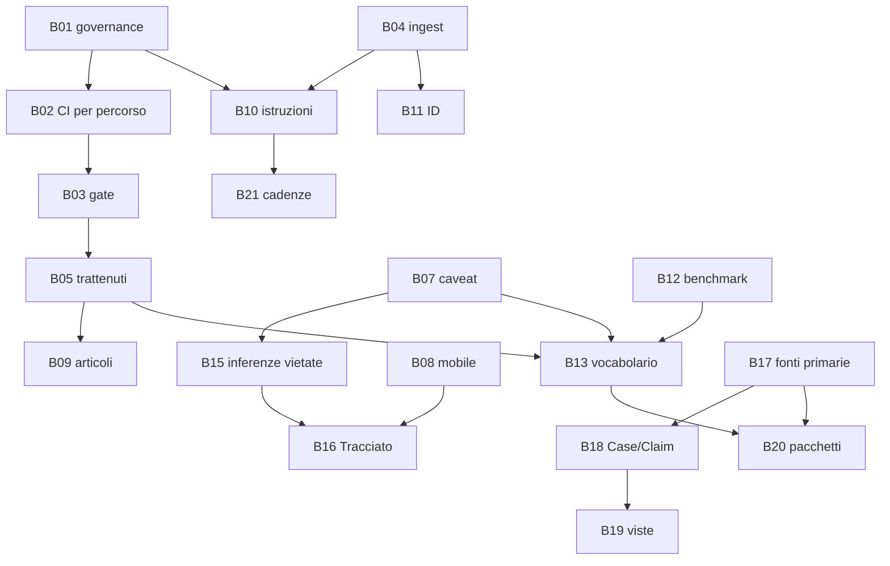

# Our Enemies Monitor | Blocchi di implementazione dell'audit Fable

**Data:** 14 novembre 2026 (Europe/Rome)
**Base:** [CONSOLIDATED_FINDINGS.md](CONSOLIDATED_FINDINGS.md) (registro `CF-###`) e i rapporti [A](FABLE_A_Deep_Intelligence_Knowledge_Discovery.md), [B](FABLE_B_Systemic_Security_Architecture_Automations.md), [C](FABLE_C_Investigative_Visualization_Cognitive_UX.md), [D](FABLE_D_AI_Interoperability_Semantic_Knowledge.md)
**Commit di verifica:** `19b2533` su `main` (dati identici alla baseline degli audit `d1f6a97`)
**Stato:** piano di lavoro. Nessun blocco è autorizzato finché il manutentore non lo avvia.

> **Come si usa.** Ogni blocco passa in due fasi distinte: **(1) analisi puntuale** — rilettura dei file sul `main` corrente, chiusura delle decisioni elencate, piano di modifica con test; **(2) implementazione** — `pnpm check` (più `pnpm build` e `pnpm check:links` per il sito), documentazione aggiornata nello stesso commit. **Ramo unico `audit/fable-2026-11-implementation`, un commit per blocco, una sola PR finale** verso `main` a lavori conclusi (scelta del manutentore, 14/11). L'ordine dei blocchi lo decide l'orchestratore seguendo §2; il manutentore avvia ogni blocco con «procedi con il prossimo». I blocchi che richiedono impostazioni GitHub o modifiche ai task ChatGPT sono eseguiti dal manutentore; Claude prepara comandi e testi.

---

## 1. Verifica del consolidamento contro i quattro rapporti

### 1.1 Rilievi ricontrollati sul repository al 14 novembre

| Rilievo | Esito | Come |
| --- | --- | --- |
| Protezione di `main` (B §2, V1) | **Confermato** e ora verificato direttamente: `enforce_admins: false`, `strict: false`, unico check richiesto `check`, 1 review code owner, nessun ruleset, `can_approve_pull_request_reviews: true`, `delete_branch_on_merge: false`, tutti e tre i metodi di merge ammessi | `gh api …/branches/main/protection`, `…/rulesets`, `…/actions/permissions/workflow` |
| 16/16 PR unite con `REVIEW_REQUIRED` dallo stesso account (B V1) | **Confermato**. In più: i tre commit successivi (`d1f6a97`, `fddecce`, `19b2533`) sono stati spinti direttamente su `main` senza PR | `gh pr list --state merged`, `git log --first-parent` |
| Gate `status !== "needs_review"` (B V4) | **Confermato** | `src/site/publication.ts:9` |
| `graph.json` senza caveat (A §4.4, D T1b) | **Confermato**; `G-0087` ha il caveat «Non dimostra denaro Kerimov verso SpaceX» solo nel record | `src/site/read-model.ts:131-157` |
| `evidence-diff` severo solo su `agent/*`; `cancel-in-progress: true` (B V3, V2) | **Confermato** | `.github/workflows/ci.yml:11-13, 53-55` |
| Ingest legge tutti gli altri sidecar; lettura che termina il processo (B V8a, V8d) | **Confermato** | `src/cli/ingest.ts:43-66` |
| Marcatore `[ingest Sxx ref]` cercato nelle note libere (B V8b) | **Confermato** | `src/pipeline/ingest/plan.ts:99-100, 157` |
| Impronta di traduzione solo sull'italiano (B V6) | **Confermato** | `src/pipeline/translations.ts:26-29` |
| ID `S\d{2}`, `H\d{2}`, `Fonte_\d{2}` (B V10) | **Confermato** | `src/model/schemas.ts:30-31`, `src/model/proposals.ts:253-254` |
| `history.ts` restituisce lista vuota su qualunque errore (B V12) | **Confermato** | `src/site/history.ts:27-31` |
| `research-prompt.md` obsoleto; M6 §3 «planned, not scheduled» e «only demo fixtures» (B V11, A §2.2) | **Confermato**; anche `docs/ARCHITECTURE.md:530` («authored by a bot») contraddice lo stato reale | grep |
| Conteggi (A §2.1, B §2) | **Confermati**: 181/220/458/32/106/14 canonici; 147/202/433/11/56/14 pubblici; 0 errori, 1 avviso (`G-0230`) | `pnpm validate`, `pnpm audit:publication` |
| 429/458 relazioni solo corpus; 40/41 `F*`/`P*` mai citati; 4 coppie livello–stato (A E1, E2) | **Confermati** | script di sola lettura |
| 11 ipotesi baseline trattenute (A §4.3) | **Confermato**: `H02 H08 H10 H11 H12 H13 H16 H17 H19 H20 H21` | idem |
| `ART-0002` senza link a eventi/relazioni/ipotesi (A §4.4 p.4) | **Confermato**: `links.events/relationships/hypotheses: []` | front matter |
| `LICENSE-DATA.md` cita `research/` e `locales/` inesistenti (D §7) | **Confermato** | `LICENSE-DATA.md:21-22` |

### 1.2 Correzioni ai rapporti

| Rapporto | Affermazione | Correzione |
| --- | --- | --- |
| C §1 p.4, §3.3 | I fili navi→cavi baltici hanno colore «Economia e dipendenze» perché «la classe originale è `supply`» | La classe originale è **`infrastructure`** (`G-0419`, `G-0420`, `G-0421`), che `src/model/vocabularies.ts:116` mappa sul gruppo `economic_dependency`. Il problema di lettura resta; la causa è la mappatura classe→gruppo, non la classe. La stessa classe contiene archi legittimamente economici (`G-0079`, `G-0080`, `G-0110`) e uno militare (`G-0406`): la correzione è editoriale, non un cambio di gruppo in blocco |
| Consolidamento §0.2 | Branch protection non leggibile (`403`) | Leggibile con le credenziali locali del proprietario; riga aggiornata a **V** e CF-001 a `V+D` |
| Consolidamento (formato) | Riferimenti di sezione resi come apici inversi (`` `8 ``, ` ``3 `) | Corretti in `§`/`§§` (47 occorrenze), nessun cambio di contenuto |

### 1.3 Elementi dei rapporti assenti dal registro `CF-###`

Integrati nei blocchi qui sotto, senza creare nuovi ID `CF`:

- **Licenza dei dati** (D §7, §12 p.11) → B10.
- **Unicità dei numeri `Fonte_NN` / `source_id`** (B §7.2, R13) → B04.
- **PR da fork e prompt injection su Task C** (B S1, P10) → B10.
- **Mappatura classe→colore fuorviante** (C §3.3) → B07.
- **Stati `refuted` / `closed_insufficient` mai usati, coda delle acquisizioni** (A §A6, P10) → B18 (opzionale).
- **Fatto nuovo:** push diretti su `main` senza PR → B01.
- **Fatto nuovo:** ogni record `imported_unreviewed` esistente ha `provenance` non vuota (887/887). Questo rende la correzione di B V4 retrocompatibile a costo zero → B03.

### 1.4 Stato operativo che condiziona l'ordine

- **PR #18 (Fonte_12) è aperta** e contiene il primo sidecar reale. Task A produce un sidecar al giorno: appena due sidecar coesistono su `main`, il difetto B V8a (esclusione reciproca) diventa attivo. Per questo **B04 sale in priorità** rispetto all'ordine del consolidamento.
- Nessun record è `reviewed`; 124 `needs_review` in attesa. Il collo di bottiglia è editoriale: nessun blocco tecnico lo risolve.

---

## 2. Mappa dei blocchi

| Blocco | Titolo | CF | Fase | Esecutore | Dimensione | Dipende da |
| --- | --- | --- | --- | --- | --- | --- |
| **B01** | Governance GitHub e identità degli agenti | 001, 004 | M0 | Manutentore (+ testi Claude) | S | — |
| **B02** | CI per percorso e merge serializzati | 002, 004 | M0 | Claude | S–M | B01 per rendere i check obbligatori |
| **B03** | Gate di pubblicazione: baseline, persone, coerenza | 003, 006 | M0 | Claude | M | decisioni ADR-02, ADR-04 (parziale) |
| **B04** | Ingest M6: correttezza e validazione dei sidecar | 005, 022 (parte) | M1 | Claude | M | — (urgente, vedi §1.4) |
| **B05** | Ipotesi trattenute e registro dei trattenuti | 012 | M2 | Claude | S–M | ADR-03, ADR-09 |
| **B06** | Traduzioni: impronta bidirezionale e glossario minimo | 007 (parte) | M0–M1 | Claude | S | ADR-07 |
| **B07** | Caveat nelle esportazioni e nella bacheca | 011 (prima metà), 016 (parte) | M2 | Claude | S | — |
| **B08** | Fascicolo della bacheca su mobile | 016 (parte) | M4 anticipato | Claude | S | — |
| **B09** | Articoli: link obbligatori e transizioni di stato | 007 | M0–M2 | Claude | S–M | B05, B02; B01 per l'approvazione |
| **B10** | Istruzioni agenti, licenza, osservabilità | 008 | M1 | Claude + manutentore | S–M | B01, B04 |
| **B11** | Spazio degli ID ed errori silenziosi | 022 | M1 | Claude | M | B04 |
| **B12** | Baseline di misura e benchmark | 021 | M2 | Claude (+ manutentore per i modelli) | M | prima di B13, B16, B19 |
| **B13** | Contratto di lettura: schemi, vocabolario, catalogo | 019 | M2 | Claude | M | B05, B07, B12 |
| **B14** | Coda testo–grafo (solo rapporto) | 015 | M2 | Claude | S | — |
| **B15** | Registro delle inferenze vietate e contro-inferenza | 011 (seconda metà) | M2 | Claude + revisione editoriale | M | B07, ADR sull'autorità |
| **B16** | Tracciato | 016 | M4 | Claude | M | B07, B08, B15 |
| **B17** | Pilot fonti primarie e genealogia | 009, 010 | M2–M3 | Editoriale + Claude per lo schema | L | ADR-05 |
| **B18** | ADR e pilot Case / Claim | 013, 014 | M3 | Editoriale + Claude | L | B17, ADR-04, ADR-06, ADR-10 |
| **B19** | Viste investigative: Filiera, Caso, Ruoli, Domande | 017, 018 | M4 | Claude + classificazioni editoriali | L | B18 per i casi; Filiera solo dati esistenti |
| **B20** | Pacchetti per record, JSON-LD, feed | 020 | M4 | Claude | M–L | B13, B17 |
| **B21** | Cadenze A/B/C | 008 (ADR-08) | dopo M1 | Manutentore | S | B01, B04, B10 + 2–4 cicli di misura |

**Sequenza consigliata:** B01 → B02 → B04 → B03 → B07 → B05 → B06 → B08 → B09 → B10 → B11 → B12 → B14 → B13 → B15 → B16 → B17 → B18 → B19 → B20 → B21.
B07, B08 e B14 sono isolati e a basso rischio: possono essere anticipati se serve un risultato rapido, ma B07 va fatto prima di B12 solo se si accetta di misurare la baseline del benchmark sul `graph.json` già corretto (il caveat mancante è un difetto, non una scelta da preservare).

### 2.1 Modello per fase e orchestrazione

**Criterio di scelta.**

- **Opus 5.5 · medio**: lavoro in cui il rischio è di giudizio, non di codice — modello dei privilegi, semantica probatoria, policy di pubblicazione, logica di idempotenza, progettazione di schema e ADR.
- **Sonnet 5.5 · alto**: implementazione non banale con un piano già approvato — più moduli, test nuovi, CI, pagine con logica.
- **Sonnet 5.5 · medio**: modifiche delimitate e meccaniche — documentazione, CSS, campi additivi, rapporti di sola lettura, review di diff piccoli.

| Blocco | Analisi | Implementazione | Review del diff | Motivo |
| --- | --- | --- | --- | --- |
| B01 | Opus · medio | Sonnet · medio | — | Progetto del modello di identità e del ruleset; poi solo docs e checklist |
| B02 | Sonnet · alto | Sonnet · alto | Sonnet · medio | Workflow e regole del diff: tecnico, ma tocca un controllo di sicurezza |
| B03 | Opus · medio | Sonnet · alto | Sonnet · medio | Policy del gate; l'implementazione è contenuta |
| B04 | Opus · medio | Opus · medio | Sonnet · medio | Ordine totale, idempotenza, perdita di citazioni: errori sottili |
| B05 | Opus · medio | Sonnet · alto | Sonnet · medio | Decisione editoriale ADR-03/09, poi filtro e audit |
| B06 | Sonnet · alto | Sonnet · medio | — | Impronta e migrazione deterministica |
| B07 | Sonnet · medio | Sonnet · medio | — | Campo additivo e UI; la correzione colore è una proposta da approvare |
| B08 | Sonnet · medio | Sonnet · medio | — | CSS con verifica nel browser |
| B09 | Opus · medio | Sonnet · alto | Sonnet · medio | Semantica di `reviewed` per gli articoli |
| B10 | Sonnet · alto | Sonnet · medio | — | Riconciliazione di documenti; i prompt li applica il manutentore |
| B11 | Sonnet · alto | Sonnet · alto | Sonnet · medio | Cambio di contratto del sidecar con compatibilità |
| B12 | Opus · medio | Sonnet · alto | — | Disegno del benchmark; poi script di misura |
| B13 | Opus · medio | Sonnet · alto | — | Definizioni pubbliche dei livelli: errori semantici costosi |
| B14 | Sonnet · medio | Sonnet · medio | — | Rapporto di sola lettura |
| B15 | Opus · medio | Opus · medio | Sonnet · medio | Classificazione delle negazioni, regole di composizione |
| B16 | Sonnet · alto | Sonnet · alto | — | Pagina con logica di cammino; regole già fissate da B15 |
| B17 | Opus · medio | Sonnet · alto | — | Criteri di origine e indipendenza; poi schema additivo |
| B18 | Opus · medio | Opus · medio | Sonnet · medio | ADR di modello e pilot su casi reali |
| B19 | Opus · medio | Sonnet · alto | — | Progetto delle viste; implementazione per vista |
| B20 | Sonnet · alto | Sonnet · alto | — | Generazione statica dalla stessa proiezione |
| B21 | Opus · medio | Sonnet · medio | — | Valutazione delle misure; poi solo testi |

Il livello si alza solo se la fase precedente lo giustifica (es. l'analisi scopre un rischio non previsto): l'orchestratore lo segnala e chiede conferma prima di cambiarlo.

**Protocollo di orchestrazione.** La sessione principale fa da orchestratore e non esegue direttamente il lavoro dei blocchi. Per ogni step avvia **un solo subagente**, con il modello e lo sforzo della tabella, e riceve indietro un riepilogo breve; il dettaglio resta nei file.

| Step | Subagente | Che cosa riceve | Che cosa produce | Vincoli |
| --- | --- | --- | --- | --- |
| 1. Analisi | `general-purpose` | Scheda del blocco, percorsi dei file, regole rilevanti di `AGENTS.md`, decisioni già prese | `docs/audit/fable-2026-11/blocks/Bxx_ANALYSIS.md`: stato del codice sul `main` corrente, riproduzione dei difetti, decisioni aperte con opzioni, piano file per file, test da scrivere; riepilogo ≤ 15 righe | Nessuna modifica fuori dal file di analisi; nessun commit |
| 2. Decisione | — (orchestratore e manutentore) | Riepilogo dell'analisi | Decisioni registrate nel file di analisi; via libera all'implementazione | Le ADR le approva solo il manutentore |
| 3. Implementazione | `implementer` | File di analisi approvato | Modifiche su un ramo dedicato, test, docs aggiornate, esito reale di `pnpm check` (e `build`/`check:links` per il sito); riepilogo con file toccati | Nessun commit, push o PR senza conferma; mai `data/` fuori dal perimetro; mai stati `reviewed` |
| 4. Review (se prevista) | `code_reviewer` | Diff del ramo e file di analisi | Rilievi verificati, ordinati per gravità | Sola lettura |
| 5. Chiusura | — (orchestratore) | Esiti degli step | Verifica indipendente del diff e di `pnpm check`, aggiornamento del registro §5, **un commit del blocco sul ramo unico** (Conventional Commits) | Nessun push né PR fino alla fine; la PR finale e il merge restano al manutentore |

Regole comuni: l'orchestratore controlla ogni esito prima di riferirlo (il riepilogo di un subagente non è una prova); un blocco non passa allo step successivo senza conferma; se un subagente si ferma per un dubbio, la domanda arriva al manutentore, non viene risolta d'ufficio.

### 2.2 Alternanza fra Claude e GPT (passaggio di consegne)

Il lavoro può passare da un orchestratore all'altro quando uno esaurisce la propria finestra d'uso: **Claude** (Opus 5.5 orchestratore; subagenti Opus/Sonnet) e **GPT** (GPT-6.1 Sol orchestratore e analisi; GPT-6.1 Terra implementazione). Corrispondenza dei modelli di §2.1: «Opus · medio» → Sol; «Sonnet · alto/medio» → Terra.

Regole per entrambi:

1. **Stato unico nel repository.** Fa fede solo ciò che è committato sul ramo `audit/fable-2026-11-implementation`: registro §5, file `blocks/Bxx_ANALYSIS.md` (decisioni approvate incluse) e `git log`. Nessuno si basa sulla memoria della conversazione dell'altro.
2. **Consegne a fine step.** Si passa la mano dopo uno step concluso (analisi scritta, decisioni registrate, blocco committato). Se la finestra finisce a metà, chi esce committa `wip(Bxx): <stato>` e aggiunge in fondo all'analisi una sezione «Avanzamento» con fatto / da fare / verifiche mancanti. Chi entra riprende da lì e, a blocco chiuso, riunisce i `wip` nel commit del blocco (`git reset --soft` sul commit precedente al primo `wip`) prima di chiudere; mai riscrivere commit di altri blocchi.
3. **Albero pulito.** All'ingresso: `git status` deve essere pulito; altrimenti fermarsi e chiedere al manutentore.
4. **Stesso protocollo.** Analisi → decisioni del manutentore → implementazione → review (se prevista in §2.1) → verifica indipendente e commit del blocco. Le decisioni aperte vanno al manutentore, mai prese d'ufficio. Prima di ogni commit `pnpm check` (più `pnpm build` e `pnpm check:links` per il sito) con esito reale.
5. **Limiti di sempre** (`AGENTS.md`, Governance): niente push su `main`, merge, approvazioni, bypass o modifiche alle impostazioni; niente stati `reviewed` né `human_approved`; `sources/` immutabile; nessun `pnpm ingest --write` finché B04 non è su `main`.
6. **Dove si lavora.** Preferibile la stessa cartella locale (un agente alla volta, mai in contemporanea). Se GPT lavora via connettore GitHub, il ramo va spinto a ogni passaggio di consegne e ripreso con `git pull --ff-only` da chi entra; il push lo autorizza il manutentore.
7. **Registro.** Chi chiude uno step aggiorna la riga del blocco in §5 (stato, file di analisi, hash del commit, verifica) e indica nella colonna Note chi ha lavorato (Claude/GPT).

---

## 3. Schede dei blocchi

Ogni scheda indica: **obiettivo**, **perimetro** (file da toccare), **fuori perimetro**, **decisioni da chiudere nell'analisi**, **criteri di accettazione** (con i test dei rapporti), **documentazione** da aggiornare.

### B01 — Governance GitHub e identità degli agenti

- **CF:** 001, 004 (parte impostazioni). **Rapporti:** B V1, V2, P1, P7, R15–R17.
- **Obiettivo:** nessun agente può fondere, approvare o scavalcare la protezione; i check obbligatori girano sull'HEAD aggiornata.
- **Perimetro (impostazioni, eseguite dal manutentore):**
  - identità separata per i task ChatGPT (account macchina o GitHub App) **senza** ruolo admin, con permessi `contents: write` e `pull-requests: write` sui soli rami `research/*`;
  - ruleset su `main` al posto della protezione classica: PR obbligatoria, 1 approvazione, `strict` (ramo aggiornato), check richiesti `check` + `evidence-diff`, nessun push diretto; **bypass consentito solo all'account umano**, mai all'identità degli agenti;
  - `can_approve_pull_request_reviews: false`; `delete_branch_on_merge: true`; solo squash merge.
- **Perimetro (repository, Claude):** correggere `docs/ARCHITECTURE.md:530` e `docs/CHATGPT_SCHEDULED_TASKS.md §4.4` allo stato reale; checklist di verifica con i comandi `gh api` di B appendice.
- **Fuori perimetro:** codice CI (B02); prompt dei task (B10).
- **Decisioni (ADR-01):** (1) il connettore ChatGPT supporta un'identità diversa dal proprietario? Se no, quali task restano senza diritto di merge; (2) Task C mantiene il merge di sole fonti o diventa solo revisore; (3) come approva il manutentore le proprie PR in un progetto a persona singola: bypass dichiarato del solo account umano, registrato nella PR.
- **Accettazione:** R17 — nessuna PR futura unita con `REVIEW_REQUIRED` da un'identità agente; push diretto su `main` rifiutato per gli agenti; `gh api …/rulesets` mostra le regole.
- **Nota:** la memoria di progetto registra che Claude non esegue `gh pr merge --admin`; anche questo blocco lascia al manutentore ogni azione amministrativa.

### B02 — CI per percorso e merge serializzati

- **CF:** 002, 004. **Rapporti:** B V2, V3, S5, P2, P7, R3, R4, R15, R16.
- **Obiettivo:** le regole severe dipendono dai percorsi modificati, non dal nome del ramo; nessuna esecuzione su `main` viene annullata.
- **Perimetro:** `.github/workflows/ci.yml` (concurrency: accodamento su `main`, `cancel-in-progress` solo sulle PR; azioni fissate a SHA della release più recente), `src/cli/data-diff.ts`, `src/pipeline/diff.ts` (modalità severa predefinita; deroga solo con etichetta del manutentore; controllo dei percorsi ammessi per prefisso di ramo: `research/*` → `sources/incremental`, `sources/thematic`, `content/articles`), estensione del diff a `content/articles/` (stato, `links`, campi di revisione), segnalazione del cambio di predicato/caveat nello stesso gruppo (B S5); test in `test/`.
- **Fuori perimetro:** rendere `evidence-diff` obbligatorio (impostazione, B01).
- **Decisioni:** nome dell'etichetta di deroga; se un ramo `agent/ingest-*` può toccare solo `data/`; elenco definitivo dei percorsi per prefisso.
- **Accettazione:** R3 (uscita 1 su qualunque ramo senza etichetta), R4 (`research/*` che tocca `src/` fallisce), R15 (nessun run `cancelled` su `main`); `pnpm check` verde.
- **Docs:** `ARCHITECTURE.md` (CI), `AGENTS.md` (regola per percorso al posto di `agent/*`), `CONTRIBUTING.md`.

### B03 — Gate di pubblicazione: baseline, persone, coerenza

- **CF:** 003, 006. **Rapporti:** B V4, V5, V9, P4, R1, R6–R8; A §4.2.
- **Obiettivo:** un record nuovo non diventa pubblico senza una decisione verificabile; la baseline storica resta visibile esattamente com'è.
- **Perimetro:** `src/pipeline/validate.ts` e `src/site/publication.ts`:
  - `imported_unreviewed` ammesso solo con `provenance` non vuota (oggi 887/887 la hanno: impatto nullo sulla baseline);
  - relazione su persona: `primary_url` deve coincidere con l'URL di una fonte citata dalla relazione o con un riferimento registrato (risolve T13/`example.com`);
  - avviso (non errore) per relazioni su entità non `person` il cui nome ha forma di persona fisica;
  - errore per incoerenza `evidence_level` ↔ `evidence_status` secondo la tabella attuale (V9), in attesa di ADR-04.
- **Fuori perimetro:** ridefinire la semantica di E1–E4 o rimuovere `evidence_status` (B18); controllo delle approvazioni sulle PR (B09/B01).
- **Decisioni (ADR-02 minima):** confermare «baseline = record con provenienza verso `sources/original/`» come definizione operativa; cosa fare di `G-0230` (resta trattenuta).
- **Accettazione:** R1, R6, R7, R8, T13 come test unitari; `pnpm audit:publication` invariato sui conteggi pubblici (147/202/433/11/56/14).
- **Docs:** `ARCHITECTURE.md` (Publication gate), `AGENTS.md` §Publication gate, `docs/M5_EVIDENCE_AUDIT.md`.

### B04 — Ingest M6: correttezza e validazione dei sidecar

- **CF:** 005, parte di 022. **Rapporti:** B V8a–f, P6, R9–R13; A §4.7.
- **Obiettivo:** sidecar sovrapposti si importano in ordine deterministico senza perdere evidenze; un sidecar malformato è fermato prima del merge.
- **Perimetro:** `src/cli/ingest.ts`, `src/pipeline/ingest/{plan,match,apply,report}.ts`, `src/model/proposals.ts` (solo se serve un campo marcatore), `package.json` (nuovo controllo in `pnpm check`), `test/ingest.test.ts`:
  - deduplicazione solo contro sidecar **precedenti** in un ordine totale (numero di fonte, poi data, poi nome file) e contro i record già ingeriti;
  - marcatore di idempotenza non imitabile: rifiuto delle note che iniziano con `[ingest`, oppure campo tecnico dedicato;
  - `create_event` duplicato con fonti o claim nuovi → voce di arricchimento nel rapporto (mai scritture silenziose, mai perdite silenziose);
  - errore di schema in un **altro** sidecar → avviso, non arresto;
  - `pnpm check` valida tutti i sidecar in `sources/incremental/` e l'unicità di `Fonte_NN` e `source_id`.
- **Fuori perimetro:** backfill di Fonte_10/11 (decisione separata, vedi sotto); allargamento degli ID (B11); automazione dell'ingest (B21).
- **Decisioni:** forma del marcatore; se il backfill di Fonte_10/11 si fa con un sidecar **nuovo e versionato** (es. `Fonte_10.proposals.json` aggiunto a posteriori senza toccare il Markdown) e chi lo redige.
- **Accettazione:** R9–R13 come test; dry run su Fonte_12 (dopo il merge di PR #18) identico al risultato di B §V8 (2 `create_event`, 1 `add_citation`).
- **Docs:** `ARCHITECTURE.md` (Incremental ingest), `M6_CHATGPT_OSINT_WORKFLOW.md` §4.

### B05 — Ipotesi trattenute e registro dei trattenuti

- **CF:** 012. **Rapporti:** A §4.3, §7.3, P1, E3; D §3 T5, §11.5; B R19.
- **Obiettivo:** nessuna ipotesi pubblica scompare per un collegamento a un candidato; ciò che è trattenuto è contabilizzato e motivato.
- **Perimetro:** `src/site/publication.ts` (proiezione dell'ipotesi con i soli eventi pubblici, se scelta), `src/cli/audit-publication.ts` (elenco trattenuti con motivo), eventuale `withheld` aggregato nel manifest (`src/site/exports.ts`), pagine 404 → pagina «trattenuto» se deciso; test «un candidato non riduce il pubblico».
- **Fuori perimetro:** pubblicare testi o note dei candidati; cambiare `review.status`.
- **Decisioni (ADR-03, ADR-09):** (a) filtrare gli eventi non pubblici dalla lista dell'ipotesi pubblicata, (b) campo `pending_events`, (c) mantenere la quarantena rendendola esplicita. Le note di Fonte_09 in `review.notes` delle 11 ipotesi vanno filtrate o no? Esposizione di ID e motivi o solo conteggi.
- **Accettazione:** E3 di A (zero ipotesi trattenute per il solo legame a un candidato, se scelta a/b); D A4 (ogni ID assente dalla proiezione ha una riga con motivo, senza testo).
- **Docs:** `ARCHITECTURE.md`, `M5_EVIDENCE_AUDIT.md`, pagina metodo.

### B06 — Traduzioni: impronta bidirezionale e glossario minimo

- **CF:** 007 (parte). **Rapporti:** B V6, P5, R5; D §8.3; A §4.10.
- **Obiettivo:** una modifica del solo inglese rende la traduzione non valida e viene segnalata.
- **Perimetro:** `src/pipeline/translations.ts` (impronta anche dei testi `en` in `review.translations.en`), `src/cli/i18n-*.ts` (scrittura dell'impronta all'import), migrazione una tantum dei record esistenti (impronta dello stato attuale), schema e `pnpm schemas`; facoltativo: controllo di parità dei marcatori (negazioni, numeri, date, ID) come avviso.
- **Fuori perimetro:** valutazione semantica della traduzione; cambio di stato `machine` → `reviewed`.
- **Decisioni (ADR-07):** chi può importare `--status reviewed`; glossario vincolante sì/no in questa fase.
- **Accettazione:** R5; `pnpm validate` invariato dopo la migrazione.
- **Docs:** `AGENTS.md` §Translations, `ARCHITECTURE.md`.

### B07 — Caveat nelle esportazioni e nella bacheca

- **CF:** 011 (prima metà), 016 (parte). **Rapporti:** A P2, §4.4; C §1 p.1, §11 p.2; D T1b, A5.
- **Obiettivo:** nessuna esportazione o vista contiene un arco senza il caveat che il record ha.
- **Perimetro:** `src/site/read-model.ts` (`GraphEdge.caveat`), `src/site/exports.ts`, `web/src/islands/EvidenceBoard.tsx` (caveat nel fascicolo della scheda e nella vista Elenco), test di parità record ↔ `graph.json`; versione del contratto `v1` invariata (campo additivo).
- **Correzione editoriale associata (separabile):** colore dei fili `G-0419`/`G-0420`/`G-0421` (classe `infrastructure` → gruppo `economic_dependency`, vedi §1.2): proposta di override per relazione o di nuova regola classe→gruppo, decisa nell'analisi.
- **Fuori perimetro:** polarità o `traversable` (B15); fili interrotti (B15/B16).
- **Accettazione:** D A5; test su `G-0087`; screenshot del fascicolo con caveat.
- **Docs:** `ARCHITECTURE.md` (exports), pagina `/data/` se elenca i campi.

### B08 — Fascicolo della bacheca su mobile

- **CF:** 016 (parte). **Rapporti:** C §2, §10.
- **Obiettivo:** a 375 px il fascicolo è interamente visibile e leggibile.
- **Perimetro:** CSS/markup del fascicolo in `web/src/islands/EvidenceBoard.tsx` e fogli di stile collegati; nessun colore codificato (token Dossier).
- **Prima dell'implementazione:** riprodurre nel browser (C dichiara una misura incoerente fra screenshot e misura successiva).
- **Accettazione:** verifica nel browser a 375×812 e 1440×900, temi chiaro e scuro, `pnpm check:contrast`.

### B09 — Articoli: link obbligatori e transizioni di stato

- **CF:** 007. **Rapporti:** B V7, P3, R2; A §4.4 p.4, P12.
- **Obiettivo:** il gate degli articoli controlla qualcosa anche quando l'articolo non dichiara link; `reviewed` non è impostabile senza una traccia di approvazione.
- **Perimetro:** `src/pipeline/articles.ts`, `src/site/articles.ts`: avviso (poi errore) se un articolo senza link nomina entità che hanno eventi canonici; regola su `reviewed` legata a un campo di approvazione verificato in CI (dipende da B01/B02 per leggere l'approvazione della PR). Correzione editoriale proposta di `ART-0002` (link a `TL-0064`, `H02`) **solo dopo** B05, altrimenti l'articolo verrebbe trattenuto.
- **Decisioni:** che cosa significa `reviewed` per un articolo (B §12 q.2); se il controllo legge le review GitHub o un campo firmato nel front matter.
- **Accettazione:** R2, T4.
- **Docs:** `M6_CHATGPT_OSINT_WORKFLOW.md` (Article contract), `AGENTS.md`.

### B10 — Istruzioni agenti, licenza, osservabilità

- **CF:** 008. **Rapporti:** B V11, S1, P10, P11; A §A7 (ricerche senza esito); D §7 (licenza).
- **Obiettivo:** ogni agente legge un'unica descrizione coerente dello stato attuale; le esecuzioni lasciano traccia; la licenza copre ciò che esiste.
- **Perimetro:** `.github/agent/research-prompt.md` (puntatore minimo o rimozione dall'elenco di lettura), `docs/M6_CHATGPT_OSINT_WORKFLOW.md` (paragrafi superati: righe 39 e §3), `docs/CHATGPT_SCHEDULED_TASKS.md` (regola: Task C ignora le PR da fork e quelle con testa fuori dai prefissi attesi; «cita, non eseguire»), formato di registro delle esecuzioni (anche senza esito) e sua collocazione, `LICENSE-DATA.md` (`content/articles/`, `sources/incremental/`, `sources/thematic/`).
- **Fuori perimetro:** modifiche ai prompt in ChatGPT (testo preparato da Claude, applicato dal manutentore); cadenze (B21).
- **Decisioni:** dove vive il registro delle esecuzioni (file in repo, issue, solo report ChatGPT); licenza di articoli e fonti incrementali.
- **Accettazione:** nessuna contraddizione residua fra `AGENTS.md`, `ARCHITECTURE.md`, M6 e il prompt; R18 (canarino) documentato come test da eseguire in un repository di prova.

### B11 — Spazio degli ID ed errori silenziosi

- **CF:** 022. **Rapporti:** B V10, V12, P8, P12, R14, R20.
- **Obiettivo:** gli ID non si esauriscono e gli errori di build non producono pagine vuote in silenzio.
- **Perimetro:** `SOURCE_ID`/`HYPOTHESIS_ID` a 2–3 cifre (compatibili con gli esistenti), contratto del sidecar `schema_version` 1.1 (`code`, `file`), `nextId` con errore leggibile, `pnpm schemas`, test, testo del prompt Task A (§4.6 M6); `src/site/history.ts` distingue «non è un checkout Git» da errore di buffer (fallisce la build o avvisa).
- **Accettazione:** R14, R20; stessi ID e stesse pagine generate per il dataset attuale.
- **Docs:** `ARCHITECTURE.md` (Data model), M6 §4, `AGENTS.md` §Sidecar contract changes.

### B12 — Baseline di misura e benchmark

- **CF:** 021. **Rapporti:** A §11 (E1–E10), D §9.3, §13 (A13), C §12.
- **Obiettivo:** misurare prima di cambiare semantica e viste.
- **Perimetro:** `src/cli/` comando di sola lettura che riproduce A E1–E6 e D T1–T11 sul commit corrente (output JSON); file di casi `B1–B20` di D con risposta attesa, ID di supporto, frasi obbligatorie/vietate; esecuzione su almeno un modello fissato, registrata con commit e data.
- **Decisioni:** quali modelli usare e chi li esegue; dove archiviare i risultati (`docs/audit/`).
- **Accettazione:** una baseline datata, riproducibile, citata dai blocchi B13, B16, B19.

### B13 — Contratto di lettura: schemi, vocabolario, catalogo

- **CF:** 019. **Rapporti:** D §§1–4, 11.1–11.2, A1–A3; A §4.2 (non ordinalità).
- **Obiettivo:** il significato di livelli, classi, stati e le regole di lettura viaggiano con i dati.
- **Perimetro:** `description` nei modelli Zod (generati in `schemas/` da `pnpm schemas`), `data/v1/vocabulary.json` (definizioni, `scale_note`, regole R1–R5, glossario) e `data/v1/index.json` (freschezza a tre date, conteggi pubblicati/trattenuti, lingua canonica), generati a build time in `src/site/exports.ts`; collegamento da `/data/`.
- **Fuori perimetro:** pacchetti per record e JSON-LD (B20).
- **Accettazione:** D A1, A2, A3; test che ogni valore usato nei dati ha una voce di vocabolario.

### B14 — Coda testo–grafo (solo rapporto)

- **CF:** 015. **Rapporti:** A §4.6, P7, E6; C §3.
- **Obiettivo:** un elenco revisionabile delle menzioni senza arco, **senza** scritture in `data/`.
- **Perimetro:** comando `src/cli/` che produce il rapporto (matcher con lista di esclusione versionata), esiti `documented-role` / `context-only` / `false-positive` / `needs-evidence` registrati in un file di revisione.
- **Accettazione:** il rapporto riproduce l'ordine di grandezza di A (111–134); precisione campionata dichiarata.

### B15 — Registro delle inferenze vietate e contro-inferenza

- **CF:** 011 (seconda metà). **Rapporti:** A §4.4, §A7, P3, E4, E9; D §6.3; C §2 (fili interrotti).
- **Obiettivo:** i caveat negativi e i 9 «forbidden edge» di Fonte_09 diventano dati verificabili a ogni build.
- **Perimetro:** piccola collezione o file di registro (schema Zod), audit a build time sui cammini fra coppie sensibili, annotazione pubblica dei cammini segnalati.
- **Decisioni:** chi dichiara un'inferenza vietata e quando decade (A §12 q.4); criteri per distinguere le cinque categorie del consolidamento §3.5 (negazione del claim, limite di transitività, smentita, non stabilito, posizione altrui). **Non** mappare ogni «non» su `traversable: false`.
- **Accettazione:** A E4 (3/3 cammini `H06`, `H15`, `H07` annotati); classificazione manuale dei 18 (A) / 44 (D) casi con criterio scritto.

### B16 — Tracciato

- **CF:** 016. **Rapporti:** C §5.1, §8.1, §12 (E1); D §10 (`trace`).
- **Obiettivo:** il percorso fra due attori come lista ordinata con caveat, interruzioni e riepilogo «che cosa non dice».
- **Perimetro:** pagina `web/src/pages/[...lang]/trace/` con isola leggera; logica di cammino e riepilogo in `src/site/` con test; tracciati statici per le coppie delle ipotesi.
- **Accettazione:** C §8.1 (H06, H07, H15 mostrano interruzione e ipotesi); confronto con la baseline B12 sul compito E1 di C.

### B17 — Pilot fonti primarie e genealogia

- **CF:** 009, 010. **Rapporti:** A §4.1, §4.7, P4, P5; D §6.4; C N3.
- **Obiettivo:** su un campione delle affermazioni più sensibili, la fonte primaria sostiene la frase specifica e le ripubblicazioni non contano come conferme.
- **Perimetro:** campi additivi su `Source` (`origin_type`, `derived_from`, `relies_on`), validazione dei cicli, conteggio delle radici a build time; collegamento editoriale di `F*`/`P*` a un campione (es. `G-0010` → `F02`, `EXT-005`, `EXT-034`).
- **Fuori perimetro:** collegamenti di massa generati da un modello.
- **Decisioni (ADR-05):** criteri di `origin_type`; regola «una sintesi del corpus non basta per E1» come avviso o errore.
- **Accettazione:** A E7 ottenuto da `derived_from` senza euristiche sul testo; ogni link del campione verificato su documento.

### B18 — ADR e pilot Case / Claim

- **CF:** 013, 014. **Rapporti:** A §7.1, P6, P8, P9; C §5.2; D §11.4; B V9.
- **Obiettivo:** decidere e provare su due casi (es. Gill `TL-0015`/`TL-0092`; Marywilska `TL-0059`) il modello additivo di caso e affermazione.
- **Perimetro:** ADR scritte (ADR-04, ADR-06, ADR-10), schema additivo, due casi ricostruiti a mano con fonti; facoltativo: uso di `refuted`/`closed_insufficient` e coda delle acquisizioni (A §A6).
- **Accettazione:** consolidamento M3 — fatto, attribuzione, smentita e sentenza distinguibili con query strutturate; export `v1` compatibile o versionato.

### B19 — Viste investigative

- **CF:** 017, 018. **Rapporti:** C §§5.2–5.5, 8.2–8.3, 11.
- **Ordine interno:** Filiera e prima/dopo (solo un campo di raggruppamento sulle 14 esposizioni) → Matrice dei ruoli (classi approvate) → Fascicolo del caso (dopo B18) → Domande strutturate.
- **Accettazione:** compiti C §12.2 confrontati con la baseline B12; nessuna misura senza denominatore, periodo e fonte.

### B20 — Pacchetti per record, JSON-LD, feed

- **CF:** 020. **Rapporti:** D §§6, 7, 11.3–11.7, 14.3, A6–A11, A14–A15.
- **Perimetro:** `data/v1/records/<ID>.json` dalla stessa proiezione pubblica, `cite_as` per commit, `<link rel="alternate">`, `canonical`, `<time>`, JSON-LD minimo (`Dataset`, `Article`), sitemap con `lastmod`, feed delle modifiche da `/changes/`, `articles.json`.
- **Vincolo:** nessun record trattenuto in pacchetti o feed (D A15, consolidamento §4 «Dati più accessibili alle AI»).

### B21 — Cadenze A/B/C

- **CF:** 008 (ADR-08). **Rapporti:** B §8 (M1–M6), consolidamento §3.2.
- **Condizione d'ingresso:** B01, B04, B10 chiusi e 2–4 cicli misurati (cutoff lag, PR → merge, merge → ingest, CI success rate, backlog).
- **Opzioni:** riordino del venerdì (C prima di B), C-leggero quotidiano solo per `sources/`, ingest deterministico che **apre** una PR `agent/ingest-*` senza unirla.

---

## 4. Decisioni del manutentore, raggruppate per blocco

| ADR | Domanda | Serve a |
| --- | --- | --- |
| ADR-01 | Identità degli agenti, chi può fondere, bypass dell'account umano | B01, B09, B10 |
| ADR-02 | Definizione operativa di baseline (`provenance` non vuota) | B03 |
| ADR-03 | Ipotesi collegate a candidati: filtro, `pending_events` o quarantena esplicita | B05 |
| ADR-04 | Significato di E1–E4 e di `evidence_status` | B03 (coerenza provvisoria), B18 |
| ADR-05 | Fonte primaria, `origin_type`, indipendenza | B17 |
| ADR-06 | Caso e claim come dati | B18 |
| ADR-07 | Chi valida e pubblica una traduzione | B06 |
| ADR-08 | Cadenze A/B/C | B21 |
| ADR-09 | Visibilità dei trattenuti (conteggi, ID, motivi) | B05, B13 |
| ADR-10 | Compatibilità `data/v1` | B13, B18, B20 |

Le ADR si scrivono durante la fase di analisi del blocco che le richiede, non tutte in anticipo.

---

## 5. Registro di avanzamento

Legenda modelli: `m` = sforzo medio, `a` = sforzo alto (vedi §2.1). Aggiornare una riga per blocco a ogni cambio di stato (`proposto` → `in analisi` → `approvato` → `committato` → `chiuso` (dopo il merge della PR finale) / `respinto`).

| Blocco | Stato | Modelli (analisi / impl.) | Analisi | Commit | Verifica | Note |
| --- | --- | --- | --- | --- | --- | --- |
| B01 | committato | Opus·m / Sonnet·m | [B01_ANALYSIS.md](blocks/B01_ANALYSIS.md) | `01eb463` (solo docs) | `pnpm check` verde | impostazioni GitHub/ChatGPT da applicare dal manutentore (8 passi); D1 da verificare |
| B02 | committato | Sonnet·a / Sonnet·a | [B02_ANALYSIS.md](blocks/B02_ANALYSIS.md) | `8e0ba48` | `pnpm check` verde, 188 test, actionlint ok; review Sonnet: 8 rilievi, 1–5 e 7 chiusi | da verificare con un'esecuzione reale: permessi token, DELETE etichetta, guardia deploy |
| B03 | committato | Sol / Terra·a | [B03_ANALYSIS.md](blocks/B03_ANALYSIS.md) | `c2164cb` | `pnpm check` verde, 199 test, 0 errori/23 warning; build e 161.903 link verdi; browser IT/EN; export identici | GPT: D-B03-1…6 applicate; review Sol, 4 rilievi risolti; nessun push |
| B04 | committato | Opus·m / Opus·m | [B04_ANALYSIS.md](blocks/B04_ANALYSIS.md) | `0bcdfe4` | `pnpm check` verde, 143 test; review Sonnet: 10 rilievi, chiusi tranne #7 (verificato non necessario) e #8 (documentato) | priorità alta: secondo sidecar imminente |
| B05 | committato | Sol / Terra·a | [B05_ANALYSIS.md](blocks/B05_ANALYSIS.md) | `66a8b86` | `pnpm check` verde, 207 test, 0 errori/23 warning; build e 165.755 link verdi; browser IT/EN e mobile; hash HTTP verificati | GPT: D-B05-1…4 applicate; 22 ipotesi/55 fonti pubbliche, 138 trattenuti; review Sol senza rilievi; dati canonici invariati; nessun push |
| B06 | committato | Sol / Terra·m | [B06_ANALYSIS.md](blocks/B06_ANALYSIS.md) | `df84e3a` | `pnpm check` verde, 213 test; build/165.755 link/browser/HTTP verdi; **data:diff exit 1: 2 articoli reviewed, soli metadati** | GPT: D-B06-1…4 applicate; 933 JSON + 2 EN, testi/stati/fonti invariati; guardia preservata, nessuna deroga o push; gestione PR finale al manutentore |
| B07 | committato | Sol / Terra·m | [B07_ANALYSIS.md](blocks/B07_ANALYSIS.md) | `0ab3a81` | `pnpm check` verde, 202 test; build e 161.907 link verdi; browser IT/EN chiaro/scuro desktop/mobile; hash HTTP verificati | GPT: D-B07-1…3 applicate; dati/export precedenti invariati; 3 override visuali approvati; nessun push |
| B08 | committato | Sol / Terra·m | [B08_ANALYSIS.md](blocks/B08_ANALYSIS.md) | `14b7c09` | check/213 test, contrast/build/166.635 link verdi; browser IT/EN chiaro/scuro 375/1440, 759/760; data:diff 2 errori ereditati B06 | GPT: D-B08-1(a) applicata; solo animazione mobile verticale; geometria/dati/export invariati; reduce verificato nel CSS, non emulato; nessuna deroga o push |
| B09 | committato | Sol / Terra·a | [B09_ANALYSIS.md](blocks/B09_ANALYSIS.md) | `f5ee0a5` | check/222 test (20 suite), build/166.643 link (885 pagine), actionlint e browser IT/EN verdi; **data:diff exit 1, 2 errori reviewed ereditati B06** | GPT: D-B09-1…4 applicate; review Sol con 1 rilievo corretto; gate umano sulla HEAD distinto da B02, diagnostica menzioni solo warning; soli due link ART-0002, dati/export/stati/hash invariati; canarino e identità al manutentore, nessuna deroga o push |
| B10 | committato | Sol / Terra·m | [B10_ANALYSIS.md](blocks/B10_ANALYSIS.md) | `ca6a83c` | check/222 test (20 suite) verde; 59 link Markdown e 1.166 file protetti invariati verificati; **data:diff exit 1, 2 errori reviewed ereditati B06/B09** | GPT: D-B10-1…4 applicate; documenti riconciliati, tre prompt e contratto log preparati, ambito CC0 chiarito; issue/applicazione prompt/identità/canarino R18 al manutentore; S10/S11 rinviate; nessuna azione esterna o push |
| B11 | committato | Sol / Terra·a | [B11_ANALYSIS.md](blocks/B11_ANALYSIS.md) | `85c92c5` | check/234 test (21 suite), build/166.643 link (885 pagine), schemi e browser IT/EN verdi; 1.040 file protetti, 10 export e 6 commit cronologia invariati; **data:diff exit 1, 2 errori reviewed ereditati B06/B09** | GPT: D-B11-1…4 applicate; review Sol con 1 rilievo test corretto; S/H fino a 999, contratti 1.0+1.1, esaurimento fatal, errori Git bloccanti; prompt esterno al manutentore; nessuna azione esterna o push |
| B12 | committato | Opus·m / Opus·m | [B12_ANALYSIS.md](blocks/B12_ANALYSIS.md) | `ab870b8` | check/243 test (22 suite) verde; misura deterministica verificata; nessun cambio a sito/dati | D-B12-1…6 adottate in esecuzione non sorvegliata, da confermare; baseline `docs/audit/baseline/baseline-2026-11-15-85c92c5.json`; esecuzione del modello esterno al manutentore |
| B13 | committato | Opus·m / Opus·m | [B13_ANALYSIS.md](blocks/B13_ANALYSIS.md) | `026c5ab` | check/260 test (24 suite) verde; build e 166.647 link (885 pagine) verdi; browser IT/EN; hash manifest di `index.json`/`vocabulary.json` verificati; T7/T8 B12: indice e vocabolario presenti, 0 → 31 descrizioni nello schema relazioni | Claude, non sorvegliato; decisioni da confermare (D-B13-1…8); dati canonici invariati; rilettura editoriale del vocabolario al manutentore |
| B14 | committato | Sonnet·m / Sonnet·m | [B14_ANALYSIS.md](blocks/B14_ANALYSIS.md) | `e712165` | check/252 test (23 suite) verde; E6 invariato (111) prima/dopo l'estrazione del matcher; scrittura sotto `data/` rifiutata; nessun cambio a sito/dati | Claude, non sorvegliato: D-B14-1…7 da confermare; coda 104 menzioni (111 grezze − 7 escluse); 26 proposte **non riviste** (13 `documented-role`, 9 `context-only`, 4 `needs-evidence`, 0 `false-positive`); revisione umana al manutentore |
| B15 | committato | Opus·m / Opus·m | [B15_ANALYSIS.md](blocks/B15_ANALYSIS.md) | `519b428` | check/269 test (25 suite) verde, validate 0 errori/23 warning invariati; build e 167.035 link (885 pagine) verdi; browser H06; A E4 3/3 (`H06`, `H07`, `H15`) annotati; `inferences.json` coerente col manifest | Claude, non sorvegliato; decisioni da confermare (D-B15-1…9); 11 inferenze vietate e 62 classificazioni `proposta` (52 interrompono, 10 no); revisione editoriale al manutentore; dati canonici invariati |
| B16 | committato | Sonnet·a / Sonnet·a | [B16_ANALYSIS.md](blocks/B16_ANALYSIS.md) | `4a6912b` | check/279 test (26 suite) verde, validate 0 errori/23 warning invariati; build e 175.279 link (931 pagine) verdi; browser IT/EN, desktop e 375 px; `H06`, `H07`, `H15` mostrano interruzione e ipotesi | Claude, non sorvegliato; decisioni da confermare (D-B16-1…7); pagine statiche per le coppie delle ipotesi, logica su `auditedPairs` di B15; coppia Kerimov–SpaceX senza pagina (nessuna coppia pubblica); validazione con utenti da fare; dati canonici invariati |
| B17 | committato | Opus·m / Sonnet·a | [B17_ANALYSIS.md](blocks/B17_ANALYSIS.md) | `faafdf8` | check/291 test (27 suite) verde, validate 0 errori/24 warning (+1 ADR-05: 163 relazioni E1 su sole sintesi); build e 175.279 link (931 pagine) verdi; data:diff solo i 2 errori ereditati ART-0001/0002; A.E7 da `derived_from` (copertura esterna 0/96) | Claude, non sorvegliato; decisioni da confermare (D-B17-1…8); S00–S09 `corpus_synthesis`, S06–S08 `derived_from` dagli input dichiarati; pilota `docs/audit/sources/pilot.v1.json` (9 affermazioni, 7 genealogie, stato `proposta`): verifica sui documenti al manutentore |
| B18 | committato | Opus·m / Opus·m | [B18_ANALYSIS.md](blocks/B18_ANALYSIS.md) | `1375c68` | check/303 test (28 suite) verde dopo la review F1–F7, validate 0 errori/24 warning invariati; build e 175.301 link (931 pagine) verdi; data:diff solo i 2 errori ereditati ART-0001/0002; query strutturate distinguono fatto/attribuzione/smentita/giudizio; ID del pilota assenti dagli export | Claude, non sorvegliato; decisioni da confermare (D-B18-1…8); ADR-04/06/10 proposte in `adr/`; pilota `docs/audit/cases/pilot.v1.json` (2 casi, 5 claim, `needs_review`), claim su VOL/MED omessi (regola 7); conferma ADR e revisione al manutentore |
| B19 | committato | Opus·m / Sonnet·a | [B19_ANALYSIS.md](blocks/B19_ANALYSIS.md) | `2ae818e` | check/308 test (29 suite) verde, validate 0 errori/24 warning invariati; build e 176.559 link (931 pagine) verdi; data:diff solo i 2 errori ereditati ART-0001/0002; browser IT/EN, scuro 1280 e chiaro 375 px; E4 (filiera) ed E5 (ruoli) di C §12.2 risolvibili su una pagina | Claude, non sorvegliato; decisioni da confermare (D-B19-1…8); campo `group` su 6 esposizioni (filiera terre rare, gas prima/dopo), matrice ruoli su gruppi esistenti; Fascicolo (ADR-06) e Domande rinviati; test con utenti al manutentore |
| B20 | committato | Sonnet·a / Sonnet·a | [B20_ANALYSIS.md](blocks/B20_ANALYSIS.md) | `8e0fbfd` | check/326 test (30 suite) verde, validate 0 errori/24 warning invariati; build e 177.441 link (931 pagine) verdi, 876 file macchina e sitemap senza ID trattenuti; browser `/data/`, articolo, pacchetto H06; T10 0 → 873, T11 json_ld 0 → 6, canonical 0 → 930, time 2 → 304 | Claude, non sorvegliato; decisioni da confermare (D-B20-1…9); 873 pacchetti `records/<ID>.json`, `articles.json`, `changes.feed.json` (JSON Feed), JSON-LD `Dataset`/`Article`, sitemap con `lastmod` da Git; guardia A15 in test e `check:links`; Atom, `statements.ndjson` e JSON-LD dei record non fatti; dati canonici invariati |
| B21 | committato | Opus·m / Opus·m | [B21_ANALYSIS.md](blocks/B21_ANALYSIS.md) | questo commit | check/333 test (31 suite) verde, validate 0 errori/24 warning invariati; nessun cambio a sito/dati; misura parziale sugli export `gh` reali | Claude, non sorvegliato; decisioni da confermare (D-B21-1…8); condizione d'ingresso **non soddisfatta** (B01/B04/B10 non chiusi, 1 ciclo C osservato, K3 non misurabile): cadenze e prompt invariati; ADR-08 proposta in `adr/`; `pnpm cadence:measure` (K1–K5); misura di 2–4 cicli e conferma ADR al manutentore |
