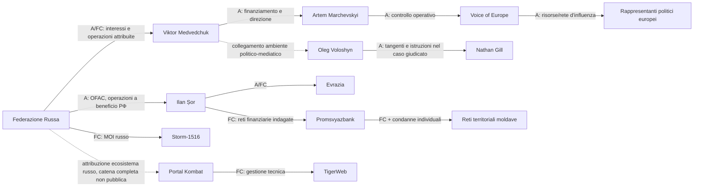
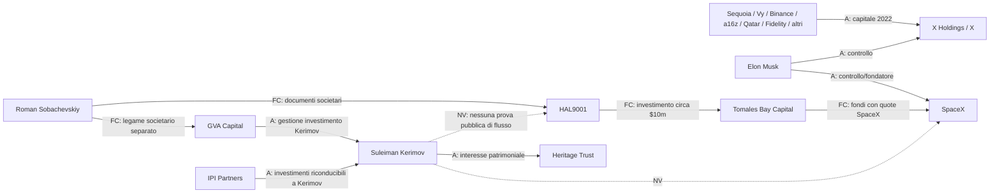
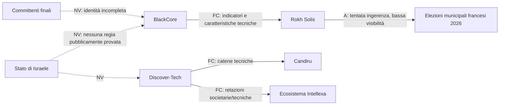

# Attori, reti, finanziamenti e infiltrazioni politiche in Europa

**Deep Search DS-01 | Periodo osservato: 2007-20 ottobre 2026 | Stato del dossier: base documentale v1.0**

## Executive summary

La ricerca conferma l'esistenza di una **ragnatela transnazionale reale**, ma mostra anche che è metodologicamente sbagliato rappresentarla come un unico cartello coordinato. Emergono almeno quattro ecosistemi differenti: reti russe direttamente o indirettamente riconducibili ad apparati statali; operazioni cinesi di intelligence e United Front; un settore privato israeliano di spyware e influence-for-hire; un ecosistema statunitense prevalentemente privato, finanziario e tecnologico, nel quale soggetti come Elon Musk esercitano influenza politica europea apertamente, ma per il quale **non emerge dalle fonti pubbliche esaminate una prova equivalente di direzione clandestina da parte dell'amministrazione federale USA**.

La **Russia** presenta il quadro probatorio più completo. Non si tratta soltanto di disinformazione. La documentazione UE, statunitense, ceca, britannica e moldava mostra una combinazione di: finanziamenti occulti; pagamento o reclutamento di politici e attivisti; media apparentemente autonomi; organizzazioni di facciata; intermediari economici; banche; infrastrutture digitali; siti clonati; influencer; operazioni informative e reti locali. Voice of Europe, la rete di Ilan Șor in Moldavia, il caso Nathan Gill, Doppelganger/Social Design Agency, Storm-1516 e Portal Kombat sono manifestazioni diverse dello stesso repertorio strategico, anche se **non è provato che dipendano tutte da un'unica catena operativa di comando**. citeturn29search14turn30search18turn32search0turn31search1turn31search7

Il caso **Voice of Europe** è particolarmente solido: l'UE afferma formalmente che la società era finanziata e diretta segretamente da Viktor Medvedchuk tramite Artem Marchevskyi e che veniva utilizzata per convogliare risorse finanziarie a propagandisti e costruire una rete di influenza con rappresentanti di partiti politici europei. L'intelligence ceca BIS aveva precedentemente individuato la rete e le autorità polacche avevano aperto un'indagine collegata per attività di spionaggio e influenza russa. citeturn29search2turn29search14turn29search25turn29search0

Il caso **Nathan Gill** porta il quadro oltre il livello delle sanzioni amministrative. L'ex eurodeputato britannico ha ammesso otto reati di corruzione ed è stato condannato nel novembre 2025 a dieci anni e sei mesi di carcere: aveva ricevuto circa £40.000 in cambio di interventi parlamentari, dichiarazioni e attività favorevoli a narrative filorusse. La polizia britannica ha identificato come interlocutore Oleg Voloshyn, ex politico ucraino filorusso, collegato all'ambiente mediatico di Medvedchuk. È uno dei casi più forti disponibili perché combina **denaro, politico europeo, istruzioni operative e risultato concreto**. citeturn32search0turn32search1turn32news4

In **Moldavia**, il modello è ancora più sistemico. OFAC attribuisce a Ilan Șor e a reti collegate attività per conto o a beneficio della Federazione Russa; le autorità moldave hanno documentato conti presso Promsvyazbank, pagamenti in rubli, reclutamento territoriale, gruppi Telegram e sistemi di remunerazione degli attivisti. Nel 2026 il Consiglio UE ha continuato a sanzionare associati di Șor e soggetti collegati a Evrazia, descritta come organizzazione russa utilizzata per reclutamento, formazione, propaganda e reti sul territorio. citeturn30search18turn30search2turn30search1turn30search6turn30search0

Sul versante **cinese**, i casi sono meno numerosi ma non meno significativi. MI5 ha formalmente dichiarato che Christine Lee aveva facilitato donazioni politiche per conto di cittadini stranieri occultando la vera origine del finanziamento e l'ha collegata all'United Front Work Department. In Germania Jian G., ex assistente di un eurodeputato, è stato condannato nel 2025 a quattro anni e nove mesi per attività di intelligence a favore della Cina, comprendenti acquisizione di informazioni dal Parlamento europeo e sorveglianza di dissidenti. citeturn27search0turn27search8turn27search6

Sul versante **israeliano**, le prove conducono soprattutto a un mercato privato di influenza e sorveglianza, non allo Stato israeliano come mandante. Nel 2026 VIGINUM ha qualificato Rokh Solis come ingerenza digitale straniera nelle municipali francesi e individuato indicatori tecnici che conducono all'ecosistema della società israeliana BlackCore, ma dichiara esplicitamente di non essere ancora in grado di determinare con precisione gli operatori e soprattutto i committenti. Questo impedisce, allo stato delle prove pubbliche, di trasformare *società israeliana* in *operazione dello Stato di Israele*. citeturn21search6turn21search19

Un secondo filone israeliano riguarda **Discover-Tech**, Candiru e l'ecosistema Intellexa. Citizen Lab ha documentato come infrastrutture adtech apparentemente ordinarie possano essere integrate in catene di sorveglianza e delivery di spyware; ha inoltre identificato relazioni societarie e tecniche fra Discover-Tech e soggetti dell'industria della sorveglianza. Il dato importante per il futuro portale è che la supply chain dell'influenza non è composta soltanto da servizi segreti e bot: comprende anche advertising technology, broker di identificatori, hosting, strumenti di profilazione e società commerciali. citeturn4search5turn4search6turn4news10

Per gli **Stati Uniti**, bisogna distinguere nettamente lo Stato dai soggetti privati. Elon Musk ha utilizzato pubblicamente X e la propria visibilità per sostenere l'AfD in Germania, intervistandone la leadership e pubblicando ripetutamente messaggi a favore del partito. Reuters, tuttavia, non ha trovato evidenza che ciò abbia avuto un ruolo decisivo nel risultato elettorale tedesco e gli analisti consultati hanno stimato un impatto limitato. Nel corpus esaminato **non emerge una prova pubblica che l'amministrazione Trump abbia diretto tali interventi europei come operazione clandestina statale**. L'interferenza politica pubblica di un miliardario vicino all'amministrazione è quindi un fatto; una regia operativa governativa statunitense è, allo stato attuale, **non verificata**. citeturn33news40turn33news46

La struttura finanziaria di **X** mostra invece quanto le piattaforme politicamente strategiche siano inserite in capitali transnazionali: la documentazione SEC del 2022 registra circa **7,139 miliardi di dollari di commitment** da co-investitori, fra cui Sequoia, VyCapital, Binance, Qatar Holding, a16z e Fidelity; il successivo elenco giudiziario degli azionisti confermò inoltre la presenza, fra gli altri, di Kingdom Holding e del principe saudita Alwaleed bin Talal. Questi investimenti sono accertati, ma **non costituiscono di per sé prova di controllo politico della piattaforma da parte degli investitori**. citeturn25search0turn25search2turn24search0

Per **SpaceX** emerge una questione diversa: l'opacità degli investitori indiretti. Documenti giudiziari ottenuti da ProPublica mostrano che investitori con indirizzi in Cina, Hong Kong e Russia hanno acquisito partecipazioni attraverso fondi intermediati da Tomales Bay Capital. HAL9001 Partners Fund I avrebbe investito circa 10 milioni di dollari in un fondo SpaceX; i documenti societari di HAL9001 furono firmati dal venture capitalist Roman Sobachevskiy, collegato anche a GVA Capital. Separatamente, OFAC ha inflitto a GVA Capital una sanzione di circa **216 milioni di dollari** per aver gestito investimenti di Suleiman Kerimov dopo la sua designazione. Tuttavia, ProPublica riporta esplicitamente che non esiste evidenza pubblica che Kerimov abbia finanziato l'investimento HAL9001 in SpaceX. Il collegamento **Kerimov → SpaceX non è quindi provato**. citeturn26search0turn26search4turn26search1

Infine, la **Brexit** è un ottimo test contro le sovrainterpretazioni. Leave.EU commise violazioni della normativa sul finanziamento e sulla rendicontazione elettorale, ma l'Electoral Commission concluse che Cambridge Analytica non aveva fornito a Leave.EU servizi o donazioni da dichiarare e che il rapporto non era andato oltre una fase iniziale di scoping. La National Crime Agency concluse inoltre di non aver trovato prove di reati nel referral relativo al finanziamento di Leave.EU, Arron Banks e Better for the Country. Ciò **non dimostra che la Russia non abbia cercato di influenzare il dibattito sulla Brexit**, ma rende non sostenibile affermare, sulla base di queste specifiche piste, che Mosca abbia finanziato o controllato il referendum o che Cambridge Analytica abbia condotto la campagna Leave.EU. citeturn33search0turn33search1turn33search2turn33search4

**Conclusione centrale della DS-01:** la ragnatela esiste, ma deve essere modellata come **grafo di relazioni probatorie**, non come teoria di una cabina di regia unica. Il nodo più densamente documentato è l'ecosistema russo; quello cinese mostra infiltrazione statale e intelligence; quello israeliano soprattutto capacità private vendute come servizio; quello statunitense soprattutto concentrazione privata di capitale, infrastrutture e capacità di influenza pubblica. Gli intermediari domestici europei sono fondamentali: senza politici, imprese, consulenti, piattaforme e facilitatori interni, molte operazioni straniere perderebbero gran parte della loro efficacia.

## Metodologia e standard probatorio

La ricerca è stata condotta dando priorità a **atti giudiziari, sanzioni, documentazione governativa e analisi tecniche istituzionali**, seguiti da Citizen Lab e da testate con procedure investigative consolidate come Reuters, ProPublica e Le Monde. I rapporti EEAS e VIGINUM vengono utilizzati soprattutto per attribuzione di infrastrutture FIMI e modus operandi. L'EEAS stesso raccomanda di studiare le connessioni fra canali visibili e infrastrutture sottostanti, anziché attribuire un account a un attore straniero sulla sola base della narrativa pubblicata. citeturn31search4turn31search11

La classificazione adottata nel dossier è:

| Stato | Criterio operativo |
|---|---|
| **Accertato** | Sentenza, ammissione di colpevolezza, documento societario ufficiale, transazione finanziaria documentata, sanzione con attribuzione formale o evidenza tecnica conclusiva sul fatto specifico |
| **Fortemente corroborato** | Più evidenze indipendenti e coerenti, oppure attribuzione tecnica di elevata confidenza da autorità specializzata |
| **Contestato** | Esistono fonti autorevoli incompatibili oppure il soggetto nega un'accusa rilevante non ancora giudicata |
| **Non verificato** | Ipotesi plausibile ma senza prova pubblica sufficiente della relazione richiesta |
| **Smentito** | Una specifica affermazione è stata direttamente esclusa da un'indagine ufficiale o da evidenza incompatibile |

Questa scala si applica alla **relazione**, non alla reputazione dell'entità. Per esempio, `Kerimov → GVA Capital` è accertato da OFAC; `Sobachevskiy → HAL9001` è fortemente corroborato dai documenti societari ottenuti da ProPublica; `Kerimov → HAL9001 → SpaceX` rimane non verificato. citeturn26search0turn26search4turn26search1

Analogamente, `BlackCore ↔ ecosistema Rokh Solis` possiede indicatori tecnici sostanziali, mentre `Governo israeliano → BlackCore → Rokh Solis` **non è dimostrato**. VIGINUM afferma precisamente che la natura e l'identità dei committenti non sono state stabilite. citeturn21search6turn21search19

Per i provvedimenti sanzionatori utilizzo il termine **accertato come attribuzione istituzionale**, che non equivale sempre a una condanna penale. Una designazione OFAC o UE è un atto amministrativo e politico-giuridico molto più forte di un articolo giornalistico, ma non va confuso con una sentenza dopo processo.

Per le società private, il modello distingue inoltre:

`proprietà → finanziamento → controllo → accesso informativo → condotta politica → coordinamento statale`

Sono sei relazioni differenti. Dimostrarne una non prova automaticamente le altre.

## Reti e casi chiave

La seguente tabella costituisce l'anagrafe sintetica iniziale delle entità più rilevanti. Il dataset allegato contiene una versione normalizzata più ampia.

| Entità | Tipo | Ruolo verificato | Valutazione |
|---|---|---|---|
| **Viktor Medvedchuk** | persona | Finanziatore/direttore occulto di Voice of Europe tramite Marchevskyi secondo UE; attività mirate a partiti e politici europei | **Accertato come attribuzione UE** citeturn29search14turn29search17 |
| **Artem Marchevskyi** | persona | Intermediario e dirigente occulto di Voice of Europe; il canale veniva usato per convogliare risorse finanziarie | **Accertato come attribuzione UE** citeturn29search1turn29search14 |
| **Voice of Europe s.r.o.** | media/società | Media e veicolo finanziario per rete di influenza europea | **Accertato** citeturn29search2turn29search25 |
| **Ilan Șor** | persona | Oligarca e politico al centro di reti di finanziamento, protesta e influenza moldave; sanzionato da USA e UE | **Accertato/Fortemente corroborato secondo il fatto** citeturn30search18turn30search19 |
| **Evrazia** | organizzazione | Piattaforma russa per reclutamento, addestramento, propaganda e reti territoriali in Moldavia secondo UE | **Accertato come designazione UE** citeturn30search0 |
| **Promsvyazbank** | banca | Conti e pagamenti in rubli usati nelle reti elettorali indagate in Moldavia | **Fortemente corroborato** citeturn30search1turn30search6turn30search8 |
| **Nathan Gill** | ex eurodeputato | Denaro in cambio di attività parlamentari e dichiarazioni filorusse | **Accertato penalmente** citeturn32search0turn32search1 |
| **Oleg Voloshyn** | persona | Interlocutore del sistema di pagamenti a Gill; imputato nel Regno Unito | **Fortemente corroborato, non giudicato nel caso** citeturn32search1 |
| **Social Design Agency** | società | Operatore della rete Doppelganger secondo DOJ | **Accertato come attribuzione DOJ** citeturn0search4 |
| **Storm-1516** | rete FIMI | MOI russo; VIGINUM ha analizzato 77 operazioni fino al marzo 2025 | **Fortemente corroborato** citeturn31search1turn31search24 |
| **Portal Kombat** | rete FIMI | Rete di almeno 193 portali pro-russi nella prima mappatura VIGINUM | **Fortemente corroborato** citeturn31search0 |
| **TigerWeb** | società | Società con sede in Crimea implicata nella creazione e amministrazione della rete Portal Kombat | **Fortemente corroborato** citeturn31search7 |
| **United Front Work Department** | apparato PCC | Struttura utilizzata dal PCC per attività di influenza; MI5 descrive campagne clandestine e corruttive | **Accertato come struttura e minaccia istituzionalmente attribuita** citeturn27search8 |
| **Christine Lee** | persona | Facilitazione di donazioni politiche per conto di cittadini stranieri occultandone la fonte secondo MI5 | **Accertato come valutazione MI5, non condanna penale** citeturn27search0turn27search11 |
| **Jian G.** | persona | Ex assistente parlamentare condannato in Germania per spionaggio a favore della Cina | **Accertato penalmente** citeturn27search6 |
| **BlackCore** | operatore privato | Entità israeliana d'influence-for-hire individuata nella pista tecnica Rokh Solis | **Fortemente corroborato per il collegamento tecnico; committenti non verificati** citeturn21search6 |
| **Discover-Tech** | società adtech | Infrastruttura advertising collegata tecnicamente a operazioni spyware | **Fortemente corroborato** citeturn4search5turn4search6 |
| **Candiru** | società spyware | Spyware mercenario utilizzato in operazioni documentate da Citizen Lab | **Fortemente corroborato** citeturn4search5 |
| **NSO Group / Pegasus** | spyware commerciale | Pegasus è stato utilizzato contro politici e società civile europei; CatalanGate documentò almeno 65 persone colpite o prese di mira, ma Citizen Lab non attribuì conclusivamente l'intera operazione a una singola autorità | **Attacchi accertati tecnicamente; mandante specifico non sempre verificato** citeturn17search6 |
| **Elon Musk** | persona | Controllore di X e attore politico privato; interventi pubblici a favore di AfD e altri soggetti europei | **Accertato per la condotta pubblica; effetto elettorale non provato** citeturn33news40turn33news46 |
| **X Holdings/X Corp.** | piattaforma | Infrastruttura comunicativa con struttura finanziaria privata e internazionale | **Proprietà/finanziamento accertati; controllo politico degli investitori non provato** citeturn25search0turn24search0 |
| **SpaceX** | società strategica | Investitori internazionali anche tramite fondi intermediari opachi | **Investimenti corroborati; influenza dei singoli LP non dimostrata** citeturn26search0turn26search3 |
| **Tomales Bay Capital** | intermediario finanziario | Fondi che hanno acquisito quote SpaceX e raccolto capitale internazionale | **Fortemente corroborato** citeturn26search0 |
| **HAL9001 Partners Fund I** | veicolo finanziario | Circa $10 milioni in un fondo SpaceX; beneficiario finale del veicolo non pubblicamente chiarito | **Investimento corroborato; UBO incompleto** citeturn26search0 |
| **Roman Sobachevskiy** | venture capitalist | Firma nei documenti di HAL9001; legame distinto con GVA Capital | **Legame societario corroborato; nessuna accusa personale nel caso Kerimov** citeturn26search0 |
| **GVA Capital** | venture capital | Gestione di investimenti per Suleiman Kerimov dopo la designazione OFAC | **Accertato** citeturn26search4 |
| **Suleiman Kerimov** | oligarca/funzionario russo | Asset occultati tramite trust, intermediari e società; Heritage Trust bloccato dagli USA | **Accertato** citeturn26search1 |
| **IPI Partners** | private equity | Ricevette e mantenne investimenti riconducibili a Kerimov; settlement OFAC nel 2025 | **Accertato come accordo OFAC** citeturn20search0 |
| **Cambridge Analytica/SCL** | consulenza politica/data | Collegamenti reali con campagne internazionali, ma specifica fornitura di servizi a Leave.EU non confermata dall'indagine elettorale britannica | **Tesi CA→Leave.EU smentita** citeturn33search0turn33search1 |
| **Hapsburg Group** | rete di ex politici | Ex politici europei utilizzati in una campagna di lobbying occulto orchestrata da Manafort per Yanukovych e Party of Regions | **Accertato negli atti giudiziari USA; direzione del Cremlino non provata** citeturn20search6turn20search8 |

Il caso **Hapsburg Group** è particolarmente utile per comprendere l'evoluzione storica. Negli atti giudiziari statunitensi, Manafort descriveva la necessità di avere autorevoli personalità europee che apparissero indipendenti e agissero senza una relazione visibile con il governo ucraino. Ex politici europei furono impiegati in questo sistema di lobbying a favore del governo Yanukovych. È un esempio precoce della trasformazione di prestigio politico, accesso istituzionale e consulenza occidentale in infrastruttura di influenza. Tuttavia, gli atti provano la relazione con Yanukovych e il Party of Regions, **non una catena diretta Cremlino → Hapsburg Group**, che non va aggiunta per inferenza. citeturn20search5turn20search6turn20search8

Anche **Team Jorge** merita di essere conservato nel dataset israeliano come caso di capacità industriale privata. L'inchiesta internazionale documentò strumenti per account falsi, hacking e manipolazione, ma il gruppo vantava autonomamente di aver partecipato a decine di elezioni. La capacità operativa è fortemente corroborata; il numero di elezioni effettivamente manipolate e vinte, basato in larga parte sulle dichiarazioni commerciali degli operatori, resta **non verificato**. citeturn17search0turn17search2

## Mappa societaria, finanziaria e relazionale

La mappa dei flussi pubblicamente documentabili mostra una caratteristica ricorrente: **tra il finanziatore ultimo e il destinatario operativo compaiono quasi sempre strati intermedi**. Possono essere media, ONG, banche, trust, fondi, società di consulenza o intermediari politici.

| Caso | Origine/nodo iniziale | Intermediario | Destinazione/effetto | Flusso noto | Stato |
|---|---|---|---|---|---|
| Voice of Europe | Medvedchuk | Marchevskyi → Voice of Europe | propagandisti e rete con rappresentanti di partiti europei | BIS descrisse denaro proveniente da Mosca e pagamenti nell'ordine di milioni di corone ceche; beneficiari completi non pubblici | **Accertato/Fortemente corroborato** citeturn29search14turn13search0 |
| Moldova | reti collegate alla Russia/Șor | Evrazia, strutture politiche, PSB, Telegram | attivisti, reti territoriali, voto e mobilitazione | autorità moldave: trasferimenti individuali da 10.000 a 155.000 rubli in alcune indagini; capi territoriali fino a 250.000 rubli mensili in uno schema documentato | **Fortemente corroborato; singoli episodi anche giudicati** citeturn30search1turn30search6turn30search8 |
| Nathan Gill | Voloshyn/rete filorussa | comunicazioni e istruzioni dirette | attività di un eurodeputato | circa **£40.000** | **Accertato penalmente** citeturn32search0turn32search1 |
| X | Musk + co-investitori | X Holdings I | acquisizione Twitter | circa **$7,139 mld** di commitment esterni nel deposito SEC del maggio 2022 | **Accertato** citeturn25search0 |
| X | Sequoia | X Holdings | acquisizione | **$800 mln** commitment | **Accertato** citeturn25search0 |
| X | VyCapital | X Holdings | acquisizione | **$700 mln** | **Accertato** citeturn25search0 |
| X | Binance | X Holdings | acquisizione | **$500 mln** | **Accertato** citeturn25search0 |
| X | a16z | X Holdings | acquisizione | **$400 mln** | **Accertato** citeturn25search0 |
| X | Qatar Holding | X Holdings | acquisizione | **$375 mln** | **Accertato** citeturn25search0 |
| X | Fidelity Management & Research | X Holdings | acquisizione | circa **$316,1 mln** | **Accertato** citeturn25search0 |
| SpaceX | investitori internazionali | fondi Tomales Bay Capital | partecipazioni SpaceX | singoli investimenti individuati fra circa **$0,8 e $40 mln** | **Fortemente corroborato da documenti giudiziari** citeturn26search0 |
| SpaceX | HAL9001 | fondo intermediato | partecipazione SpaceX | circa **$10 mln** | **Fortemente corroborato** citeturn26search0 |
| SpaceX | entità collegata a David Su | fondo intermediato | partecipazione SpaceX | circa **$15 mln** nel 2020 | **Fortemente corroborato** citeturn26search0 |
| Kerimov | strutture patrimoniali e proxy | Heritage Trust / gestori USA | portafoglio di asset USA | Heritage Trust valeva oltre **$1 mld** quando fu bloccato; Treasury indicò circa $1,3 mld durante l'indagine | **Accertato OFAC** citeturn26search1turn26search7 |
| GVA Capital | investimento riconducibile a Kerimov | GVA | gestione asset nonostante sanzioni | sanzione civile OFAC **$215.988.868** | **Accertato** citeturn26search4 |
| IPI Partners | strutture riconducibili a Kerimov | IPI Fund | investimenti data center | settlement OFAC **$11.485.352** | **Accertato** citeturn20search0 |
| BlackCore | **non noto** | BlackCore/ecosistema privato | Rokh Solis e infrastrutture di amplificazione | **nessun flusso finanziario pubblico sufficiente** | **Non verificato sul piano finanziario** citeturn21search6 |
| Discover-Tech | capitale societario privato | adtech e intermediari advertising | infrastrutture utilizzabili per delivery/profilazione spyware | importi del servizio e clienti operativi non pubblicamente ricostruiti in modo completo | **Struttura tecnica corroborata, flussi incompleti** citeturn4search5turn4search6 |

Nel caso **X**, i valori SEC indicano impegni di capitale nell'operazione di acquisizione, non necessariamente la quota azionaria definitiva odierna di ogni investitore. Il successivo elenco ordinato dal tribunale comprende quasi cento entità e conferma una base azionaria molto frammentata. È quindi scorretto trasformare un commitment finanziario del 2022 in una percentuale corrente di controllo senza ulteriore documentazione. citeturn24search0turn24search5

Nel caso **SpaceX**, l'elemento investigativamente più interessante è la separazione fra limited partner e società operativa. ProPublica ha ottenuto documenti che rivelano investitori precedentemente non pubblici nei fondi intermediari. Ma gli stessi dati mostrano perché serve prudenza: Roman Sobachevskiy compare nella costituzione di HAL9001 ed era collegato a GVA Capital; GVA Capital gestiva separatamente un investimento riconducibile a Kerimov; **non è però disponibile una prova pubblica che il capitale Kerimov abbia finanziato HAL9001 o SpaceX**. citeturn26search0turn26search4

**Legenda:** `A = Accertato`; `FC = Fortemente corroborato`; linea tratteggiata = relazione indiretta o catena di comando non completamente dimostrata. Le relazioni derivano da UE, DOJ, VIGINUM, autorità britanniche e moldave. citeturn29search14turn30search18turn31search1turn31search7turn32search1

Il grafo rende evidente una differenza essenziale: **Nathan Gill non è semplicemente un politico con opinioni coincidenti con Mosca**. Nel suo caso esistono denaro, istruzioni e dichiarazioni quasi corrispondenti agli script, più una confessione e una condanna. Questa è la soglia probatoria che il portale dovrebbe utilizzare per distinguere una relazione ideologica da una relazione operativa. citeturn32search0turn32search1

Qui `NV = Non verificato`. Il grafico è deliberatamente costruito per **mostrare anche il collegamento che non possiamo fare**. La vicinanza nel grafo societario non deve diventare automaticamente una relazione finanziaria. citeturn26search0turn26search1turn26search4turn20search0

Per il settore israeliano, il quadro è ancora differente:

VIGINUM considera Rokh Solis un'ingerenza digitale straniera, ma sottolinea sia la **bassa visibilità ottenuta dall'operazione** sia l'impossibilità, allo stato dell'indagine, di identificare con precisione i committenti. citeturn21search6turn21search2

## Cronologia e contro-analisi comparata

| Periodo | Evento | Significato investigativo |
|---|---|---|
| **2007-2011** | La finestra della DS-01 parte dal 2007, ma i primi casi selezionati con catene probatorie sufficientemente forti emergono soprattutto dal decennio successivo | Evita di riempire gli anni iniziali con collegamenti speculativi |
| **2012-2014** | Manafort/Gates organizzano il cosiddetto Hapsburg Group di ex politici europei per promuovere posizioni favorevoli a Yanukovych e al Party of Regions senza rendere evidente la relazione finanziaria | Primo modello rilevante di *political influence-for-hire* con intermediari occidentali; nessuna prova sufficiente per trasformarlo automaticamente in operazione diretta del Cremlino citeturn20search6turn20search8 |
| **2016** | Referendum Brexit | Caso fondamentale per distinguere sospetti plausibili da fatti provati |
| **2017-2018** | Heritage Trust e altre strutture custodiscono asset di Kerimov negli USA; Kerimov viene sanzionato nel 2018 | Mostra l'utilizzo di trust, proxy e gestori occidentali per proprietà opache citeturn26search1 |
| **2018-2019** | Nathan Gill accetta pagamenti in cambio di attività politiche filorusse mentre è eurodeputato | Caso penalmente provato di corruzione di un rappresentante europeo citeturn32search0 |
| **2021-2022** | MI5 indaga Christine Lee e nel 2022 emette un Interference Alert | Modello cinese fondato su accesso politico, relazioni di lungo periodo e finanziamenti citeturn27search0turn27search8 |
| **2022** | OFAC sanziona Șor per interferenze a beneficio del governo russo; acquisizione Twitter finanziata da un gruppo internazionale di investitori | Due fenomeni da non confondere: influenza clandestina da un lato, concentrazione privata e capitale internazionale in un'infrastruttura politica dall'altro citeturn30search18turn25search0 |
| **2022-2024** | Portal Kombat si espande verso pubblici occidentali; VIGINUM identifica TigerWeb | Industrializzazione della distribuzione di contenuti filorussi citeturn31search0turn31search7 |
| **2023** | Șor viene condannato definitivamente a 15 anni per frode bancaria e riciclaggio; reti collegate continuano operazioni politiche | L'ecosistema sopravvive al destino giudiziario del leader citeturn30search19 |
| **2023-2025** | Storm-1516 esegue numerose operazioni informative contro pubblici occidentali | Passaggio a campagne multicanale e sempre più sintetiche/AI-assisted citeturn31search1turn31search24 |
| **2024** | Czechia e UE agiscono contro Voice of Europe, Medvedchuk e Marchevskyi; Polonia svolge perquisizioni collegate | Convergenza di intelligence nazionale, indagini giudiziarie e sanzioni europee citeturn29search25turn29search0turn29search14 |
| **2024** | Autorità moldave documentano conti PSB, pagamenti e reclutamento elettorale | Collegamento fra banca russa, infrastruttura digitale e reti fisiche locali citeturn30search1turn30search6 |
| **2025** | Jian G. viene condannato per spionaggio cinese; Gill si dichiara colpevole e viene condannato; OFAC sanziona GVA Capital e conclude un settlement con IPI | Tre dimostrazioni differenti di accesso politico, corruzione e finanza opaca citeturn27search6turn32search0turn26search4turn20search0 |
| **2025** | Musk sostiene pubblicamente AfD durante il ciclo elettorale tedesco | Influenza politica transnazionale visibile, non operazione clandestina; effetto causale sul voto non dimostrato citeturn33news40 |
| **2026** | VIGINUM documenta Rokh Solis e tracce verso BlackCore; Citizen Lab pubblica l'indagine Discover-Tech; UE continua le designazioni contro reti Șor/Evrazia | Cresce il peso di contractor privati, adtech e servizi d'influenza commerciali accanto agli apparati statali citeturn21search6turn4search5turn30search0 |
| **2026** | Documenti giudiziari rendono più visibile la struttura degli investitori indiretti in SpaceX | Evidenzia il problema degli UBO e degli LP nei fondi che investono in imprese strategiche citeturn26search0 |

La contro-analisi porta a una gerarchia delle evidenze.

**Russia: livello di evidenza molto alto.** Esistono casi in cui il collegamento arriva dal denaro al destinatario politico, come Gill; casi in cui una decisione UE identifica finanziatore, intermediario e veicolo, come Voice of Europe; casi in cui le autorità finanziarie e giudiziarie ricostruiscono pagamenti e reti territoriali, come Moldavia; e casi di infrastrutture digitali attribuite con elevata confidenza, come Storm-1516 e Portal Kombat. La proposizione «la Russia conduce operazioni di influenza politica e informativa in Europa» è quindi sostenuta da un corpus probatorio estremamente forte. citeturn29search14turn30search18turn31search1turn32search0

È invece troppo forte, allo stato delle prove, la proposizione «tutte le proteste, i partiti euroscettici o le tensioni sociali sono coordinati da Mosca». Le fonti dimostrano che la Russia **sfrutta e amplifica fratture già esistenti**, finanzia alcuni attori e costruisce infrastrutture di influenza. Non dimostrano che abbia creato ogni conflitto sociale europeo.

**Cina: evidenza alta ma diversa.** Il modello pubblico osservabile privilegia intelligence, accesso a parlamenti e istituzioni, coltivazione di interlocutori, United Front, diaspora e finanza politica. Christine Lee e Jian G. dimostrano che non si tratta soltanto di soft power legittimo. Allo stesso tempo, non abbiamo in questa ricerca un equivalente pubblico della vasta combinazione russa di media clandestini, reti di pagamento territoriale e FIMI attribuita su scala europea. citeturn27search0turn27search8turn27search6

**Israele: forte evidenza sull'industria privata, insufficiente sulla regia statale.** BlackCore, Team Jorge, NSO, Candiru, Intellexa e Discover-Tech dimostrano l'esistenza di un ecosistema israeliano altamente sofisticato di intelligence commerciale, spyware e influence-for-hire. Ma attribuire automaticamente le loro campagne allo Stato israeliano sarebbe un errore probatorio. Nel caso BlackCore, VIGINUM dice esplicitamente che i committenti non sono stati identificati. Nel caso Pegasus/Candiru, in diversi episodi europei i possibili clienti sono addirittura apparati degli stessi Stati europei. citeturn21search6turn17search0turn17search6turn4search5

**Stati Uniti: occorre distinguere potere privato e apparato statale.** Musk possiede contemporaneamente una piattaforma centrale del dibattito politico, enormi risorse economiche e imprese strategiche; ha inoltre utilizzato pubblicamente tale posizione per intervenire nella politica europea. Questo costituisce un problema reale di concentrazione di potere transnazionale. Non ho però trovato, nel corpus autorevole esaminato per questa DS-01, la prova che Trump I o Trump II abbiano ordinato o finanziato un'operazione clandestina Musk/X sulle elezioni europee. Tale rapporto dovrà quindi essere investigato separatamente mediante contatti ufficiali, log decisionali, contratti, comunicazioni, FARA, Presidential Records e documentazione societaria, senza anticiparne la conclusione. Gli interventi personali di Musk restano comunque documentati. citeturn33news40turn33news46

**Brexit: causalità ancora più delicata.** Sono esistite vulnerabilità, campagne opache e violazioni elettorali. Ma due narrative diffuse devono essere corrette. L'Electoral Commission non trovò servizi Cambridge Analytica forniti a Leave.EU; la NCA non trovò prove di reati nel referral relativo al finanziamento Banks/Leave.EU. La conclusione corretta non è «nessuna influenza russa sulla Brexit», ma «non esiste prova pubblica sufficiente per attribuire alla Russia il controllo o il finanziamento determinante del referendum sulla base di queste piste». citeturn33search0turn33search2turn33search4

Questa distinzione sarà fondamentale per il portale: **l'obiettivo non dovrebbe essere confermare l'esistenza dei “nemici dell'Europa”, ma identificare quali attori abbiano compiuto quali azioni, tramite quali intermediari, con quale evidenza e con quale effetto**. Il grafo risultante sarà più credibile proprio perché conterrà anche relazioni contestate, smentite e non dimostrate.

## Dataset, gap e priorità forensi

Il primo dataset normalizzato contiene **34 entità core** e utilizza i campi richiesti:

`id, nome, tipo, ruolo, collegamenti, fonte, stato attribuzione, note`

Sono disponibili entrambi i formati:

[Scarica il dataset CSV](sandbox:/mnt/data/DS01_dataset_normalizzato_2007_2026.csv)

[Scarica il dataset JSON](sandbox:/mnt/data/DS01_dataset_normalizzato_2007_2026.json)

Il dataset deve essere considerato **v0.1**, non un elenco definitivo degli attori. La scelta è deliberata: è preferibile un nucleo piccolo con relazioni verificabili rispetto a centinaia di nomi collegati tramite semplici co-occorrenze mediatiche.

I principali gap investigativi sono:

| Gap | Stato attuale | Verifica prioritaria |
|---|---|---|
| Beneficiari politici completi di Voice of Europe | non tutti pubblicamente identificati o giudicati | fascicoli giudiziari cechi, belgi, polacchi e tedeschi; contabilità sequestrata; AML/SAR |
| Origine e percorso completo dei fondi Voice of Europe | UE/BIS attribuiscono il sistema a Medvedchuk, ma la catena bancaria completa non è pubblica | SWIFT, corrispondenti bancari, corporate accounts, crypto exchange records |
| UBO di HAL9001 | non pubblico | Delaware filings, KYC di amministratori/fund manager, subscription agreement |
| Kerimov → HAL9001/SpaceX | **non verificato** | LP register, subscription docs, bank wires, beneficial-owner certifications |
| Investitori finali indiretti SpaceX | solo parzialmente emersi | cap table storica, SPV, side letters, CFIUS material, LP registers |
| Controllo politico esercitato dagli investitori di X | nessuna prova dalla sola partecipazione | shareholder agreements, board rights, veto, information rights, side letters |
| Committente di BlackCore/Rokh Solis | sconosciuto | fatture, wallet, contratti, DNS/hosting, registri societari israeliani, documenti fiscali |
| Proprietà e finanziamento completo Discover-Tech | parzialmente ricostruiti | Israeli corporate filings, cap table storica, shareholder agreements, merchant/payment records |
| Cliente finale nelle campagne spyware europee | variabile per singola operazione | procurement pubblico, export licence, server logs, mobile forensics |
| Catena finanziaria Șor/Evrazia/PSB | ampia evidenza ma non interamente pubblica | PSB ledgers, crypto bridges, cash couriers, Moldova/Russia company registry |
| Collegamento Stato cinese → intermediari politici europei | molto forte in alcuni casi, incompleto in altri | UFWD records, MSS tasking, communication metadata, funding chains |
| Musk ↔ amministrazioni Trump ↔ attività politiche europee | vicinanza politica nota; direzione operativa non provata nel corpus DS-01 | White House records, ethics disclosures, communications, campaign/administration coordination records |
| Reti Storm-1516 → finanziatori/contractor reali | attribuzione del MOI forte, UBO operativi parziali | domain/payment records, hosting purchases, crypto, operator OPSEC failures |
| Portal Kombat → catena statale completa | TigerWeb e natura filorussa ben documentate; livelli superiori incompleti | TigerWeb ownership, procurement, banking, Russian state contracts |

Le verifiche forensi successive dovrebbero partire da **registri societari e beneficial ownership**, non dai social. I social identificano il comportamento visibile; il denaro permette spesso di risalire alla struttura.

L'ordine di priorità consigliato è:

**Registri societari nazionali e storici.** Czech Commercial Register per Voice of Europe; Delaware e Cayman/BVI per SPV statunitensi; Companies House; registri israeliani; registri di Moldova, Cipro, Guernsey e altri centri utilizzati nei casi specifici.

**Atti giudiziari completi e discovery.** I fascicoli spesso contengono ciò che manca ai comunicati pubblici: e-mail, WhatsApp, contratti, bonifici, dati KYC, cap table e allegati sequestrati. Il caso Gill dimostra il valore di questa fonte: messaggi e script hanno permesso di distinguere una semplice affinità politica da corruzione operativa. citeturn32search1

**Registri AML, leaks bancari e SWIFT**, dove legalmente accessibili attraverso materiale giudiziario, leak verificati o richieste investigative. Devono essere trattati come evidenza documentale solo dopo autenticazione.

**Registri trust e fondi.** Heritage Trust mostra quanto un beneficial owner possa essere schermato attraverso fiduciari, parenti, proxy e molteplici livelli societari. Treasury descrive esplicitamente l'uso di entità opache statunitensi e non statunitensi per occultare l'interesse di Kerimov. citeturn26search1

**Contratti di advertising e cyber-surveillance.** Nel caso Discover-Tech il punto critico è passare dalla topologia tecnica alla topologia economica: chi comprava inventory, chi pagava, per quale audience, chi forniva exploit e quale cliente riceveva i dati. citeturn4search5turn4search6

Un'ulteriore regola tecnica per il futuro database è separare sempre tre attributi:

`confidence_evidence`

`confidence_attribution`

`confidence_impact`

Per esempio Storm-1516 può avere **alta confidenza di attribuzione**, ma una singola operazione può avere **basso impatto**, esattamente come Rokh Solis, che VIGINUM considera un'ingerenza straniera ma che ha ottenuto scarsa visibilità online. citeturn31search24turn21search6

Questo evita uno degli errori più frequenti nei dossier geopolitici: confondere la sofisticazione o la gravità intenzionale di un'operazione con la sua efficacia reale.

## Fonti primarie e domande investigative

Il nucleo documentale da conservare nel portale dovrebbe privilegiare le seguenti famiglie di fonti. Le citazioni sono direttamente navigabili verso i documenti o le pagine sorgente.

| Fonte | Utilità |
|---|---|
| **EUR-Lex, Decisione PESC su Medvedchuk, Marchevskyi e Voice of Europe** | prova istituzionale della struttura Voice of Europe e della funzione finanziaria del media citeturn29search2turn29search14 |
| **BIS ceca** | origine investigativa della rete Voice of Europe citeturn29search25 |
| **ABW polacca** | componente investigativa transnazionale Voice of Europe citeturn29search0 |
| **U.S. Treasury/OFAC, Moldova** | Șor, attori russi e operazioni di destabilizzazione citeturn30search18turn30search2 |
| **Procuratura Anticorupție Moldova** | pagamenti PSB, reclutamento e finanziamento elettorale citeturn30search1turn30search6turn30search20 |
| **Consiglio UE, Moldova 2026** | rete post-Șor, Evrazia e operazioni finanziate dalla Russia citeturn30search0 |
| **VIGINUM, Storm-1516** | attribuzione tecnica e modus operandi russo citeturn31search1turn31search24 |
| **VIGINUM, Portal Kombat/TigerWeb** | infrastruttura tecnica della rete di portali citeturn31search0turn31search7 |
| **EEAS FIMI reports** | tassonomia e interconnessione delle infrastrutture FIMI russe e cinesi citeturn31search2turn31search4turn31search11 |
| **DOJ, Doppelganger/SDA/Structura** | collegamento fra società operative e amministrazione presidenziale russa secondo l'azione giudiziaria USA citeturn0search4 |
| **Crown Prosecution Service e Counter Terrorism Policing** | prova giudiziaria del caso Nathan Gill citeturn32search0turn32search1 |
| **MI5/NPSA** | Christine Lee, UFWD e modello cinese di interferenza politica citeturn27search0turn27search8 |
| **VIGINUM, Rokh Solis** | collegamenti tecnici BlackCore e limiti dell'attribuzione del committente citeturn21search6 |
| **Citizen Lab** | BlackCore, Discover-Tech, Candiru, Intellexa, Pegasus/CatalanGate citeturn4search1turn4search5turn17search6 |
| **SEC** | finanziamento dell'acquisizione di Twitter/X citeturn25search0turn25search1 |
| **OFAC, Kerimov/GVA/IPI** | trust, proxy, gestori patrimoniali e violazioni sanzionatorie citeturn26search1turn26search4turn20search0 |
| **ProPublica e documenti giudiziari SpaceX** | investitori indiretti e opacità dei fondi SpaceX citeturn26search0turn26search3 |
| **DOJ, Manafort/Hapsburg Group** | precedente storico di lobbying occulto tramite personalità europee citeturn20search5turn20search6 |
| **UK Electoral Commission/NCA** | controllo delle affermazioni su Leave.EU, Cambridge Analytica e finanziamenti Brexit citeturn33search0turn33search2 |

Le **dieci domande investigative prioritarie** per il follow-up sono:

| Priorità | Domanda |
|---|---|
| **A** | Qual è la catena bancaria completa `Medvedchuk → intermediari → Voice of Europe → beneficiari`, e quali politici europei hanno effettivamente ricevuto denaro, direttamente o indirettamente? |
| **B** | Esistono sovrapposizioni personali, finanziarie o infrastrutturali fra Voice of Europe, Storm-1516, Doppelganger, Portal Kombat ed Evrazia, oppure sono programmi indipendenti accomunati soltanto dall'obiettivo strategico russo? |
| **C** | Qual è il beneficial owner reale di HAL9001 e degli altri SPV con indirizzi o investitori russi/cinesi che hanno acquisito partecipazioni SpaceX? |
| **D** | È possibile dimostrare o escludere definitivamente un flusso `Kerimov/proxy → HAL9001/Tomales Bay → SpaceX` mediante subscription agreements e bank wires? |
| **E** | Quali diritti di governance, informazione, veto o board observation hanno ottenuto gli investitori stranieri di X, oltre alla semplice proprietà economica? |
| **F** | Chi ha commissionato e finanziato Rokh Solis/BlackCore, e quali altre campagne europee sono riconducibili alla stessa infrastruttura tecnica o finanziaria? |
| **G** | Chi sono stati i clienti finali di Discover-Tech, Candiru, Intellexa e operatori collegati quando sono stati colpiti politici, giornalisti, funzionari o infrastrutture europee? |
| **H** | Quali flussi finanziari collegano Evrazia, Promsvyazbank, soggetti russi e partiti/attivisti moldavi, e quali componenti sono state replicate in altri Stati europei? |
| **I** | Esistono comunicazioni, direttive, finanziamenti o accordi che colleghino formalmente amministrazioni Trump a interventi politici europei compiuti da Musk/X, oppure siamo davanti a iniziative autonome e convergenza ideologica? |
| **J** | Quali politici, consulenti, società, think tank, media e finanziatori europei costituiscono gli **hub interni ricorrenti** che compaiono in più reti straniere, anche appartenenti a Stati rivali fra loro? |

L'ultima domanda è probabilmente la più importante per la fase successiva. La ricerca suggerisce infatti che la vera struttura da monitorare non sia soltanto:

`Stato ostile → Europa`

ma:

`apparato statale / oligarca / committente privato → intermediario finanziario → società o contractor → infrastruttura digitale/media → facilitatore locale → politico/giornalista/influencer/attivista → istituzione o opinione pubblica`

con, in parallelo:

`capitale estero → fondo/SPV/trust → infrastruttura strategica → diritti economici/informativi → possibile leva politica`

La differenza fra questi due grafi è sostanziale. Il primo descrive **operazioni di influenza**; il secondo descrive **dipendenze e vulnerabilità**, che possono esistere senza che nessuno le abbia ancora trasformate in un attacco.

La DS-01 consente quindi di fissare un primo principio architetturale per il futuro portale: **non classificare innanzitutto gli attori come “amici” o “nemici”, ma classificare relazioni e azioni**. Russia, Cina, Stati Uniti, Israele, oligarchi, fondi, piattaforme e contractor potranno comparire nello stesso grafo, ma ogni arco dovrà portare con sé `fonte`, `data`, `tipo di relazione`, `confidence`, `stato giudiziario`, `contro-evidenza` e `ultima verifica`. Solo successivamente sarà possibile calcolare una valutazione aggregata della minaccia senza trasformare correlazioni, interessi economici o affinità ideologiche in coordinamenti mai dimostrati.