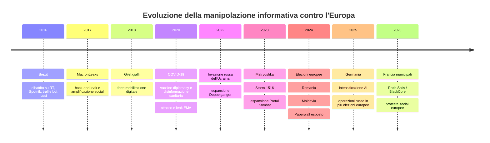
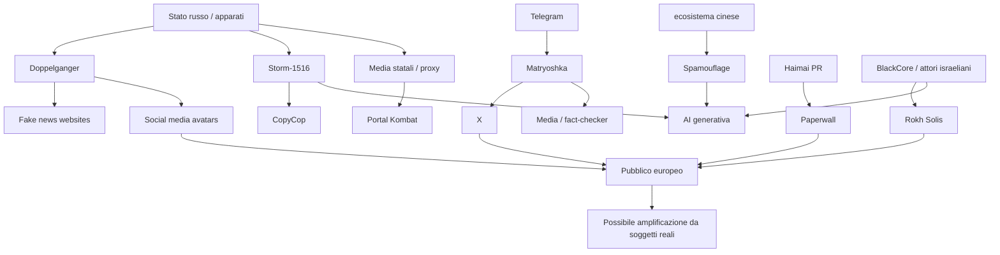
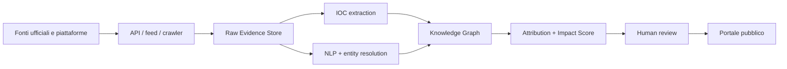

# DS-02 · Manipolazione informativa, elezioni e società in Europa

**Periodo analizzato: 2007-2026 · Stato della ricerca: 20 ottobre 2026**

## Executive summary

La ricerca conferma l'esistenza di un **ecosistema persistente e sempre più industrializzato di manipolazione informativa rivolto contro l'Europa**, ma non supporta l'ipotesi di un'unica regia che coordini tutte le crisi politiche, elettorali e sociali europee.

Il quadro emerso è più complesso. La **Russia rappresenta l'attore statale più aggressivo e sistematico nei confronti dell'UE**, con infrastrutture sovrapposte come Doppelganger, Storm-1516, Matryoshka e Portal Kombat, insieme a media controllati dallo Stato, proxy locali, influencer e società specializzate. La Cina adotta prevalentemente tecniche differenti, orientate alla costruzione di un ambiente informativo favorevole a Pechino e alla marginalizzazione delle critiche, attraverso Spamouflage, Paperwall e infrastrutture di information laundering. A questi si aggiunge un mercato privato dell'**influence-for-hire**, nel quale il caso israeliano BlackCore dimostra che capacità precedentemente associate soprattutto agli apparati statali sono ormai acquistabili come servizio. citeturn23search1turn23search3turn23search5turn23search6turn27search0turn27search1

La scala è rilevante. Il quarto rapporto FIMI del SEAE ha identificato nel solo 2025 **540 incidenti e circa 10.500 canali social o siti utilizzati per produrre o amplificare FIMI**; il 29% degli incidenti analizzati è stato attribuito alla Russia e il 6% alla Cina. Il SEAE considera ormai testo, audio e video sintetici strumenti ordinari delle operazioni informative, non più sperimentali. citeturn23search7turn23search8

La principale scoperta trasversale è tuttavia che **capacità operativa, esposizione e persuasione sono tre cose differenti**. Molte operazioni dispongono di migliaia di account o centinaia di domini ma producono pochissimo engagement autentico. Spamouflage e Paperwall ne sono esempi; anche Rokh Solis, pur essendo stato classificato ufficialmente dalla Francia come ingerenza straniera, ha raggiunto una visibilità molto bassa. citeturn27search5turn27search0turn27search2

Le elezioni rappresentano l'obiettivo più chiaramente documentato. Il SEAE descrive per la Russia un playbook ricorrente: delegittimare leadership e istituzioni mesi prima del voto, sfruttare divisioni domestiche durante la campagna, quindi attaccare la credibilità del processo elettorale nella fase finale. Nel 2025 questo schema è stato osservato in Germania, Polonia, Romania, Moldavia e Repubblica Ceca. citeturn28search4

La **Moldavia costituisce uno dei casi probatoriamente più forti**: l'UE ha sanzionato individui e organizzazioni coinvolti in operazioni finanziate dalla Russia comprendenti disinformazione, propaganda e compravendita di voti nelle elezioni 2024-2025. citeturn24search2turn24search3

Al contrario, casi molto discussi richiedono maggiore prudenza. Per la **Brexit**, il rapporto Russia dell'Intelligence and Security Committee britannico concluse che vi erano indicazioni open-source di campagne russe, ma denunciò contemporaneamente che il governo non aveva effettuato una valutazione adeguata; determinare l'effetto sul risultato è considerato difficile o impossibile. Quindi non esiste una base probatoria per sostenere che «la Russia abbia causato Brexit». citeturn25search12turn25search13

Analogamente, nelle **presidenziali romene del 2024** la manipolazione algoritmica, gli influencer occultamente remunerati e l'attività inautentica sono documentati, ma VIGINUM ha esplicitamente precisato che la propria analisi non costituiva un'attribuzione di ingerenza straniera. TikTok dichiarò inoltre che la rete specificamente focalizzata sulla promozione di Călin Georgescu da essa individuata operava dalla Romania ed era composta da 78 account e 1.781 follower. L'origine straniera dell'intera operazione resta quindi un problema di attribuzione distinto dall'esistenza della manipolazione. citeturn24search0turn24search1turn32search1

Infine, la contro-analisi delle proteste dell'ottobre 2026 è particolarmente importante. Le proteste simultanee in Francia, Italia, Belgio, Portogallo e altri paesi presentano rivendicazioni domestiche reali e differenti. In Francia, prima del 17 ottobre, **VIGINUM non aveva rilevato evidenze che attori stranieri avessero provocato la mobilitazione**; l'attività straniera osservata era minima e opportunistica. Questo non esclude sfruttamento propagandistico successivo, ma rende allo stato attuale **non verificata** l'ipotesi di una regia straniera della protesta europea del 2026. citeturn30search0turn30news8

La conclusione strategica è pertanto:

> **la minaccia più dimostrabile non consiste nel creare artificialmente dal nulla le fratture europee, ma nell'identificare fratture reali, amplificarle, polarizzarle, riciclarle attraverso infrastrutture apparentemente indipendenti e sfruttarle al momento politicamente più favorevole.**

## Metodologia e criteri di attribuzione

Il rapporto privilegia SEAE, VIGINUM, Commissione europea, Consiglio UE, governi e intelligence nazionali, EMA, ENISA, documenti parlamentari, DOJ/FBI, rapporti delle piattaforme e studi accademici. Citizen Lab viene utilizzato come fonte tecnica indipendente per infrastrutture di influenza privata.

Il concetto FIMI è deliberatamente più ampio della semplice «fake news»: il SEAE lo definisce come un pattern prevalentemente non illegale di comportamento manipolativo capace di compromettere valori, procedure e processi politici. L'attenzione deve essere quindi posta sul **comportamento coordinato**, non solamente sulla falsità del singolo messaggio. citeturn31search9turn26search6

VIGINUM utilizza quattro dimensioni: contenuto ingannevole, diffusione artificiale o automatizzata e deliberata, lesione potenziale degli interessi fondamentali e coinvolgimento diretto o indiretto di un attore straniero. citeturn31search0turn31search5

Per il portale propongo di separare obbligatoriamente:

`evento → operatore → mandante → tecnica → infrastruttura → esposizione → effetto`

e di assegnare indipendentemente **Attribution Confidence** e **Impact Confidence**.

| Stato | Criterio operativo |
|---|---|
| **Accertato** | Relazione sostenuta da documentazione ufficiale, evidenza tecnica diretta o accertamento istituzionale sufficientemente specifico. Non equivale necessariamente a condanna penale. |
| **Fortemente corroborato** | Fonti tecniche indipendenti e autorevoli convergono sulla stessa attribuzione. |
| **Contestato** | Esistono evidenze significative ma anche spiegazioni alternative o fonti autorevoli discordanti. |
| **Non verificato** | Accusa esistente, ma evidenza pubblica insufficiente. |
| **Smentito** | Evidenze disponibili contraddicono sostanzialmente l'affermazione. |

L'**impatto** va misurato su una scala diversa:

`output prodotto → reach → engagement → esposizione umana → cambiamento opinione → cambiamento comportamento/voto`

La maggior parte degli studi riesce a misurare bene i primi tre passaggi e molto peggio gli ultimi tre. Anche il BfV tedesco sottolinea che, nonostante le campagne russe rilevate intorno alle elezioni federali del 2025, stabilire se abbiano modificato opinioni o comportamenti rimane problematico. citeturn28search6

La copertura 2007-2013 è inevitabilmente meno granulare: la moderna tassonomia FIMI, i dataset delle piattaforme e gli apparati europei di rilevazione sono maturati soprattutto dopo il 2016 e ulteriormente dopo l'invasione russa dell'Ucraina del 2022. I dati longitudinali devono quindi essere interpretati evitando di scambiare **migliore rilevazione** con **aumento reale della frequenza**. citeturn28search2turn31search15

## Campagne, operatori e infrastrutture

| Campagna | Origine/operatore | Tecniche principali | Europa | Attribuzione | Impatto pubblico osservabile |
|---|---|---|---|---|---|
| **Storm-1516** | Ecosistema russo; nel caso tedesco entità supportate dal GRU | falsi media, attori, testimonianze inventate, AI, deepfake, proxy/influencer | Francia, Germania, altri paesi occidentali | **Accertato / fortemente corroborato** | alcuni contenuti molto visibili, effetto comportamentale non misurabile citeturn23search1turn28search0 |
| **Doppelganger** | SDA, Structura, ANO Dialog; autorità USA indicano direzione dell'amministrazione presidenziale russa | cybersquatting di media, falsi articoli, avatar, ads, influencer, AI | Germania, Francia, Italia, UK, UE | **Fortemente corroborato** | grande persistenza e infrastruttura, conversione elettorale ignota citeturn23search5turn32search0 |
| **Matryoshka** | ecosistema filo-russo | falsi video/report, Telegram come seed, risposte coordinate su X rivolte a media e fact-checker | oltre 60 paesi | **Fortemente corroborato** | successo nel generare verifiche e attenzione, persuasione non quantificata citeturn23search4 |
| **Portal Kombat** | ecosistema filo-russo | rete automatizzata di siti, aggregazione, SEO, riciclo di fonti russe | Francia e molti paesi occidentali | **Fortemente corroborato** | almeno 193 siti già identificati nel 2024 citeturn23search3 |
| **Spamouflage** | Meta lo collega a individui associati alle forze dell'ordine cinesi | account falsi/dirottati, cross-platform, AI cartoons/video impersonation | UE e pubblico globale | **Fortemente corroborato** | enorme scala infrastrutturale, engagement generalmente basso citeturn23search6turn27search5 |
| **Paperwall** | Haimai, società PR cinese | falsi media locali, content laundering, traduzioni/automazione | UK, Francia, Italia e altri | **Operatore fortemente corroborato; mandato statale non verificato** | 123 siti/30 paesi nel 2024; ulteriore espansione nel 2025, ma esposizione inizialmente minima citeturn27search0turn27search5 |
| **Rokh Solis / BlackCore** | marcatori israeliani; collegamenti tecnici a BlackCore | fake personas, siti, TikTok/Instagram/X/Facebook, polarizzazione ideologica | Francia 2026 | **INE accertata; coinvolgimento BlackCore fortemente corroborato; cliente ignoto** | visibilità molto bassa citeturn27search2turn27search1 |

Questa comparazione mostra una trasformazione importante: l'operazione moderna non dipende più necessariamente da una «fabbrica di troll». Può essere composta da società PR, registratori di domini, advertising, AI generativa, content farm, influencer, proxy apparentemente indipendenti e piattaforme diverse.

Doppelganger è emblematico. Meta eliminò nel 2022 **1.633 account Facebook, 703 pagine e 29 account Instagram** riconducibili a una rete originata in Russia che impersonava media europei e colpiva soprattutto Germania, Francia, Italia, Ucraina e Regno Unito. Nel 2024 il Dipartimento di Giustizia statunitense sequestrò 32 domini e descrisse un'infrastruttura che combinava siti falsi, identità apparentemente locali, influencer, pubblicità e contenuti generati con AI. citeturn32search0turn23search5

La Cina mostra invece una forte strategia di **information laundering**. Paperwall mescola materiale commerciale innocuo con contenuti politici favorevoli a Pechino all'interno di falsi media locali. Citizen Lab attribuisce tecnicamente la rete a Haimai ma non prova che ogni attività sia direttamente ordinata dallo Stato cinese. Il SEAE ha osservato successivamente altri 108 domini, 40 nuovi paesi e 15 lingue aggiuntive, insieme al riciclo di contenuti provenienti anche da fonti russe. citeturn27search0turn27search5

Quest'ultimo collegamento è significativo, ma **non prova coordinamento strategico sino-russo della rete Paperwall**. Una sorgente russa tradotta da un'infrastruttura cinese costituisce una relazione informativa; non necessariamente una relazione di comando.

## Elezioni, salute pubblica e movimenti sociali

### Processi elettorali

| Caso | Fenomeno verificato | Attribuzione | Effetto sul risultato |
|---|---|---|---|
| **Brexit 2016** | RT/Sputnik, bot/troll e attività filo-Brexit rilevate da studi open-source | presenza russa plausibile; indagine statale britannica insufficiente | **Non dimostrato**; ISC: estremamente difficile o impossibile quantificarlo citeturn25search12turn25search13 |
| **Francia 2017** | MacronLeaks, phishing, hack-and-leak, falsi documenti, bot e amplificazione internazionale | Francia non attribuì ufficialmente l'operazione a uno Stato; successivi rapporti indicano forti indizi russi | impatto apparentemente limitato citeturn29search0turn29search1turn29academia7 |
| **UE 2024** | 42 episodi russi FIMI rilevati dal SEAE | Russia | nessun incidente grave rilevato; nessuna grande campagna durante i giorni del voto citeturn28search3turn28search5 |
| **Romania 2024** | manipolazione algoritmica, influencer, attività coordinata TikTok | **origine straniera complessiva contestata/non conclusiva pubblicamente** | grave crisi istituzionale, causalità elettorale non quantificabile citeturn24search0turn24search1turn32search4 |
| **Moldavia 2024-25** | disinformazione, finanziamenti, propaganda, vote buying | reti finanziate dalla Russia | influenza perseguita accertata; variazione del voto individuale non misurabile citeturn24search2turn24search3 |
| **Germania 2025** | Storm-1516, deepfake, falsi siti, pseudo-inchieste | attribuzione governativa alla Russia, con supporto GRU alle entità coinvolte | non determinabile citeturn28search0turn28search6 |
| **Francia 2026** | quattro ingerenze digitali alle municipali; Rokh Solis tra esse | Russia in alcuni MOI; attori israeliani/BlackCore per Rokh Solis | Rokh Solis ebbe visibilità molto bassa citeturn27search3turn27search2 |

Il caso Brexit costituisce un'importante correzione rispetto a molte ricostruzioni popolari. Il rapporto ISC criticò severamente il governo britannico perché **non aveva cercato sistematicamente le prove e non aveva prodotto una valutazione post-referendum**, ma proprio per questo non permette di concludere né che non vi fu interferenza né che essa determinò la vittoria del Leave. citeturn25search12turn25search14

Anche la Romania richiede separazione tra tre proposizioni:

`manipolazione avvenuta` ≠ `manipolazione straniera provata` ≠ `manipolazione causa del risultato`

La Commissione europea aprì un procedimento DSA contro TikTok a seguito di «serie indicazioni» di interferenza straniera, ma precisò che l'apertura dell'indagine non ne pregiudicava l'esito. VIGINUM documentò le tecniche senza classificarle come ingerenza straniera, mentre TikTok attribuì alla Romania la propria rete individuata specificamente a favore di Georgescu. citeturn24search0turn24search1turn32search1

### Sanità e COVID

Durante la pandemia Russia e Cina utilizzarono media statali, proxy e account diplomatici per promuovere i propri vaccini e contemporaneamente mettere in dubbio sicurezza, imparzialità regolatoria e strategie vaccinali occidentali. Il SEAE registrò in particolare campagne contro i vaccini occidentali e contro l'EMA. citeturn26search0turn26search5

Esiste inoltre un episodio distinto che deve **restare distinto**: nel 2020 EMA subì un attacco informatico, documenti relativi ai vaccini furono sottratti e alcuni furono manipolati prima della pubblicazione in una forma che l'Agenzia affermò potesse compromettere la fiducia nei vaccini. EMA non attribuisce pubblicamente in quel documento l'attacco a Russia o Cina. Quindi:

**attacco + manipolazione = accertato; attribuzione statale = non verificata pubblicamente.** citeturn26search1turn26search7

L'effetto generale della disinformazione sanitaria è molto meglio dimostrato del contributo specifico delle operazioni straniere: la revisione sistematica dell'OMS associa l'esposizione alla cattiva informazione sanitaria ad aumento dell'esitazione vaccinale, interpretazioni scientifiche errate e possibili ritardi nell'accesso alle cure. Non consente però di assegnare tali conseguenze a uno Stato straniero specifico. citeturn26search4

### Gilet gialli e proteste del 2026

I Gilet gialli del 2018 furono fortemente digitalizzati, ma gli studi empirici invitano a ridimensionare la tesi secondo cui i bot ne avrebbero costituito il motore: nell'analisi delle reti Twitter, gli account verificati e i media risultavano più centrali dei bot non verificati. Studi multi-piattaforma di Sciences Po evidenziano inoltre l'eterogeneità geografica, ideologica e organizzativa del movimento. citeturn30search6turn30search7

Lo stesso principio è essenziale nel 2026. Il 17 ottobre centinaia di migliaia di persone hanno protestato in Francia, mentre Belgio, Italia, Portogallo e altri paesi hanno vissuto mobilitazioni parallele legate a istruzione, costo della vita, servizi e abitazione. citeturn30news8turn30search3

La convocazione francese del 17 ottobre aveva una forte componente TikTok e mostrava account appena creati o rinominati e materiali generati con AI. Tuttavia VIGINUM dichiarò a *Le Monde* che non vi erano elementi indicanti che attori stranieri avessero incoraggiato il movimento e che le riprese straniere allora osservate erano opportunistiche e quasi prive di audience. Alcuni degli account sospetti sembravano invece perseguire follower e monetizzazione. citeturn30search0

**Classificazione attuale della tesi «le proteste europee 2026 sono orchestrate dall'estero»: NON VERIFICATO.**

Rimane invece altamente plausibile e monitorabile lo **sfruttamento successivo** delle proteste da parte di reti FIMI, una tecnica già ricorrente in altri contesti.

## Piattaforme, intelligenza artificiale e impatto

| Piattaforma | Funzione nelle operazioni | Esempi | Limiti di osservazione |
|---|---|---|---|
| **X** | amplificazione rapida, reply flooding, bot, collegamenti a falsi media | Matryoshka, Doppelganger, Storm-1516 | nel campione SEAE 2024 rappresentava l'88% dell'attività rilevata, ma il SEAE avverte che l'accessibilità dei dati distorce il confronto tra piattaforme citeturn28search3 |
| **TikTok** | recommender manipulation, influencer laundering, video sintetici, mobilitazione | Romania 2024, proteste 2026 | Research Tools disponibili solo a ricercatori qualificati/approvati citeturn22search4turn22search5 |
| **Telegram** | incubazione/seeding, distribuzione iniziale, comunità proxy | Matryoshka, ecosistemi filorussi | copertura storica completa non specificata; necessario archiviare prospetticamente canali pubblici citeturn23search4 |
| **Facebook / Instagram** | fake personas, pagine, ads, amplificazione CIB | Doppelganger, Spamouflage, BlackCore | dataset completi dell'intero grafo non pubblici; integrare threat report e DSA citeturn23search6turn32search0 |
| **YouTube** | video, pseudo-documentari, cross-platform amplification | reti russe rimosse periodicamente | API disponibile ma soggetta a quote operative citeturn22search8turn22search9 |
| **Siti web** | information laundering, SEO, impersonazione di media | Portal Kombat, Doppelganger, Paperwall | ottima osservabilità via DNS/WHOIS/certificati/web archive; contenuti e domini sono però effimeri citeturn23search3turn27search0 |

Un dato importante non deve diventare un falso indicatore: nel campione SEAE 2024 **X rappresentava l'88% dei canali individuati**, ma lo stesso rapporto avverte che il calcolo dipende dalla disponibilità dei dati e dalla possibilità di raccoglierli automaticamente. Non significa quindi che l'88% di tutta la manipolazione europea avvenga realmente su X. citeturn28search3

L'AI sta modificando soprattutto **costo, velocità e capacità di localizzazione**. Il SEAE osserva nel 2025 uso routinario di testo, audio e video sintetici; Spamouflage produce varianti rapide di cartoon e video impersonation, mentre Storm-1516 utilizza deepfake, falsi testimoni e siti pseudo-giornalistici. citeturn23search7turn27search5turn28search0

L'AI non risolve però il problema fondamentale dell'attaccante: **ottenere persone reali**. Spamouflage continua ad avere engagement generalmente basso nonostante l'automazione; Rokh Solis ha fallito nel generare grande visibilità nonostante numerose tecniche di amplificazione. citeturn27search5turn27search2

Questo suggerisce che il moltiplicatore più pericoloso non sia necessariamente il bot autonomo, ma il passaggio:

```text
contenuto artificiale
        ↓
rete artificiale
        ↓
influencer / politico / giornalista reale
        ↓
media mainstream
        ↓
pubblico autentico
```

VIGINUM segnala precisamente che alcune narrative Storm-1516, pur originate in ecosistemi manipolativi, sono state successivamente riprese anche da personalità politiche di primo piano. citeturn23search1

## Dataset normalizzato e grafo delle relazioni

### Timeline analitica



Le tappe elettorali e operative della timeline sono documentate dai rapporti ISC, VIGINUM, SEAE, Commissione UE, governo tedesco e Citizen Lab. citeturn25search13turn29search0turn26search0turn32search0turn23search4turn28search3turn28search0turn27search2

### Grafo concettuale



Le frecce indicano **relazioni documentate o tecniche**, non necessariamente controllo gerarchico. In particolare, la relazione Cina-Paperwall non deve essere trasformata automaticamente in un rapporto di comando statale, e il committente di BlackCore/Rokh Solis resta non identificato pubblicamente. citeturn27search0turn27search1turn27search2

### Dataset CSV-like iniziale

| ID | Tipo | Entità/operazione | Origine | Target | Piattaforme/infrastruttura | Stato attribuzione | Impact confidence | Fonte primaria/tecnica |
|---|---|---|---|---|---|---|---|---|
| OP-RU-001 | operation | Doppelganger | Russia | UE/Occidente | web, X, Meta, Telegram | fortemente corroborato | medio-basso | DOJ, Meta citeturn23search5turn32search0 |
| OP-RU-002 | operation | Storm-1516 | Russia | Europa/USA | X, fake media, video | accertato/forte | medio | VIGINUM, BfV citeturn23search1turn28search6 |
| OP-RU-003 | operation | Matryoshka | filo-russa | media/fact-checker | Telegram, X | fortemente corroborato | basso-medio | VIGINUM citeturn23search4 |
| OP-RU-004 | infrastructure | Portal Kombat | filo-russa | UE/Occidente | ≥193 siti | fortemente corroborato | non specificato | VIGINUM citeturn23search3 |
| OP-CN-001 | operation | Spamouflage | Cina | globale/UE | >50 piattaforme | fortemente corroborato | generalmente basso | Meta/SEAE citeturn23search6turn27search5 |
| OP-CN-002 | infrastructure | Paperwall | Haimai, Cina | ≥30 paesi iniziali | falsi media web | forte per Haimai | basso iniziale | Citizen Lab citeturn27search0 |
| OP-IL-001 | operation | Rokh Solis | attori israeliani | Francia | X/Meta/TikTok/web | accertata come INE | basso | VIGINUM citeturn27search2 |
| ACT-IL-001 | actor | BlackCore | Israele | multi-paese | influence-for-hire | fortemente corroborato | variabile | Citizen Lab citeturn27search1 |
| EVT-UK-2016 | event | Brexit | UK | referendum | social/media | interferenza russa contestata nella portata | non misurabile | ISC citeturn25search13 |
| EVT-FR-2017 | event | MacronLeaks | Francia | presidenziali | hack-and-leak/X | indizi russi, nessuna attribuzione statale FR | basso | Senato FR/studi citeturn29search0turn29academia7 |
| EVT-EU-2024 | event | Elezioni UE | UE | Parlamento europeo | multi-platform | 42 incidenti russi EEAS | nessun grave impatto rilevato | EEAS/Commissione citeturn28search3turn28search5 |
| EVT-RO-2024 | event | Presidenziali Romania | Romania | elezioni | TikTok/Meta | straniera contestata/non conclusiva | non misurabile | EC/VIGINUM/TikTok citeturn24search0turn24search1turn32search1 |
| EVT-MD-2025 | event | Elezioni Moldova | Moldavia | elezioni | social/offline/finanza | Russia accertata UE | elevato rischio, voto individuale ignoto | Consiglio UE citeturn24search2 |
| EVT-DE-2025 | event | Bundestag | Germania | elezioni | Storm-1516 | Russia/GRU accertato politicamente | non quantificato | Governo DE citeturn28search0 |
| EVT-EU-2026 | event | proteste ottobre | vari Stati UE | società | TikTok/social/strada | regia straniera non verificata | non applicabile | VIGINUM/Reuters citeturn30search0turn30news8 |

Per gli account individuali il dataset dovrà conservare `platform_id`, `handle`, `first_seen`, `last_seen`, `operator_cluster`, `confidence`, `archived_url/hash`. Non è opportuno popolarli automaticamente con semplici account «filorussi» o «filocinesi»: orientamento politico e appartenenza a un'operazione sono due attributi differenti.

## Monitoraggio e integrazione nel portale

### Elementi prioritari

| Priorità | Indicatore | Perché monitorarlo |
|---:|---|---|
| 1 | Nuovi domini collegati a Doppelganger/Portal Kombat/Paperwall | infrastruttura relativamente osservabile e correlabile |
| 2 | Storm-1516 e CopyCop | forte targeting elettorale europeo |
| 3 | Matryoshka | rileva campagne prima del passaggio verso media/fact-checker |
| 4 | reti Spamouflage | capacità cross-platform e crescente uso dell'AI |
| 5 | influence-for-hire | BlackCore dimostra disponibilità commerciale della capacità |
| 6 | elezioni e referendum nei prossimi 180 giorni | fase di massima intensificazione FIMI secondo il SEAE citeturn28search4 |
| 7 | hack-and-leak | collega cyber intrusion e manipolazione informativa |
| 8 | salute, energia, migrazione, guerra e costo della vita | cleavages riutilizzati frequentemente dalle campagne russe citeturn28search4turn26search0 |
| 9 | passaggi da account sintetici a influencer/politici reali | possibile moltiplicatore di audience |
| 10 | operazioni con engagement basso ma infrastruttura crescente | possono costituire capacità dormienti o sperimentali |

### Pipeline tecnica consigliata



Le fonti macchina più utili sono:

**DSA Transparency Database**, la Commissione dispone di una Research API basata su OpenSearch, con endpoint search, SQL, count e aggregazioni. L'indice dell'API di ricerca conserva gli statement degli ultimi sei mesi, quindi il portale dovrebbe effettuare **snapshot periodici** anziché utilizzarla come archivio storico permanente. citeturn22search1turn22search2

**TikTok Research Tools**, consentono accesso programmatico a informazioni pubbliche su video, commenti e account, ma l'accesso richiede qualificazione e approvazione; ciò va marcato nel sistema come `access_constraint=researcher_approval`. citeturn22search4turn22search6

**X API**, al 20 ottobre 2026 opera con pricing a consumo. Per analisi ad alto volume il costo deve quindi essere trattato come variabile infrastrutturale e affiancato da dataset pubblicati da autorità e archivi propri. citeturn22search7

**YouTube Data API**, dispone di quote giornaliere e di quote granulari per alcune operazioni; è adatta alla sorveglianza di canali e video identificati più che allo scraping indiscriminato dell'intera piattaforma. citeturn22search8turn22search9

Per VIGINUM, SEAE, Consiglio UE, Commissione, BfV, intelligence e Citizen Lab utilizzerei ingestion di HTML/RSS ove disponibili più un crawler differenziale delle pagine ufficiali. Ogni documento dovrebbe essere conservato con `SHA-256`, timestamp, copia WARC/PDF ove legalmente consentito e relazione `evidence_supports_claim`.

Gli indicatori tecnici da estrarre automaticamente dovrebbero includere:

```text
domain
subdomain
IP / ASN
nameserver
registrar
TLS certificate
favicon hash
analytics / AdSense IDs
URL
platform account ID
media perceptual hash
posting timestamp
language
repeated text similarity
cross-platform first_seen
archive snapshot
known operation cluster
```

Il caso Paperwall mostra bene il valore di questo approccio: Citizen Lab è riuscito a collegare domini apparentemente indipendenti a Haimai anche attraverso identificatori infrastrutturali condivisi. citeturn27search0

Il sistema AI non dovrebbe mai produrre automaticamente:

```text
condivide narrativa russa
        ↓
è account russo
```

ma:

```text
condivide narrativa russa
        ↓
similarità narrativa = osservazione

+ infrastruttura condivisa
+ comportamento coordinato
+ temporalità sincronizzata
+ indicatori tecnici
+ precedente attribuzione
        ↓
probabilità di appartenenza a cluster
        ↓
revisione umana
        ↓
attribuzione
```

Questa distinzione è fondamentale per evitare che il futuro portale diventi esso stesso uno strumento di attribuzione politica arbitraria.

### Query secondarie raccomandate

| Deep Search successiva | Query |
|---|---|
| **DS-02A · Ecosistema russo** | «Ricostruire infrastruttura, persone, società, domini, finanziamenti e sovrapposizioni tecniche tra Doppelganger, Storm-1516, CopyCop, Matryoshka e Portal Kombat dal 2022 al 2026» |
| **DS-02B · Elezioni** | «Analizzare comparativamente Brexit 2016, Francia 2017, UE 2019/2024, Romania 2024, Germania 2025, Moldavia 2024-25 e Francia 2026 distinguendo interferenza, reach e causalità elettorale» |
| **DS-02C · Cina** | «Mappare Spamouflage, Paperwall, Falsos Amigos e altre infrastrutture cinesi in Europa, identificando operatori privati, statali e relazioni sino-russe» |
| **DS-02D · Influence-for-hire** | «Mappare BlackCore e l'industria globale commerciale di manipolazione elettorale e social targeting operante in Europa, con casi israeliani e non israeliani» |
| **DS-02E · Proteste e radicalizzazione** | «Ricostruire Gilet gialli 2018-19 e proteste europee 2026 mediante timeline cross-platform, distinguendo mobilitazione autentica, monetizzazione opportunistica, amplificazione straniera e tentativi di radicalizzazione» |

Il quadro DS-02 porta quindi a una conclusione più precisa della semplice idea di una «ragnatela di propaganda». **Esiste una ragnatela di capacità e infrastrutture**, alcune statali, alcune private, alcune opportunisticamente interconnesse. Russia e Cina non operano allo stesso modo; BlackCore dimostra che gli attacchi non provengono esclusivamente da avversari geopolitici; le piattaforme non sono meri canali passivi, perché recommender, pubblicità, moderazione e disponibilità dei dati modificano l'ambiente operativo. citeturn28search4turn27search1turn24search0

Soprattutto, **non ogni protesta, risultato elettorale o crisi di fiducia è il prodotto di un attacco esterno**. Le operazioni più efficaci documentate sfruttano problemi che esistono già. È proprio questa interazione tra vulnerabilità domestica e capacità straniera a costituire l'oggetto più importante da monitorare: non soltanto «chi pubblica una falsità», ma **chi costruisce l'infrastruttura, chi la finanzia, chi la amplifica, quale pubblico raggiunge, chi la porta dal margine al mainstream e quali conseguenze misurabili produce**.