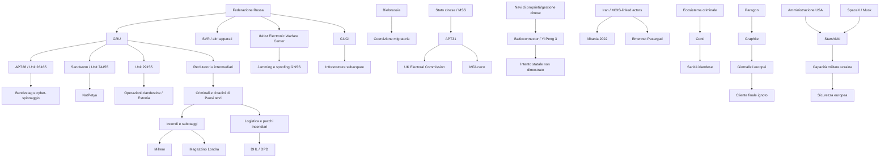
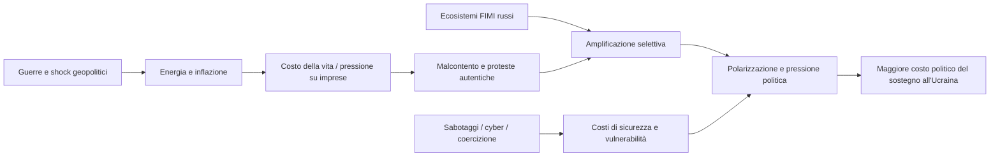

# DS-03 · Guerra ibrida, sabotaggi e sicurezza europea

**Deep Research ripetuta e ampliata | Periodo 2007-2026 | Aggiornamento: 21 ottobre 2026**

## Executive summary

La ricerca conferma che la sicurezza europea è sottoposta a una **campagna ibrida pluriennale e crescente**, nella quale cyberattacchi, sabotaggi fisici, assassinii e tentati assassinii, incendi, operazioni contro la logistica, coercizione migratoria, guerra elettronica, pressione sulle infrastrutture spaziali e manipolazione informativa vengono utilizzati singolarmente o in combinazione. La Russia rappresenta nettamente l'attore statale più frequentemente associato dalle autorità europee a questa categoria di operazioni, ma non è l'unico: Cina, Iran, Bielorussia, gruppi criminali e fornitori commerciali di tecnologie intrusive compaiono in segmenti differenti del quadro. citeturn0search0turn0search1turn18search5turn13search2

La prima conclusione importante è temporale. **Il fenomeno precede l'invasione russa dell'Ucraina del 2014 e quella su vasta scala del 2022**, come mostrano gli attacchi cyber contro l'Estonia nel 2007 e quelli paralleli alla guerra russo-georgiana del 2008. Tuttavia, il 2014 e soprattutto il 24 febbraio 2022 costituiscono due acceleratori decisivi. NATO, Unione europea, IISS e CSIS descrivono un'intensificazione delle operazioni russe contro gli Stati che sostengono l'Ucraina, con un'espansione dalle tradizionali operazioni di intelligence verso sabotaggi a basso costo eseguiti mediante intermediari reclutati online. citeturn4search1turn4search51turn19search7turn26search0turn0search7

L'IISS rileva nel proprio database **1 incidente nel 2018, 1 nel 2019, 2 nel 2020, nessuno nel 2021, 13 nel 2022, 9 nel 2023, 33 nel 2024 e 11 nel solo primo semestre 2025**. Le categorie includono infrastrutture di comunicazione, energia, governo, sanità, industria, obiettivi militari, trasporti, infrastrutture sottomarine e acqua. L'IISS sottolinea che la propria serie riguarda attività ibride russe con effetti fisici e non l'intero universo di cyberattacchi o FIMI, ragione per cui non va confrontata direttamente con database costruiti secondo criteri differenti. citeturn29view0turn26search0


Il cambiamento operativo successivo al 2022 è particolarmente significativo. Le espulsioni di centinaia di funzionari d'intelligence russi hanno reso più difficile operare con personale ufficiale, ma Mosca ha compensato sviluppando quella che l'IISS definisce una **"intelligence-operative gig economy"**: reclutamento online di cittadini europei o di Paesi terzi, intermediari criminali, pagamenti in criptovalute, istruzioni via Telegram e operazioni compartimentate nelle quali l'esecutore può non conoscere né il committente finale né l'obiettivo strategico. citeturn28view0turn26search12turn26news30

Diversi casi non sono più semplici valutazioni d'intelligence. Abbiamo **condanne giudiziarie o attribuzioni istituzionali molto robuste**: il Tribunale superiore di Berlino ha stabilito che l'omicidio di Zelimkhan Khangoshvili nel 2019 fu ordinato da organi statali russi; il Regno Unito ha ottenuto condanne per l'incendio del 2024 di un magazzino londinese contenente aiuti e materiale Starlink destinato all'Ucraina, con collegamenti alla rete Wagner; Cechia e UE attribuiscono al GRU le esplosioni di Vrbětice; l'UE attribuisce APT28 al GRU per il Bundestag e Sandworm/GRU per NotPetya; Germania ed Estonia hanno attribuito formalmente alla Russia gli attacchi del 2026 a Leipzig/Halle e Milrem Robotics. citeturn25search1turn25search2turn3search4turn1search2turn1search7turn15search5turn18search0turn23search0

Altri casi impongono invece prudenza. Le indagini tedesche sul sabotaggio di Nord Stream hanno prodotto accuse contro presunti membri di una squadra ucraina, ma il processo è tuttora in corso e Kiev nega qualsiasi responsabilità statale. Nei danneggiamenti baltici associati alle navi cinesi *NewNew Polar Bear* e *Yi Peng 3*, la causalità materiale dell'ancora è fortemente supportata, ma **l'intenzionalità e un eventuale ordine di Pechino non sono dimostrati**. Lo stesso vale per *Eagle S*: il collegamento alla cosiddetta shadow fleet russa è rilevante, ma non prova che Mosca abbia ordinato il danneggiamento di Estlink 2. citeturn11news9turn11search3turn12search0turn11news11turn12search9turn12search38

Un'altra conclusione importante riguarda le infrastrutture sottomarine. Almeno undici cavi baltici risultavano danneggiati fra ottobre 2023 e fine 2025 secondo i dati citati da Reuters; NATO ha reagito con **Baltic Sentry**, mentre l'UE ha varato un Cable Security Toolbox e stanziato altri **347 milioni di euro** per infrastrutture, sorveglianza e capacità di riparazione. Nel 2026 alleati NATO hanno inoltre intercettato presso le Svalbard un'esercitazione segreta dell'unità russa GUGI riguardante tecnologie destinate a neutralizzare infrastrutture subacquee. In quest'ultimo caso non vi è stato alcun danneggiamento. citeturn22news8turn19search0turn19search3

Anche lo spettro elettromagnetico è ormai un dominio della campagna. EASA registra un forte aumento di jamming e spoofing GNSS dal febbraio 2022; nel luglio 2025 l'UE ha sanzionato l'**841st Separate Electronic Warfare Center** russo e suoi dirigenti, collegando le interferenze provenienti da Kaliningrad ai disturbi osservati soprattutto nei Paesi baltici e nell'aviazione civile europea. citeturn16search0turn19search11

La Cina presenta un modello diverso. Sono documentate operazioni di cyber-spionaggio statale, come APT31 contro l'Electoral Commission britannica e il Ministero degli Esteri ceco, nonché operazioni attribuite nel 2026 dall'UE a Integrity Technology Group e Anxun/i-Soon. **Non emerge però una campagna cinese di sabotaggio fisico in Europa paragonabile quantitativamente e qualitativamente a quella attribuita alla Russia.** I casi delle navi cinesi nel Baltico restano quindi da tenere separati dalle attribuzioni cyber già consolidate. citeturn13search0turn13search3turn13search2

L'Iran presenta un ulteriore modello: l'attacco distruttivo contro il governo albanese del 2022 è uno dei casi più solidamente attribuiti, con analisi Microsoft, CISA/FBI e sanzioni statunitensi che convergono su attori collegati al Ministero iraniano dell'Intelligence. Nel marzo 2026 l'UE ha inoltre sanzionato Emennet Pasargad per operazioni che avevano interessato Francia e Svezia. citeturn2search4turn2search7turn13search2

Il settore criminale deve essere trattato separatamente. L'attacco ransomware Conti contro l'Health Service Executive irlandese nel 2021 fu estremamente distruttivo, ma l'appartenenza del gruppo a un ecosistema criminale russofono **non costituisce prova di un ordine del Cremlino**. ENISA rileva che il ransomware rimane una delle minacce più impattanti e che gran parte dell'attività criminale contro infrastrutture europee è motivata finanziariamente, anche se Stati e criminali possono condividere strumenti, servizi o soggetti intermediari. citeturn14search4turn14search0turn14search8

Il caso **Starshield/Starlink dell'ottobre 2026 merita una categoria propria**. Non è corretto classificarlo allo stato attuale come "attacco russo". È invece un caso paradigmatico di **dipendenza strategica da un'infrastruttura privata extracomunitaria**. La limitazione dei collegamenti per terminali su sistemi che viaggiavano oltre circa 160 km/h è documentata e ha compromesso missioni ucraine con droni offensivi e intercettori. Reuters ha inizialmente riferito, citando due funzionari statunitensi e un funzionario occidentale, che l'ordine proveniva dall'interno della Casa Bianca; il *Telegraph* ha successivamente attribuito a Elon Musk la proposta iniziale; il 20 ottobre il *Wall Street Journal* ha riferito, sulla base di funzionari statunitensi e altre fonti, che Musk avrebbe impartito personalmente l'ordine e avrebbe discusso la questione con Trump. Trump e Musk hanno pubblicamente negato di essere responsabili nei termini descritti. Reuters non è riuscita a verificare indipendentemente l'ultima ricostruzione del WSJ. citeturn22search1turn21news6turn22news7turn21search0

**Non vi è attualmente prova pubblica sufficiente per collegare la limitazione Starshield a un ordine russo, a rapporti con oligarchi russi o a una specifica operazione d'intelligence di Mosca.** È invece provato l'effetto della restrizione sulla capacità militare ucraina. Non è provato il nesso causale fra tale restrizione e specifiche vittime civili di attacchi russi. citeturn21search3turn21news7turn21news6

Infine, la ricerca non sostiene che la campagna ibrida abbia "creato" le proteste europee dell'ottobre 2026. Le evidenze pubbliche indicano cause economiche e sociali autonome molto forti. Eurostat registra per settembre un'inflazione annuale dell'eurozona del **3,8%**, con l'energia al **18,9% nel dato definitivo**, leggermente superiore al 18,8% della stima flash. Reuters collega gran parte dello shock energetico del 2026 alla guerra USA-Iran e alle perturbazioni dei mercati energetici. VIGINUM, prima delle proteste francesi del 17 ottobre, aveva rilevato attività estera iniziale minima e opportunistica. Ci sono invece evidenze di **sfruttamento successivo delle proteste e delle tensioni energetiche da parte di ecosistemi propagandistici stranieri**. citeturn20search0turn20search1turn22news6turn9search0turn9search2

La valutazione complessiva è quindi:

| Fenomeno | Valutazione DS-03 |
|---|---|
| Campagna russa di sabotaggio e guerra ibrida contro Paesi europei | **Accertata** |
| Forte aumento dopo l'invasione su vasta scala del 2022 | **Fortemente corroborato** |
| Obiettivo di indebolire sostegno europeo all'Ucraina | **Accertato nelle valutazioni UE/NATO e fortemente corroborato dai pattern operativi** |
| Utilizzo di proxy criminali e reclutamento online | **Accertato/corroborato** |
| Campagna cinese di cyber-spionaggio contro obiettivi europei | **Accertata** |
| Sabotaggi baltici ordinati dalla Cina | **Non dimostrati** |
| Campagna cyber iraniana contro Albania e altri obiettivi europei | **Accertata in specifici casi** |
| Coinvolgimento statale russo nell'HSE/Conti | **Non verificato** |
| Regia straniera delle proteste europee dell'ottobre 2026 | **Non dimostrata** |
| Amplificazione straniera delle tensioni e delle proteste | **Documentata in alcuni casi** |
| Restrizione Starshield in Ucraina | **Accertata** |
| Responsabile ultimo della decisione Starshield | **Contestato fra diverse ricostruzioni** |
| Collegamento operativo Starshield-Russia | **Non verificato** |
| Nesso fra rallentamento Starshield e specifiche morti civili | **Non verificato** |

## Metodo, fonti e quadro strategico

Questa Deep Research utilizza quattro livelli probatori. **Accertato** indica una sentenza, un procedimento giudiziario conclusivo sul punto specifico, una prova tecnica particolarmente forte o un'attribuzione formale dello Stato supportata da evidenze convergenti. **Corroborato** indica la convergenza di più fonti autorevoli e indipendenti, pur senza completa pubblicazione delle prove o sentenza definitiva. **Contestato** identifica casi nei quali esistono elementi sostanziali ma anche spiegazioni concorrenti credibili o procedimenti aperti. **Non verificato** identifica accuse per le quali le fonti pubbliche non consentono di stabilire responsabilità o causalità. Questa distinzione è necessaria perché l'attribuzione di un'operazione ibrida non è un processo binario. citeturn28view1turn26search0

L'IISS osserva esplicitamente che l'attribuzione pubblica può avvenire molto tempo dopo l'evento perché governi e servizi devono proteggere fonti e metodi, preservare margini diplomatici e valutare il rischio di escalation. Di conseguenza, **"nessuna attribuzione pubblica" non significa automaticamente "nessuna evidenza d'intelligence"**, ma allo stesso modo un'affermazione governativa priva di evidenza pubblica non deve essere trattata come una sentenza giudiziaria. citeturn28view1

Le fonti sono state ordinate secondo questa gerarchia:

| Priorità | Fonti | Uso |
|---|---|---|
| **Primaria istituzionale** | Consiglio UE, EEAS, NATO, Commissione europea, EASA, ICAO, ENISA, governi, procure, tribunali, servizi di sicurezza | Attribuzioni ufficiali, sanzioni, dati tecnici, provvedimenti |
| **Forense indipendente** | Citizen Lab, Microsoft Threat Intelligence e analoghe analisi tecniche | Indicatori di compromissione, exploit, infrastrutture e malware |
| **Ricerca strategica** | IISS, CSIS | Pattern, dataset longitudinali, metodi operativi |
| **Giornalismo investigativo** | Reuters, WSJ, Telegraph e altre testate con reporting originale | Intelligence non resa pubblica, testimonianze, ricostruzione di operazioni in corso |
| **Fonti secondarie** | Altri media e studi | Corroborazione e contestualizzazione, non base unica di attribuzione |

Il rapporto del SEAE sulle minacce FIMI del marzo 2026 è particolarmente utile perché colloca le operazioni informative russe all'interno di un **toolkit ibrido più ampio**, osservando esplicitamente che campagne informative, incursioni di droni, sabotaggi e attacchi contro infrastrutture critiche vengono utilizzati in combinazione e che nel 2025 il focus russo si era ulteriormente spostato verso l'Europa e il sostegno occidentale all'Ucraina. citeturn18search5

NATO ha adottato una lettura simile. Già nel 2024 descriveva una campagna russa comprendente sabotaggio, violenza, interferenze cyber ed elettroniche, disinformazione e operazioni attraverso proxy. Nel settembre 2026 l'Alleanza ha osservato un aumento della frequenza di violazioni dello spazio aereo, cyberattacchi e sabotaggi; al Hybrid Symposium NATO del 15-16 ottobre 2026 il tema centrale è stato proprio il rafforzamento della resilienza contro sabotaggi, incidenti con droni e cyberattacchi russi. citeturn0search0turn19search7turn19search5

L'Unione europea formula un'analoga attribuzione strategica. Nel 2024 il Consiglio descriveva una campagna russa coordinata comprendente sabotaggi, incendi, vandalismo, cyberattacchi, manipolazione informativa, strumentalizzazione della migrazione e interferenze satellitari. Nel settembre 2026 l'UE ha qualificato il tentato attacco di Leipzig/Halle come parte di una campagna russa persistente contro sicurezza, resilienza e sostegno all'Ucraina. citeturn0search1turn18search1

Un punto metodologico essenziale è **non confondere correlazione geopolitica e attribuzione**. Una nave russa nei pressi di un cavo danneggiato non basta; un indirizzo IP russo non basta; la nazionalità russa di un criminale non basta; una società israeliana che produce spyware non prova un ordine dello Stato israeliano; l'origine cinese di una nave non prova un'operazione di Pechino; la coincidenza fra una decisione statunitense e un vantaggio russo non prova coordinamento con Mosca.

Per questo il dataset DS-03 conserva separatamente almeno sei campi concettuali: **evento, metodo, esecutore materiale, attore attribuito, livello probatorio e collegamento con l'Ucraina**.

Dal punto di vista quantitativo, IISS e CSIS arrivano entrambi alla conclusione di una forte intensificazione dopo il 2022, ma partendo da criteri diversi. Il CSIS include attacchi e complotti distruttivi con un criterio minimo di più fonti credibili e revisione esperta, mentre l'IISS utilizza un database più ampio di attività ibride con effetti fisici e livelli di confidenza graduati. Le differenze fra le serie non sono quindi anomalie, ma un avvertimento contro l'uso di un unico numero come misura assoluta della campagna. citeturn0search7turn26search0turn29view0

Un dato qualitativo è invece molto stabile: i bersagli ricorrenti sono **difesa, logistica verso l'Ucraina, trasporti, infrastrutture energetiche, telecomunicazioni, istituzioni pubbliche e individui politicamente sensibili**. L'IISS sottolinea inoltre la vulnerabilità prodotta dalla proprietà privata delle infrastrutture, dall'interdipendenza dei sistemi e da decenni di manutenzione insufficiente. citeturn28view1turn26search0

## Cronologia degli incidenti significativi

La cronologia seguente non pretende di catalogare ogni incidente avvenuto in Europa. Comprende gli episodi più utili a ricostruire l'evoluzione dei metodi, il livello delle attribuzioni e il passaggio dall'era prevalentemente cyber alla campagna multi-dominio attuale.

| Data | Luogo | Evento e metodo | Attribuzione | Stato probatorio / fonti |
|---|---|---|---|---|
| **apr-mag 2007** | Estonia | DDoS contro governo, banche e media dopo la crisi del Bronze Soldier | Attori e infrastrutture filorusse; direzione dello Stato russo mai pubblicamente provata in modo conclusivo | **Contestato sul comando statale**. L'episodio fu determinante nello sviluppo della postura cyber estone e NATO. citeturn4search1turn4search10 |
| **ago 2008** | Georgia | DDoS e compromissioni di siti in parallelo con l'offensiva militare russa | Ecosistema filorusso; coordinamento temporale forte ma catena di comando non completamente dimostrata in fonti aperte | **Corroborato, attribuzione statale non giudiziaria**. citeturn4search51turn4search13 |
| **ott-dic 2014** | Vrbětice, Cechia | Esplosioni in depositi di munizioni | Ufficiali GRU, secondo indagine ceca sostenuta dall'UE | **Accertato istituzionalmente**. Due morti. citeturn1search2 |
| **2015** | Germania | Intrusione nel Bundestag, esfiltrazione di dati | APT28 / GRU | **Accertato istituzionalmente**, con sanzioni UE. citeturn1search7turn1search15 |
| **giu 2017** | Ucraina con spillover europeo e globale | NotPetya, wiper distribuito tramite una supply chain software | Sandworm / GRU Unit 74455 | **Accertato istituzionalmente** da governi occidentali e UE. citeturn15search0turn15search5 |
| **mar 2018** | Salisbury, UK | Novichok contro Sergei e Yulia Skripal | GRU/Russia secondo UK; OPCW confermò l'agente chimico | **Accertato istituzionalmente e forensicamente sul vettore**; Russia nega. citeturn1search0turn1search9turn1search13 |
| **apr 2018** | L'Aia | Operazione close-access per penetrare la rete OPCW | Quattro ufficiali GRU identificati ed espulsi | **Accertato**. Equipaggiamento recuperato fisicamente dalle autorità olandesi. citeturn1search6turn1search27 |
| **ago 2019** | Berlino | Omicidio di Zelimkhan Khangoshvili con pistola silenziata | Organi statali russi | **Accertato giudiziariamente** dal Kammergericht. citeturn25search1turn25search2 |
| **2020** | Estonia | Compromissione di ministeri e sottrazione di documenti | GRU Unit 29155 secondo UE | **Accertato istituzionalmente**, sanzioni UE nel 2025. citeturn10search4 |
| **mag 2021** | Irlanda | Conti ransomware contro HSE | Gruppo Conti, ecosistema criminale russofono | **Accertato sul gruppo criminale; mandato statale non verificato**. citeturn14search4turn14search7 |
| **2021** | Bielorussia-Polonia-Lituania-Lettonia | Trasporto organizzato di migranti verso il confine UE | Regime bielorusso | **Accertato istituzionalmente** dall'UE; sanzionati anche intermediari economici. citeturn17search0turn17search3 |
| **24 feb 2022** | Ucraina e UE | Attacco distruttivo contro la rete satellitare KA-SAT di Viasat | Federazione Russa | **Accertato istituzionalmente** dall'UE e alleati. Il timing coincide con l'inizio dell'invasione su vasta scala. citeturn2search0turn2search1 |
| **lug-set 2022** | Albania | Accesso persistente, furto dati, ransomware/wiper e information operation | Attori iraniani collegati al MOIS | **Accertato/corroborato tecnicamente** da Microsoft, CISA/FBI e sanzioni USA. citeturn2search4turn2search7 |
| **26 set 2022** | Baltico | Esplosioni Nord Stream | Procura tedesca accusa una squadra ucraina; possibile collegamento con strutture militari ancora oggetto di processo | **Contestato e giudizialmente aperto**. Kiev nega coinvolgimento statale. citeturn11news9turn11search2turn11search3 |
| **2023-24** | Finlandia | Afflusso anomalo di migranti dalla Russia e chiusura dei valichi | Finlandia accusa Mosca di facilitazione/strumentalizzazione | **Corroborato istituzionalmente**. citeturn17search10turn17search11 |
| **8 ott 2023** | Golfo di Finlandia | Balticconnector e cavi danneggiati dall'ancora di *NewNew Polar Bear* | Nave cinese; Pechino ha riconosciuto il ruolo materiale definendolo accidentale | **Causalità corroborata, dolo non verificato**. citeturn12search0turn12news42 |
| **12 mar 2024** | Vilnius | Aggressione a Leonid Volkov con gas irritante e martello | Controspionaggio lituano indicò servizi russi; indagine giudiziaria ha esplorato anche altre piste | **Contestato sull'ordinante finale**. citeturn24search1turn24search2turn24search3 |
| **20 mar 2024** | Londra | Incendio doloso di magazzino con aiuti e apparati Starlink destinati all'Ucraina | Esecutori reclutati nell'ambito di una rete collegata a Wagner | **Accertato giudiziariamente**, con condanne sotto il National Security Act. citeturn3search4turn3search5 |
| **mag 2024** | Varsavia | Incendio Marywilska 44 | Governo e investigatori polacchi attribuiscono l'ordine ai servizi russi | **Fortemente corroborato istituzionalmente**, Russia nega. citeturn3news10turn3search6 |
| **lug 2024** | Germania | Piano di assassinio contro Armin Papperger, Rheinmetall | Intelligence occidentale attribuisce il complotto alla Russia | **Corroborato da più fonti d'intelligence, non giudicato pubblicamente**. citeturn3search7turn3search8 |
| **lug 2024** | Germania, Polonia, UK | Pacchi incendiari DHL/DPD, dispositivi occultati con timer | Investigatori lituani collegano organizzazione e supervisione a cittadini russi con legami con intelligence militare | **Fortemente corroborato**. Potenziale prova generale per colpire cargo aereo. citeturn3search0turn3search2turn3search3 |
| **nov 2024** | Baltico | *Yi Peng 3* danneggia due cavi con l'ancora | Nave cinese | **Causalità materiale supportata; intenzionalità non dimostrata** dalla successiva indagine svedese. citeturn11news11turn11search4 |
| **25 dic 2024** | Finlandia-Estonia | *Eagle S* danneggia Estlink 2 e cavi telecom | Equipaggio sospettato; nave associata alla shadow fleet russa | **Contestato sul mandato statale**. Il processo finlandese fu chiuso per questioni di giurisdizione. citeturn12search9turn11search7turn12news37 |
| **dal 2022** | Baltico | Forte crescita di jamming/spoofing GNSS | UE collega attività da Kaliningrad all'841st Separate Electronic Warfare Center | **Accertato istituzionalmente**; sanzioni UE. citeturn16search0turn19search11 |
| **2021-22, attrib. 2024** | Regno Unito | Compromissione Electoral Commission e ricognizione contro parlamentari | APT31 / attori affiliati al governo cinese | **Accertato istituzionalmente**; nessuna prova che il processo elettorale sia stato alterato. citeturn13search0turn13search8 |
| **dal 2022, attrib. 2025** | Cechia | Cyber-spionaggio persistente contro rete MFA | APT31 collegato al Ministero cinese della Sicurezza di Stato | **Accertato istituzionalmente con alto grado di certezza**. citeturn13search3turn13search4 |
| **2024, sanzioni 2026** | Francia/Svezia | Breach, compromissioni SMS e operazioni informative iraniane | Emennet Pasargad | **Accertato istituzionalmente dall'UE**. citeturn13search2 |
| **2025** | Italia/Europa | Spyware Graphite contro giornalisti | Tecnologia Paragon; un medesimo operatore/customer dietro almeno due casi | **Accertato forensicamente per lo spyware; cliente finale non identificato**. citeturn18search2turn18search3 |
| **nov 2025** | Polonia | Esplosione e tentativo di deragliamento sulla Varsavia-Lublino | Due cittadini ucraini che, secondo Varsavia, collaboravano con intelligence russa | **Fortemente corroborato istituzionalmente**. citeturn10news6 |
| **primavera 2026** | Svalbard | GUGI simula impiego di tecnologia per neutralizzare cavi sottomarini | Russia/GUGI secondo funzionari occidentali e dichiarazioni norvegesi-britanniche | **Corroborato**, nessun cavo danneggiato. citeturn22news8 |
| **4 ago 2026** | Leipzig/Halle | Drone con esplosivo presso aeroporto cargo | Federazione Russa | **Attribuzione ufficiale tedesca**, sostenuta dall'UE. citeturn18search0turn18search1 |
| **15 ago 2026** | Tallinn | Incendio doloso contro Milrem Robotics | Servizi speciali russi, esecutori intermediari | **Attribuzione KAPO ad alta confidenza**; tre sospetti arrestati. citeturn23search0turn23search1 |
| **14-21 ott 2026** | Ucraina | Restrizioni di velocità Starshield/Starlink su terminali mobili | Responsabilità decisionale controversa tra SpaceX/Musk e Casa Bianca | **Effetto accertato, decision-maker contestato**. citeturn21search3turn22search1turn21news6 |

La serie mostra un'evoluzione evidente. I primi episodi sono prevalentemente **cyber e intelligence-intensive**; dopo il 2022 compaiono sempre più spesso operazioni fisiche a basso costo eseguite da proxy, attacchi alla logistica ucraina, guerra elettronica e pressione contro infrastrutture di duplice uso. L'IISS considera questa decentralizzazione una caratteristica strutturale della nuova campagna russa. citeturn28view0turn26search12

Un secondo pattern è il rapporto con l'Ucraina. Milrem produce veicoli terrestri senza equipaggio forniti all'Ucraina; il magazzino londinese conteneva aiuti e sistemi Starlink destinati all'Ucraina; Rheinmetall è uno dei maggiori produttori europei di armamenti; Leipzig/Halle è un nodo logistico importante; la ferrovia polacca Varsavia-Lublino è collegata alle linee di approvvigionamento verso est. Questi bersagli rendono plausibile, e in molti casi esplicitamente dichiarato dalle autorità europee, l'obiettivo di aumentare il costo del sostegno occidentale a Kiev. citeturn23search1turn3search4turn18search1turn19search9

Un terzo pattern riguarda la **plausible deniability**. L'esecutore materiale è sempre meno frequentemente un ufficiale russo sotto copertura diplomatica e sempre più spesso un soggetto reclutato ad hoc. IISS, servizi europei e procedimenti giudiziari descrivono l'impiego di cittadini di Paesi terzi, criminali comuni e persone reclutate online, spesso attraverso Telegram e pagate con criptovalute. citeturn26search12turn24search7turn3search0

## Attribuzione tecnica e ragnatela degli attori

La forza di un'attribuzione dipende dal tipo di prova. Nei cyberattacchi si utilizzano infrastrutture di comando e controllo, malware, exploit, certificati, pattern di compilazione, domini, orari operativi, tecniche MITRE ATT&CK e sovrapposizioni con campagne precedenti. Ma **la similarità tecnica non basta da sola**, perché codice e strumenti possono essere riutilizzati o deliberatamente imitati.

Nei sabotaggi fisici entrano invece in gioco video, celle telefoniche, registri di viaggio, esplosivi, pagamenti, messaggi fra intermediari, geolocalizzazione, AIS delle navi, dati radar, testimonianze, intelligence classificata e infine evidenze giudiziarie.

La seguente matrice sintetizza alcuni dei casi più rappresentativi.

| Caso | Evidenza decisiva | Forza | Limite principale |
|---|---|---:|---|
| **Tiergarten** | Processo penale, identità falsa, catena operativa e valutazione del tribunale | **Molto alta** | Parte delle informazioni d'intelligence resta non pubblica. citeturn25search0turn25search2 |
| **Salisbury** | Identificazione operativi, travel pattern, CCTV, chimica OPCW | **Molto alta** | OPCW certifica la sostanza, non il committente politico. citeturn1search9turn1search13 |
| **OPCW 2018** | Agenti colti durante operazione close-access e materiale tecnico sequestrato | **Molto alta** | Pochi limiti sull'esecutore; obiettivo politico inferito dal contesto. citeturn1search6 |
| **NotPetya** | Malware, infrastrutture, intelligence multilaterale e attribuzioni coordinate | **Alta** | Gran parte dell'intelligence statale non è pubblica. citeturn15search0turn15search5 |
| **Viasat** | Timing dell'operazione, analisi cyber e attribuzione multilaterale | **Alta** | Dettagli forensi completi non pubblicati. citeturn2search0 |
| **Vrbětice** | Lunga indagine ceca, identità GRU, intelligence alleata | **Alta** | Parte della prova resta classificata. citeturn1search2 |
| **Milrem 2026** | Intelligence KAPO, sospetti arrestati, modus operandi | **Alta istituzionale** | Procedimento penale ancora in corso e intelligence non pubblica. citeturn23search0turn23search2 |
| **Leipzig 2026** | Investigazione federale e attribuzione ufficiale tedesca | **Alta istituzionale** | Catena operativa completa non resa pubblica. citeturn18search0 |
| **Nord Stream** | Tracce investigative, arresti e imputazioni tedesche | **Media** | Processo in corso; livello di autorizzazione statale non determinato. citeturn11news9turn11search2 |
| **Balticconnector** | Ancora della nave e investigazione marittima | **Alta sulla causa fisica** | Dolo e mandato statale non dimostrati. citeturn12search0 |
| **Yi Peng 3** | Rotta e ancora compatibili con i danni | **Alta sulla causalità** | La Svezia non ha trovato prova conclusiva di intenzionalità. citeturn11news11 |
| **Eagle S** | Ancora e danni, appartenenza alla shadow fleet | **Alta sulla causalità** | Collegamento con lo Stato russo insufficiente; controversia giurisdizionale. citeturn12search9turn12search38 |
| **Graphite** | Artefatti forensi, server fingerprint, zero-click CVE-2025-43200 | **Molto alta sul prodotto** | Cliente finale non identificato. citeturn18search2 |
| **Starshield 2026** | Effetto tecnico osservato + reporting convergente | **Alta sull'effetto** | Responsabile politico/aziendale finale contestato. citeturn21news6turn22search1 |

La ragnatela degli attori non deve essere letta come un'unica organizzazione. Il grafico mostra **ecosistemi distinti e relazioni documentate**, mentre i collegamenti tratteggiati concettualmente rappresentano aree nelle quali il mandato finale non è stabilito.



Il nodo russo è il più articolato. **APT28** è associato al GRU e alle operazioni contro istituzioni politiche; **Sandworm** a operazioni cyber distruttive; **Unit 29155** a operazioni clandestine e sabotaggi; **GUGI** alla guerra subacquea; l'**841st Electronic Warfare Center** alle interferenze GNSS. Al loro fianco opera un ecosistema meno formalizzato di intermediari, reclutatori e soggetti criminali. citeturn0search3turn15search5turn10search4turn22news8turn19search11

Questo modello offre a Mosca almeno quattro vantaggi: costo ridotto, scalabilità, maggiore distanza fra committente ed esecutore e maggiore difficoltà nel raggiungere una soglia probatoria capace di giustificare una risposta NATO significativa. L'IISS identifica espressamente questi vantaggi nella strategia della "gig economy" operativa. citeturn28view0turn26search12

Il rovescio della medaglia è la qualità. Intermediari scarsamente addestrati aumentano la probabilità di fallimento e arresto. Diversi complotti sono stati scoperti prima dell'esecuzione, e le operazioni di Leipzig, Milrem e Londra mostrano come servizi europei e forze di polizia abbiano migliorato la capacità di identificare rapidamente proxy e reti operative. citeturn28view0turn18search0turn23search0turn3search4

**La Cina** opera principalmente attraverso cyber-spionaggio e acquisizione informativa. Il governo britannico considera APT31 un'entità affiliata al Ministero cinese della Sicurezza di Stato; la Cechia ha attribuito allo stesso ecosistema una campagna pluriennale contro il proprio Ministero degli Esteri. Nel marzo 2026 il Consiglio UE ha sanzionato anche Integrity Technology Group e Anxun Information Technology, collegandole a campagne che avevano interessato dispositivi e infrastrutture in più Stati membri. citeturn13search0turn13search3turn13search2

Questo non autorizza a reinterpretare automaticamente gli incidenti *Balticconnector* e *Yi Peng 3* come sabotaggi cinesi. In entrambi i casi il vettore materiale è associato a una nave cinese, ma le prove pubbliche non stabiliscono un ordine di Pechino. La separazione fra **"nave cinese" e "operazione dello Stato cinese"** è metodologicamente indispensabile. citeturn12search0turn11news11

**L'Iran** presenta invece una relazione più diretta fra cyber-operazioni e obiettivi politici. Microsoft ricostruì nell'attacco albanese un accesso iniziale tramite vulnerabilità SharePoint, mesi di permanenza nella rete, esfiltrazione, wiper e campagna informativa; CISA e FBI corroborarono la ricostruzione. citeturn2search4turn2search7

**Gli operatori commerciali di spyware** creano una categoria ulteriore. Citizen Lab ha trovato indicatori forensi ad alta confidenza di Graphite su dispositivi di giornalisti europei e ha collegato almeno due bersagli allo stesso operatore del prodotto Paragon. La Procura italiana ha successivamente confermato l'hacking di Francesco Cancellato. Ciò identifica la tecnologia, non necessariamente il committente. citeturn18search2turn18search3

Per il futuro portale, questa distinzione deve diventare strutturale: **vendor, operator, customer, tasking authority e target non devono mai essere fusi in una sola entità**.

## Impatto sulla sicurezza europea, proteste del 2026 e caso Starshield

La conseguenza più profonda della campagna ibrida non è il danno materiale di un singolo incendio. È il **costo cumulativo della difesa**.

Ogni aeroporto deve aumentare la sorveglianza anti-drone; ogni impresa della difesa deve proteggere dirigenti e impianti; i servizi devono investigare centinaia di soggetti reclutabili online; i gestori di cavi devono moltiplicare sensori e capacità di riparazione; l'aviazione civile deve predisporre procedure contro jamming e spoofing; gli Stati devono mantenere riserve e ridondanze. Il costo viene così trasferito dall'attaccante al difensore. L'IISS considera proprio l'imposizione di costi economici e sociali uno degli obiettivi strategici della campagna russa. citeturn28view0turn26search0

Un secondo effetto è la **pressione sulla soglia NATO**. Sabotare un magazzino mediante un criminale reclutato su Telegram è intenzionalmente diverso dal lanciare un missile russo contro lo stesso edificio. L'effetto materiale può essere simile, ma la seconda azione rende immediatamente identificabili aggressore e responsabilità, mentre la prima crea giorni o mesi di incertezza investigativa. Questa ambiguità rende più difficile stabilire quando una serie di operazioni sotto soglia debba produrre una risposta collettiva. NATO ribadisce comunque che dispone di opzioni simmetriche e asimmetriche e che la risposta non deve necessariamente essere pubblica. citeturn19search6

La componente sottomarina è particolarmente problematica. Cavi dati, interconnettori elettrici e gasdotti sono concentrati in corridoi geografici relativamente ristretti e difficili da sorvegliare permanentemente. La Commissione europea ricorda che i cavi sottomarini trasportano **circa il 99% del traffico Internet intercontinentale**, motivo per cui nel 2026 ha adottato un Cable Security Toolbox, individuato progetti europei prioritari e stanziato ulteriori 347 milioni di euro. citeturn19search0turn19search2

La risposta NATO ha incluso **Baltic Sentry**, mentre gli alleati stanno aumentando pattugliamenti, analisi del comportamento navale e cooperazione pubblico-privato. L'operazione sventata presso le Svalbard mostra però che la problematica non è limitata al Baltico: riguarda anche l'Artico e le infrastrutture che collegano reti satellitari, finanza, energia e telecomunicazioni. citeturn22news8turn19search6

La guerra elettronica produce un'altra esternalità: un'operazione nata per proteggere infrastrutture militari russe o disturbare sistemi ucraini può degradare servizi civili di Paesi NATO. EASA ha registrato un aumento molto marcato delle interferenze GNSS dal 2022; l'UE è arrivata a sanzionare direttamente l'unità EW russa di Kaliningrad associata a jamming e spoofing che interessano l'aviazione civile. citeturn16search3turn19search11

**Il legame con le proteste europee del 2026 è invece prevalentemente indiretto.**

I dati disponibili non sostengono la tesi secondo cui Mosca abbia creato o controllato l'ondata di proteste di Francia, Italia, Portogallo, Spagna, Belgio e Albania. In Francia, VIGINUM aveva rilevato prima del 17 ottobre una presenza estera iniziale limitata, opportunistica e senza una portata significativa; alcuni account sospetti sembravano persino finalizzati alla crescita e successiva monetizzazione commerciale dei follower. citeturn9search0

Le ragioni economiche sono robuste. L'inflazione dell'eurozona è salita dal 3,2% di agosto al **3,8% di settembre 2026**. La stima flash collocava l'energia al 18,8%; il dato definitivo Eurostat l'ha portata al **18,9%**. citeturn20search0turn20search1

Reuters collega l'accelerazione dei prezzi energetici in larga misura alla guerra USA-Iran iniziata nel febbraio 2026 e alle perturbazioni che ne sono seguite. L'agenzia riporta che il gas europeo era salito di circa il 140% dall'inizio del conflitto e il diesel era raddoppiato, mentre la Commissione stimava un costo dell'ordine di 100 miliardi di euro per l'Europa attraverso energia e commercio. Queste grandezze offrono una spiegazione macroeconomica più diretta del malcontento rispetto all'ipotesi di un coordinamento occulto delle manifestazioni. citeturn22news6

Ciò non rende irrilevante la componente ibrida. Gli ecosistemi russi possono **sfruttare** condizioni che non hanno creato, promuovendo per esempio la narrativa secondo cui il costo della vita dipende esclusivamente dal sostegno all'Ucraina e che il ritorno alle importazioni energetiche russe sarebbe la soluzione immediata. Reuters osserva che argomentazioni favorevoli al ripristino dei rapporti energetici con Mosca stanno guadagnando spazio in diversi Paesi proprio durante l'attuale crisi dei prezzi. citeturn22news6

Il SEAE descrive questa tattica come coerente con l'obiettivo russo di approfondire fratture già esistenti, erodere la fiducia nell'UE e rendere politicamente più costoso il sostegno all'Ucraina. Questo è diverso dal sostenere che Mosca abbia creato quelle fratture. citeturn18search5

La relazione causale più difendibile è quindi:



Questo schema non implica che ogni arco abbia la stessa forza empirica. Il percorso **shock energetico → costo della vita → protesta** è molto più direttamente osservabile nel 2026 del percorso **sabotaggio russo → protesta**. citeturn20search1turn22news6turn9search0

**Starshield introduce invece una vulnerabilità qualitativamente diversa.**

Il 14 ottobre 2026 unità ucraine hanno segnalato che terminali associati ai servizi satellitari militari cessavano di funzionare correttamente su piattaforme in rapido movimento. L'adviser Serhiy Beskrestnov ha riferito un limite intorno alle 100 miglia orarie, circa 160 km/h, con missioni annullate. Reuters ha verificato che il problema interessava droni offensivi e sistemi di intercettazione. citeturn21search3turn22search2

Reuters ha successivamente riferito, citando **due funzionari statunitensi e un funzionario occidentale**, che l'ordine di ridurre il servizio era arrivato dall'interno della Casa Bianca al Dipartimento della Difesa, senza poter identificare la persona che lo aveva impartito. citeturn22search1

La ricostruzione del *Telegraph* ha attribuito a Musk la proposta della restrizione e ha sostenuto che Trump l'avesse approvata, sulla base di quattro fonti informate. La ricostruzione è stata contestata dalla Casa Bianca e non poggia su un ordine scritto pubblicamente disponibile.

Il 20 ottobre il *Wall Street Journal* ha aggiunto un elemento nuovo: secondo funzionari statunitensi e persone informate, **Musk avrebbe personalmente disposto il rallentamento**. Alcune fonti del giornale sostengono che abbia agito unilateralmente; un'altra sostiene che avesse discusso la misura con Trump e altri alti funzionari prima dell'implementazione. Il Journal riferisce inoltre che la questione avrebbe prodotto confusione all'interno dell'amministrazione. citeturn21news6

Il link WSJ richiesto per il dossier è:

`https://www.wsj.com/world/ukraine-starlink-elon-musk-trump-dbc49193`

Reuters, riportando l'inchiesta il 21 ottobre, ha specificato di **non essere riuscita a verificarla indipendentemente**. citeturn21search0

Nel frattempo Trump aveva negato che lui o Musk fossero responsabili della riduzione; Musk aveva dichiarato che i limiti di Starshield dipendevano dalle autorità statunitensi; il segretario alla Difesa Pete Hegseth, secondo il WSJ, ha successivamente affermato che il governo non aveva impartito direttive e che Starlink disponeva di autonomia sulle proprie condizioni operative. Le dichiarazioni sono materialmente incompatibili, quindi l'attribuzione decisionale deve rimanere **contestata**. citeturn22news7turn21news6

L'effetto tecnico è però molto meno controverso: la restrizione ha degradato attività ucraine con droni e intercettori e Reuters ha documentato difficoltà anche nelle comunicazioni di unità sul fronte. citeturn21search4turn22search2

La questione coincide inoltre con un deterioramento più ampio dei rapporti Washington-Kyiv. Trump ha rimosso restrizioni riguardanti il diesel russo, ha chiesto a Kiev di ridurre gli attacchi alle raffinerie russe e ha concesso deroghe a nuove sanzioni, mentre il Pentagono ha ritardato alcune autorizzazioni relative agli intercettori Patriot acquistati dagli alleati europei. Rubio ha negato che i ritardi siano parte di una direttiva politica finalizzata a danneggiare l'Ucraina. citeturn21news7turn22news5

Questa concomitanza è geopoliticamente significativa, ma **non dimostra una collaborazione operativa fra Musk, Trump e Putin**. Per arrivare a tale conclusione servirebbero comunicazioni, istruzioni, accordi, flussi finanziari o testimonianze verificabili che colleghino la decisione satellitare a Mosca. Nessuna delle fonti analizzate fornisce al momento questa catena probatoria. citeturn21news6turn21search0

Il caso dimostra invece un altro punto con elevata chiarezza: **l'Europa e l'Ucraina dipendono da un'infrastruttura privata americana che non può essere sostituita rapidamente**. Reuters ha esaminato le alternative europee e ha concluso che né Eutelsat OneWeb né IRIS² possono oggi replicare rapidamente tutto il servizio operativo fornito da Starlink/Starshield. citeturn22search2

Ne deriva una categoria di rischio che il futuro portale dovrebbe distinguere dalle operazioni ostili:

> **Strategic Dependency Event**: evento nel quale un attore esterno, anche alleato o privato, può unilateralmente degradare una capacità europea essenziale.

Starshield è il prototipo di questa categoria.

Per le vittime civili occorre mantenere uno standard probatorio ancora più alto. Funzionari ucraini sostengono che la ridotta efficacia degli intercettori abbia esposto maggiormente città e infrastrutture agli attacchi russi, ma **non esiste finora un'analisi pubblica capace di dimostrare che una determinata persona sarebbe sopravvissuta in assenza del limite Starshield**. L'aggressore materiale degli attacchi missilistici e con droni resta la Federazione Russa. citeturn21news6turn22news5

## Monitoraggio e mitigazione

La risposta efficace richiede di evitare due errori opposti: trattare ogni incidente come parte di una gigantesca cospirazione coordinata, oppure trattare ciascun episodio come un reato isolato.

**Sul piano tecnico**, la priorità è una piattaforma europea di correlazione degli incidenti. Cyber IOC, AIS navale, GNSS, immagini satellitari, registri di droni, incendi sospetti, reclutamento online, infrastrutture finanziarie e campagne informative dovrebbero confluire in un modello comune di threat intelligence. Le campagne russe mostrano infatti che domini tradizionalmente separati possono appartenere alla stessa operazione. citeturn18search5turn26search0

Per le infrastrutture critiche, l'UE ha già iniziato a spostarsi da un modello puramente preventivo a uno di **prevention-detection-response-recovery-deterrence**. Il Cable Security Toolbox del 2026 segue precisamente questo ciclo e comprende stress test, capacità di monitoraggio, ridondanza, riparazione e cooperazione con operatori privati. citeturn19search2turn19search3

La componente marittima richiede inoltre analisi comportamentale, non soltanto controllo della bandiera. Rotte anomale, riduzioni di velocità, drift ripetuti sopra infrastrutture, manipolazione AIS, storico societario della nave e appartenenza alla shadow fleet sono indicatori più utili della nazionalità nominale. Gli incidenti *NewNew Polar Bear*, *Yi Peng 3* ed *Eagle S* dimostrano esattamente perché. citeturn12search0turn11news11turn12search9

Per il GNSS, EASA raccomanda procedure operative resilienti a jamming e spoofing; sul medio periodo servono maggiore sensor fusion, ricevitori multi-costellazione e capacità alternative di Positioning, Navigation and Timing. L'attribuzione UE dell'841st EW Center dimostra che il problema non è più puramente tecnico ma anche di deterrenza. citeturn16search0turn19search11

Per il cyber, ENISA evidenzia che nel Threat Landscape 2026 il settore pubblico rappresentava circa il **32% degli incidenti osservati** e che il 73% dei bersagli apparteneva a entità classificate come essenziali o importanti ai sensi di NIS2. Il ransomware continua a essere una delle minacce con maggior impatto. La resilienza deve quindi comprendere segmentazione di rete, backup offline verificati, gestione delle identità privilegiate, patch management, EDR/XDR e piani realistici di continuità operativa. citeturn14search0turn14search8

Per le aziende della difesa il rischio non è più soltanto industrial espionage. Milrem, Rheinmetall, i pacchi incendiari e Leipzig indicano la necessità di **convergere physical security e cybersecurity**, includendo executive protection, screening dei fornitori, monitoraggio di ricognizioni fisiche e digitali e meccanismi rapidi per notificare tentativi di reclutamento del personale. citeturn23search0turn3search7turn3search0turn18search0

**Sul piano dell'intelligence**, il reclutamento online merita un trattamento analogo a quello del terrorismo decentralizzato. IISS identifica social network e servizi di messaggistica come strumenti essenziali della nuova gig economy operativa. Monitorare account che offrono denaro per fotografie di infrastrutture, vandalismi, incendi o consegne apparentemente innocue può consentire di interrompere l'operazione prima che l'esecutore conosca il vero scopo. citeturn26search12turn23search7

**Sul piano politico**, gli Stati europei dovrebbero rendere le attribuzioni più standardizzate. Un framework pubblico potrebbe distinguere:

| Livello | Requisito minimo | Risposta indicativa |
|---|---|---|
| **A** | Incidente sospetto, causa ignota | Investigazione e preservazione prove |
| **B** | Causalità materiale stabilita | Misure preventive e cooperazione internazionale |
| **C** | Attore/proxy identificato | Procedimento penale e misure finanziarie |
| **D** | Collegamento a intelligence straniera altamente probabile | Sanzioni, espulsioni, disruption |
| **E** | Responsabilità statale accertata | Risposta diplomatica, economica, cyber o di sicurezza collettiva |

Un modello del genere ridurrebbe sia l'attribuzione politica prematura sia la tendenza opposta a non reagire fino a quando non esiste una sentenza definitiva.

NATO ha già introdotto una logica di risposta flessibile: Mark Rutte ha ricordato nell'ottobre 2026 che le risposte possono essere visibili o invisibili, simmetriche o asimmetriche. L'obiettivo è togliere all'aggressore la certezza che restare sotto la soglia cinetica significhi non subire conseguenze. citeturn19search6

La resilienza civile è altrettanto importante. Nel settembre 2026 NATO ha pubblicato i propri **Baseline Requirements for Resilience**, includendo continuità di energia, acqua, cibo, sanità e comunicazioni e promuovendo un approccio "whole of society". citeturn19search8

**Sul piano spaziale**, la lezione Starshield è netta: l'UE dovrebbe trattare la connettività militare satellitare come infrastruttura strategica comparabile all'energia. IRIS², GOVSATCOM, capacità nazionali, accordi con Eutelsat e terminali multi-network dovrebbero essere progettati non soltanto per la disponibilità tecnica, ma per eliminare il **single point of political control** rappresentato dalla dipendenza da un unico fornitore o governo straniero. Reuters conferma che nel 2026 una sostituzione immediata non esiste. citeturn22search2

Il principio dovrebbe applicarsi anche a cloud, AI, servizi di intelligence satellitare, GPS/PNT, semiconduttori e piattaforme sociali. Questo travalica DS-03 e confluirà soprattutto in DS-04, ma Starshield dimostra perché **autonomia tecnologica e sicurezza nazionale sono ormai lo stesso problema**.

Per la disinformazione, occorre evitare di trasformare ogni protesta in un caso di sicurezza nazionale. La risposta più efficace è documentare chi amplifica cosa e quando. Una campagna che compare **dopo** l'inizio di una protesta va classificata come exploitation/amplification salvo prove ulteriori, non come initiation. Il caso francese del 2026 è un ottimo esempio della distinzione. citeturn9search0turn9search2

Per il portale futuro suggerisco quindi questi campi obbligatori per ogni record:

```text
incident_id
date_start
date_end
country
location
domain
incident_type
target
method
material_executor
suspected_sponsor
attributed_actor
attribution_authority
evidence_status
confidence
evidence_type
judicial_status
ukraine_link
fimi_link
strategic_dependency
casualties
economic_impact
political_impact
primary_sources[]
contrary_sources[]
last_verified_at
```

Un ulteriore campo dovrebbe registrare separatamente **`causal_impact_confidence`**. Sapere che un attore ha condotto un'operazione non equivale infatti a sapere quanto quell'operazione abbia modificato elezioni, proteste, vittime o decisioni politiche.

Il dataset normalizzato preparato per questa ricerca contiene **33 incidenti e campagne** e può fungere da prima tabella `incidents` del futuro portale:

**[Scarica il dataset CSV DS-03](sandbox:/mnt/data/DS03_incidenti_guerra_ibrida_europa_2007_2026.csv)**

Il grafico ricostruito dalla serie IISS è disponibile separatamente:

**[Scarica il grafico IISS in PNG](sandbox:/mnt/data/DS03_IISS_frequenza_attivita_ibride_2018_2025H1.png)**

Il dataset deve essere considerato **versione 1.0**, non enumerazione esaustiva. Alcuni record, in particolare Nord Stream, *Yi Peng 3*, *Eagle S*, Volkov e Starshield, dovranno cambiare stato automaticamente quando procedimenti giudiziari, documenti declassificati o nuove analisi forensi modificheranno il livello probatorio.

## Fonti chiave e valutazione finale

La base documentale più importante della ricerca può essere organizzata come segue.

| Fonte | Contributo alla DS-03 |
|---|---|
| **Consiglio dell'Unione europea** | Attribuzioni e sanzioni relative a GRU/APT, GNSS, attori cinesi e iraniani; quadro sulle minacce ibride russe. citeturn0search1turn19search11turn13search2 |
| **EEAS / SEAE, 4th FIMI Threat Report 2026** | Integrazione fra FIMI, sabotaggio, incursioni di droni e attacchi alle infrastrutture. citeturn18search5 |
| **NATO** | Valutazione strategica della campagna russa, Baltic Sentry, resilienza e risposta alle minacce ibride. citeturn0search0turn19search5turn19search6 |
| **IISS** | Database e analisi dell'escalation della campagna di sabotaggio; gig economy operativa; infrastrutture critiche. citeturn26search0turn29view0turn29view1 |
| **CSIS** | Dataset indipendente su attacchi e complotti distruttivi con criteri di attribuzione multi-fonte. citeturn0search7 |
| **ENISA** | Threat landscape cyber europeo, ransomware e sanità. citeturn14search0turn14search2 |
| **EASA e ICAO** | Impatto e attribuzione delle interferenze GNSS sulla sicurezza dell'aviazione. citeturn16search0turn16search4 |
| **Autorità giudiziarie e sicurezza nazionali** | Tiergarten, Milrem, Londra, Nord Stream, Volkov e altre indagini. citeturn25search1turn23search0turn3search4turn11search2turn24search1 |
| **Citizen Lab** | Forensics su Graphite/Paragon e attribuzione tecnica dello spyware. citeturn18search2turn18search3 |
| **Reuters** | Sabotaggi in corso, Svalbard, Starshield, proteste ed effetti energetici. citeturn22news8turn22search1turn22news6 |
| **Wall Street Journal** | Nuova ricostruzione del 20 ottobre sul ruolo personale di Musk nella limitazione Starlink/Starshield. citeturn21news6 |
| **The Telegraph** | Prima ricostruzione che indicava Musk come proponente delle limitazioni a Trump; affermazione basata su fonti anonime e contestata dalle parti interessate. |
| **Eurostat** | Inflazione e shock della componente energetica nell'autunno 2026. citeturn20search0turn20search1 |
| **Commissione europea** | Cable Security Toolbox e 347 milioni di euro di nuovi investimenti per resilienza delle infrastrutture sottomarine. citeturn19search0turn19search2 |

Il quadro complessivo consente di formulare una conclusione più precisa rispetto all'espressione generica "guerra ibrida".

**La Russia conduce una campagna multiforme e documentata contro l'ecosistema di sicurezza europeo.** Non tutti gli episodi sospetti sono russi, non tutti sono dimostrati e non esiste evidenza che ogni operazione discenda da un unico centro di comando. Esistono tuttavia abbastanza attribuzioni giudiziarie, tecniche e istituzionali da poter parlare di una strategia persistente e non di una semplice successione di coincidenze. citeturn18search1turn19search9turn26search0

Il passaggio cruciale avviene dopo il 2022. L'IISS descrive esplicitamente l'invasione su vasta scala come l'inizio dell'escalation della guerra non convenzionale russa in Europa; NATO e UE collegano gli attacchi alla volontà di **indebolire il sostegno occidentale a Kiev**. La crescita dei bersagli legati all'industria militare, alla logistica e alle infrastrutture rende tale interpretazione fortemente coerente con l'evidenza operativa. citeturn28view0turn18search1turn19search9

Non si tratta tuttavia di una campagna onnipotente. L'IISS osservava ancora nel 2025 che non erano state confermate morti civili in Europa direttamente causate dalla nuova ondata di sabotaggi russi successiva all'invasione del 2022, anche se diversi episodi avevano creato rischi molto elevati. Vrbětice, precedente al 2022, aveva invece causato due morti. La relativa scarsità di vittime sembra compatibile con una strategia calibrata per produrre costi e timore restando sotto una soglia che renderebbe inevitabile una risposta molto più aggressiva. citeturn29view1turn1search2

Gli eventi del 2026 indicano però un possibile aumento dell'audacia: un drone esplosivo presso Leipzig/Halle, l'incendio contro Milrem Robotics, operazioni GUGI presso le Svalbard, continue interferenze GNSS e una più intensa attività di sabotaggio denunciata da governi europei e NATO. citeturn18search0turn23search0turn22news8turn19search5

La Cina costituisce soprattutto una **minaccia cyber e di intelligence**, con attribuzioni robuste ad APT31 e imprese tecnologiche cinesi, ma non abbiamo allo stato attuale una base equivalente per descrivere una campagna cinese di sabotaggio fisico europeo. citeturn13search0turn13search2

L'Iran ha dimostrato la capacità e volontà di compiere operazioni cyber distruttive e informative contro specifici Paesi europei, ma su scala molto più limitata rispetto alla campagna russa. citeturn2search4turn13search2

Il settore privato introduce infine una trasformazione forse altrettanto importante: **non tutte le vulnerabilità strategiche europee derivano da un nemico**. Spyware commerciali e infrastrutture satellitari private possono produrre conseguenze di sicurezza nazionale anche quando appartengono a imprese di Paesi alleati. Graphite dimostra il problema della sorveglianza mercenaria; Starshield quello del controllo privato o estero di una capacità militare essenziale. citeturn18search2turn21news6turn22search2

Questo punto è essenziale per il futuro sistema di monitoraggio. La tassonomia non dovrebbe limitarsi a **"amico/nemico"**, ma distinguere almeno:

**Hostile State Operation → Proxy Operation → Criminal Operation → Commercial Intrusion → Coercive State Action → Strategic Dependency → Opportunistic Information Exploitation.**

Solo in questo modo sarà possibile rappresentare correttamente una realtà nella quale la Russia può sabotare un'infrastruttura europea, un gruppo criminale russofono può attaccare un ospedale senza ordine statale, una nave cinese può rompere un cavo senza prova di sabotaggio, un'impresa israeliana può fornire lo spyware impiegato da un cliente sconosciuto e un'azienda statunitense può controllare una risorsa decisiva per la difesa ucraina senza che nessuno di questi casi debba essere artificialmente ricondotto alla medesima catena di comando. citeturn14search4turn11news11turn18search2turn21news6

**La scoperta centrale di DS-03 è quindi strutturale:** l'Europa non affronta soltanto una successione di attacchi. Affronta un ambiente nel quale la distinzione fra guerra e pace, Stato e criminalità, infrastruttura civile e militare, azienda privata e funzione sovrana è diventata progressivamente meno netta. È precisamente questa ambiguità che rende la guerra ibrida efficace. citeturn28view0turn28view1turn18search5

DS-03 fornisce ora una base sufficientemente robusta per essere incrociata con DS-01 sulle reti e i finanziamenti, DS-02 sulla manipolazione informativa, DS-04 sulle dipendenze economiche e tecnologiche e DS-05 sulle convergenze geopolitiche.