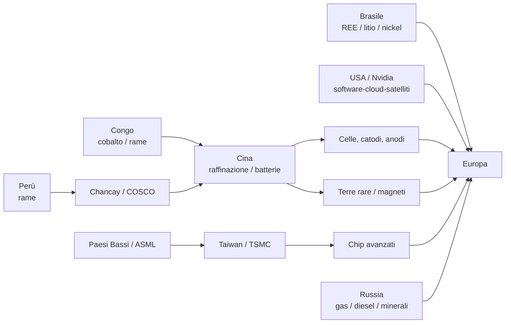

# DS-04 — Dominio industriale, energia e dipendenze strategiche dell’Europa

## Executive summary

La ricerca conferma che **la vulnerabilità europea non deriva da una singola dipendenza, ma dall’intersezione di più colli di bottiglia**: raffinazione cinese dei minerali critici, fabbricazione asiatica dei semiconduttori avanzati, batterie e componentistica cinese, energia importata, software e infrastrutture satellitari statunitensi, porti partecipati da operatori extra-UE e tecnologie di sorveglianza commerciali. La Commissione UE considera ormai esplicitamente la “weaponisation of economic dependencies” una delle quattro categorie fondamentali di rischio per la sicurezza economica europea. citeturn11search12turn11search6

I punti più rilevanti sono questi:

| Vulnerabilità | Situazione al 2026 | Evidenza |
|---|---|---|
| **Terre rare / magneti** | Il 98% della domanda UE di magneti alle terre rare è soddisfatto da importazioni cinesi; nelle importazioni UE di terre rare grezze del 2025 Cina 46,8%, Russia 25,9%, Malaysia 23,1%. | **Accertato** citeturn0search1turn14search0 |
| **Raffinazione minerali** | Cina primo raffinatore di 19 dei 20 minerali energetico-strategici analizzati dall’IEA, quota media circa 70%. | **Accertato** citeturn0search4 |
| **Semiconduttori** | UE circa 9% del mercato mondiale; nessuna open foundry UE per chip leading-edge; forte dipendenza da design USA e fabbricazione Taiwan/Corea. | **Accertato** citeturn1search0turn2search4 |
| **Batterie** | Cina >80% delle celle mondiali 2025, ~85% dei materiali catodici e >90% degli anodici. | **Accertato** citeturn5search0turn5search1 |
| **Farmaceutica** | Circa il 75% dei siti produttivi di API chimici utilizzati dall’UE è fuori dall’Unione, soprattutto India e Cina. | **Accertato** citeturn5search11 |
| **Gas** | Quota russa sulla domanda UE scesa da ~40% nel 2021 a ~10% nel 2025, ma con maggiore esposizione al mercato LNG globale. | **Accertato** citeturn3search4 |
| **Connettività satellitare** | IRIS² non offrirà la piena alternativa sovrana prima della fine del decennio: primi lanci dal 2029, servizi dal 2030. | **Accertato** citeturn11search1turn11search4 |

**Conclusione centrale:** il problema europeo non è semplicemente “dipendere dalla Cina”, dalla Russia o dagli Stati Uniti. È **dipendere contemporaneamente da attori diversi in differenti anelli della stessa catena**. Un chip AI può essere progettato negli USA, prodotto a Taiwan con macchinari olandesi, utilizzare minerali raffinati in Cina, essere inserito in un data center europeo alimentato da energia importata e collegato attraverso infrastrutture cloud o satellitari extra-UE. citeturn1search5turn1search6turn13view0

Per questa DS utilizzo i livelli **Accertato**, **Fortemente corroborato**, **Contestato**, **Non verificato** e **Smentito**. “Accertato” non significa necessariamente illecito: può indicare anche una dipendenza economica quantitativamente documentata.

## Materie prime e dipendenze industriali

La concentrazione maggiore non è necessariamente nell’estrazione, ma nella **raffinazione e trasformazione**. Nel 2024 la quota media dei primi tre Paesi nella raffinazione di minerali energetici fondamentali era salita all’86%; per 19 dei 20 minerali allargati studiati dall’IEA, la Cina è il principale raffinatore. Anche nel 2035 l’IEA prevede alla Cina oltre il 60% del litio e cobalto raffinati e circa l’80% di grafite battery-grade e terre rare. citeturn0search3turn0search4

| Catena | Nodo dominante | Indicatore | Rischio |
|---|---|---:|---|
| Terre rare → magneti | Cina | 98% domanda UE di magneti coperta da import cinese | **Molto alto** citeturn0search1 |
| Terre rare UE, import 2025 | Cina / Russia / Malaysia | 46,8% / 25,9% / 23,1% | **Alto** citeturn14search0 |
| Grafite e REE, scenario N-1 2035 | Cina | offerta restante coprirebbe solo 35–40% della domanda extra-Cina | **Critico** citeturn0search3 |
| Batterie | Cina | >80% celle mondiali 2025 | **Critico** citeturn5search1 |
| API farmaceutici | Cina/India | ~75% siti chimici fuori UE | **Alto** citeturn5search11 |

I dati del 2025 mostrano anche che **la Russia non è scomparsa dalle dipendenze minerarie europee**: 3.900 tonnellate di terre rare importate nell’UE provenivano dalla Russia, il 25,9% del peso totale. Storicamente Mosca è inoltre un grande produttore di palladio, nickel e altri metalli; queste dipendenze sono diverse da quella energetica e richiedono strategie specifiche. citeturn14search0turn14search12

Il rischio di coercizione non è teorico. Pechino ha progressivamente introdotto controlli all’esportazione su gallio, germanio, antimonio, tungsteno e terre rare pesanti; nel 2025 ha ampliato le restrizioni su diversi elementi delle terre rare, mantenendone una parte anche dopo la sospensione di alcune misure successive. citeturn0search4turn7search9

Lo scenario di shock dell’IEA è significativo: un’interruzione prolungata delle forniture di metalli per batterie potrebbe aumentare i prezzi medi globali dei battery pack del **40–50%**. citeturn0search4

La risposta europea è il Critical Raw Materials Act: entro il 2030 almeno 10% del fabbisogno UE dovrebbe provenire da estrazione europea, 40% da lavorazione europea, 25% da riciclo, e nessun singolo Paese terzo dovrebbe fornire oltre il 65% di una materia strategica in uno stadio rilevante della catena. Al 9 ottobre 2026 la Commissione aveva riconosciuto **106 progetti strategici CRMA**. citeturn0search0turn14search3

RESourceEU punta inoltre a ridurre fino al 50% entro il 2029 alcune dipendenze nelle catene di batterie, terre rare e difesa, con €3 miliardi di sostegno UE per progetti a breve termine. citeturn0search9turn11search6

## Semiconduttori, AI e manifattura

La catena dei semiconduttori è forse il migliore esempio di **interdipendenza asimmetrica**.

NVIDIA segue esplicitamente un modello *fabless*: progetta i chip ma utilizza foundry esterne come TSMC e Samsung per produrre i wafer e imprese terze per assemblaggio, test e packaging. NVIDIA stessa identifica la concentrazione geografica dei fornitori come un rischio. citeturn13view2turn13view1

TSMC rimane profondamente ancorata a Taiwan. Nel 2025 le sue strutture gestite superavano 17 milioni di wafer equivalenti da 12 pollici l’anno; i principali impianti avanzati restano sull’isola, mentre Arizona, Giappone e Germania stanno gradualmente ampliando la diversificazione. La fabbrica TSMC/ESMC di Dresda sarà però focalizzata su nodi 28/22 nm e 16/12 nm, essenziali per automotive e industria ma non equivalenti alla frontiera AI. citeturn1search6turn2search6

La Commissione stima che nel 2024 l’UE abbia consumato circa **€55 miliardi** di chip, importandone €43,6 miliardi; la produzione UE equivaleva quindi a circa il 22% del consumo. Il 35% del valore delle importazioni proveniva da Cina e Taiwan. Per i chip leading-edge la situazione è più severa: l’UE non dispone di una vera foundry aperta sotto i 10 nm ed è dipendente da design statunitensi e capacità produttive taiwanesi e sudcoreane. citeturn2search4

ASML costituisce invece il principale **choke point europeo positivo**: la sua tecnologia litografica è indispensabile per i chip avanzati. Ma la stessa ASML è esposta geopoliticamente: nel 2025 Cina e Taiwan rappresentavano rispettivamente il 29,1% e il 25,5% delle vendite nette; EUV e alcuni sistemi DUV sono soggetti a controlli sulle esportazioni. citeturn1search5

Gli Stati Uniti costituiscono così contemporaneamente un partner tecnologico e un regolatore extraterritoriale della catena. Washington ha irrigidito i controlli sulle GPU avanzate destinate alla Cina nel 2025, modificandone poi nel gennaio 2026 la politica per consentire, caso per caso, licenze per Nvidia H200, AMD MI325X e prodotti comparabili. citeturn1search4turn1search7

**Scenario Taiwan:** una grave interruzione nello Stretto colpirebbe simultaneamente foundry avanzate, AI, telecomunicazioni e automotive. È un’inferenza, ma poggia su una vulnerabilità accertata: l’UE non possiede oggi capacità aperta equivalente con cui sostituire rapidamente la produzione leading-edge taiwanese. citeturn2search4turn1search6

La manifattura verde presenta una concentrazione analoga. Nel 2025 la Cina rappresentava circa il 70% della produzione mondiale di automobili elettriche, oltre l’80% delle celle, circa l’85% dei materiali catodici e oltre il 90% degli anodici. Le imprese cinesi fornivano quasi il 75% delle batterie EV impiegate globalmente e oltre metà del mercato UE. citeturn5search0turn5search1

La capacità produttiva europea può crescere, ma l’IEA sottolinea che una fabbrica di batterie può richiedere **oltre cinque anni** dall’avvio per avvicinarsi alla capacità nominale: il de-risking è quindi un processo pluriennale, non sostituibile con soli dazi. citeturn5search1

## Energia, infrastrutture e supply chain globali

La dipendenza energetica dalla Russia è quella su cui l’Europa ha ottenuto il cambiamento più radicale. Le forniture russe via gasdotto sono diminuite di circa il 90% fra 2021 e 2025; la quota del gas russo sulla domanda UE è scesa da quasi 40% a circa 10%. Contemporaneamente, però, la quota LNG è salita da meno del 20% a quasi il 45%, trasferendo parte della vulnerabilità dal fornitore russo al mercato mondiale del gas liquefatto. citeturn3search3turn3search4

L’UE ha deciso l’eliminazione progressiva del gas russo entro il 2027: stop completo al LNG russo previsto dal gennaio 2027 e al restante gas via pipeline entro settembre-novembre 2027. citeturn3search4

Nel settembre 2026 l’inflazione dell’eurozona ha raggiunto il **3,8%**, mentre l’energia segnava **+18,8% annuo**, contro +14,3% in agosto. L’energia ha fornito da sola circa 1,71 punti percentuali dell’inflazione complessiva. citeturn3search0turn3search1

Le decisioni statunitensi dell’ottobre 2026 introducono una nuova variabile. Trump ha sospeso l’applicazione di specifiche nuove sanzioni e tariffe previste dal Graham Act, pur lasciando formalmente intatte le precedenti sanzioni anti-russe. Reuters riferisce parallelamente dell’intesa con Mosca che ha consentito il ritorno di gasolio russo sui mercati mondiali; il 20 ottobre risultavano nuovamente spedizioni verso Turchia, Brasile e Marocco. **Il fatto dell’allentamento è accertato; l’interpretazione secondo cui costituisca uno scambio geopolitico più ampio con Putin resta da dimostrare.** citeturn3search7turn3news8turn3search6

Nord Stream deve essere trattato separatamente. Nel 2026 la procura federale tedesca ha incriminato e fatto arrestare cittadini ucraini accusati di partecipazione al sabotaggio del 2022; uno degli imputati è attualmente a processo e nega il coinvolgimento. L’attribuzione completa allo Stato ucraino rimane pertanto **Contestata**, non un fatto giudiziariamente definitivo. citeturn4search1turn4news6

Sul fronte logistico, gli operatori cinesi possiedono o gestiscono partecipazioni in porti quali Pireo, Amburgo, Rotterdam, Anversa/Zeebrugge, Valencia, Bilbao e Vado Ligure. Il Parlamento europeo ha stimato una presenza cinese totale o parziale in 14 porti UE; ciò non significa che Pechino “controlli i porti europei”, ma genera rischi di dipendenza, dati, coercizione e dual-use. citeturn6search10turn6search1

Nel marzo 2026 la Commissione ha reagito con una nuova **EU Ports Strategy**, che prevede criteri specifici per proprietà e controllo stranieri delle infrastrutture portuali strategiche. I porti UE movimentano circa il 74% del commercio estero dell’Unione e 3,4 miliardi di tonnellate di merci l’anno. citeturn6search2

## Imprese strategiche e dipendenze tecnologiche

La dipendenza strategica non riguarda solo Stati ostili. Può nascere anche da imprese di Paesi alleati.

| Ecosistema | Nodo di potere | Valutazione |
|---|---|---|
| **SpaceX / Starlink / xAI / X** | Dopo l’acquisizione di xAI da parte di SpaceX nel febbraio 2026, X rientra indirettamente nello stesso ecosistema societario che combina satelliti, lanci, AI e piattaforma social. | **Fortemente corroborato** citeturn9search0turn9search1 |
| **SpaceX – capitale straniero** | ProPublica ha identificato investitori con indirizzi in Cina, Hong Kong e Russia in fondi che detenevano quote pre-IPO; le quote risultavano piccole e passive, non prova di controllo. | **Fortemente corroborato** citeturn9search3 |
| **Palantir** | Nel 2025 il 54% dei ricavi proveniva da clienti governativi; 74% dei ricavi totali dagli USA e 10% dal Regno Unito. | **Accertato** citeturn9search5 |
| **Paragon / Graphite** | Citizen Lab ha confermato forensicamente attacchi contro giornalisti europei; il cliente-operatore resta non identificato. | **Accertato / operatore non verificato** citeturn9search7 |
| **NSO / Pegasus** | Pegasus ha compromesso anche un ex europarlamentare durante il lavoro della commissione PEGA; Citizen Lab non attribuisce l’operazione a uno Stato specifico. | **Accertato / operatore non verificato** citeturn10search4 |
| **Candiru / Discover-Tech** | Nel 2026 Citizen Lab ha documentato la distribuzione di spyware attraverso infrastrutture pubblicitarie e compromissioni Candiru. | **Accertato** citeturn10search0turn10news8 |

La questione strategica non è quindi la nazionalità dell’impresa, bensì **quanto rapidamente l’Europa possa sostituirne il servizio**. Un fornitore americano può rappresentare una dipendenza critica pur appartenendo a un alleato; uno spyware israeliano può essere acquistato da un governo europeo e impiegato contro cittadini europei. Sono problemi differenti dalle operazioni russe o cinesi, ma appartengono alla stessa categoria più ampia di sovranità tecnologica. citeturn9search6turn9search7

## Africa, America Latina e geografia delle risorse

La competizione per le risorse si sta spostando sempre più verso Africa e America Latina.

**Repubblica Democratica del Congo.** Il Paese è il principale produttore mondiale di cobalto e dispone di grandi risorse di rame, litio e coltan. CMOC, Zijin e Huayou hanno posizioni rilevanti; nel marzo 2026 Kinshasa e Pechino hanno ulteriormente ampliato la cooperazione mineraria, includendo trattamento locale e condivisione di dati geologici. Contemporaneamente USA ed Europa cercano accordi alternativi. citeturn6news11turn6search7

**Brasile.** USGS stima riserve brasiliane di terre rare intorno a **21 milioni di tonnellate**, contro una produzione ancora minima: una delle maggiori possibilità mondiali di diversificazione. BYD ha acquisito diritti di esplorazione sul litio in Minas Gerais, mentre imprese occidentali come Serra Verde e Viridis stanno sviluppando catene destinate anche a USA ed Europa. citeturn7search9turn7news8turn7search2

**Perù.** È il terzo produttore mondiale di rame e punta ad aggiungere circa un milione di tonnellate annue di produzione entro cinque-sei anni. Imprese cinesi e statunitensi competono per nuovi progetti; società cinesi sono già centrali in miniere come Las Bambas e Chinalco. citeturn8search3turn8search5

Il porto peruviano di **Chancay**, costruito con COSCO e collegato direttamente con la Cina, mostra come miniere e logistica possano diventare un’unica catena strategica: l’investimento iniziale è stato di circa $1,4 miliardi e una nuova rotta Guangzhou-Chancay promette tempi e costi inferiori nel commercio transpacifico. citeturn8news9

Il grafo indica **dipendenze e flussi**, non alleanze politiche o controllo comune. citeturn0search4turn5search0turn1search6turn14search0

## Autonomia strategica UE e valutazione finale

La risposta europea è ormai articolata, ma i tempi restano il fattore critico.

| Capacità | Risposta UE | Orizzonte realistico |
|---|---|---|
| Minerali | CRMA + RESourceEU + 106 progetti strategici | forte riduzione di alcune dipendenze entro 2029–30, non autosufficienza citeturn11search6turn14search3 |
| Semiconduttori | Chips Act + Chips Act 2.0; >€80 mld di investimenti annunciati | gap leading-edge ancora aperto nel 2026 citeturn2search4turn2search5 |
| Batterie | nuove gigafactory e €852 mln di progetti Innovation Fund | crescita possibile, ma ramp-up industriale >5 anni citeturn5search7turn5search1 |
| Gas russo | REPower/diversificazione e ban progressivo | uscita prevista entro fine 2027 citeturn3search4 |
| Satelliti | IRIS² / SpaceRISE | primi lanci 2029; servizi sovrani dal 2030 citeturn11search1 |
| Porti | EU Ports Strategy + screening | quadro rafforzato dal 2026 citeturn6search2 |

IRIS² è particolarmente indicativo del problema dei tempi. Il programma disponeva inizialmente di €2,4 miliardi di budget UE; l’accordo rivisto dell’agosto 2026 porta la costellazione principale a **348 satelliti**, 330 LEO e 18 MEO, ma i primi lanci sono programmati dal 2029. Fino ad allora, la sostituibilità di reti extra-UE rimane limitata. citeturn12search2turn11search2

La valutazione conclusiva della DS-04 può essere sintetizzata così:

**Accertato:** l’UE possiede dipendenze strutturali molto elevate da Cina, Taiwan, USA e, in categorie residue, Russia; alcune riguardano beni per i quali la sostituzione richiede anni. citeturn2search4turn0search4turn3search4

**Accertato:** Cina e USA dispongono già di strumenti normativi o commerciali capaci di incidere sulle catene europee — Pechino attraverso controlli alle esportazioni di minerali e Washington attraverso controlli tecnologici sui semiconduttori. citeturn7search9turn1search4turn1search7

**Fortemente corroborato:** infrastrutture private come satelliti, AI, software governativo, porti e spyware stanno diventando nodi geopolitici quasi comparabili alle materie prime fisiche. citeturn9search0turn9search5turn10search4

**Non dimostrato:** queste dipendenze costituiscono una strategia coordinata di Russia, Cina, USA o Israele contro l’Europa. Le prove indicano piuttosto **strategie nazionali e commerciali differenti, spesso concorrenti, che sfruttano o possono sfruttare vulnerabilità europee comuni**.

La priorità per il futuro portale dovrebbe quindi essere monitorare non soltanto gli “attacchi”, ma quattro indicatori distinti: **concentrazione**, **sostituibilità**, **tempo di sostituzione** e **uso effettivo della dipendenza come leva coercitiva**. È la combinazione di questi quattro fattori a distinguere una normale relazione commerciale da una vulnerabilità strategica.

Il dataset normalizzato contiene **34 record**, con classificazione dell’evidenza e URL della fonte per ogni evento o dipendenza:

[Scarica il dataset CSV DS-04](sandbox:/mnt/data/DS04_dominio_industriale_energia_dipendenze_2026-10-21.csv)