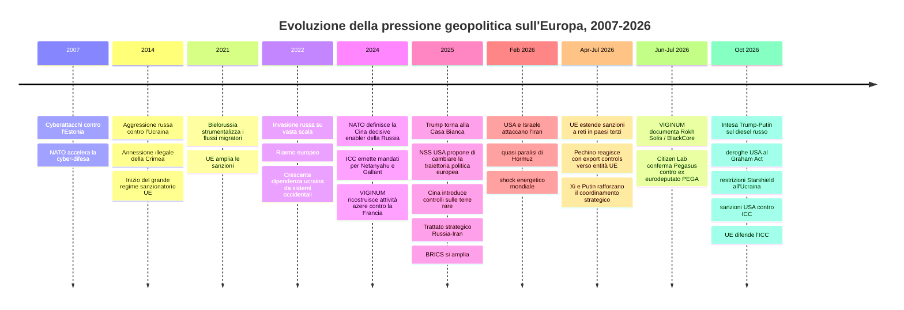
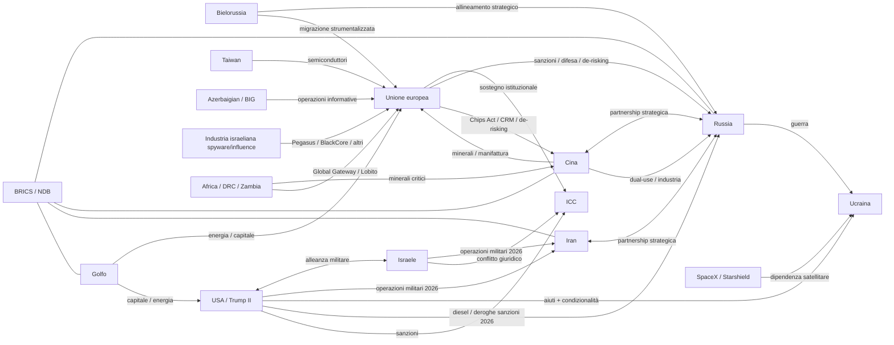

# DS-05 — Strategie globali, convergenze geopolitiche e conseguenze europee

**Deep Research consolidata | Periodo 2007–21 ottobre 2026 | Baseline per il futuro portale di monitoraggio**

## Executive summary

L'indagine mostra che l'Europa non è esposta a un unico «blocco nemico», ma a **un sistema multipolare di pressioni, dipendenze e operazioni ostili che si sovrappongono senza coincidere**. La Russia costituisce il caso più netto: aggressione militare contro l'Ucraina, sabotaggi, cyberattacchi, operazioni FIMI, coercizione economica e attività clandestine formano una campagna che UE e NATO descrivono esplicitamente come persistente e coordinata. citeturn16search0turn16search3

La Cina occupa una posizione differente: partner economico, concorrente e rivale sistemico dell'UE, è contemporaneamente un fondamentale partner strategico di Mosca. NATO ed UE documentano trasferimenti di materiali e tecnologie dual-use verso la base industriale russa, mentre Pechino possiede posizioni dominanti nella raffinazione di molte materie prime critiche. citeturn16search0turn18search2

La seconda amministrazione Trump introduce una **divergenza strategica transatlantica**: resta un alleato NATO, ma la strategia statunitense del 2025 dichiara apertamente l'intenzione di modificare la traiettoria politica europea; nell'ottobre 2026 Washington ha inoltre attenuato nuove pressioni economiche su Mosca e limitato capacità satellitari utilizzate dall'Ucraina. Non esistono prove pubbliche di un'alleanza USA-Russia. citeturn19search6turn16search2turn19news4

Israele, Iran, Bielorussia, Azerbaigian, BRICS e monarchie del Golfo completano la rete attraverso guerra, energia, intelligence, spyware, capitale, coercizione migratoria e operazioni informative.

**La vulnerabilità europea fondamentale emerge quindi dall'intersezione fra attacchi diretti e dipendenze strategiche.**

## Ambiti semantici e domande di ricerca

Per DS-05 adotterei **otto ambiti semantici**, sufficientemente ampi da coprire la geopolitica globale ma abbastanza distinti da essere convertiti successivamente in sottoreti interrogabili.

| Ambito | Contenuto della ricerca | Variabili da estrarre |
|---|---|---|
| **Allineamenti strategici** | Russia-Cina, Russia-Iran, USA-Israele, Russia-Bielorussia, BRICS | trattati, summit, accordi, votazioni, cooperazione militare |
| **Guerre e sicurezza europea** | Ucraina 2014/2022, Iran 2026, Taiwan, Mar Nero, Artico | belligeranti, sostegno, armi, intelligence, escalation |
| **Guerra ibrida** | sabotaggio, cyber, FIMI, migrazione strumentalizzata, proxy | operazione, attribuzione, sponsor, bersaglio, TTP |
| **Energia** | petrolio, gas, LNG, diesel, Hormuz, shadow fleet | origine, destinazione, volumi, sanzioni, prezzo, choke point |
| **Tecnologia e infrastrutture** | chip, satelliti, cloud, AI, telecomunicazioni, spyware | fornitore, cliente, dipendenza, sostituibilità |
| **Materie prime e industria** | terre rare, gallio, germanio, grafite, cobalto, rame | estrazione, raffinazione, quota mercato, export control |
| **Finanza e intermediari** | fondi sovrani, oligarchi, shell companies, BRICS/NDB, crypto | proprietà, beneficiario, investimento, giurisdizione |
| **Conseguenze europee** | NATO, difesa UE, autonomia strategica, polarizzazione, inflazione | impatto, risposta, costo, policy, resilienza |

Questo schema permette soprattutto di distinguere **relazione** da **attribuzione**. Essere partner commerciale della Russia, per esempio, non equivale automaticamente a sostenere la guerra; comparire in una designazione sanzionatoria per forniture dual-use costituisce invece una relazione molto più specifica. L'UE ha ormai inserito nei propri pacchetti contro Mosca entità situate anche in Cina, Hong Kong, India, Kazakhstan, Kirghizistan, Turchia ed Emirati Arabi Uniti proprio per attività legate alle catene di approvvigionamento e all'elusione. citeturn16search1turn16search3

**Le domande guida da utilizzare nelle successive Deep Search sono almeno queste diciotto:**

1. **Quanto è profonda l'integrazione strategica Russia-Cina?** Dove termina la partnership e dove cominciano interessi divergenti?
2. Quali aziende e intermediari cinesi hanno effettivamente fornito alla Russia microelettronica, macchinari CNC, componentistica, materiali e tecnologie dual-use?
3. Qual è il grado di dipendenza reciproca: quanto Mosca dipende dalla Cina e quanto Pechino continua a dipendere da energia, risorse e cooperazione russa?
4. Il trattato strategico Russia-Iran produce un'alleanza militare effettiva oppure una partnership opportunistica e limitata?
5. Come si sono comportate Russia e Cina durante la guerra USA-Israele-Iran del 2026 e cosa rivela il loro comportamento sui limiti dei rispettivi impegni verso Teheran?
6. Quanto dello shock energetico europeo del 2026 deriva direttamente dalla guerra iraniana e dalla quasi paralisi di Hormuz?
7. In quale misura le decisioni dell'amministrazione Trump II sull'Ucraina, sul diesel russo e sulle sanzioni hanno prodotto vantaggi economici o strategici misurabili per Mosca?
8. Quale catena decisionale ha portato alle limitazioni Starlink/Starshield dell'ottobre 2026, e quale ruolo ebbero Casa Bianca, Pentagono, SpaceX ed Elon Musk?
9. Esistono prove documentali di coordinamento Trump-Musk-Russia, oppure disponiamo soltanto di interessi convergenti e decisioni favorevoli a Mosca?
10. Quanto è strutturale la divergenza USA-UE nella National Security Strategy 2025 e quali soggetti politici europei Washington intende sostenere?
11. Quali attività israeliane in Europa sono attribuibili allo Stato, quali a servizi d'intelligence e quali invece a società commerciali indipendenti?
12. Chi commissiona BlackCore, Pegasus, Graphite, Candiru e altri servizi commerciali di influenza o sorveglianza quando gli obiettivi si trovano in Europa?
13. Quali intermediari finanziari, società di comodo, fondi e giurisdizioni permettono alla Russia di aggirare le sanzioni occidentali?
14. Gli Emirati, l'Arabia Saudita, il Qatar e gli altri Paesi del Golfo stanno diventando nodi capaci di arbitrare contemporaneamente capitale occidentale, energia e relazioni con Russia/Cina?
15. BRICS sta sviluppando strumenti realmente capaci di diminuire la dipendenza dal sistema finanziario occidentale oppure rimane soprattutto un forum di coordinamento politico ed economico?
16. Quanto potrebbe un'interruzione cinese di terre rare, magneti, gallio, germanio, grafite o componentistica industriale paralizzare settori europei?
17. Quale effetto avrebbe una crisi militare nello Stretto di Taiwan sull'industria europea dei semiconduttori, dell'automobile, della difesa e dell'AI?
18. Quali dipendenze europee possono essere eliminate in cinque-dieci anni, quali richiedono molto più tempo e quali costituiscono veri *single points of failure*?

Un ulteriore principio attraversa tutte le domande: **beneficiare di un evento non prova averlo causato**. La ricerca dovrà cercare sistematicamente l'anello mancante fra interesse, capacità, azione e conseguenza.

## Mappa analitica e cronologia geopolitica

Il periodo 2007-2026 può essere diviso in quattro fasi analitiche.

**Dal 2007 al 2013** emerge in modo evidente la vulnerabilità digitale europea. Gli attacchi informatici che colpirono l'Estonia nell'aprile 2007 contribuirono a rendere la cyber-difesa una priorità NATO. È corretto utilizzarli come spartiacque storico, ma non attribuire automaticamente l'intera operazione al governo russo: NATO documenta gli attacchi e le conseguenze strategiche, mentre la responsabilità statale diretta rimane più complessa. citeturn15search0turn15search5

**Dal 2014 al 2021** l'aggressione russa all'Ucraina e l'annessione illegale della Crimea trasformano la sicurezza europea. L'UE costruisce progressivamente il regime sanzionatorio contro Mosca; parallelamente crescono le attività informative, cyber e clandestine. Nel 2021 la Bielorussia porta un altro strumento nella competizione ibrida: il Consiglio UE attribuisce al regime di Lukashenko una strumentalizzazione politicamente motivata dei migranti, sanzionando anche compagnie aeree, tour operator e hotel coinvolti nell'organizzazione dei flussi verso le frontiere europee. citeturn18search7

**Dal 2022 al 2024** l'invasione russa su vasta scala determina un salto qualitativo. NATO identifica Mosca come la più significativa e diretta minaccia alla sicurezza alleata e descrive una campagna ibrida comprendente sabotaggi, violenza, provocazioni di frontiera, strumentalizzazione migratoria, cyberattacchi, interferenze elettroniche, disinformazione, influenza politica ed economic coercion. Nella dichiarazione di Washington del luglio 2024 l'Alleanza definisce inoltre la Cina un *decisive enabler* della guerra russa, indicando il sostegno alla base industriale della difesa mediante materiali dual-use, componenti, equipaggiamenti e materie prime. citeturn16search0

**Il 2025-2026 vede invece l'interconnessione delle crisi.** La Cina introduce controlli sulle esportazioni di terre rare; gli USA cambiano significativamente l'approccio strategico all'Europa; la guerra USA-Israele-Iran produce uno shock energetico mondiale; UE e Cina entrano in un ciclo di sanzioni e controsanzioni; aumentano le evidenze su spyware commerciali e influence-for-hire; Washington contemporaneamente attenua alcune nuove misure contro la Russia e aumenta la pressione su Kiev. citeturn18search2turn19search6turn19news4



Le date e le relazioni principali della timeline sono corroborate da NATO, Consiglio UE, Casa Bianca, IEA, VIGINUM, Citizen Lab, ministero degli Esteri cinese e documentazione BRICS. citeturn16search0turn18search7turn16search2turn21search1turn17search9turn17search14turn17search0

**Russia.** È l'attore per il quale il passaggio fra politica estera, operazioni ibride e conflitto militare è più direttamente documentato. UE e NATO non descrivono incidenti isolati, ma una campagna persistente. Il Consiglio UE ha inoltre sanzionato nel giugno 2026 soggetti russi coinvolti in propaganda/FIMI e società in Cina, Liberia, Turchia, Emirati, Azerbaigian e Hong Kong associate al complesso militare-industriale o alla shadow fleet. citeturn16search3

**Cina.** Il rapporto è molto più ambiguo. Bruxelles definisce Pechino contemporaneamente partner, concorrente e rivale sistemico; NATO considera invece particolarmente problematica la cooperazione con Mosca. Nel maggio 2026 Xi Jinping e Vladimir Putin hanno firmato una nuova dichiarazione sul rafforzamento del coordinamento strategico e assistito alla firma di venti documenti nei settori economico, commerciale, educativo, scientifico e tecnologico. citeturn21search1turn16search0

Il sostegno alla Russia non equivale però a un'alleanza militare analoga alla NATO. La stessa condotta cinese nella guerra iraniana dimostra la capacità di Pechino di evitare automaticamente un coinvolgimento militare diretto quando i costi superano i benefici. La categoria più appropriata rimane quindi **partnership strategica profonda con interessi autonomi**, non blocco monolitico.

La leva economica cinese è potenzialmente altrettanto importante di quella diplomatica. Secondo IEA, la Cina rappresenta oltre il 90% della raffinazione mondiale di gallio, grafite, manganese e terre rare magnetiche; nel caso delle terre rare magnetiche produceva nel 2024 circa il 91% del raffinato e il 94% dei magneti permanenti sinterizzati. citeturn18search1turn18search3

I controlli introdotti nell'aprile 2025 su sette terre rare pesanti produssero difficoltà nelle industrie automobilistiche di Stati Uniti ed Europa. L'IEA stima che, qualora le restrizioni cinesi più estese fossero applicate integralmente, fino a **6,5 trilioni di dollari di produzione downstream annuale extra-cinese** potrebbero risultare esposti; è uno scenario di stress, non una previsione di perdite certe. citeturn18search2turn18search3

La dipendenza non è però unidirezionale. La Cina domina il raffinato di cobalto, ma dipende fortemente dal minerale congolese. Reuters rileva che la Cina raffinava il 78% del cobalto mondiale nel 2024, mentre i controlli alle esportazioni della Repubblica Democratica del Congo hanno messo in evidenza la fragilità di tale modello. citeturn20news9

Questo spiega perché Africa e infrastrutture di trasporto diventino parte della competizione strategica. UE, Stati Uniti, Italia, Angola, Zambia e Repubblica Democratica del Congo partecipano allo sviluppo del **Lobito Corridor**, esplicitamente collegato anche alle value chain delle materie prime critiche. citeturn20search5turn20search6

**Taiwan e semiconduttori.** La vulnerabilità europea è differente da quella dei minerali: l'UE possiede competenze essenziali in segmenti della filiera, ma la Commissione ammette ancora dipendenze estere significative nella fabbricazione avanzata e nella progettazione. Il Chips Act 2.0 del giugno 2026 nasce precisamente dall'obiettivo di ridurre queste dipendenze. citeturn18search4turn18search5

Ne deriva un punto fondamentale per il portale: **una crisi nello Stretto di Taiwan non dovrebbe essere catalogata soltanto come rischio asiatico**, ma come potenziale shock europeo a semiconduttori, automotive, AI, telecomunicazioni e difesa.

**Iran.** La guerra iniziata il 28 febbraio 2026 con gli attacchi congiunti statunitensi e israeliani ha trasformato una rivalità regionale in un problema economico europeo. L'IEA descrive la quasi interruzione di Hormuz come la maggiore crisi di offerta nella storia del mercato petrolifero; circa 20 milioni di barili al giorno transitavano attraverso lo stretto prima del conflitto. Gli Stati membri IEA hanno autorizzato un rilascio d'emergenza di circa 400 milioni di barili, il più grande mai concordato. citeturn16search5turn16search6

A ottobre il problema non era ancora riassorbito: l'IEA riportava forti riduzioni dell'offerta di gasolio, prezzi elevati e indebolimento della domanda mondiale, con Europa e Cina fra le regioni maggiormente interessate dalla contrazione. citeturn16search4

Ciò mostra una catena causale importante:

**guerra lontana dal territorio UE → chokepoint energetico → inflazione e riduzione disponibilità di carburanti → pressione industriale e sociale europea.**

Non è necessario che l'Europa sia il bersaglio deliberato perché la conseguenza geopolitica sia grave.

**Stati Uniti sotto Trump II.** È necessario utilizzare una categoria diversa da quella applicata alla Russia. Gli Stati Uniti rimangono il principale alleato militare di gran parte dell'Europa attraverso NATO; nello stesso tempo, la National Security Strategy 2025 contiene una critica esplicita dell'attuale modello politico europeo e afferma che gli Stati Uniti dovrebbero aiutare il continente a cambiare traiettoria, esprimendo apprezzamento per la crescente influenza dei «patriotic European parties». È quindi legittimo catalogare una **strategia dichiarata di influenza politica**, senza equipararla automaticamente a un'operazione clandestina. citeturn19search6turn19search7

Gli eventi dell'ottobre 2026 accentuano il problema. La Casa Bianca ha utilizzato il potere di deroga previsto dal Graham Act per sospendere l'applicazione di numerose nuove sanzioni e tariffe contro la Russia, pur lasciando formalmente intatte le sanzioni precedenti basate su altri ordini esecutivi. citeturn16search2

Contemporaneamente Washington ha temporaneamente allentato le restrizioni sul diesel russo mentre cercava di ridurre i prezzi dei carburanti aggravati dalla guerra iraniana. Reuters riferisce che la misura ha consentito ai flussi russi di tornare verso alcuni mercati e che l'amministrazione stava cercando contemporaneamente maggiore produzione domestica e internazionale. citeturn19news0turn19news3

Queste decisioni **producono un vantaggio economico per Mosca**, ma questo non costituisce prova che Washington e Mosca operino attraverso una strategia comune.

Il caso Starshield è più sensibile. Reuters, sulla base di due funzionari statunitensi e un funzionario occidentale, ha riferito che l'ordine di limitare il servizio utilizzato dall'Ucraina proveniva dall'interno della Casa Bianca; il provvedimento interferì con droni ucraini e interceptor. citeturn19news4

Il *Wall Street Journal* ha successivamente ricostruito un ruolo diretto di Musk nella decisione. Le due ricostruzioni non sono necessariamente incompatibili, ma l'esatta catena di comando resta oggetto di testimonianze giornalistiche e versioni divergenti. Deve quindi essere catalogata come **Contestata** relativamente alla responsabilità personale, mentre l'esistenza delle restrizioni e dei loro effetti operativi è molto meglio corroborata. citeturn19news2turn19news4

**Israele.** Anche qui è indispensabile separare almeno tre reti.

La prima è **statale e militare**: cooperazione con Washington nella guerra contro l'Iran.

La seconda è **politico-diplomatica**: Stati Uniti e Israele contestano l'azione della Corte penale internazionale. La Casa Bianca aveva introdotto sanzioni contro ICC già nel febbraio 2025; nell'ottobre 2026 l'UE ha reagito alle nuove sanzioni statunitensi riaffermando il proprio sostegno all'indipendenza della Corte. citeturn17search0turn17search1

La terza è **commerciale e tecnologica**. Nel giugno 2026 VIGINUM ha identificato indicatori tecnici che collegavano l'operazione informativa *Rokh Solis*, diretta contro le municipali francesi, ad attori israeliani e in particolare alla società BlackCore. Crucialmente, VIGINUM non ha identificato pubblicamente il committente dell'operazione. Non è quindi legittimo trasformare «società israeliana» in «operazione dello Stato israeliano». citeturn17search9turn17search22

Citizen Lab ha inoltre confermato forensicamente che l'ex eurodeputato Stelios Kouloglou fu infettato con Pegasus mentre sedeva nella commissione PEGA che indagava sull'abuso degli spyware. L'attribuzione dell'operatore responsabile non è però stata stabilita. citeturn17search14

Questo settore dimostra l'esistenza di un fenomeno che dovrà costituire una classe propria nel portale: **mercenary surveillance e influence-for-hire**, dove produttore della tecnologia, utilizzatore, finanziatore e beneficiario possono essere quattro soggetti differenti.

**Bielorussia e Azerbaigian** rappresentano due esempi più circoscritti ma probatoriamente forti. Nel primo caso l'UE parla esplicitamente di strumentalizzazione organizzata e politicamente motivata della migrazione. Nel secondo VIGINUM è arrivata a stabilire un collegamento diretto fra il Baku Initiative Group e lo Stato azerbaigiano, qualificando BIG come strumento di propaganda statale contro interessi francesi, in particolare rispetto ai territori d'oltremare. citeturn18search7turn21search50

**BRICS e monarchie del Golfo** non vanno invece catalogati come blocco ostile. BRICS comprende undici membri, fra cui Russia, Cina, Iran, Arabia Saudita ed Emirati, ma anche India, Brasile, Sudafrica e Indonesia, con interessi spesso divergenti. Il gruppo lavora sull'ampliamento della cooperazione economica e sulla maggiore utilizzazione delle valute locali, mentre la New Development Bank costituisce una sua importante infrastruttura finanziaria. citeturn17search20turn17search48

Le monarchie del Golfo sono piuttosto **nodi di interconnessione**: energia, finanza sovrana, infrastrutture, tecnologia e mediazione. La guerra iraniana del 2026 ha mostrato contemporaneamente la loro forza finanziaria e la vulnerabilità geografica: Reuters riportava circa 5.000 miliardi di dollari complessivamente accumulati dai grandi fondi sovrani della regione, mentre alcuni governi valutavano come riorientare investimenti in risposta allo shock del conflitto. citeturn20news10

## Relazioni strategiche e conseguenze per l'Europa

La seguente matrice costituisce il nucleo interpretativo di DS-05.

| Attore | Relazione con l'Europa | Principali leve | Valutazione DS-05 |
|---|---|---|---|
| **Russia** | Conflitto strategico | guerra, sabotaggio, cyber, FIMI, energia, intelligence, proxy | **Minaccia diretta e documentata**. UE/NATO parlano di campagna ibrida persistente. citeturn16search0turn16search3 |
| **Cina** | Partner + concorrente + rivale sistemico | commercio, manifattura, minerali, dual-use, cyber/FIMI, Taiwan | **Dipendenza sistemica e competizione strategica**, con sostegno materiale rilevante all'industria russa. citeturn16search0turn18search2 |
| **USA / Trump II** | Alleato NATO con crescente divergenza | difesa, intelligence, dollaro, sanzioni, tecnologia, energia, influenza politica | **Alleanza istituzionale ma crescente rischio di dipendenza/coercizione politica**; nessuna prova di alleanza USA-Russia. citeturn19search6turn16search2 |
| **Israele** | Partner di molti Stati UE ma con controversie crescenti | intelligence, difesa, cyber, spyware, diplomazia | **Relazione mista**; distinguere governo da industria privata. citeturn17search9turn17search14 |
| **Iran** | Potenza regionale ostile a USA/Israele e partner di Mosca | energia, missili/droni, Hormuz, proxy | **Fonte di rischio indiretto molto elevato per energia e navigazione europea**. citeturn16search4turn21search12 |
| **Bielorussia** | Fortemente allineata alla Russia | migrazione, territorio, basi, propaganda | **Attore ibrido direttamente documentato**. citeturn18search7turn16search0 |
| **Azerbaigian** | Cooperazione economica ma contenziosi politici con la Francia | energia, influenza, disinformazione, territori francesi | **Operazioni informative specifiche documentate**, non ostilità generale verso UE. citeturn21search29turn21search50 |
| **Paesi del Golfo** | Partner energetici e finanziari | petrolio/LNG, fondi sovrani, infrastrutture, diplomazia | **Nodi strategici e finanziari**, non nemici; potenziali intermediari e giurisdizioni di elusione in singoli casi. citeturn16search3turn20news10 |
| **BRICS** | Forum concorrente in parte all'architettura occidentale | NDB, valute locali, coordinamento diplomatico | **Polo multipolare, non alleanza militare**. citeturn17search20turn17search48 |

### La rete delle convergenze



Il grafo **non rappresenta una struttura unica di comando**. Una linea indica un rapporto documentato o una dipendenza, non necessariamente cooperazione ostile. È proprio questa distinzione che impedirà al futuro portale di trasformarsi in una raccolta di guilt-by-association.

### Le convergenze più importanti

**Cina-Russia: convergenza strutturale alta.** È documentata ai massimi livelli politici e presenta una componente economico-industriale che incide direttamente sulla capacità bellica russa. NATO utilizza una formulazione eccezionalmente forte definendo Pechino *decisive enabler*. L'UE ha colpito ripetutamente entità cinesi e di Hong Kong per trasferimenti dual-use. citeturn16search0turn16search1turn21search1

**Russia-Iran: convergenza alta ma non alleanza automatica.** Mosca ha ratificato il trattato di partnership strategica nel 2025. Tuttavia, la risposta alla guerra iraniana del 2026 dimostra che l'esistenza di un trattato non equivale a una garanzia NATO-style di intervento automatico. citeturn21search12

**USA-Israele: cooperazione militare molto elevata.** Nella guerra iraniana del 2026 l'azione è stata congiunta; sul piano giudiziario esiste inoltre una forte convergenza nella contestazione dell'ICC, mentre l'UE si trova su una posizione istituzionale opposta. citeturn16search5turn17search0

**USA-Russia: convergenze tattiche nel 2026, non alleanza dimostrata.** L'accordo sul diesel, il waiver del Graham Act e la pressione sull'Ucraina producono effetti compatibili con interessi russi; contemporaneamente rimangono in vigore numerose altre sanzioni statunitensi. L'ordine esecutivo del 16 ottobre precisa espressamente che i waiver non annullano automaticamente le misure precedentemente adottate sotto altri ordini. citeturn16search2turn19news0

Questa distinzione dovrà essere codificata nel database:

`strategic_alignment ≠ tactical_convergence ≠ transaction ≠ common_beneficiary`

### Le dipendenze europee più critiche

| Dipendenza | Nodo principale | Gravità potenziale | Sostituibilità |
|---|---|---:|---|
| Difesa territoriale | USA/NATO | Molto alta | Bassa nel breve periodo |
| Intelligence strategica | USA + capacità nazionali | Molto alta | Limitata |
| Connettività satellitare militare | USA/SpaceX in alcuni impieghi | Molto alta | Crescente, ma non immediata |
| Terre rare e magneti | Cina | Molto alta | Bassa-moderata |
| Gallio/germanio/grafite | Cina | Molto alta | Bassa in alcuni segmenti |
| Semiconduttori avanzati | Taiwan + ecosistema asiatico/USA | Molto alta | Bassa nel breve periodo |
| Petrolio/gas attraverso Hormuz | Golfo / rotte marittime | Alta | Parziale |
| Cobalto grezzo | DRC | Alta | Limitata |
| Difesa industriale | USA + industrie UE | Alta | In aumento |
| Piattaforme digitali/cloud/AI | principalmente USA, con componenti globali | Alta | Variabile |

La Commissione riconosce formalmente la dipendenza da Paesi terzi nei semiconduttori avanzati; l'IEA mostra una concentrazione ancora maggiore nelle materie prime; il Consiglio UE indica espressamente la riduzione delle dipendenze strategiche come uno degli obiettivi della nuova politica di difesa. citeturn18search4turn18search2turn20search0

L'Europa sta già reagendo. Readiness 2030 prevede la possibilità di mobilitare fino a **800 miliardi di euro di spesa aggiuntiva per la difesa entro il 2030**, mentre SAFE rende disponibili fino a **150 miliardi di euro di prestiti** per investimenti e procurement congiunti. Il Consiglio definisce esplicitamente una UE più capace come complementare alla NATO, non sostitutiva. citeturn20search1turn20search2

La conseguenza politica fondamentale di DS-05 è quindi questa:

> **Autonomia strategica europea non significa necessariamente autonomia dagli alleati; significa capacità di evitare che una singola capitale, società, rotta commerciale o filiera possa unilateralmente paralizzare una funzione europea essenziale.**

## Priorità delle sottoricerche e piano operativo

DS-05 è sufficientemente ampia da meritare **cinque Deep Search verticali**. Le disporrei in questo ordine.

| Sottoricerca | Priorità | Perché viene prima | Sforzo |
|---|---:|---|---|
| **DS-05A — Russia, Ucraina, Cina e USA: economia della guerra e dipendenze transatlantiche** | Critica | Collega guerra, dual-use cinese, sanzioni, Trump II, Starshield, petrolio e capacità militare europea | Molto alto |
| **DS-05B — Iran 2026, Israele, USA e Golfo: guerra, Hormuz ed energia europea** | Critica | Permette di ricostruire il più importante shock energetico del 2026 e i rapporti USA-Israele-Russia-Cina-Iran | Alto |
| **DS-05C — Cina, Taiwan e chokepoint industriali** | Critica | Terre rare, chip, magneti, batterie e manifattura sono vulnerabilità strutturali superiori ai singoli eventi politici | Molto alto |
| **DS-05D — BRICS, Golfo, oligarchi e finanza transnazionale** | Alta | Serve a ricostruire fondi, shell companies, sanzioni, shadow fleet, crypto, NDB e capitali sovrani | Molto alto |
| **DS-05E — Intelligence privata e infrastrutture strategiche** | Alta | Unisce spyware, influence-for-hire, satelliti, piattaforme e capacità private con effetti sovrani | Alto |

Per l'esecuzione futura è più utile usare **livelli di sforzo e dipendenze** anziché una durata espressa in giorni: ciascuna Deep Search verrà completata integralmente nella sessione in cui sarà richiesta, e la complessità dipenderà soprattutto dalla quantità di documenti societari, giudiziari e tecnici da verificare.

Le milestone comuni saranno:

**Milestone A — Corpus primario.** Acquisizione di trattati, sanzioni, registri societari, atti giudiziari, documenti NATO/UE, bilanci, comunicati governativi, report tecnici e database economici.

**Milestone B — Entity resolution.** Normalizzazione di persone, aziende, alias, veicoli societari, organizzazioni, servizi d'intelligence e programmi operativi.

**Milestone C — Relationship extraction.** Ogni relazione deve essere tradotta in un triplo:

`source_entity → relationship_type → target_entity`

per esempio:

`PRC → strategic-partnership → Russian Federation`

oppure:

`Company X → supplied-dual-use-component → Russian entity Y`.

**Milestone D — Attribution audit.** Separazione fra evidenza dell'evento, evidenza dell'autore e evidenza dell'effetto.

**Milestone E — Contradiction audit.** Ricerca deliberata delle fonti che contraddicono l'ipotesi principale.

**Milestone F — Consolidamento.** Unione dei cinque dataset, deduplicazione, timeline globale e costruzione del knowledge graph.

La prima verticale dovrebbe essere **DS-05A**, perché contiene i nodi che ricorrono in quasi tutte le altre ricerche: Russia, Cina, USA, Ucraina, sanzioni, energia, tecnologia militare e logistica.

## Fonti, query e output strutturati

La gerarchia delle fonti dovrebbe diventare una regola permanente del futuro portale.

| Livello | Fonti prioritarie | Uso |
|---|---|---|
| **A — Primarie istituzionali** | UE/Consiglio/Commissione/SEAE, NATO, ONU, ICC, IEA, IAEA, ENISA, ministeri, Tesoro USA/OFAC, Casa Bianca, DOJ, intelligence con documentazione pubblica | attribuzioni, sanzioni, trattati, dati ufficiali |
| **A — Tecniche forensi** | VIGINUM, Citizen Lab, CERT-EU, ANSSI, ENISA, NCSC e laboratori accademici con metodologia verificabile | cyber, spyware, FIMI, infrastrutture |
| **B — Giornalismo investigativo** | Reuters, AP, WSJ, FT, Le Monde, El País, BBC, DW, ANSA | fonti riservate, ricostruzione operativa |
| **B — Ricerca strategica** | IISS, CSIS, RUSI, SWP, IFRI, Chatham House, Carnegie | comparazione, scenari, capacità militari/economiche |
| **C — Dati economici** | Eurostat, IMF, World Bank, WTO, OECD, ECB, UN Comtrade | commercio, energia, prezzi, dipendenze |
| **C — Registri** | registri societari nazionali, SEC/EDGAR, Companies House, Registro imprese, EU Transparency Register, TED, OpenCorporates come indice | ownership, procurement, lobbying |
| **D — Fonti degli attori** | Cremlino, MFA russo, MFA/MOFCOM cinese, governo israeliano, governo iraniano, BRICS/NDB | posizione ufficiale dell'attore, mai unica fonte dell'attribuzione |

La documentazione ufficiale cinese, per esempio, conferma direttamente il coordinamento politico Xi-Putin e i venti documenti firmati nel maggio 2026; NATO e UE sono invece necessarie per valutare ciò che quelle relazioni producono sulla sicurezza europea. citeturn21search1turn16search0

Per FIMI, il **quarto rapporto EEAS del marzo 2026** dovrà essere una fonte strutturale: nel campione 2025 il 27% degli incidenti analizzati utilizzava tattiche o tecniche AI-related, con 147 casi contro 41 nell'anno precedente. Ciò rende necessario che il futuro sistema di monitoraggio tracci specificamente contenuti sintetici, voice cloning e produzione automatizzata. citeturn21search48turn21search14

### Query Google e web

Alcune query baseline:

```text
site:consilium.europa.eu Russia sanctions China "dual-use" 2026
site:eeas.europa.eu FIMI Russia China Europe filetype:pdf
site:sgdsn.gouv.fr/viginum "ingérence numérique étrangère"
site:sgdsn.gouv.fr/viginum Russie OR Chine OR Azerbaïdjan OR BlackCore
site:citizenlab.ca Pegasus OR Graphite OR Candiru Europe
site:nato.int Russia hybrid China "decisive enabler"
site:iea.org China rare earth export controls Europe
site:ec.europa.eu critical raw materials China dependency
site:reuters.com Russia China dual-use sanctions Europe
site:reuters.com Trump Russia diesel Ukraine Starshield 2026
site:wsj.com Musk Starlink Ukraine Russia Trump
```

Per reti finanziarie:

```text
("beneficial owner" OR "ultimate beneficial owner")
(Russia OR Russian OR China)
(sanctions OR "export control")
(Europe OR EU)

("shell company" OR intermediary OR fund)
AND Russia
AND ("shadow fleet" OR dual-use OR sanctions)

("sovereign wealth fund" OR PIF OR QIA OR Mubadala OR ADIA)
AND (AI OR SpaceX OR defence OR Europe)
```

Per italiano:

```text
Russia Cina componenti dual use sanzioni Unione europea
elusione sanzioni russe società Emirati Hong Kong Turchia
terre rare Cina dipendenza europea raffinazione magneti
interferenza straniera elezioni Europa finanziamenti
spyware israeliano giornalisti europarlamentari Europa
Trump Russia gasolio sanzioni Ucraina Starshield
```

### LexisNexis

La sintassi precisa varia a seconda dell'istanza LexisNexis, ma i pattern dovrebbero utilizzare operatori di prossimità, headline e data filtering:

```text
HLEAD(Russia OR Russian) AND (diesel W/10 Trump)
(Musk W/20 Starlink) AND (Ukraine OR Zelensky)
(BlackCore OR "influence-for-hire") AND (France OR Europe)
(oligarch! W/15 fund!) AND (Europe OR EU)
("dual-use" W/20 China) AND Russia
("beneficial owner" W/20 sanctioned)
```

Dovranno essere applicati filtri per data, giurisdizione, publisher e lingua, nonché deduplicazione automatica delle versioni syndicated di Reuters/AP.

### Database UE e giuridici

Le query dovranno includere sistematicamente:

**EUR-Lex / CELEX** per regolamenti, decisioni e atti sanzionatori.

**EU Sanctions Map e Gazzetta ufficiale UE** per persone, imprese, IMO numbers delle navi e basi giuridiche.

**EU Transparency Register** per lobbying e rappresentanza d'interessi.

**TED — Tenders Electronic Daily** per procurement e contratti.

**EUDAMED/EMA/ENISA** quando l'indagine toccherà sanità o cyber-health.

**Registro imprese nazionale + SEC/EDGAR + Companies House** per catene societarie.

Per ogni risultato societario si dovrà cercare almeno:

```text
company_name
former_name
registration_number
jurisdiction
directors
shareholders
ultimate_beneficial_owner
sanctions_identifier
parent_company
subsidiary
address
shared_address
phone
domain
name_server
bank
legal_representative
```

### Output richiesti

DS-05 produrrà sei output permanenti:

**Rapporto espositivo**, cioè il documento analitico corrente e le successive verticali.

**Tabelle comparative**, con attori, strumenti, obiettivi, attribuzione ed effetti.

**Timeline interoperabile**, con ogni evento dotato di `event_id`.

**Grafo delle relazioni**, dove ogni arco sia riconducibile a una o più evidenze.

**Evidence ledger**, che conservi anche smentite e fonti contrarie.

**Dataset normalizzato CSV**, già avviato in questa ricerca.

Ho prodotto una baseline comprendente quattro CSV:

- `entities.csv`
- `events.csv`
- `relationships.csv`
- `evidence.csv`

più uno schema README.

**[Scarica il dataset CSV normalizzato DS-05](sandbox:/mnt/data/DS-05_dataset_normalizzato_2026-10-21.zip)**

La baseline contiene **24 entità, 21 eventi, 24 relazioni e 24 record probatori**. Non deve essere ancora considerata un database definitivo: le successive Deep Search dovranno espanderla e riverificare individualmente ogni record prima della pubblicazione nel portale.

## Criteri probatori e modello di attribuzione

Il futuro portale non dovrebbe assegnare semplicemente una probabilità generale a una notizia. Dovrebbe mantenere **tre attribuzioni distinte**:

`event_status`

È accaduto l'evento?

`actor_attribution`

Chi lo ha causato?

`causal_impact`

Quale conseguenza ha effettivamente prodotto?

Questo risolve numerosi problemi osservati durante la nostra ricerca.

Per esempio:

> **Starshield è stato limitato** → fortemente corroborato.

> **l'ordine proveniva dalla Casa Bianca** → fortemente corroborato da Reuters sulla base di più fonti ufficiali anonime. citeturn19news4

> **Musk personalmente ordinò il rallentamento** → forte inchiesta WSJ ma contestata nella ricostruzione complessiva della catena decisionale. citeturn19news2

> **Putin ordinò a Musk di farlo** → non verificato sulla base delle evidenze pubbliche finora disponibili.

Sono quattro claim differenti e non devono essere fusi.

### Stati probatori

| Stato | Criterio |
|---|---|
| **Accertato** | documento primario autentico, sentenza/atto giudiziario, ammissione verificabile, attribuzione tecnica conclusiva o evidenza materiale diretta |
| **Fortemente corroborato** | almeno due fonti indipendenti di elevata qualità, oppure una fonte tecnica autorevole sostenuta da evidenza documentale |
| **Contestato** | esistono ricostruzioni incompatibili entrambe plausibili oppure l'attribuzione è significativamente contestata |
| **Non verificato** | accusa plausibile ma priva di evidenza pubblica sufficiente |
| **Smentito** | evidenze affidabili rendono falsa o materialmente errata l'affermazione |

**«Contestato» non significa 50/50.** Il database dovrà memorizzare separatamente il peso delle evidenze favorevoli e contrarie.

### Metadati minimi per ogni claim

```text
claim_id
claim_text
subject_entity_id
predicate
object_entity_id
event_id
date_start
date_end
location
country
source_id
source_type
publisher
author
publication_date
access_date
source_url
archive_url
source_language
primary_or_secondary
source_independence
evidence_status
event_status
actor_attribution_status
causal_impact_status
technical_attribution
political_attribution
legal_attribution
supporting_evidence
counter_evidence
beneficiary
alleged_perpetrator
confirmed_perpetrator
target
impact_type
financial_impact
casualties
confidence_notes
last_verified
reviewer
```

Il campo **beneficiary** è particolarmente importante. Deve essere diverso da `perpetrator`.

Se un rialzo del petrolio beneficia la Russia, per esempio:

`beneficiary = Russia`

non significa:

`perpetrator = Russia`.

Analogamente, un'operazione BlackCore può beneficiare un partito senza che quel partito ne sia necessariamente il committente.

### Qualità della fonte

Aggiungerei inoltre un punteggio non di «verità», ma di **forza probatoria della singola fonte**:

| Classe | Esempio |
|---|---|
| **P1** | sentenza, documento ufficiale, dato forense primario |
| **P2** | attribuzione governativa dettagliata, report tecnico indipendente |
| **P3** | più fonti riservate indipendenti in Reuters/AP/WSJ/FT |
| **P4** | singola fonte giornalistica qualificata |
| **P5** | dichiarazione politica non corroborata |
| **P6** | social media, leak non autenticato, fonte anonima non verificabile |

Una dichiarazione di un governo riguardo al comportamento del suo avversario dovrebbe quindi essere memorizzata come **fonte primaria della posizione del governo**, ma non automaticamente come P1 dell'attribuzione sottostante.

## Rischi metodologici e conclusioni operative

Il rischio maggiore del progetto è **costruire la rete che ci aspettiamo di trovare invece di ricostruire quella che le evidenze dimostrano**.

Sono almeno nove i bias da controllare.

**Bias di conferma.** Ogni Deep Search dovrà dedicare una fase specifica alla ricerca di prove contrarie alla tesi principale.

**Guilt by association.** Un fondo che investe in un'impresa non controlla automaticamente l'impresa; un cittadino russo non rappresenta automaticamente il Cremlino; un'azienda israeliana non rappresenta automaticamente Israele.

**Confondere convergenza e coordinamento.** Trump e Putin possono beneficiare della medesima scelta per motivazioni differenti. Cina e Russia possono coordinarsi su alcune questioni e competere su altre.

**Confondere dipendenza e ostilità.** Taiwan è una dipendenza critica dell'Europa nei semiconduttori, ma non è per questo una minaccia europea.

**Confondere fornitore e utilizzatore.** NSO produce Pegasus; chi commissiona una specifica operazione deve essere dimostrato separatamente. Citizen Lab, nel caso Kouloglou, conferma Pegasus ma non attribuisce il cliente responsabile. citeturn17search14

**Confondere esposizione e compromissione.** Una rete pubblicitaria presente su migliaia di siti non significa che tutti i dispositivi raggiunti siano stati spiati.

**Bias occidentale nelle fonti.** Rapporti NATO, UE e USA sono indispensabili ma rappresentano anche le istituzioni coinvolte nel confronto. Quando possibile andranno confrontati con dati tecnici indipendenti, documenti cinesi/russi/iraniani originali e fonti economiche neutrali.

**Bias di sopravvivenza.** Vediamo soprattutto le operazioni scoperte. Un basso numero di casi attribuiti a un determinato attore può riflettere una capacità investigativa minore, non necessariamente una minore attività.

**Bias causale.** Correlazione temporale, interesse economico e risultato favorevole non costituiscono da soli prova di causalità.

Il caso Azerbaigian mostra invece come dovrebbe funzionare un'attribuzione forte: VIGINUM ha analizzato infrastrutture digitali, account, organizzazione e collegamenti tecnici fino a stabilire un legame diretto con lo Stato azerbaigiano. citeturn21search50

Il caso Cina-Russia mostra un secondo modello: abbiamo dichiarazioni congiunte ufficiali, documenti di cooperazione, identificazione NATO del ruolo cinese e designazioni sanzionatorie europee di imprese specifiche. È quindi possibile parlare di **supporto materiale e coordinamento strategico** senza postulare una fusione delle rispettive catene di comando. citeturn21search1turn16search0turn16search1

Il caso USA-Russia dell'ottobre 2026 mostra il modello opposto: esistono accordi energetici, deroghe alle sanzioni e decisioni americane che possono diminuire la pressione su Mosca; manca però la prova pubblica di una comune strategia contro l'Europa. Il corretto record sarebbe **convergenza/transazione documentata**, non «alleanza». citeturn16search2turn19news0

E BRICS illustra un quarto modello ancora: Russia, Cina, Iran, Arabia Saudita, UAE, India e Brasile possono appartenere alla stessa struttura multilaterale pur perseguendo interessi di sicurezza profondamente differenti. Il gruppo promuove riforma della governance internazionale, maggiore finanziamento in valute locali e istituzioni proprie come NDB, ma non costituisce un sistema di difesa collettiva. citeturn17search20turn17search2

La conseguenza più importante per il progetto complessivo è quindi una ridefinizione della «ragnatela».

Non dovremmo costruire:

**Nemico → attacco → Europa**

ma:

```text
ATTORI
│
├── Stati
├── apparati
├── aziende
├── oligarchi / individui
├── intermediari
└── organizzazioni multilaterali
        │
        ▼
RELAZIONI
│
├── alleanza
├── partnership
├── finanziamento
├── contratto
├── fornitura
├── comando
├── influenza
├── dipendenza
├── sanzione
├── coercizione
└── convergenza
        │
        ▼
AZIONI / EVENTI
│
├── guerra
├── sabotaggio
├── cyber
├── FIMI
├── sorveglianza
├── interferenza elettorale
├── pressione economica
├── export control
├── pressione migratoria
└── decisione diplomatica
        │
        ▼
IMPATTI EUROPEI
│
├── sicurezza
├── democrazia
├── economia
├── energia
├── industria
├── tecnologia
├── informazione
└── autonomia strategica
        │
        ▼
EVIDENZE
    Accertato
    Fortemente corroborato
    Contestato
    Non verificato
    Smentito
```

Questa architettura permette al portale di arrivare a conclusioni molto più forti proprio perché evita di presupporle.

**DS-05 porta dunque a una conclusione strategica centrale: l'Europa affronta simultaneamente una minaccia militare e ibrida russa, una forte dipendenza e competizione sistemica con la Cina, una crescente incertezza sulla prevedibilità dell'alleato statunitense, vulnerabilità derivanti da infrastrutture e tecnologie private, e shock provenienti da conflitti e nodi energetici esterni al continente.** Questi fenomeni possono rafforzarsi reciprocamente anche senza essere coordinati.

La risposta europea già osservabile — riarmo, SAFE, Readiness 2030, Chips Act 2.0, Critical Raw Materials policies, Global Gateway, sanzioni e strumenti FIMI — suggerisce che Bruxelles stessa sta progressivamente trattando sicurezza militare, industriale, informativa ed economica come componenti della medesima problematica di resilienza. citeturn20search0turn20search1turn18search4turn20search5

Il risultato finale del nostro progetto dovrebbe quindi essere meno un **«elenco dei nemici dell'Europa»** e più un **sistema europeo di threat intelligence geopolitica** capace di mostrare chi compie cosa, attraverso quali intermediari, con quali prove, quali dipendenze rende l'azione possibile e quali conseguenze produce.

È una struttura sufficientemente rigorosa da permettere, in seguito, anche il monitoraggio automatico AI senza trasformare automaticamente ogni nuova notizia in un collegamento causale.

**Dataset operativo DS-05:** [scarica il pacchetto CSV normalizzato](sandbox:/mnt/data/DS-05_dataset_normalizzato_2026-10-21.zip).