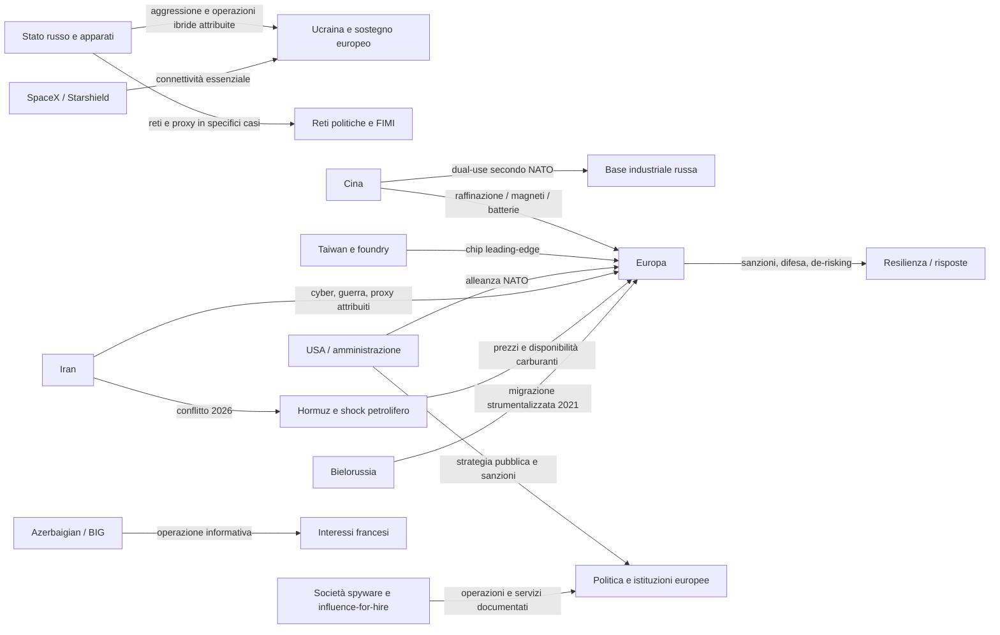
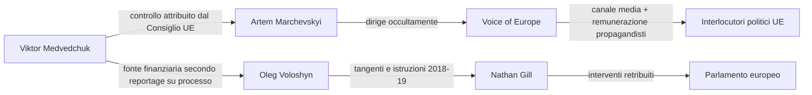
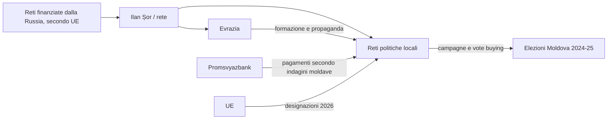
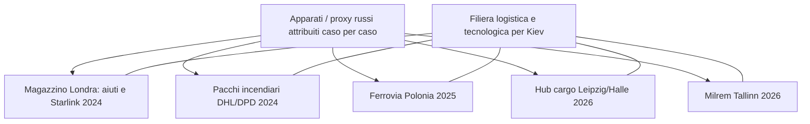
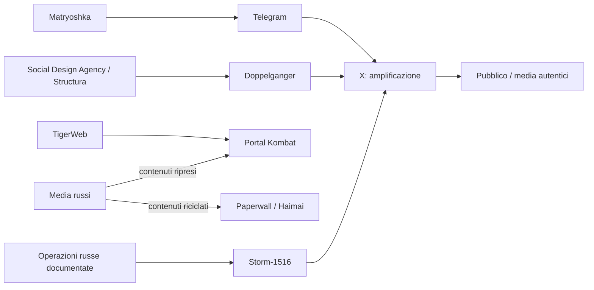

# Fonte_07 — La ragnatela delle pressioni, infiltrazioni e dipendenze geopolitiche sull’Europa

**Progetto:** Our Enemies Monitor  
**Tipo:** documento di consolidamento relazionale, modello di grafo investigativo e registro di ipotesi  
**Versione:** 1.0  
**Data e cutoff:** 21 ottobre 2026  
**Corpus principale:** Fonte_00, Fonte_01, Fonte_02, Fonte_03, Fonte_04, Fonte_05 e Fonte_06  
**Stato:** baseline di ricerca, non rapporto di attribuzione penale né accertamento giudiziario autonomo

> **Avvertenza epistemica:** la categoria politica «nemici dell’Europa» non equivale a una qualifica investigativa. Il grafo documenta anche alleati, partner commerciali, fornitori privati, regolatori e persone attaccate. La semplice comparsa nel grafo non implica illecito, complicità, subordinazione o intenzione ostile. Un collegamento economico, una nazionalità, una narrativa condivisa o una contemporaneità non dimostrano un ordine operativo. **Le ipotesi sono fisicamente separate dagli archi documentati.**

## 1. Risultato e chiave di lettura

Il consolidamento dei sette documenti contiene **353 nodi** (di cui **147 eventi della Fonte_06** e **4 eventi aggiuntivi verificati separatamente**), **444 archi descrittivi**, **153 relazioni dirette tra entità**, **22 domande investigative aperte** e **4 nuovi record esterni tenuti fuori dalla timeline ufficiale**. Gli archi di presenza negli eventi servono alla navigazione cronologica e **non vanno confusi con prova di comando, finanziamento o coordinamento**.

La conclusione di sistema è **pluralità di reti con alcuni ponti documentati**, non un apparato unico mondiale. L’apparato russo presenta la più completa combinazione documentata di guerra, sabotaggio, cyber, influenza e pagamenti politici. La Cina presenta congiuntamente capacità cyber/United Front, leva commerciale e supporto industriale alla Russia secondo NATO. Nel settore israelo-europeo sono documentate operazioni private d’influenza e spyware, ma il committente statale non è automaticamente identificabile. Gli Stati Uniti sono un alleato militare, con una politica europea pubblicamente divergente sotto Trump II e con imprese private che detengono dipendenze infrastrutturali importanti. L’Iran appare come attore militare, cyber e, in casi specifici, utilizzatore attribuito di proxy criminali. [S00–S06]

### 1.1 Matrice dei livelli di prova

| Codice | Portata | Uso consentito | Errore da evitare |
|---|---|---|---|
| **E1** | Atti, decisioni, sentenze, operazioni tecniche verificate | Registrare esistenza del fatto/atto nel suo oggetto esatto | Equiparare sanzione a colpevolezza penale |
| **E2** | Attribuzione formale di intelligence, governo, UE/NATO | Dire «secondo la specifica autorità X» | Spacciare la valutazione statale per verità giudiziaria |
| **E3** | Ricerca forense, inchiesta, corroborazione multi-fonte | Documentare un nesso con caveat e provenienza | Estendere un indizio tecnico a comando politico |
| **E4** | Accusa o denuncia non corroborata | Conservare come contestazione riferita | Accettarla come responsabilità accertata |
| **E5** | Correlazione / scenario / ipotesi | Solo nel registro `ipotesi.csv` | Inserire l’ipotesi tra gli archi fattuali |

**Precisione aggiuntiva:** un arco E1 su una decisione di sanzionare è forte per *la decisione*, mentre il nesso di colpevolezza indicato nella sanzione può richiedere un arco E2. `attribution_confidence` e `impact_confidence` vanno mantenuti indipendenti nell’applicazione futura. I singoli archi della versione 1.0 recano una qualifica principale, non un punteggio numerico pseudo-oggettivo.

### 1.2 Classi ontologiche

| Classe di nodo | Numero | Esempi |
|---|---:|---|
| `event` | 151 | Attacchi DDoS contro l’Estonia, Cyberattacchi durante la guerra russo-georgiana, Hapsburg Group e lobbying per Yanukovych |
| `organization` | 47 | GRU / intelligence militare russa, APT28 / Fancy Bear, Sandworm / GRU unità 74455 |
| `asset` | 36 | IRIS² / SpaceRISE, Critical Raw Materials Act, REPowerEU / uscita dal gas russo |
| `company` | 34 | X (ex Twitter), SpaceX, Starlink |
| `institution` | 33 | Unione europea, NATO, Corte penale internazionale |
| `state` | 32 | Federazione Russa, Repubblica Popolare Cinese, Stati Uniti / amministrazione federale |
| `person` | 20 | Vladimir Putin, Viktor Medvedchuk, Artem Marchevskyi |

Le categorie dei legami includono finanziamenti, proprietà e controllo, direzione operativa, attribuzioni istituzionali, servizi commerciali, supporto logistico, utilizzo delle piattaforme, fornitura tecnologica, dipendenza, risposta istituzionale, trasmissione di narrativa e conseguenze economiche. **Ogni predicato va letto letteralmente**, senza promuoverlo a `GESTITO_DA` per vicinanza topologica.

## 2. Mappa generale: più reti sovrapposte



La figura è **sintetica**, non visualizza gli archi contestati né afferma un’alleanza clandestina fra Stati Uniti, Russia, Cina, Israele e Iran. Per i legami dettagliati sono disponibili `archi.csv` e `graphml`. [S00, S03, S04, S05]

## 3. I poli di potere: attori, obiettivi e leve

| Polo | Interessi riportati o inferenza strategica esplicitata | Leve documentate | Intersezioni rilevanti | Limite fondamentale |
|---|---|---|---|---|
| **Russia / GRU / ecosistemi FIMI** | Conservare capacità bellica contro Kiev; indebolire sostegno occidentale; condizionare pubblico e interlocutori UE | Aggressione, sabotaggi logistici, cyber, finanziamenti, siti pseudo-mediatici, proxy | Bielorussia; Cina dual-use; VoE/Șor; apparati europei sotto attacco | Non ogni azione filorussa è ordinata da Mosca; imputare ogni incidente separatamente. [S00,S01,S02,S03,S05] |
| **Cina / PCC / apparati cyber** | Protezione mercati e influenza, Taiwan, potere industriale; partnership con Mosca | APT31, UFWD, imprese, materiali critici, controlli export, progetti portuali | Base industriale russa, filiere UE, Taiwan, Africa/Perù, media internazionali | Commercio lecito e dominio industriale non sono sabotaggio; Paperwall non prova ordine governativo. [S01,S02,S03,S04,S05] |
| **USA / Trump II** | Orientamento dichiarato nella NSS 2025; controllo export, interessi nazionali su carburanti e sicurezza | NATO, sanzioni/deroghe, export control, accordi diplomatici e militari | Russia (diesel), Europa (NSS), Israele (Iran/CPI), Ucraina (condizionalità) | Alleanza NATO e divergenze non equivalgono ad accordo clandestino con Putin. [S00,S04,S05] |
| **Musk / SpaceX / X** | Contratti satellitari, tecnologia, AI e interventi politici pubblici | Starlink/Starshield, X, proprietà, infrastrutture e raccolta capitali | Dipendenza ucraina; agenda politica AfD; fonti finanziarie internazionali | Nessuna prova che LP o Kerimov dirigano operazioni militari; responsabile ultimo Starshield contestato. [S01,S03,S04] |
| **Israele / operatori privati israeliani** | Stato: sicurezza e Iran; imprese: business spyware e influenza | Cooperazione bellica USA; BlackCore, Pegasus, Candiru/Discover-Tech, Team Jorge | Francia, ex eurodeputati, istituzioni CPI, target civili | Le imprese non diventano emanazioni dello Stato per nazionalità; committenti spesso ignoti. [S01,S02,S04,S05] |
| **Iran / MOIS / operatori e proxy** | Sicurezza del regime, conflitto con USA/Israele e sostegno selettivo a partner | Cyber contro Albania, Emennet, partnership Russia, pressioni Hormuz, attribuzioni Foxtrot | Servizi cyber europei, sicurezza UK, petrolio | Mandato iraniano non generalizzabile da un caso Foxtrot all’intera criminalità collegata. [S03,S05, WEB-EXT] |
| **Bielorussia / Azerbaigian** | Pressioni territoriali e interessi nazionali diversi | Bielorussia: migrazione organizzata attribuita UE; BIG: interferenze anti-francesi | Frontiere UE; territori francesi d’oltremare | Non trasferire l’attribuzione Bielorussia 2021 a Marocco/Ceuta 2026. [S03,S05] |
| **Golfo / BRICS / capitale internazionale** | Energia, diplomazia, fondi, commercio e infrastrutture | Fondi sovrani, petrolio/LNG, reti logistiche, NDB | UE/USA/Cina/Russia, canali commerciali | Non costituiscono un blocco ostile omogeneo; colpire società sanzionate, non nazionalità intere. [S01,S04,S05] |
| **Unione europea / NATO** | Difesa e sovranità democratica, continuità economica, autonomia strategica | Sanzioni, CSD/DSA, NATO, IRIS², Chips Act, CRMA, REPowerEU, SAFE | Tutti i poli attraverso trade, difesa, tecnologia e infrastrutture | Risposta istituzionale non è segno di direzione straniera; non confondere obiettivi futuri con capacità odierne. [S00,S03,S04,S05] |

## 4. Le ragnatele operative: catene e percorsi verificabili

### Rete A. Medvedchuk, Voice of Europe e il caso Gill: il ponte più specifico



**Constatazione di incrocio S01+S06 e verifica aggiuntiva:** l’atto del Consiglio UE del 27 maggio 2024 attesta la rete VoE/Medvedchuk/Marchevskyi; la condanna di Gill del 21 novembre 2025 attesta lo schema delle tangenti con circa £40.000; Euronews riferisce, sulla base dell’udienza, che Medvedchuk fu la principale fonte di denaro anche per lo schema Gill. Il nodo condiviso è perciò **Medvedchuk** con almeno **due catene operative distinte nel tempo**, non prova che Gill fosse pagato da Voice of Europe o che tutti i politici intervistati fossero corrotti. [S01, S06: TL-0015, TL-0056, TL-0060, TL-0092]

**Riferimenti verificati:** [Consiglio UE](https://www.consilium.europa.eu/it/press/press-releases/2024/05/27/information-manipulation-in-russia-s-war-of-aggression-against-ukraine-eu-lists-two-individuals-and-one-entity/); [Crown Prosecution Service](https://www.cps.gov.uk/cps/news/former-ukip-mep-jailed-taking-bribes); [ricostruzione processuale Euronews](https://it.euronews.com/2025/11/22/la-condanna-a-nathan-gill-solleva-nuovi-interrogativi-sui-legami-tra-europarlamentari-e-cr).

**Nuova domanda (H01):** stessi conti, intermediari o contratti? La fonte attuale **non documenta** la continuità finanziaria fra Voice of Europe e Gill. Questo è un obiettivo di indagine, non un arco attribuito.

### Rete B. Moldova: dal capitale al voto attraverso organizzazione e infrastruttura



La combinazione **finanziamento, banca, intermediari territoriali, reclutamento e influenza** rappresenta uno dei casi più documentati del corpus. L’UE nel giugno 2026 descrive persone legate a reti Șor/Evrazia impiegate per disturbare le elezioni parlamentari del settembre 2025 e la compravendita di voti. I flussi PSB sono trattati come riportati dalle autorità moldave, non come prova che ogni transazione sia attribuibile a un unico mandante. [S00, S01, S02, S05, S06: TL-0053, TL-0077, TL-0115]

**Fonte istituzionale:** [Consiglio UE](https://www.consilium.europa.eu/it/press/press-releases/2026/06/15/republic-of-moldova-council-lists-six-individuals-for-actions-destabilising-the-country/); [decisione consolidata EUR-Lex](https://eur-lex.europa.eu/eli/dec/2023/891/2026-06-15/eng).

### Rete C. Sabotaggio fisico contro la catena europea di sostegno militare



L’elemento ricorrente è la **funzione del bersaglio**, non una catena di comando dimostrata in tutti gli episodi. Il magazzino londinese colpito il 20 marzo 2024 custodiva aiuti e apparati Starlink; Milrem sviluppa mezzi senza equipaggio per Kiev; Rheinmetall e hub cargo tedeschi sono nodi sensibili. Le attribuzioni passano rispettivamente da sentenze, controspionaggio e dichiarazioni istituzionali di differente valore; perciò gli archi individuali conservano stato distinto. [S03, S06: TL-0058, TL-0063, TL-0064, TL-0091, TL-0119, TL-0120]

**Scoperta relazionale:** la stessa dipendenza satellitare può essere **bersaglio fisico di sabotaggi** (dispositivi in transito a Londra) e **punto di controllo di fornitore** (restrizioni Starshield nel 2026). Non implica alcuna cooperazione tra sabotatori e SpaceX. I due percorsi producono vulnerabilità cumulative anche quando gli attori non collaborano. [S03, S04, S06: TL-0058, TL-0137]

### Rete D. FIMI: produzione, lavanderia informativa e amplificazione



Doppelganger ha una struttura industrializzata attribuita dal DOJ; Storm-1516 utilizza false testimonianze e video sintetici; Portal Kombat amplifica e aggrega contenuti; Matryoshka punta anche sul coinvolgimento di media e fact-checker. **Paperwall**, tecnicamente collegata a Haimai, riprende anche narrazioni russe: questo è un **ponte informativo osservato** fra ecosistemi, non prova di pianificazione congiunta Pechino–Mosca. L’appartenenza di un messaggio alla stessa narrazione non permette di identificare l’operatore. [S01, S02, S05; S06: TL-0032, TL-0033, TL-0045, TL-0047, TL-0051, TL-0055, TL-0082]

**Verifica di impatto:** le operazioni possono avere grandi quantità di account e scarso engagement autentico. Distinguere produzione, reach, engagement, esposizione umana e cambiamento del voto; non sostituire l’ultimo con il primo. [S02]

### Rete E. Cina: spionaggio, accesso politico, leva industriale

Sono **tre sottoreti distinte**: `APT31 → attacchi alle istituzioni britanniche e ceche` con attribuzioni statali; `UFWD ↔ Christine Lee` con valutazione MI5 su origine occultata di donazioni, **non una condanna Lee**; `Jian G. → spionaggio per Cina` con condanna tedesca. Parallelamente `raffinazione cinese → magneti/batterie UE` e `Cina → supporto dual-use russo secondo NATO` costituiscono legami commerciali e strategici documentati che non possono essere automaticamente assimilati alla sorveglianza o all’infiltrazione. [S01,S03,S04,S05; S06: TL-0026, TL-0027, TL-0054, TL-0065, TL-0070, TL-0074, TL-0075, TL-0089]

La dichiarazione NATO usa espressamente la definizione **decisive enabler** per il supporto industriale cinese alla Russia; si tratta di un’attribuzione degli alleati, contestata dalla Cina. [NATO, 10 luglio 2024](https://nato.int/en/about-us/official-texts-and-resources/official-texts/2024/07/10/washington-summit-declaration).

### Rete F. USA, Musk e società strategiche: tre piani da non fondere

**Piano statale:** la NSS 2025 dichiara un orientamento politico nei confronti dell’Europa; nel 2026 gli Stati Uniti cooperano militarmente con Israele contro l’Iran e adottano deroghe selettive al Graham Act mentre negoziano il dossier del diesel russo. La divergenza dagli interessi di alcuni partner UE è documentata, **non** un’alleanza clandestina USA-Russia. [S00,S04,S05]

**Piano imprenditoriale-operativo:** SpaceX controlla infrastrutture Starlink/Starshield usate dall’Ucraina. Nell’ottobre 2026 limitazioni tecniche incidono su parte dei sistemi mobili militari ucraini; responsabilità ultima personale/istituzionale contestata da ricostruzioni giornalistiche. SpaceX ha anche collaborato per bloccare terminali russi non autorizzati, fatto da conservare per evitare inferenze a senso unico. [S00,S03,S04,S05; TL-0097, TL-0137, TL-0142, TL-0146]

**Piano finanziario:** il corpus prova `HAL9001 → fondo Tomales → partecipazione SpaceX`, `Sobachevskiy → documenti HAL9001`, `Sobachevskiy ↔ GVA Capital` e separatamente `GVA → investimenti di Kerimov` oggetto di OFAC. **Non prova** `Kerimov → HAL9001`, `Kerimov → SpaceX` né controllo degli investitori sulle decisioni Starshield. Anche gli investimenti in X del 2022 non equivalgono a diritti di controllo oggi. [S01,S04; TL-0084, TL-0116]


**Attenzione:** la figura mostra un *percorso di relazioni eterogenee*; **non** un flusso dimostrato di capitale da Kerimov a SpaceX. Per un diagramma investigativo, il tratto `GVA–Sobachevskiy` deve restare visualmente distinto da un bonifico. È un caso paradigmatico di *path fallacy*: la transitività dell’essere «collegato» non produce la transitività del «finanzia» o del «controlla». [S01]

### Rete G. Società private israeliane e committenti potenzialmente differenti

Il corpus sostiene: `BlackCore ↔ Rokh Solis → tentata ingerenza alle municipali francesi`; `NSO → Pegasus → compromissione forense di ex eurodeputato PEGA`; `Paragon → Graphite → giornalisti europei`; `Discover-Tech ↔ catene adtech per spyware Candiru`. Team Jorge dimostra la disponibilità commerciale di capacità di influenza. **Mancano spesso clienti finali e beneficiari**. Lo Stato israeliano non riceve quindi un arco diretto di comando verso tali operazioni. [S01,S02,S03,S04,S05]

VIGINUM segnala una visibilità online *molto bassa* di Rokh Solis e non stabilisce il committente: [rapporto](https://www.sgdsn.gouv.fr/viginum/publications/rokh-solis-analyse-dun-mode-operatoire-informationnel-ayant-cible-les). Citizen Lab documenta specifiche catene spyware via advertising: [indagine Discover-Tech](https://citizenlab.ca/research/how-discover-tech-turned-targeted-ads-into-a-pipeline-for-spyware/).

### Rete H. Iran 2026, proxy criminali ed effetti economici

La documentazione di progetto combina `Iran/MOIS → operazioni cyber contro Albania`, `Emennet Pasargad → Francia/Svezia`, `USA+Israele → guerra contro Iran nel febbraio 2026`, `Hormuz → crisi di petrolio → energia europea` e `Iran ↔ Russia: trattato strategico`. **Il trattato non equivale a obbligo automatico di difesa reciproca**. [S00,S03,S05,S06: TL-0040, TL-0050, TL-0083, TL-0100, TL-0103, TL-0106]

**Nuova evidenza esterna, non contenuta nella Fonte_06:** OFAC nel marzo 2025 ha sanzionato Foxtrot Network e Rawa Majid, dichiarando che la rete aveva organizzato nel gennaio 2024 un attacco all’ambasciata israeliana a Stoccolma su incarico iraniano e che Majid cooperava con MOIS. Il CPS britannico documenta un complotto omicida Foxtrot risalente al marzo 2025, con sentenza a 20 anni nei confronti di Johannes Natland il 16 ottobre 2026. **Questa sentenza non dimostra che il MOIS abbia ordinato quel preciso complotto**. Altra vicenda distinta: un episodio del 27 settembre 2026 presso RAF Fairford è oggetto di indagini e di nuovi arresti il 20 ottobre per sospetto aiuto ai servizi iraniani; alla baseline non è una responsabilità giudicata. [WEB-EXT-001…004]

**Fonti di verifica:** [OFAC, 12 marzo 2025](https://home.treasury.gov/news/press-releases/sb0047); [CPS, aggiornato al 16 ottobre 2026](https://www.cps.gov.uk/national-news/news/teen-hitman-guilty-uk-murder-plot); [Reuters, indagine RAF Fairford](https://www.reuters.com/world/uk/uk-police-re-arrest-pair-suspicion-helping-iranian-intelligence-over-raf-2026-10-20/).

**Intersezione strutturale osservata:** Russia e Iran, in **casi distinti** attribuiti da autorità diverse, utilizzano o sono collegati a intermediari criminali per operazioni in Europa. Questa è una *convergenza di modalità organizzative* che suggerisce indicatori comuni per il monitoraggio (reclutamento, crypto, canali cifrati, armi/logistica), **non** una collaborazione operativa Russia–Foxtrot né il mandato iraniano per ogni caso. [S03, WEB-EXT]

## 5. Intersezioni tra reti: ciò che emerge incrociando le fonti

| ID | Incrocio non banale | Tipo di connessione | Solidità e limite | Fonti |
|---|---|---|---|---|
| X01 | Medvedchuk collega VoE e precedente schema Gill | **Nodo personale comune** e possibili circuiti affini | VoE E2; Gill E1; fondi Medvedchuk in caso Gill riferiti da reportage E3; conto comune non provato | S01,S06,WEB |
| X02 | Filiere logistiche, aziendali e satellitari ucraine bersagliate | **Convergenza di bersagli** | Diversi sabotaggi attribuiti alla Russia con mandati non sempre identici | S03,S06 |
| X03 | Doppelganger/Storm/Portal Kombat ↔ media e account reali | **Infrastruttura e distribuzione**, non necessariamente un’unica direzione | Attribuzione russo-FIMI robusta, impatto politico difficilmente misurabile | S01,S02 |
| X04 | Media russi ripresi da Paperwall/Haimai | **Information laundering transfrontaliero** | Riuso osservato, accordi o comando Pechino-Mosca non provati | S02,S05 |
| X05 | Cyber di APT31 + UFWD/Lee + caso Jian G. | **Pluralità di accessi politico-tecnici** | Tre modalità cinesi distinte; vietata unificazione di catena operativa | S01,S03 |
| X06 | Cina dual-use verso Russia + dipendenza industriale UE dalla Cina | **Doppia leva supply chain** | NATO attribuisce supporto russo; dominanza UE quantitativa; nessuna coercizione implicita nel commercio | S04,S05 |
| X07 | Starlink colpito come materiale logistico; Starshield limitato come servizio | **Vulnerabilità cumulativa**, non coordinamento | Sabotaggio fisico attribuito a proxy russi; decisione fornitore 2026 contestata | S00,S03,S04 |
| X08 | Kerimov-GVA-Sob-HAL9001-Tomales-SpaceX | **Percorso societario non transitivo** | Alcuni link E1/E3, Kerimov→SpaceX non provato | S01,S04 |
| X09 | USA-Israele contro Iran, Hormuz e aumento pressione sociale UE | **Trasmissione macroeconomica** | IEA/Eurostat supportano shock; non segue comando straniero delle proteste | S00,S02,S04,S05 |
| X10 | Sanzioni statunitensi CPI e opposizione istituzionale UE | **Divergenza USA-UE** in campo giudiziario | Atti pubblici; non campagna clandestina | S00,S05 |
| X11 | Bielorussia 2021 e Ceuta 2026 | **Somiglianza di categoria di frontiera** | Regia bielorussa E2; regia marocchina non verificata | S00,S03,S05 |
| X12 | GUGI, cavi baltici, navi con ancore e shadow fleet | **Superficie d’attacco condivisa** | Solo alcuni incidenti attribuiti; danno non prova dolo né mandato | S03,S06 |
| X13 | Russia e Iran usano proxy criminali in episodi distinti | **Analogia organizzativa corroborata** | Uso iraniano Foxtrot attribuito OFAC per caso 2024; non stessa rete russo-iraniana | S03,WEB-EXT |
| X14 | IRIS² / CRMA / Chips Act / REPowerEU | **Risposte a dipendenze differenti** | Capacità pianificate non sono capacità già dispiegate | S04,S05 |
| X15 | Cobalto RDC → raffinazione Cina → manifattura UE; litografia ASML → foundry Taiwan → AI USA | **Dipendenze multinodo incrociate** | Filiere verificate, stress scenario non prova sabotaggio imminente | S04,S05 |
| X16 | Rokh Solis e altre capacità commerciali di sorveglianza/influenza | **Mercato di servizi a committente variabile** | Tecnologia forense ≠ identità cliente ≠ Stato produttore | S01,S02,S04,S05 |

**Risultato chiave delle correlazioni:** i collegamenti vanno distinti fra **persone/denaro condivisi**, **stesso metodo**, **stessa infrastruttura**, **stesso bersaglio**, **stesso beneficio** e **catena di comando comune**. Soltanto l’ultima, se dimostrata, giustifica una fusione operativa di reti. [S00–S06]

## 6. Connessioni da non affermare come fatti

In questa baseline rimangono **esplicitamente prive di arco fattuale**: `Kerimov FINANZIA SpaceX`; `Russia ORDINA limitazioni Starshield`; `Trump/Musk/Putin/Israele CONCORDANO una regia europea`; `Stato israeliano ORDINA Rokh Solis`; `Cina ORDINA ogni danneggiamento dei cavi operato da navi cinesi`; `Marocco ORGANIZZA afflusso Ceuta`; `Russia DETERMINA Brexit/elezioni Romania/proteste ottobre 2026`; `Iran ORDINA ogni operazione Foxtrot`; `account filorusso = agente GRU`. La loro formulazione corretta è quella di un’ipotesi falsificabile, tracciata nel registro, oppure di una specifica tesi già non supportata dagli atti. [S00–S06; WEB-EXT]

## 7. Dossier delle piste prioritarie, con domande e prove richieste

La tabella seguente elenca **domande**, non accuse o ipotesi convalidate. `Hxx` è un oggetto separato: non incrementa la densità del grafo dei legami dimostrati. Il registro CSV riporta fonti, record temporali, verifiche e avvertenze.

| ID | Priorità | Oggetto della verifica | Stato iniziale e limite |
|---|---|---|---|
| **H01** | Alta | Si può dimostrare se Voice of Europe e tangenti Gill condivisero conti, veicoli o intermediari oltre Medvedchuk? | Non provato un unico circuito finanziario; sponsor politico è nodo condiviso ma schema e date diverse. |
| **H02** | Critica | Quali committenti e canali uniscono DHL, magazzino Londra, Rheinmetall, Leipzig e Milrem? | Una campagna strategica comune non implica direttiva identica per ogni episodio. |
| **H03** | Alta | Il riuso Paperwall di fonti russe deriva da accordi editoriali, aggregazione automatica o istruzioni statali? | Ripresa di contenuti dimostrata; coordinamento non dimostrato. |
| **H04** | Critica | Chi ha commissionato e pagato Rokh Solis? | Nazionalità israeliana operatore non identifica committente né Stato israeliano. |
| **H05** | Critica | Quali enti effettivamente acquistano, implementano e autorizzano l’uso di Candiru/Discover-Tech? | Catena tecnologica non attribuisce ogni infezione al fornitore o a un governo. |
| **H06** | Critica | Esiste prova bancaria di fondi Kerimov entrati nell’investimento HAL9001 o SpaceX? | NESSUNA prova nel corpus; vietata la catena per semplice vicinanza Sob-GVA. |
| **H07** | Alta | Esistono ordini, accordi e contatti governativi relativi al sostegno Musk ad AfD? | Sostegno pubblico accertato, regia clandestina federale non dimostrata. |
| **H08** | Critica | Quale soggetto autorizzò specificamente le limitazioni Starshield e quando? | WSJ/Reuters/Telegraph e interessati divergono; non collegare automaticamente a Mosca. |
| **H09** | Alta | Il governo marocchino pianificò la crisi o ne conosceva l’arrivo senza organizzarla? | Fonti e cifre discordanti; non equiparare al caso bielorusso. |
| **H10** | Alta | Il trascinamento ancora fu intenzionale o risulta accidentale? | Dolo e ordine del governo cinese non provati. |
| **H11** | Alta | La nave Yi Peng 3 agì deliberatamente? | Indagine svedese non dimostra il dolo; nazionalità non prova mandato. |
| **H12** | Alta | Una catena di ordini collega il danneggiamento Estlink 2 allo Stato russo? | Associazione shadow fleet è solo contesto. |
| **H13** | Media | Quali campagne sono misurabili per scala ed esposizione reale, non soltanto volume bot? | Nessun dato consente di provare che Russia abbia determinato esito. |
| **H14** | Alta | Quale parte della manipolazione TikTok 2024 aveva finanziatori esteri? | Manipolazione certa; VIGINUM non attribuisce in blocco ingerenza straniera. |
| **H15** | Critica | Quali reti straniere hanno amplificato manifestazioni dopo l’origine domestica? | Assenza di prove che fossero create dall’estero; viralità non è comando. |
| **H16** | Alta | Quanto del rischio energetico eliminato con REPowerEU è migrato al mercato LNG globale e Hormuz? | Rischio macro misurabile, non prova azione deliberata contro proteste UE. |
| **H17** | Alta | Quale combinazione Taiwan+minerali raffinati Cina+controlli USA+energia potrebbe interrompere settori UE? | Scenario stress non evento già avvenuto. |
| **H18** | Media | Esiste amplificazione reciproca tracciabile tra BIG e reti russe su Francia? | Nessun coordinamento descritto dalle fonti; solo bersaglio potenzialmente comune. |
| **H19** | Alta | La condanna Natland prova un ordine specifico da intelligence iraniana? | No; CPS accerta complotto Foxtrot, OFAC attribuisce altri specifici episodi al MOIS. |
| **H20** | Critica | Si può dimostrare un incarico iraniano nel caso RAF Fairford? | L’inchiesta è aperta al cutoff; nessuna condanna o responsabilità definitiva. |
| **H21** | Alta | Quali società effettive nelle sanzioni 2026 condividono amministratori, UBO, wallet, navi? | Entità specifiche sanzionate non equivalgono a colpevolezza di Paesi terzi. |
| **H22** | Media | Le accuse politiche sui disordini albanesi hanno indicatori forensi indipendenti? | Accuse del premier non equivalgono a prova. |

### Perché queste domande meritano nuovi approfondimenti

Le priorità **critiche** sono quelle che potrebbero trasformare **un legame attualmente incompleto in una catena finanziaria/operativa effettiva**, determinare il decisore di una restrizione strategica, oppure stabilire il committente di un servizio di influenza. Le priorità **alte** seguono superfici d’attacco condivise, dipendenze a rischio sistemico, e anomalie documentate. Le priorità **medie** servono soprattutto a escludere correlazioni spurie prima che entrino in una rappresentazione pubblica. Nessuna priorità costituisce indice di responsabilità o di probabilità di colpevolezza.

## 8. Quattro casi ulteriori documentati fuori dal corpus S00–S06

| ID esterno | Data | Rilievo | Prova e limite |
|---|---|---|---|
| `EXT-001` | 2024-01 | Attacco contro l’ambasciata israeliana a Stoccolma: attribuzione OFAC a Foxtrot su incarico iraniano | OFAC sostiene che Foxtrot organizzò l’attacco per conto dell’Iran. Si tratta di attribuzione USA, distinta da sentenza sul mandato. [Fonte originale](https://home.treasury.gov/news/press-releases/sb0047) |
| `EXT-002` | 2025-03-12 | OFAC sanziona Foxtrot Network e Rawa Majid | Designazione Foxtrot come organizzazione criminale transnazionale e del leader Rawa Majid; OFAC dichiara cooperazione Majid-MOIS. [Fonte originale](https://home.treasury.gov/news/press-releases/sb0047) |
| `EXT-003` | 2026-10-16 | Condanna Natland per complotto omicida Foxtrot nel Regno Unito | CPS aggiorna il 16 ottobre la condanna a 20 anni per un tentativo di omicidio su commissione nel marzo 2025; il singolo ordine iraniano non è dimostrato nel caso. [Fonte originale](https://www.cps.gov.uk/national-news/news/teen-hitman-guilty-uk-murder-plot) |
| `EXT-004` | 2026-09-27 | Incidente alla base RAF Fairford e nuovi arresti del 20 ottobre | Arresti presso la base il 27 settembre; due nuovamente arrestati il 20 ottobre per sospetta assistenza ai servizi iraniani. Indagine aperta e responsabilità non giudicata. [Fonte originale](https://www.reuters.com/world/uk/uk-police-re-arrest-pair-suspicion-helping-iranian-intelligence-over-raf-2026-10-20/) |

Le nuove voci sono **consolidamenti supplementari tramite fonti esterne**, non eventi da attribuire retroattivamente a Fonte_06. Una successiva Fonte_06 v1.1 potrà importarle, dopo revisione umana. I dati comparativi e i nuovi link investigativi restano nettamente separati dal corpus originario.

## 9. Agenda di monitoraggio: ciò che potrebbe cambiare il grafo

| Sorveglianza | Entità / bersagli | Trigger di aggiornamento | Azione sui dati |
|---|---|---|---|
| Decisioni e sentenze | Gill/VoE, Moldavia, Nord Stream, Volkov, sabotaggi baltici, Milrem, RAF Fairford | Sentenza, imputazione, chiusura indagini, acquisizione prove | Aggiornare nesso specifico E2/E3; non tutta la rete |
| Registri sanzioni | UE CFSP/EUR-Lex, OFAC, UK sanctions | Nuova designazione, allegato motivazionale, revoca | Creare evento e distinto arco di attribuzione E2 |
| Tracciamento capitale | GVA/HAL9001/Tomales, nuovi UBO, capitali X | Bilanci/SPV, KYC, delibere CFIUS, LP register verificato | Nuova relazione FINANZIA solo con documento di flusso |
| Manipolazione informativa | Storm-1516, Doppelganger, Portal Kombat, Paperwall, BlackCore | Domini nuovi, account con IOC validati, rimozioni piattaforma | Associare a operatore soltanto con evidenze tecniche |
| Politiche USA | NSS, Graham Act, diesel, CPI, export GPU | Ordine esecutivo, nuova deroga, rescissione, atti Congresso | Separare policy pubblica da presunta operazione clandestina |
| Infrastrutture critiche | Baltico, GNSS, cavi, nave e proprietà reale | Incidenti forensi, indagini marittime, AIS e VDR pubblici | Danno e attribuzione su relazioni distinte |
| Starshield/Starlink | Contratti UA/SpaceX, specifiche terminali e sospensioni | Change log tecnico, ordine amministrativo, reporting corroborato | Separare effetto tecnico, decisore, motivazioni, impatti |
| Materie prime e industria | REE, grafite, gallio, chip, batterie, porti | Export controls, quote mensili, shutdown industriale, firma accordi | Aggiornare concentrazione e sostituibilità, non attribuire ostilità |
| Energia, economia, piazze | Hormuz, diesel, prezzi IEA/Eurostat, proteste | Shock, dati mensili, campagne FIMI con engagement verificato | Non inferire regia da sola coincidenza temporale |
| Iran e proxy | Foxtrot, MOIS, Emennet, RAF Fairford | Nuova sentenza, sanzione, comunicazione dei servizi | Evitare mandato per analogia; separare condotta criminale e direzione statale |

### 9.1 Triage e decadimento delle evidenze

1. **Acquisizione:** `source_url`, ente/editore, `published_at`, `observed_at`, data fatto, snapshot, hash, licenza e lingua.
2. **Identity resolution:** identificativi canonici, alias, varianti linguistiche, paese di costituzione, numero registrazione; evitare omonimie.
3. **Claim extraction:** estrarre *una* proposizione per arco: attore, predicato tipizzato, oggetto, specifica evidenza, limitazione/contestazione, date.
4. **Revisione:** nuovo articolo non promuove automaticamente E3 a E1. Servono documenti primari o corroborazioni distintive e controlettura delle smentite.
5. **Versionamento:** archi ed entità `valid_from`, `valid_to`, `observed_at`, `source_published_at`, `reviewed_at`, `superseded_by`. La rimozione di un collegamento lascia audit trail.
6. **Scadenza:** rivedere settimanalmente controversie attive, mensilmente serie FIMI e sanzioni, trimestralmente strutture finanziarie e dipendenze; `last_checked_at` non è `date_evento`.
7. **Pubblicazione:** mostrare chiaramente i nessi *accertati*, quelli *attribuiti*, e quelli *indagati*. Vietare layout in cui una linea tratteggiata sembri una catena di comando certa.

### 9.2 Regole di alert collegate a vere prove

**Alert A | Bridge finanziario sostanziale:** nuova evidenza nominativa su beneficiario, bonifico o UBO risolve un salto di 2–3 archi nella stessa struttura.  
**Alert B | Proxy operativo ricorrente:** un wallet, numero di contatto, società o chat-id appare in due procedimenti giudiziari distinti. Richiedere matching tecnico e probabilità di collisione.  
**Alert C | Coordinamento informativo:** due reti pubblicano **asset tecnici identici in ordine temporalmente causale** e emerge infrastruttura condivisa. Il contenuto tematicamente simile da solo è insufficiente.  
**Alert D | Dipendenza sotto coercizione:** una quota elevata di importazione o servizio subisce taglio/deroga/esportazione limitata e impatto reale misurato.  
**Alert E | Cambiamento probatorio:** un’accusa E4 diventa E2/E1 dopo formalizzazione o viene smentita da atti nuovi. Il portale deve mostrare **anche** gli esiti assolutori o le attribuzioni ritirate.

## 10. Modello dati, interrogabilità e visualizzazione futura

### 10.1 File allegati alla Fonte_07

- `**Fonte_07_Ragnatela_Attori_Interessi_Relazioni_Europa_2026-10-21.md**`: analisi narrativa, mappe, matrici e questioni aperte.
- `**Fonte_07_Ragnatela_Attori_Interessi_Relazioni_Europa_2026-10-21_nodi.csv**`: anagrafe nodi normalizzata, comprendente tutti i 147 `TL-*`.
- `**Fonte_07_Ragnatela_Attori_Interessi_Relazioni_Europa_2026-10-21_archi.csv**`: legami tipizzati, evidence level, caveat e riferimenti.
- `**Fonte_07_Ragnatela_Attori_Interessi_Relazioni_Europa_2026-10-21_ipotesi.csv**`: possibili nessi, *esclusi* dal grafo fattuale.
- `**Fonte_07_Ragnatela_Attori_Interessi_Relazioni_Europa_2026-10-21_nuove_evidenze.csv**`: quattro record pubblici ulteriori non presenti in S06.
- `**Fonte_07_Ragnatela_Attori_Interessi_Relazioni_Europa_2026-10-21.graphml**`: grafo esportabile in Gephi e Cytoscape.
- `**Fonte_07_Ragnatela_Attori_Interessi_Relazioni_Europa_2026-10-21_pacchetto.zip**`: i file e lo schema, per importazione congiunta.

### 10.2 Schema di un arco

```json
{
  "id": "G-0001",
  "source": "MED",
  "target": "MAR",
  "predicate": "CONTROLLA_TRAMITE_ASSOCIATO",
  "relation_class": "operational",
  "evidence_level": "E2",
  "evidence_status": "attribuzione_istituzionale",
  "source_docs": "S01,S00",
  "timeline_ids": "TL-0060",
  "primary_url": "https://www.consilium.europa.eu/it/press/press-releases/2024/05/27/information-manipulation-in-russia-s-war-of-aggression-against-ukraine-eu-lists-two-individuals-and-one-entity/",
  "layer": "source",
  "description_or_caveat": "Attribuzione Consiglio UE"
}
```

Il JSON è un **esempio di struttura** illustrativo, non sostituisce il contenuto concreto dell’arco G-0001 nel CSV. I campi `date_start` e `date_end` possono essere vuoti se la fonte non dà la precisione necessaria: non trasformare un anno di pubblicazione nella data della condotta.

**Tre proiezioni diverse obbligatorie:** (a) *grafo evidenze*: E1–E4 con caveat, ma senza ipotesi; (b) *grafo ipotesi*: solo Hxx, evidenziato come esplorativo; (c) *grafo dipendenze*: commercio/infrastruttura/produzione, esplicitamente non un grafo di illeciti. Per algoritmi di centralità, filtrare `event_participation`: il fatto che uno Stato sia presente in molti eventi non dimostra un comando centrale, e la copertura della ricerca può distorcere ranking e clustring.

### 10.3 Esempi di query sul dataset

```sql
-- Individuazione di finanziamenti o gestione operativa con fonte verificabile
SELECT source, predicate, target, evidence_level, timeline_ids, primary_url
FROM graph_edges
WHERE relation_class IN ('financial', 'operational')
  AND evidence_level IN ('E1', 'E2', 'E3')
ORDER BY source, target;

-- Timeline degli eventi collegati a una singola entità senza dedurre il mandato
SELECT e.timeline_ids, e.predicate, n.name, n.date_start
FROM graph_edges e
JOIN graph_nodes n ON n.id = e.target
WHERE e.source = 'MED'
  AND e.relation_class = 'event_participation'
ORDER BY n.date_start;

-- Richiede accesso a un registro diverso: le ipotesi non sono graph_edges
SELECT id, verification_question, evidence_needed
FROM graph_hypotheses
WHERE priority = 'Critica';
```

### 10.4 Criteri di pubblicazione responsabile

Per ogni persona reale devono essere visibili **atto che la riguarda, fonte, limitazione, data e diritto di correzione**. Non compilare elenchi di sospetti sulla base di ideologia politica, nazionalità, orientamento elettorale o associazioni superficiali. I dati sensibili dei soggetti privati che non hanno rilevanza pubblica comprovata non devono essere raccolti o pubblicati. Distinguere `SANCISCE` da `CONDANNA`, `FORNISCE_A` da `GESTISCE`, `RILANCIA` da `COORDINA`, `BENEFICIA_DI` da `CAUSA`. Conservare le smentite e i cambi di stato di ogni attribuzione.

## 11. Audit di qualità della timeline e delle fonti

La Fonte_06 è un consolidamento dei documenti S00–S05: un nodo evento punta al suo ID `TL-*` ma non sempre a un URL individuale già normalizzato. Il corpus contiene molte citazioni `cite…` originate dalle Deep Search: tali identificativi sono **riferimenti interni alle sessioni di ricerca originali**, non permalink risolvibili automaticamente fuori dalle sessioni. Il dossier S00 contiene invece un registro F01–F30 con URL. Prima dell’esposizione pubblica occorre collegare ogni attribuzione personale a uno snapshot dell’atto originale, distinguendo la pubblicazione dagli atti descritti.

**Tre anomalie di normalizzazione da trattare nella futura Fonte_06 v1.1:** `TL-0113` riporta 2026-06 come periodo di Rokh Solis/municipali benché le municipali francesi siano del marzo 2026: distinguere svolgimento elettorale, operazione e report VIGINUM; `TL-0035` è classificato come «Cyber/spionaggio» pur riguardando l’alert MI5 e i finanziamenti politici; `TL-0048` ha etichetta «Spyware/diritti» pur riguardando i mandati ICC. Anche `TL-0147` è una data di compilazione, non un evento ostile; resta marcato come metadato. Correggerli **non** cambia le conclusioni probatorie della rete. [S02,S05,S06]

## 12. Catalogo completo degli attori registrati

I seguenti nodi costituiscono l’indice di consultazione. Il loro inserimento non conferisce status di sospetto o minaccia; il ruolo è specificato dagli archi e dalle evidenze.

### state (32)

| ID | Nome | Ambito |
|---|---|---|
| `RU` | Federazione Russa | geopolitics |
| `CN` | Repubblica Popolare Cinese | geopolitics |
| `US` | Stati Uniti / amministrazione federale | geopolitics |
| `IL` | Stato di Israele | geopolitics |
| `IR` | Repubblica Islamica dell’Iran | geopolitics |
| `BY` | Bielorussia | geopolitics |
| `AZ` | Azerbaigian | geopolitics |
| `MA` | Marocco | geopolitics |
| `UA` | Ucraina | geopolitics |
| `MD` | Repubblica di Moldova | geopolitics |
| `TW` | Taiwan | geopolitics |
| `GB` | Regno Unito | geopolitics |
| `FR` | Francia | geopolitics |
| `DE` | Germania | geopolitics |
| `PL` | Polonia | geopolitics |
| `CZ` | Cechia | geopolitics |
| `EE` | Estonia | geopolitics |
| `FI` | Finlandia | geopolitics |
| `LT` | Lituania | geopolitics |
| `RO` | Romania | geopolitics |
| `AL` | Albania | geopolitics |
| `ES` | Spagna | geopolitics |
| `PT` | Portogallo | geopolitics |
| `BE` | Belgio | geopolitics |
| `BR` | Brasile | geopolitics |
| `PE` | Perù | geopolitics |
| `CD` | Repubblica Democratica del Congo | geopolitics |
| `AO` | Angola | geopolitics |
| `AE` | Emirati Arabi Uniti | geopolitics |
| `TR` | Turchia | geopolitics |
| `QA` | Qatar | geopolitics |
| `SA` | Arabia Saudita | geopolitics |

### institution (33)

| ID | Nome | Ambito |
|---|---|---|
| `EU` | Unione europea | institutional |
| `NATO` | NATO | institutional |
| `ICC` | Corte penale internazionale | institutional |
| `EEAS` | Servizio europeo per l’azione esterna / SEAE | institutional |
| `VIGINUM` | VIGINUM / SGDSN | institutional |
| `BIS` | BIS (intelligence ceca) | institutional |
| `OFAC` | OFAC (Tesoro USA) | institutional |
| `CPS` | Crown Prosecution Service UK | institutional |
| `KAPO` | KAPO (sicurezza estone) | institutional |
| `IEA` | International Energy Agency | institutional |
| `ENISA` | ENISA | institutional |
| `EASA` | EASA | institutional |
| `WTO` | Organizzazione mondiale del commercio | institutional |
| `IISS` | International Institute for Strategic Studies | institutional |
| `CSIS` | Center for Strategic and International Studies | institutional |
| `EPRS` | Servizio Ricerca Parlamento europeo | institutional |
| `EC` | Commissione europea | institutional |
| `FRJ` | Organi giudiziari francesi | institutional |
| `UKINT` | MI5 / intelligence del Regno Unito | institutional |
| `NDB` | New Development Bank | institutional |
| `BRICS` | BRICS | institutional |
| `UK_BUNDESTAG` | Parlamento federale tedesco | targets |
| `ELECTCOM` | Electoral Commission UK | targets |
| `CZECH_MFA` | Ministero degli Esteri ceco | targets |
| `OPCW` | OPCW | targets |
| `HSE` | Health Service Executive Irlanda | targets |
| `EMA` | European Medicines Agency | targets |
| `EUROPARL` | Parlamento europeo | targets |
| `EUPARTIES` | Partiti e rappresentanti politici europei | targets |
| `RAFFAIR` | Base RAF Fairford | targets |
| `ISREMB` | Ambasciata israeliana a Stoccolma | targets |
| `RU_PRESS` | Media statali russi RT / Sputnik | targets |
| `TUR_BRA_MOR` | Mercati Turchia, Brasile, Marocco (diesel russo) | targets |

### person (20)

| ID | Nome | Ambito |
|---|---|---|
| `PUTIN` | Vladimir Putin | persons |
| `MED` | Viktor Medvedchuk | persons |
| `MAR` | Artem Marchevskyi | persons |
| `VOL` | Oleg Voloshyn | persons |
| `GILL` | Nathan Gill | persons |
| `SHOR` | Ilan Șor | persons |
| `MANAFORT` | Paul Manafort | persons |
| `GATES` | Rick Gates | persons |
| `YANUKOVYCH` | Viktor Yanukovych | persons |
| `TRUMP` | Donald Trump | persons |
| `MUSK` | Elon Musk | persons |
| `KERIMOV` | Suleiman Kerimov | persons |
| `SOB` | Roman Sobachevskiy | persons |
| `JIANG` | Jian G. | persons |
| `LEE` | Christine Lee | persons |
| `KOUL` | Stelios Kouloglou | persons |
| `PAPP` | Armin Papperger | persons |
| `MAJID` | Rawa Majid | persons |
| `NATLAND` | Johannes Natland | persons |
| `VLAAH` | Irina Vlah | persons |

### organization (47)

| ID | Nome | Ambito |
|---|---|---|
| `GRU` | GRU / intelligence militare russa | intelligence-security |
| `APT28` | APT28 / Fancy Bear | intelligence-security |
| `SANDWORM` | Sandworm / GRU unità 74455 | intelligence-security |
| `GRU29155` | Unità GRU 29155 | intelligence-security |
| `GUGI` | GUGI (apparato subacqueo russo) | intelligence-security |
| `EW841` | 841st Separate Electronic Warfare Center | intelligence-security |
| `APT31` | APT31 / attori cyber affiliati alla Cina | intelligence-security |
| `UFWD` | United Front Work Department | intelligence-security |
| `MOIS` | Ministero dell’Intelligence iraniana (MOIS) | intelligence-security |
| `IRGC` | Corpo delle Guardie della Rivoluzione iraniane (IRGC) | intelligence-security |
| `AZBIG` | Baku Initiative Group | intelligence-security |
| `WAGNER` | Rete Wagner / collegati | intelligence-security |
| `FOXTROT` | Foxtrot Network (organizzazione criminale) | intelligence-security |
| `PARACRIM` | Intermediari criminali reclutati online | intelligence-security |
| `VOE` | Voice of Europe | influence-technology |
| `EVRAZIA` | Evrazia | influence-technology |
| `PSB` | Promsvyazbank | influence-technology |
| `HAPSBURG` | Hapsburg Group | influence-technology |
| `PARTYREG` | Party of Regions | influence-technology |
| `STORM` | Storm-1516 | influence-technology |
| `DOPP` | Doppelganger | influence-technology |
| `SDA` | Social Design Agency | influence-technology |
| `STRUCTURA` | Structura | influence-technology |
| `DIALOG` | ANO Dialog | influence-technology |
| `MATRY` | Matryoshka | influence-technology |
| `PORTALK` | Portal Kombat | influence-technology |
| `TIGERWEB` | TigerWeb | influence-technology |
| `COPYCOP` | CopyCop | influence-technology |
| `SPAM` | Spamouflage | influence-technology |
| `PAPER` | Paperwall | influence-technology |
| `HAIMAI` | Haimai PR | influence-technology |
| `FALSOS` | Falsos Amigos | influence-technology |
| `BLACK` | BlackCore | influence-technology |
| `ROKH` | Rokh Solis | influence-technology |
| `TEAMJORGE` | Team Jorge | influence-technology |
| `NSO` | NSO Group | influence-technology |
| `PEGASUS` | Pegasus | influence-technology |
| `PARAGON` | Paragon Solutions | influence-technology |
| `GRAPHITE` | Graphite | influence-technology |
| `CANDIRU` | Candiru | influence-technology |
| `DISCOVER` | Discover-Tech | influence-technology |
| `INTELLEXA` | Intellexa | influence-technology |
| `EMENNET` | Emennet Pasargad | influence-technology |
| `CONTIG` | Conti criminal ransomware group | influence-technology |
| `MOLDP` | Reti politiche locali moldave / blocco Victory-Pobeda | influence-technology |
| `CIVEU` | Società civile, stampa e corpo elettorale europeo | influence-technology |
| `HEALTH` | Settore sanitario europeo | influence-technology |

### company (34)

| ID | Nome | Ambito |
|---|---|---|
| `X` | X (ex Twitter) | commerce-infrastructure |
| `SPACEX` | SpaceX | commerce-infrastructure |
| `STARLINK` | Starlink | commerce-infrastructure |
| `STARSHIELD` | Starshield | commerce-infrastructure |
| `XAI` | xAI | commerce-infrastructure |
| `TESLA` | Tesla | commerce-infrastructure |
| `TSMC` | TSMC | commerce-infrastructure |
| `ASML` | ASML | commerce-infrastructure |
| `NVIDIA` | NVIDIA | commerce-infrastructure |
| `RHEIN` | Rheinmetall | commerce-infrastructure |
| `MILREM` | Milrem Robotics | commerce-infrastructure |
| `VIASAT` | Viasat / KA-SAT | commerce-infrastructure |
| `PALANTIR` | Palantir | commerce-infrastructure |
| `META` | Meta / Facebook / Instagram | commerce-infrastructure |
| `TIKTOK` | TikTok | commerce-infrastructure |
| `TELEGRAM` | Telegram | commerce-infrastructure |
| `YOUTUBE` | YouTube | commerce-infrastructure |
| `TOMALES` | Tomales Bay Capital | commerce-infrastructure |
| `HAL9001` | HAL9001 Partners Fund I | commerce-infrastructure |
| `GVA` | GVA Capital | commerce-infrastructure |
| `HERITAGE` | Heritage Trust | commerce-infrastructure |
| `IPI` | IPI Partners | commerce-infrastructure |
| `SEQUOIA` | Sequoia Capital | commerce-infrastructure |
| `BINANCE` | Binance | commerce-infrastructure |
| `QHOLD` | Qatar Holding | commerce-infrastructure |
| `VYCAP` | VyCapital | commerce-infrastructure |
| `A16Z` | Andreessen Horowitz (a16z) | commerce-infrastructure |
| `FIDELITY` | Fidelity | commerce-infrastructure |
| `COSCO` | COSCO | commerce-infrastructure |
| `CMOC` | CMOC | commerce-infrastructure |
| `BYD` | BYD | commerce-infrastructure |
| `NEWNEW` | NewNew Polar Bear (nave) | commerce-infrastructure |
| `YIPENG` | Yi Peng 3 (nave) | commerce-infrastructure |
| `EAGLES` | Eagle S (nave) | commerce-infrastructure |

### asset (36)

| ID | Nome | Ambito |
|---|---|---|
| `IRIS2` | IRIS² / SpaceRISE | dependencies |
| `CRMA` | Critical Raw Materials Act | dependencies |
| `REPOWER` | REPowerEU / uscita dal gas russo | dependencies |
| `CHIPSACT` | EU Chips Act / Chips Act 2.0 | dependencies |
| `EUROPORTS` | EU Ports Strategy | dependencies |
| `READINESS` | Readiness 2030 / SAFE | dependencies |
| `BALTICSENTRY` | Baltic Sentry | dependencies |
| `MOLDELEC` | Elezioni moldave 2024-2025 | dependencies |
| `BREXIT` | Referendum Brexit 2016 | dependencies |
| `ROMELEC` | Presidenziali Romania 2024 | dependencies |
| `EU24` | Elezioni europee 2024 | dependencies |
| `FRELEC` | Municipali francesi 2026 | dependencies |
| `GELEC` | Elezioni federali tedesche 2025 | dependencies |
| `AFD` | Alternative für Deutschland | dependencies |
| `CABLES` | Cavi sottomarini baltici | dependencies |
| `GNSS` | Segnale GNSS civile baltico | dependencies |
| `HORMUZ` | Stretto di Hormuz / traffico energetico | dependencies |
| `EUENERGY` | Mercato energetico europeo | dependencies |
| `RU_GAS` | Gas naturale russo verso UE | dependencies |
| `LNG` | Mercato globale del gas naturale liquefatto | dependencies |
| `REE` | Terre rare e magneti industriali | dependencies |
| `CHNREFINE` | Raffinazione cinese dei minerali | dependencies |
| `BATT` | Produzione batterie | dependencies |
| `SEMICON` | Semiconduttori avanzati | dependencies |
| `EUDEF` | Capacità difensiva europea | dependencies |
| `RUMIC` | Base industriale militare russa | dependencies |
| `UKRLOG` | Logistica europea per la difesa ucraina | dependencies |
| `PROTEST26` | Proteste europee autunno 2026 | dependencies |
| `CEUTA` | Crisi migratoria Ceuta 2026 | dependencies |
| `LITHCOERCION` | Coercizione commerciale contro la Lituania | dependencies |
| `SHADOW` | Shadow fleet russa | dependencies |
| `RUSANCTIONS` | Sanzioni occidentali contro la Russia | dependencies |
| `XDSA` | Obblighi Digital Services Act verso X | dependencies |
| `OILMARKET` | Mercato mondiale dei carburanti | dependencies |
| `CHANCAY` | Porto di Chancay, Perù | dependencies |
| `LOBITO` | Corridoio di Lobito | dependencies |

## 13. Catalogo delle relazioni dirette fra entità

Sono esclusi da questa tabella gli archi puramente cronologici verso i 147 eventi. I riferimenti `TL-*` identificano le date; le classi e caveat completi restano nel CSV.

| Da | Relazione | A | Livello | Documenti |
|---|---|---|---|---|
| `RU` | `GESTISCE` | `GRU` | E2 | S03 |
| `GRU` | `ATTRIBUZIONE_APPARATO` | `APT28` | E2 | S03 |
| `GRU` | `ATTRIBUZIONE_APPARATO` | `SANDWORM` | E2 | S03 |
| `GRU` | `UNITA` | `GRU29155` | E2 | S03 |
| `RU` | `APPARATO_STATALE` | `GUGI` | E2 | S03 |
| `RU` | `APPARATO_STATALE` | `EW841` | E2 | S03 |
| `RU` | `AGGRESSIONE_MILITARE` | `UA` | E1 | S00,S03,S05 |
| `MED` | `CONTROLLA_TRAMITE_ASSOCIATO` | `MAR` | E2 | S01,S00 |
| `MAR` | `GESTISCE_OCCULTAMENTE` | `VOE` | E2 | S01,S00 |
| `MED` | `FINANZIA_E_DIRIGE_INDIRETTAMENTE` | `VOE` | E2 | S01,S00 |
| `VOE` | `COSTRUISCE_RETE_INFLUENZA_POLITICA` | `EUPARTIES` | E2 | S01,S00 |
| `VOE` | `DISTRIBUISCE_CONTENUTI_SU` | `X` | E1 | S01,S00 |
| `VOE` | `DISTRIBUISCE_CONTENUTI_SU` | `TELEGRAM` | E1 | S01,S00 |
| `VOL` | `PAGA_E_IMPARTISCE_ISTRUZIONI` | `GILL` | E1 | S01 |
| `GILL` | `CONDUCE_INTERVENTI_RETRIBUITI` | `EUROPARL` | E1 | S01 |
| `VOL` | `COLLEGAMENTO_POLITICO_MEDIATICO` | `MED` | E3 | S01 |
| `MED` | `FINANZIA_SCHEMA_GILL_SECONDO_REPORTAGE` | `VOL` | E3 | S01,WEB |
| `RU` | `SOSTEGNO_OPERAZIONI_FAVORITE_DA` | `SHOR` | E2 | S01,S00 |
| `SHOR` | `COLLEGAMENTO_ORGANIZZATIVO` | `EVRAZIA` | E2 | S01,S05 |
| `SHOR` | `FINANZIA_E_ORGANIZZA_RETI` | `MOLDP` | E2 | S01 |
| `PSB` | `CANALI_PAGAMENTO` | `MOLDP` | E3 | S01 |
| `EVRAZIA` | `RECLUTA_ADDESTRA_E_DIFFONDE` | `MOLDP` | E2 | S01,S05 |
| `MOLDP` | `COMPRAVENDITA_VOTI_E_FIMI` | `MOLDELEC` | E2 | S01,S02 |
| `MANAFORT` | `ORGANIZZA` | `HAPSBURG` | E1 | S01 |
| `GATES` | `ORGANIZZA` | `HAPSBURG` | E1 | S01 |
| `HAPSBURG` | `LOBBYING_A_FAVORE` | `YANUKOVYCH` | E1 | S01 |
| `YANUKOVYCH` | `LEADERSHIP_POLITICA` | `PARTYREG` | E1 | S01 |
| `RU` | `DIREZIONE_ATTRIBUITA_DA_DOJ` | `SDA` | E2 | S01,S02 |
| `SDA` | `OPERA` | `DOPP` | E2 | S01,S02 |
| `STRUCTURA` | `ASSOCIATO_OPERATIVO` | `DOPP` | E2 | S02 |
| `DIALOG` | `ASSOCIATO_OPERATIVO` | `DOPP` | E2 | S02 |
| `RU` | `ATTRIBUZIONE_FIMI_RUSSA` | `STORM` | E2 | S01,S02 |
| `STORM` | `CONNESSIONE_ECOSISTEMA` | `COPYCOP` | E3 | S02 |
| `MATRY` | `SEEDING_SU` | `TELEGRAM` | E3 | S02 |
| `MATRY` | `AMPLIFICA_SU` | `X` | E3 | S02 |
| `PORTALK` | `GESTIONE_TECNICA_ATTRIBUITA` | `TIGERWEB` | E3 | S01,S02 |
| `PORTALK` | `RICICLA_CONTENUTI` | `RU_PRESS` | E3 | S02 |
| `CN` | `ATTRIBUZIONE_DI_INTELLIGENCE` | `APT31` | E2 | S03 |
| `CN` | `APPARATO_PCC` | `UFWD` | E1 | S01 |
| `LEE` | `ATTIVITA_COLLEGATA_DA_MI5` | `UFWD` | E2 | S01 |
| `LEE` | `DONAZIONI_POLITICHE_FONTE_OCCULTATA` | `GB` | E2 | S01 |
| `JIANG` | `SPIA_A_FAVORE_DI` | `CN` | E1 | S01 |
| `JIANG` | `ACQUISISCE_INFORMAZIONI_DA` | `EUROPARL` | E1 | S01 |
| `HAIMAI` | `OPERATORE_TECNICO` | `PAPER` | E3 | S02 |
| `PAPER` | `RIPRENDE_NARRAZIONI` | `RU_PRESS` | E3 | S02 |
| `CN` | `ATTRIBUZIONE_RETE_A_INDIVIDUI_COLLEGATI` | `SPAM` | E3 | S02 |
| `BLACK` | `INDICATORI_TECNICI` | `ROKH` | E3 | S01,S02,S05 |
| `ROKH` | `TENTA_INGERENZA` | `FRELEC` | E2 | S02 |
| `NSO` | `PRODUCE` | `PEGASUS` | E1 | S01,S04 |
| `PEGASUS` | `COMPROMISSIONE_FORMALE_FORENSE` | `KOUL` | E3 | S00,S04,S05 |
| `PARAGON` | `PRODUCE` | `GRAPHITE` | E1 | S01,S04 |
| `GRAPHITE` | `SORVEGLIANZA_DOCUMENTATA_SU_GIORNALISTI` | `CIVEU` | E3 | S03,S04 |
| `DISCOVER` | `INFRASTRUTTURA_DELIVERY_COLLEGATA` | `CANDIRU` | E3 | S01,S04,S05 |
| `DISCOVER` | `RELAZIONI_TECNICHE_E_SOCIETARIE` | `INTELLEXA` | E3 | S01 |
| `EMENNET` | `OPERAZIONI_CYBER_FIMI_IN` | `FR` | E2 | S03 |
| `EMENNET` | `ATTRIBUZIONE_IRANIANA_UE` | `IR` | E2 | S03 |
| `IR` | `APPARATO_STATALE` | `MOIS` | E2 | S03 |
| `BY` | `STRUMENTALIZZA_MIGRAZIONE_CONFINE` | `EU` | E2 | S00,S03,S05 |
| `AZ` | `CONNESSIONE_STATALE_VIGINUM` | `AZBIG` | E2 | S05 |
| `AZBIG` | `OPERAZIONI_INFLUENZA_TERRITORI` | `FR` | E2 | S05 |
| `CN` | `SOSTEGNO_DUAL_USE_SECONDO_NATO` | `RUMIC` | E2 | S00,S03,S05 |
| `RU` | `COMPLESSO_INDUSTRIALE_DIFESA` | `RUMIC` | E1 | S03,S05 |
| `CN` | `PARTNERSHIP_STRATEGICA` | `RU` | E1 | S05 |
| `RU` | `TRATTATO_DI_PARTNERSHIP_STRATEGICA` | `IR` | E1 | S05 |
| `RU` | `ALLINEAMENTO_STRATEGICO` | `BY` | E1 | S05 |
| `US` | `OPERAZIONE_MILITARE_CONGIUNTA_2026` | `IL` | E1 | S00,S05 |
| `US` | `APPLICA_SANZIONI` | `ICC` | E1 | S00,S05 |
| `EU` | `SOSTIENE_INDIPENDENZA` | `ICC` | E1 | S05 |
| `TRUMP` | `CAPO_ESECUTIVO_2025_2026` | `US` | E1 | S05 |
| `US` | `DICHIARA_OBIETTIVI_INFLUENZA_POLITICA_NSS` | `EU` | E1 | S00,S05 |
| `MUSK` | `CONTROLLA` | `X` | E1 | S01,S04 |
| `MUSK` | `CONTROLLA` | `SPACEX` | E1 | S01,S04 |
| `SPACEX` | `ACQUISISCE_2026` | `XAI` | E3 | S04 |
| `XAI` | `CONTROLLA_INDIRETTAMENTE` | `X` | E3 | S04 |
| `MUSK` | `SOSTIENE_PUBBLICAMENTE` | `AFD` | E1 | S01,S02 |
| `X` | `SANZIONATA_DSA_DA` | `EU` | E1 | S00 |
| `SPACEX` | `FORNITORE` | `STARLINK` | E1 | S03,S04 |
| `SPACEX` | `FORNITORE` | `STARSHIELD` | E1 | S03,S04 |
| `STARSHIELD` | `SUPPORTA_CONNETTIVITA_MILITARE` | `UA` | E1 | S00,S03,S04 |
| `STARLINK` | `FORNISCE_CONNETTIVITA` | `UA` | E1 | S03,S04 |
| `SPACEX` | `BLOCCA_TERMINALI_NON_AUTORIZZATI` | `RU` | E3 | S00 |
| `TOMALES` | `FONDI_PARTECIPANO_CAPITALE` | `SPACEX` | E3 | S01,S04 |
| `HAL9001` | `LP_INVESTE_FONDO` | `TOMALES` | E3 | S01 |
| `SOB` | `FIRMA_DOCUMENTI_SOCIETARI` | `HAL9001` | E3 | S01 |
| `SOB` | `COLLEGAMENTO_SOCIETARIO_SEPARATO` | `GVA` | E3 | S01 |
| `GVA` | `GESTISCE_ASSET_SANZIONATI` | `KERIMOV` | E1 | S01 |
| `HERITAGE` | `ASSET_ATTRIBUITI_A` | `KERIMOV` | E1 | S01 |
| `IPI` | `INVESTIMENTI_RICONDUCIBILI_A` | `KERIMOV` | E1 | S01 |
| `SEQUOIA` | `COMMITMENT_ACQUISIZIONE_2022` | `X` | E1 | S01 |
| `BINANCE` | `COMMITMENT_ACQUISIZIONE_2022` | `X` | E1 | S01 |
| `QHOLD` | `COMMITMENT_ACQUISIZIONE_2022` | `X` | E1 | S01 |
| `VYCAP` | `COMMITMENT_ACQUISIZIONE_2022` | `X` | E1 | S01 |
| `A16Z` | `COMMITMENT_ACQUISIZIONE_2022` | `X` | E1 | S01 |
| `FIDELITY` | `COMMITMENT_ACQUISIZIONE_2022` | `X` | E1 | S01 |
| `CN` | `INDUSTRIA_NAZIONALE_DOMINA_RAFFINAZIONE` | `CHNREFINE` | E1 | S04,S05 |
| `CHNREFINE` | `DOMINIO_RAFFF_E_MAGNETI` | `REE` | E1 | S04,S05 |
| `CN` | `DOMINIO_MANIFATTURIERO` | `BATT` | E1 | S04 |
| `EU` | `DIPENDE_IMPORTAZIONI` | `REE` | E1 | S04 |
| `CN` | `COERCIZIONE_COMMERCIALE_CONTESTATA_UE` | `LITHCOERCION` | E2 | S00,S04 |
| `EU` | `ADOTTA_PRESIDIO_DE_RISKING` | `CRMA` | E1 | S00,S04 |
| `EU` | `ADOTTA_STRATEGIA_INDUSTRIALE` | `CHIPSACT` | E1 | S04 |
| `EU` | `FINANZIA_PROGRAMMA_SOVRANO` | `IRIS2` | E1 | S04 |
| `EU` | `PERSEGUE_ELIMINAZIONE_GAS_RUSSO` | `REPOWER` | E1 | S04 |
| `EU` | `PUBBLICA_STRATEGIA` | `EUROPORTS` | E1 | S04 |
| `EU` | `POTENZIA_DIFESA_EUROPEA` | `READINESS` | E1 | S05 |
| `NATO` | `ISTITUISCE` | `BALTICSENTRY` | E1 | S03 |
| `CN` | `IMPRESA_CINESE` | `COSCO` | E1 | S04 |
| `COSCO` | `INVESTE_GESTISCE_PORTO` | `CHANCAY` | E1 | S04 |
| `CD` | `PAESE_OPERATIVITA_MINERARIA` | `CMOC` | E1 | S04 |
| `CN` | `FILIERA_EV_GLOBALE` | `BYD` | E1 | S04 |
| `MAJID` | `LEADERSHIP` | `FOXTROT` | E2 | WEB-EXT-002 |
| `MAJID` | `COOPERAZIONE_ATTRIBUITA_OFAC` | `MOIS` | E2 | WEB-EXT-002 |
| `US` | `USO_MILITARE_BASI` | `RAFFAIR` | E3 | WEB-EXT-004 |
| `RHEIN` | `FORNITORE_DI_CAPACITA_MILITARE` | `UKRLOG` | E3 | S03 |
| `MILREM` | `FORNISCE_SISTEMI_TERRA_SENZA_EQUIPAGGIO` | `UA` | E3 | S03 |
| `STARLINK` | `INFRASTRUTTURA_PRESENTE_IN_LOGISTICA_UCRAINA` | `UKRLOG` | E3 | S03 |
| `RU` | `BERSAGLI_ASSOCIATI_A_CAMPAGNA_RUSSA` | `UKRLOG` | E2 | S03 |
| `APT28` | `INTRUSIONE_ATTRIBUITA` | `UK_BUNDESTAG` | E2 | S03 |
| `SANDWORM` | `MALWARE_NOTPETYA_ATTRIBUITO` | `UA` | E2 | S03 |
| `GRU29155` | `CAMPAGNA_ESPIONAGGIO_ATTRIBUITA` | `EE` | E2 | S03 |
| `MOIS` | `CYBERATTACCHI_ATTRIBUITI` | `AL` | E2 | S03 |
| `APT31` | `ACCESSO_ABUSIVO_ATTRIBUITO` | `ELECTCOM` | E2 | S03 |
| `APT31` | `CYBER_SPIONAGGIO_ATTRIBUITO` | `CZECH_MFA` | E2 | S03 |
| `GUGI` | `CAPACITA_SUBACQUEA_ESERCITATA` | `CABLES` | E3 | S03 |
| `EW841` | `INTERFERENZE_ATTRIBUITE_DA_UE` | `GNSS` | E2 | S03 |
| `NEWNEW` | `DANNEGGIAMENTO_DA_ANCORA` | `CABLES` | E3 | S03 |
| `YIPENG` | `DANNEGGIAMENTO_DA_ANCORA` | `CABLES` | E3 | S03 |
| `EAGLES` | `DANNEGGIAMENTO_ASSOCIATO_NAVE` | `CABLES` | E3 | S03 |
| `EAGLES` | `ASSOCIAZIONE_FLOTTA` | `SHADOW` | E3 | S03 |
| `RU` | `DESTINATARIO_SANZIONI` | `RUSANCTIONS` | E1 | S00,S05 |
| `US` | `DEROGHE_NUOVE_MISURE_2026` | `RUSANCTIONS` | E1 | S00,S05 |
| `RU` | `FORNITORE_DIESEL_RIAMMESSO_SU_MERCATI` | `OILMARKET` | E3 | S04,S05 |
| `US` | `ATTENUA_RESTRIZIONI_DIESEL` | `OILMARKET` | E1 | S00,S04,S05 |
| `OILMARKET` | `INFLUISCE_SU_PREZZI_2026` | `EUENERGY` | E3 | S04,S05 |
| `HORMUZ` | `CHOKEPOINT_OFFERTA_INTERROTTO` | `OILMARKET` | E1 | S05 |
| `EUENERGY` | `FATTORE_ECONOMICO_PLAUSIBILE` | `PROTEST26` | E3 | S00,S02,S05 |
| `RU_GAS` | `DIPENDENZA_STORICA_2021` | `EUENERGY` | E1 | S04 |
| `LNG` | `NUOVA_DIPENDENZA_DA_MERCATO_GLOBALE` | `EUENERGY` | E1 | S04 |
| `TW` | `CENTRO_FABBRICAZIONE_CHIP` | `SEMICON` | E1 | S04,S05 |
| `TSMC` | `PRODUZIONE_FOUNDRY_AVANZATA` | `SEMICON` | E1 | S04 |
| `ASML` | `FORNITORE_LITOGRAFIA_FONDAMENTALE` | `SEMICON` | E1 | S04 |
| `NVIDIA` | `CLIENTE_DESIGN_FABLESS` | `TSMC` | E1 | S04 |
| `NVIDIA` | `PROGETTA_CHIP_FABBRICAZIONE_ESTERNA` | `SEMICON` | E1 | S04 |
| `EU` | `DIPENDENZA_LEADING_EDGE_ESTERA` | `SEMICON` | E1 | S04,S05 |
| `BATT` | `CATENA_IMPORTANTE_PER_AUTOMOTIVE` | `EU` | E1 | S04 |
| `CD` | `FORNISCE_COBALTO_IN_CATENA` | `CHNREFINE` | E3 | S04,S05 |
| `EU` | `DIFESA_E_RIPARAZIONE` | `CABLES` | E1 | S03 |
| `NATO` | `SUPPORTO_CAPACITA_E_DIFESA` | `EUDEF` | E1 | S05 |
| `SPACEX` | `CONTESTO_COMPETIZIONE_INFRASTRUTTURALE` | `IRIS2` | E3 | S04 |
| `US` | `CONTESTO_ESTERNO_NON_ATTRIBUZIONE` | `GELEC` | E3 | S01,S05 |
| `ENISA` | `MONITORA_MINACCE_CYBER` | `HEALTH` | E1 | S00,S03 |
| `EMA` | `REGOLATORE_SANITARIO` | `HEALTH` | E1 | S02 |
| `CPS` | `ESERCITA_AZIONE_PENALE` | `GILL` | E1 | S01,WEB |

## 14. Registro delle fonti e provenienza

| ID | Documento, ambito e tracciabilità |
|---|---|
| S00 | `Fonte_00_Dossier_Ragnatela_Interferenze_Geopolitiche_Europa_2026-10-20.md` |
| S01 | `Fonte_01_DeepSearch_01 - Attori, reti, finanziamenti e infiltrazioni politiche in Europa.md` |
| S02 | `Fonte_02_DeepSearch_02 - Manipolazione informativa, elezioni e società in Europa.md` |
| S03 | `Fonte_03_DeepSearch_03 - Guerra ibrida, sabotaggi e sicurezza europea.md` |
| S04 | `Fonte_04_DeepSearch_04 - Dominio industriale, energia e dipendenze strategiche dell’Europa.md` |
| S05 | `Fonte_05_DeepSearch_05 - Strategie globali, convergenze geopolitiche e conseguenze europee.md` |
| S06 | `Fonte_06_Timeline_Cronologica_Eventi_Documentati_Europa_2007-2026_2026-10-21.md` |

### Link istituzionali, investigativi e forensi direttamente recuperabili

- `voe`: https://www.consilium.europa.eu/it/press/press-releases/2024/05/27/information-manipulation-in-russia-s-war-of-aggression-against-ukraine-eu-lists-two-individuals-and-one-entity/
- `md`: https://www.consilium.europa.eu/it/press/press-releases/2026/06/15/republic-of-moldova-council-lists-six-individuals-for-actions-destabilising-the-country/
- `eurlexmd`: https://eur-lex.europa.eu/eli/dec/2023/891/2026-06-15/eng
- `nato`: https://nato.int/en/about-us/official-texts-and-resources/official-texts/2024/07/10/washington-summit-declaration
- `cps`: https://www.cps.gov.uk/cps/news/former-ukip-mep-jailed-taking-bribes
- `police`: https://www.counterterrorism.police.uk/?p=31744&post_type=post
- `newvoe`: https://it.euronews.com/2025/11/22/la-condanna-a-nathan-gill-solleva-nuovi-interrogativi-sui-legami-tra-europarlamentari-e-cr
- `blackcore`: https://www.sgdsn.gouv.fr/viginum/publications/rokh-solis-analyse-dun-mode-operatoire-informationnel-ayant-cible-les
- `blackcore2`: https://citizenlab.ca/research/blackcores-influence-operations-for-hire/
- `candiru`: https://citizenlab.ca/research/how-discover-tech-turned-targeted-ads-into-a-pipeline-for-spyware/
- `usnss`: https://www.whitehouse.gov/wp-content/uploads/2025/12/2025-National-Security-Strategy.pdf
- `graham`: https://www.whitehouse.gov/presidential-actions/2026/10/implementing-the-lindsey-o-graham-sanctioning-russia-and-iran-act-of-2026/
- `iea`: https://www.iea.org/reports/oil-market-report-march-2026
- `iearare`: https://www.iea.org/reports/rare-earth-elements/executive-summary
- `crma`: https://commission.europa.eu/topics/competitiveness/green-deal-industrial-plan/european-critical-raw-materials-act_en
- `eucables`: https://www.consilium.europa.eu/en/press/press-releases/2021/12/02/belarus-eu-adopts-5th-package-of-sanctions-over-continued-human-rights-abuses-and-the-instrumentalisation-of-migrants/
- `czechtrade`: https://policy.trade.ec.europa.eu/enforcement-and-protection/dispute-settlement/wto-dispute-settlement/wto-disputes-cases-involving-eu/wtds610-china-measures-concerning-trade-goods-and-services_en
- `foxtrot`: https://home.treasury.gov/news/press-releases/sb0047
- `foxtrotcourt`: https://www.cps.gov.uk/national-news/news/teen-hitman-guilty-uk-murder-plot
- `fairford`: https://www.reuters.com/world/uk/uk-police-re-arrest-pair-suspicion-helping-iranian-intelligence-over-raf-2026-10-20/
- `muskspace`: https://www.propublica.org/article/spacex-elon-musk-ipo-foreign-investors-china
- `eeas`: https://www.eeas.europa.eu/eeas/4th-eeas-annual-report-foreign-information-manipulation-and-interference-threats_en
- `citizenpeg`: https://citizenlab.ca/research/
- `protests`: https://apnews.com/article/210ff22c6746b9ec66438ac80740bc0e
- `eurostat`: https://ec.europa.eu/eurostat/web/products-euro-indicators/w/2-16102026-ap

**Limite documentale:** questa Fonte_07 è innanzitutto una sintesi relazionale del corpus di progetto. La verifica web è stata effettuata selettivamente sullo snodo Medvedchuk/Gill e sulle nuove piste iraniane Foxtrot/RAF Fairford, non come rilettura esterna indipendente di tutti i 147 eventi e di tutti gli archi. Nuove fonti o sentenze possono imporre aggiornamenti, riduzioni o rimozioni di nessi.

---
**Conclusione:** il modello investigativo utile al portale è un *grafo temporale multilivello e versionato*. Ogni arco deve dire **chi ha fatto cosa, a chi, tramite quale meccanismo, quando, secondo chi e con quali limitazioni**. Le reti condividono talvolta sponsor, talvolta tattiche, talvolta bersagli, spesso soltanto vulnerabilità. Mantenere queste differenze rende la ragnatela interrogabile e aggiornabile senza trasformarla in una teoria di colpevolezza per associazione.
