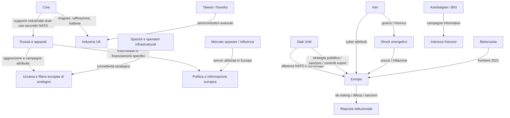

# Fonte 08 | L'Europa sotto pressione: attori ostili, reti transnazionali e vulnerabilità strategiche

**Rapporto integrato di intelligence da fonti aperte e analisi geopolitica**  
**Progetto:** Our Enemies Monitor  
**Versione:** 1.0, consolidamento analitico iniziale  
**Data di compilazione e limite temporale:** 21 ottobre 2026  
**Orizzonte retrospettivo:** 2007-2026, con riferimenti precedenti ove utili  
**Ambito territoriale:** Unione europea, Europa geografica, paesi NATO europei e vicinato strategico, con connessioni globali  
**Materiali integrati:** Fonte_00, Fonte_01–Fonte_05, Fonte_06 (MD e CSV), Fonte_07 (MD, CSV nodi, archi, ipotesi, nuove evidenze e GraphML)  
**Destinazione:** fonte documentale autonoma e interoperabile per successivi approfondimenti, aggiornamenti e progettazione del portale  
**Natura del rapporto:** analisi interpretativa delle fonti raccolte, **non** nuova indagine giudiziaria e **non** certificazione indipendente di tutte le affermazioni del corpus.

> **Principio fondamentale.** L'etichetta progettuale «nemici dell'Europa» descrive una *domanda di ricerca*, non una qualità automaticamente attribuibile alle persone, ai paesi o alle aziende menzionati. La minaccia viene qualificata in base a condotte verificabili e a rapporti specifici con gli interessi europei. Uno Stato alleato può imporre pressioni commerciali; uno Stato concorrente può essere un partner indispensabile; un operatore privato può costituire una dipendenza critica senza essere ostile; una rete criminale può agire senza mandato statale. Non si deduce una cospirazione dall'esistenza di relazioni, vantaggi comuni o vicinanza in un grafo.

## Indice

1. Giudizio complessivo sullo stato dell'Europa al 21 ottobre 2026
2. Metodo, classificazioni e delimitazioni del corpus
3. L'Europa come sistema strategico: forze, esposizioni e contraddizioni
4. Geografia delle minacce e matrice comparativa degli attori
5. Russia: il nucleo più documentato della pressione ostile
6. Cina: rivalità sistemica, intelligence e dominio dei colli di bottiglia
7. Stati Uniti: alleanza strategica, divergenza politica e controllo privato di infrastrutture
8. Israele, mercato della sorveglianza, influenza commerciale e giustizia internazionale
9. Iran, Bielorussia, Azerbaigian e altre potenze regionali
10. Guerra dell'informazione, elezioni, sanità e movimenti sociali
11. Sabotaggi, infrastrutture critiche e frontiere
12. Dipendenze industriali, digitali, energetiche e logistiche
13. Lo shock geopolitico ed economico del 2026: Hormuz, inflazione e proteste
14. Reti globali: cooperazioni documentate, convergenze e limiti
15. Sedici intersezioni strategiche dedotte dall'incrocio documentale
16. Capacità di risposta dell'Europa e limiti strutturali
17. Scenari di stress: possibili traiettorie e indicatori di allerta
18. Matrice dei rischi e priorità strategiche
19. Registro delle 22 questioni investigative irrisolte
20. Audit dei dati, correzioni necessarie e rischi di errore
21. Prescrizioni per il portale di monitoraggio e per l'aggiornamento AI
22. Conclusioni strategiche
23. Registro delle fonti e riferimenti verificabili

---

# 1. Giudizio complessivo sullo stato dell'Europa al 21 ottobre 2026

## 1.1 Tesi principale

**L'Europa affronta contemporaneamente una campagna ostile deliberata, una competizione per il controllo delle dipendenze strategiche e shock globali che producono vulnerabilità politiche interne.** Queste tre dinamiche sono collegate negli effetti, ma non necessariamente nei mandanti. L'ipotesi di un'unica alleanza segreta fra tutti gli attori che traggono beneficio dall'indebolimento europeo non è sostenuta dalle prove raccolte [S00–S07].

La **Russia** è il caso più forte di condotta direttamente ostile: aggressione militare all'Ucraina, attività di intelligence, sabotaggio, operazioni cyber, repressione extraterritoriale, manipolazione informativa, finanziamenti e intermediari politici. Le attribuzioni NATO e UE descrivono una campagna ibrida persistente e non un insieme casuale di incidenti. [S01,S02,S03,S05; P01]

La **Cina** coniuga una partnership strategica concreta con la Russia, operazioni attribuite di spionaggio e influenza, e una posizione industriale che può creare coercizione anche senza guerra. Non emerge un'equivalente campagna cinese di sabotaggi fisici contro l'Europa. Il principale rischio sistemico è la possibilità di colpire, anche indirettamente, più filiere essenziali attraverso raffinazione, componentistica, controlli alle esportazioni e una crisi di Taiwan. [S01,S03,S04,S05; P01,P06]

Gli **Stati Uniti dell'amministrazione Trump II** restano un alleato militare attraverso la NATO, ma introducono una divergenza politica esplicita, un uso autonomo di sanzioni e strumenti commerciali e un'incertezza sulla continuità di forniture essenziali. È documentata una strategia pubblica di influenza politica sull'Europa, non una catena clandestina comune USA-Russia. [S00,S04,S05,S07; P09,P10]

**Israele** deve essere separato dal settore delle imprese israeliane: la cooperazione militare e diplomatica dello Stato con Washington è documentata; lo sono anche operazioni di spyware e influence-for-hire tecnicamente collegate a imprese israeliane, ma con committenti spesso ignoti. Attribuire ogni servizio privato allo Stato israeliano sarebbe un salto probatorio ingiustificato. [S01,S02,S04,S05; P07]

L'**Iran** dimostra capacità di operare contro obiettivi europei con cyberattacchi e, secondo specifiche attribuzioni istituzionali, attraverso reti criminali; il conflitto regionale del 2026 ha inoltre prodotto uno shock sull'energia mondiale. **Bielorussia** e **Azerbaigian** mostrano modelli di pressione più circoscritti, rispettivamente attraverso strumentalizzazione della migrazione e campagne informative contro interessi francesi. [S03,S05,S07]

## 1.2 Dodici conclusioni ad alta rilevanza

1. **Il rischio europeo è multidominio.** Difesa, infrastrutture, industria, finanza, informazione, energia e istituzioni democratiche non sono più superfici indipendenti. Una perturbazione in un dominio può propagarsi agli altri.
2. **La Russia è il principale attore ostile direttamente documentato nel corpus.** Questa conclusione si riferisce alla qualità e varietà delle evidenze disponibili, non a un indice quantitativo universale di «pericolosità».
3. **Il 2022 è il maggiore spartiacque recente della sicurezza europea.** Dopo l'invasione su vasta scala aumentano le operazioni attribuite e si diversificano gli esecutori. La migliore capacità di rilevazione può contribuire all'aumento osservato.
4. **Le reti di influenza più efficaci mescolano persone reali e infrastrutture artificiali.** Pagamenti, consulenze, media fittizi, piattaforme, influencer e politici possono costituire catene più efficaci di semplici bot.
5. **Influenza prodotta e influenza riuscita non coincidono.** Le operazioni FIMI possono essere ampie sul piano tecnico e trascurabili nel raggiungimento di persone o nella modifica del voto.
6. **La Cina dispone di leve materiali sproporzionate.** Minerali raffinati, magneti, batterie e interdipendenza con Taiwan espongono l'Europa a shock industriali difficili da assorbire rapidamente.
7. **La dipendenza da alleati può essere un rischio nazionale anche senza ostilità.** Connettività satellitare, cloud, software, chip, piattaforme e intelligence richiedono analisi della sostituibilità oltre che della nazionalità del fornitore.
8. **Le convergenze politiche non provano coordinamento.** Una scelta di Washington che avvantaggia Mosca non dimostra un accordo segreto; una narrativa russa ripresa da una rete cinese non prova una regia comune.
9. **Il costo della vita del 2026 ha cause materiali corroborate.** Guerra regionale, shock dell'offerta energetica e inflazione costituiscono spiegazioni robuste della pressione sociale, senza attribuire l'origine delle proteste a governi stranieri.
10. **La difesa europea sta reagendo, ma la capacità effettivamente disponibile è inferiore a quella pianificata.** IRIS², Chips Act, CRMA, REPowerEU, readiness militare e protezione dei cavi hanno orizzonti diversi.
11. **I nodi interni all'Europa sono indispensabili per comprendere le interferenze.** Corruzione, incentivi economici, conflitti di interesse, polarizzazione preesistente e vulnerabilità organizzative possono essere più decisivi di un ordine estero isolato.
12. **Il metodo probatorio è esso stesso una forma di resilienza.** Un portale che sbaglia attribuzioni, diffonde insinuazioni o confonde rischio e reato può amplificare proprio la sfiducia che intende contrastare.

## 1.3 Diagnosi di sintesi

Il quadro complessivo non corrisponde né a un'Europa priva di strumenti né a un continente pienamente autonomo. L'UE possiede dimensione economica, capacità regolatoria, filiere industriali avanzate, potere commerciale e capacità diplomatiche; gli Stati europei possiedono capacità militari e apparati di sicurezza rilevanti. Tuttavia, il coordinamento politico e i tempi di sostituzione di alcuni fornitori e materiali sono vulnerabilità. **La distanza fra decisione strategica e disponibilità operativa di una capacità autonoma è uno degli indicatori più importanti del 2026.** [S04,S05,S07]

---

# 2. Metodo, classificazioni e delimitazioni del corpus

## 2.1 Fonti consolidate e loro ruolo

| Documento | Funzione specifica nella Fonte 08 | Limite da preservare |
|---|---|---|
| **S00 / Fonte_00** | Dossier di partenza, perimetro, attori, episodi, vocabolario E1–E5 | Alcune affermazioni di ottobre 2026 sono state poi meglio precisate dalle Deep Search |
| **S01 / Fonte_01** | Persone, società, pagamenti, influenza politica, assetti e beneficiari | La presenza in un circuito societario non dimostra transito di denaro o comando |
| **S02 / Fonte_02** | FIMI, campagne digitali, elezioni, proteste, salute pubblica | Impatto sui comportamenti quasi mai stimabile dai soli account e post |
| **S03 / Fonte_03** | Attacchi ibridi, cyber, sabotaggio, attribuzioni e logistica | Database IISS e CSIS non hanno lo stesso universo statistico |
| **S04 / Fonte_04** | Materie prime, semiconduttori, energia, cloud, porti, filiere | Dipendenza non equivale a coercizione e dati di filiere diverse hanno denominatori distinti |
| **S05 / Fonte_05** | Allineamenti, politica mondiale, shock esogeni, scenari | BRICS e partnership non sono automaticamente alleanze militari |
| **S06 / Fonte_06** | 147 record cronologici deduplicati e riferimenti TL | La selezione è curatoriale, non il conteggio di tutti gli attacchi verificatisi |
| **S07 / Fonte_07** | 353 nodi, 444 archi, 22 ipotesi, 4 evidenze esterne e grafo | Archi di contesto e presenza non equivalgono a rapporti di comando |

**Controllo aritmetico sui file CSV acquisiti:** 147 righe di eventi `TL-*`; 353 nodi ripartiti in 151 eventi, 47 organizzazioni, 36 asset, 34 aziende, 33 istituzioni, 32 Stati, 20 persone; 444 archi, di cui 291 etichettati `event_participation` e 153 archi diretti fra entità non-evento; 22 ipotesi separate; 4 nuove evidenze esterne. La distinzione 291/153 deriva dal *tipo di relazione*, non dalla sola proprietà `layer`: i dieci archi evento delle quattro evidenze esterne hanno `layer=source`. I conteggi non misurano la grandezza reale della minaccia: riflettono come è stato costruito il corpus. [S06,S07; `nodi.csv`, `archi.csv`, `ipotesi.csv`, `nuove_evidenze.csv`]

## 2.2 Modello della prova

Adottiamo la tassonomia della Fonte_00/07, applicata al **nesso specifico** e non all'intera reputazione dell'entità:

| Livello | Significato | Forma corretta della frase |
|---|---|---|
| **E1** | Atto, sentenza, documento societario, decisione pubblica, dato o effetto tecnico direttamente verificato | «Il tribunale ha condannato X per...» oppure «L'atto prevede...» |
| **E2** | Attribuzione formale di governo, intelligence, UE, NATO o altra autorità | «Secondo il Consiglio UE...»; non chiamarla condanna penale |
| **E3** | Inchiesta originale, prova forense indipendente o convergenza robusta di fonti qualificate | «L'indagine documenta...» indicando margine e punti ignoti |
| **E4** | Denuncia, accusa interessata o pista ufficiale non corroborata pubblicamente | «È stato ipotizzato/contestato, senza prova conclusiva...» |
| **E5** | Ipotesi, scenario, correlazione, vantaggio comune | Solo in un registro esplorativo, fuori dal grafo fattuale |

Le classi di stato `Accertato`, `Fortemente corroborato`, `Contestato`, `Non verificato` e `Smentito` restano un campo **separato** dalla scala E1–E5. Una condanna è E1 per la condanna, non per tutte le accuse esterne contenute nella motivazione; una sanzione è E1 per l'atto e può essere E2 per la responsabilità attribuita; una prova forense E3 può essere forte per l'infezione ma non identificare il cliente che l'ha commissionata. [S00–S07]

**Ulteriori separazioni obbligatorie:**

- `esistenza dell'evento` ≠ `responsabilità materiale` ≠ `mandante` ≠ `motivazione` ≠ `impatto`;
- `produzione di contenuti` ≠ `esposizione umana` ≠ `conversione elettorale`;
- `partecipazione societaria` ≠ `beneficiario ultimo` ≠ `diritto di controllo`;
- `dipendenza commerciale` ≠ `utilizzo coercitivo`;
- `interesse convergente` ≠ `finanziamento comune` ≠ `catena di comando`;
- `atto previsto` ≠ `capacità già entrata in esercizio`;
- `evento storico` ≠ `data della sentenza` ≠ `data della pubblicazione`.

## 2.3 Gradi di giudizio usati nella Fonte 08

Una valutazione geopolitica aggregata viene qualificata come **diagnosi analitica**; non riceve automaticamente un voto E1 perché è composta da fatti E1. Gli indicatori di gravità usano *basso/medio/alto/critico* soltanto con criteri descritti e senza presentarsi come probabilità scientifiche. Quando non si dispongono di dati su intenzione, capacità o vulnerabilità si indica `dato insufficiente`. Le ipotesi H01–H22 non diventano vere per essere prioritarie. [S05,S07]

## 2.4 Limiti epistemici, copertura e fonti esterne

Il corpus integra cinque ricerche eseguite con fonti primarie, studi, indagini e giornalismo originale, ma **non replica qui una verifica primaria riga per riga di 147 eventi e 444 archi**. Alcune citazioni delle Deep Search sono identificativi legati alle sessioni originarie e non URL permanenti: prima di pubblicare un'affermazione su un individuo occorre associare un atto originale salvato e verificato. In questa Fonte 08 sono state effettuate verifiche esterne selettive su NATO, SEAE, Eurostat, IEA, Consiglio UE, VIGINUM, CPS e Casa Bianca, contrassegnate `Pxx` nel registro finale. [S07 §11]

Il rapporto è soggetto a quattro limiti: selezione dei casi più visibili; difficoltà strutturale di osservare operazioni clandestine non scoperte; prevalenza di fonti istituzionali occidentali da distinguere da evidenza giudiziaria indipendente; possibile evoluzione rapidissima delle notizie dell'ottobre 2026. Gli esiti di procedimenti aperti non sono anticipati.

---

# 3. L'Europa come sistema strategico: forze, esposizioni e contraddizioni

## 3.1 Quale Europa viene protetta?

Per leggere correttamente il rischio occorre distinguere **UE**, **NATO**, **Europa geografica**, **Ucraina** e **vicinato strategico**. Le sovrapposizioni sono grandi ma non perfette. Un attacco alla logistica di Kiev può colpire materialmente uno Stato membro UE o NATO; un'incursione informativa nel Regno Unito non ricade direttamente nelle istituzioni UE; una crisi in Moldavia può modificare la sicurezza dell'UE senza verificarsi nel territorio comunitario. [S00,S03,S05]

Questa distinzione cambia anche le capacità di risposta: difesa collettiva NATO, procedure sanzionatorie UE, prerogative nazionali dell'intelligence, regolazione del mercato interno, competenze industriali e giurisdizione giudiziaria non sono interscambiabili. Un approccio limitato ai confini UE perderebbe le catene di fornitura ucraine, le rotte energetiche e i nodi industriali del resto del mondo.

## 3.2 I punti di forza europei

1. **Potere regolatorio ed economico**: l'UE può definire condizioni di accesso al mercato, obblighi di piattaforma, criteri di sicurezza, misure commerciali e sanzioni.
2. **Capacità industriali specifiche**: l'Europa è un attore fondamentale della litografia avanzata tramite ASML e conserva competenze chimiche, automobilistiche, aerospaziali e ingegneristiche.
3. **Strutture di sicurezza multilivello**: NATO, apparati nazionali, ENISA, CERT e cooperazione giudiziaria consentono difesa, attribuzione e condivisione di informazioni.
4. **Capacità di ridurre singole dipendenze**: il ridimensionamento del gas russo dopo il 2022 dimostra un potere di sostituzione, pur accompagnato da nuove esposizioni.
5. **Istituzioni di verifica pubblica**: SEAE, VIGINUM, tribunali e organismi specializzati producono prove e attribuzioni contestabili e aggiornabili. [S02–S05]

## 3.3 Le vulnerabilità strutturali

L'Europa importa parti cruciali del proprio fabbisogno di energia, minerali, elettronica, infrastrutture digitali e servizi privati. Può avere libertà formale di scegliere un'azione e **non avere i mezzi per sostenerla senza rilevanti costi di sostituzione**. Il caso di una tecnologia satellitare essenziale, il monopolio relativo di fasi di raffinazione e la mancanza di foundry aperte leading-edge sono tre diverse manifestazioni dello stesso rischio. [S04]

Esiste inoltre una seconda vulnerabilità: gli avversari possono ottenere un risultato senza controllare tutti i passaggi. Il sabotaggio logistico riduce temporaneamente la capacità di sostegno; l'amplificazione informativa sfrutta polarizzazioni già presenti; un blocco della raffinazione genera prezzi e scarsità che si riflettono nelle dispute politiche nazionali. **La vulnerabilità europea può avere una causalità composita anche quando non esiste un coordinamento composito degli aggressori.** [S02–S05]

## 3.4 Il problema decisivo: tempi di reazione asimmetrici

| Tempo | Attaccante o shock | Difensore europeo |
|---|---|---|
| Ore-giorni | DDoS, incendio, manipolazione social, GNSS jamming, interruzione di servizio | Risposta CERT, polizia, ridondanza locale, comunicazione d'emergenza |
| Settimane-mesi | Campagne FIMI, sanzioni mirate, restrizioni commerciali, crisi logistica | Attribuzione, procedimenti, sostituzione parziale di fornitori, riserve |
| Anni | Concentrazione industriale, dipendenza da foundry e satelliti, mercato del gas, investimenti portuali | Costruzione impianti, formazione, accordi di approvvigionamento, autonomia infrastrutturale |

Questa matrice è una *interpretazione temporale* delle fonti, non una promessa di durate certe: una nuova miniera può richiedere molti più anni; il ripristino di un collegamento può richiedere meno di un giorno o molto di più in base all'incidente. [S03,S04,S05]

---

# 4. Geografia delle minacce e matrice comparativa degli attori

## 4.1 Distinguere ostilità, competizione e vulnerabilità

| Attore / rete | Condotte documentate rilevanti per l'Europa | Leva principale | Giudizio analitico | Limite essenziale |
|---|---|---|---|---|
| **Russia / apparati e proxy** | Aggressione, sabotaggio, cyber, propaganda, corruzione politica, coercizione | Violenza e operazioni clandestine combinate | **Minaccia diretta e sistemica documentata** | Non attribuire ogni protesta, crimine o incidente alla Russia |
| **Bielorussia** | Pressione sul confine UE tramite migrazione organizzata secondo Consiglio UE | Controllo dei flussi di frontiera | **Operatore ostile in specifici episodi** | Non assimilare tutte le crisi migratorie |
| **Cina / PCC / imprese** | Cyber-spionaggio, United Front, sostegno dual-use russo secondo NATO, export control | Industria, commercio, informazione e intelligence | **Rivale sistemico e dipendenza strategica** | Non assimilare ogni attività commerciale a ingerenza |
| **Iran / apparati e proxy** | Cyber distruttivo, influence e specifiche attribuzioni di operazioni tramite criminalità | Cyber, intelligence, partner e crisi regionale | **Attore ostile in casi specifici; rischio indiretto globale elevato** | Distinguere mandato specifico da semplice affiliazione criminale |
| **Azerbaigian / BIG** | Operazioni informative contro interessi francesi attribuite da VIGINUM | Disinformazione e influenza | **Pressione mirata documentata** | Non dimostrata collaborazione operativa con tutte le reti russe |
| **USA / amministrazione Trump II** | Divergenze strategiche, pressioni commerciali, deroghe sanzionatorie, posizioni politiche sull'UE | Difesa, tecnologia, sanzioni e finanza | **Alleato con rischi di coercizione e disallineamento** | Non provata un'alleanza clandestina con il Cremlino |
| **SpaceX / Starlink / X e altre imprese USA** | Controllo di servizi critici, interventi politici pubblici, connettività militare | Infrastrutture e piattaforme | **Potere privato sistemico e concentrazione della dipendenza** | Intervento imprenditoriale ≠ operazione di intelligence straniera |
| **Stato israeliano** | Azioni militari e diplomatiche, cooperazione USA, conflitti con posizione UE su CPI | Militari, diplomazia e intelligence | **Partner su alcuni ambiti; forti divergenze in altri** | Non trasferire al governo azioni di ogni società israeliana |
| **Fornitori spyware/influence israeliani** | BlackCore/Rokh Solis; Pegasus, Graphite, Candiru; tecnologia di manipolazione | Sorveglianza e servizio commerciale | **Mercato di capacità ad alto rischio per diritti e democrazia** | Committenti, operatori e beneficiari spesso non identificati |
| **Marocco / crisi Ceuta** | Contrasti sulle responsabilità della gestione frontaliera nel 2026 | Controllo della frontiera | **Caso contestato** | Direzione deliberata della crisi non provata |
| **BRICS / monarchie del Golfo** | Collaborazione economica, capitale, energia e mediazione | Rotte, finanza e commercio | **Interconnessioni, non un blocco ostile unitario** | Divergenze profonde fra membri e partner |
| **Criminalità transnazionale** | Ransomware, sabotaggi per commissione, servizi illeciti | Profitto, intermediazione, deniability | **Minaccia distinta, talora sfruttata da Stati** | Lingua e area di origine non dimostrano finanziamento statale |

Il giudizio è **qualitativo**, riferito a queste fonti e non una graduatoria ufficiale. L'alta gravità di un singolo attacco o rischio industriale non conferisce retroattivamente colpevolezza ad altri soggetti dello stesso paese. [S00–S07]

## 4.2 Principali obiettivi attribuibili agli attori

**Russia:** preservare la capacità di guerra contro l'Ucraina, minare i costi politici del sostegno europeo, ottenere accesso informativo e capacità di pressione, aggirare vincoli economici. Questi obiettivi sono inferiti dalle operazioni e dalle dichiarazioni strategiche documentate; non ogni attacco dispone di un memorandum che espliciti un movente. [S01,S03,S05]

**Cina:** conservare capacità industriale e tecnologica, rafforzare l'influenza globale, gestire la questione Taiwan, contrastare restrizioni occidentali e mantenere una partnership utile con Mosca. L'Europa è simultaneamente mercato, interlocutore politico, concorrente e potenziale bersaglio di intelligence. [S01,S04,S05]

**USA:** perseguire sicurezza ed egemonia tecnologica secondo priorità nazionali, usare alleanze e strumenti economici e orientare apertamente parte del dibattito europeo. Il disallineamento dal contesto UE non rappresenta prova automatica di intenzione di sabotaggio dell'Unione. [S04,S05]

**Iran:** difendere la propria posizione regionale e il regime, contrastare gli avversari con mezzi militari, cyber e servizi, e negoziare rapporti con Russia e Cina senza garanzia di mutuo intervento militare. [S03,S05]

**Imprese e intermediari:** accedere a mercati, contratti, informazioni, audience e rendite; talvolta servire committenti statali. Le motivazioni economiche autonome vanno sempre considerate prima di attribuire direzione politica. [S01,S02,S04]

---
# 5. Russia: il nucleo più documentato della pressione ostile

## 5.1 Dalla guerra convenzionale all'ecosistema ibrido

La traiettoria russa non inizia nel febbraio 2022. Gli attacchi informatici del 2007 contro l'Estonia e quelli del 2008 durante il conflitto russo-georgiano anticipano forme di pressione digitale associate a controversie militari o politiche, benché le prove pubbliche sul comando statale diretto non siano conclusive in tutti questi precedenti. La crisi della Crimea e del Donbas nel 2014 produce il primo grande mutamento strutturale; l'invasione su vasta scala del 24 febbraio 2022 inaugura il secondo, con escalation simultanea di combattimenti, sanzioni, logistica, intelligence, pressione informativa e sabotaggi. [S03,S06: TL-0001, TL-0002, TL-0005, TL-0006, TL-0039]

La NATO nella dichiarazione del vertice di Washington del luglio 2024 descrive una campagna ibrida russa comprendente sabotaggi, violenza, provocazioni alle frontiere, strumentalizzazione migratoria, attività cyber malevole, interferenze elettroniche, disinformazione, influenza politica e coercizione economica. È un'attribuzione politico-istituzionale articolata [E2], corroborata per molti episodi da documentazione investigativa o tecnica distinta. **Non significa che ogni incidente in Europa appartenga automaticamente a quella campagna.** [S03,S05; P01]

## 5.2 Il repertorio operativo

| Dimensione | Metodi | Casi distintivi | Valore dell'evidenza |
|---|---|---|---|
| Guerra militare | Occupazione, attacchi terrestri, aerei, missilistici | Crimea/Donbas 2014; invasione 2022 | E1 per gli eventi |
| Cyber-spionaggio | Intrusione in istituzioni, esfiltrazione, persistenza | Bundestag 2015, campagne APT28 | E2 per attribuzione GRU |
| Cyber distruttivo | Wiper, compromissione di fornitori, supply chain | NotPetya 2017; Viasat KA-SAT 2022 | E2 per attribuzione a Russia/GRU |
| Sabotaggio fisico | Incendi, esplosivi, pacchi incendiari, danni logistici | Vrbětice 2014, magazzino Londra 2024, hub cargo e fabbriche 2026 | Da E1 a E3 secondo il caso |
| Repressione extraterritoriale | Aggressioni, avvelenamento, omicidio | Skripal 2018, Khangoshvili 2019 | Attribuzioni istituzionali/accertamento giudiziario |
| Corruzione e influenza | Pagamenti, coperture mediatiche, intermediari politici | Nathan Gill, Voice of Europe, Moldavia | Condanna E1 e altre designazioni E2 |
| FIMI | Media falsi, bot, account, deepfake, riciclo contenuti | Doppelganger, Storm-1516, Portal Kombat, Matryoshka | E2–E3 per specifici operatori |
| Guerra elettronica | Jamming/spoofing GNSS, disturbo infrastrutture | Kaliningrad e interferenze nel Baltico | E2 per attribuzioni UE in casi specifici |
| Coercizione di vicinato | Pressioni alle frontiere, energia e mobilità | Finlandia 2023-24; cooperazione con Bielorussia | Attribuzioni istituzionali distinte |

### Casi a particolare forza probatoria

- **Vrbětice, 2014.** Le esplosioni di depositi di munizioni in Cechia causarono due morti. Le autorità ceche hanno attribuito il coinvolgimento a ufficiali del GRU; l'evento è E1, la responsabilità russa E2 come attribuzione istituzionale. [S03; TL-0007]
- **Bundestag, 2015.** Compromissione e sottrazione di informazioni attribuite ad APT28/GRU; il caso dimostra la capacità di colpire istituzioni legislative dell'UE senza occupare fisicamente territorio. [S03; TL-0008]
- **NotPetya, 2017.** Il malware distruttivo lanciato attraverso una supply chain con obiettivo primario ucraino si propagò oltre confine, producendo effetti globali: esempio di attacco cyber con esternalità industriali. [S03; TL-0013]
- **OPCW, Paesi Bassi, 2018.** Autorità olandesi intercettarono ufficiali russi e sequestrarono apparati destinati a un'operazione informatica ravvicinata. Qui il nesso operativo è più specifico di un semplice tracciamento IP. [S03; TL-0018]
- **Omicidio Khangoshvili, Berlino, 2019.** Il giudizio del tribunale tedesco sulla responsabilità di organi statali russi fornisce un raro esempio di attribuzione giudiziaria della direzione dell'operazione. [S03; TL-0019]
- **Viasat KA-SAT, 24 febbraio 2022.** Attacco distruttivo alla connettività satellitare in coincidenza con l'invasione dell'Ucraina e conseguenze anche per utenze europee: convergenza di guerra militare, telecomunicazioni e danni transfrontalieri. [S03; TL-0038]
- **Incendio del magazzino londinese, 2024.** Condanne britanniche riguardano un deposito con aiuti e apparati Starlink destinati a Kiev; viene ricostruita una filiera di proxy associata alla rete Wagner. [S03,S07; TL-0058]

## 5.3 Una «gig economy» dell'intelligence ostile

Le fonti IISS analizzate dalla DS-03 descrivono il passaggio a forme di reclutamento online e subappalto: esecutori locali o di paesi terzi, spesso pagati per singoli incarichi, con istruzioni attraverso servizi di messaggistica e talvolta pagamenti in criptovalute. Il movente immediato del reclutato può essere finanziario e completamente diverso dall'obiettivo strategico del mandante. Le espulsioni di personale d'intelligence dopo il 2022 hanno contribuito a cambiare il costo relativo dei metodi di esecuzione. [S03]

**Conseguenza:** la mancata conoscenza del committente da parte dell'esecutore non esclude una direzione estera, ma impedisce di inferirla senza riscontri sulla catena di istruzioni. I singoli incendi, ordigni, trasferimenti, wallet, utenze e intermediari necessitano di ricostruzione autonoma. H02 riguarda precisamente l'eventuale sovrapposizione di tali filiere, non l'assunto che tutte abbiano lo stesso comandante.

Le serie storiche disponibili corroborano la crescita, ma **non devono essere sommate**: IISS censisce 13 incidenti nel 2022, 9 nel 2023, 33 nel 2024 e 11 nel primo semestre 2025, secondo la propria definizione di attività ibride russe con effetti fisici; CSIS usa un campione differente e riporta 3, 12 e 34 attacchi/complotti con effetti fisici rispettivamente nel 2022, 2023 e 2024. Differenti criteri di inclusione, disponibilità delle fonti e aggiornamenti delle indagini non permettono di trasformare queste due serie in un conteggio complessivo europeo. [S00,S03]

## 5.4 La rete finanziaria e politica: quando il passaggio dal denaro all'atto è dimostrato

### Voice of Europe

Il Consiglio UE ha attribuito a Viktor Medvedchuk un controllo/finanziamento occulto di **Voice of Europe**, esercitato tramite Artem Marchevskyi, descrivendo la struttura come strumento per propaganda, remunerazione e costruzione di rapporti con esponenti di partiti europei. La relazione Medvedchuk → Marchevskyi → Voice of Europe e la funzione del mezzo risultano istituzionalmente attribuite, non una condanna di ogni politico apparso sulla piattaforma. [S01,S07; TL-0056, TL-0060; P02]

### Nathan Gill

L'ex eurodeputato britannico **Nathan Gill** ha ammesso otto reati di corruzione e il 21 novembre 2025 è stato condannato a dieci anni e sei mesi di reclusione. Secondo il Crown Prosecution Service, ricevette circa **40.000 sterline nel 2018-2019** per interventi parlamentari e altri atti favorevoli a interessi filorussi. La catena pagamento → persona → atto politico è qui dimostrata penalmente. La rete coinvolge Oleg Voloshyn come interlocutore; un reportage sugli atti processuali attribuisce a Medvedchuk il ruolo di fonte finanziaria nello schema. Ciò collega politicamente due schemi di influenza, **non** dimostra che il denaro a Gill provenisse dal veicolo Voice of Europe. [S01,S07; TL-0015, TL-0092; P03]

### Moldavia

La rete di **Ilan Șor** mostra l'uso combinato di organizzazioni, intermediazione bancaria, reclutamento, pagamenti e campagne. Autorità moldave hanno descritto trasferimenti attraverso Promsvyazbank, pagamenti a persone e organizzatori, attività Telegram e strutture territoriali; le sanzioni UE del giugno 2026 attribuiscono a persone associate a Șor ed Evrazia operazioni finanziate dalla Russia volte a perturbare le elezioni parlamentari del settembre 2025, incluse compravendita di voti e disinformazione. La precisione probatoria riguarda gli individui e le operazioni descritte, non ogni elettore o associazione del paese. [S01,S02,S07; P04]

**Lezione integrata:** la Russia dispone di esempi in cui la catena *interesse strategico → intermediario → finanziamento → attività politica* è dimostrabile in misura molto superiore al mero rilancio di messaggi favorevoli a Mosca. La disponibilità di tali casi impone di cercare prove transazionali e contratti nei nuovi filoni invece di basarsi sulle affinità ideologiche.

## 5.5 Disinformazione russa come infrastruttura distribuita

**Doppelganger** ricostruisce falsi siti di media, personas, inserzioni e contenuti che imitano istituzioni informative affidabili; il DOJ ha descritto componenti della rete legate alla Social Design Agency e ad altri operatori. **Storm-1516** impiega testimoni inventati, video sintetici e pseudo-inchieste. **Portal Kombat** costituisce una rete di aggregazione automatizzata di siti filorussi, collegata da indagini a TigerWeb. **Matryoshka** usa semina iniziale e amplificazione su piattaforme, spesso bersagliando anche giornalisti e fact-checker. [S01,S02,S07]

Il meccanismo comune è produrre contenuti dalla provenienza occultata, amplificarli e ottenere la ripresa da attori reali. Non è dimostrato che tutte e quattro le famiglie dipendano da un'identica linea gerarchica; le infrastrutture, i fornitori e gli operatori devono restare separabili. L'efficacia è estremamente eterogenea. [S02]

## 5.6 Qual è il risultato strategico perseguito?

La campagna sembra puntare a **far salire il costo economico, operativo e politico del sostegno europeo all'Ucraina**, degradare la fiducia nelle istituzioni, aumentare le cautele industriali e di sicurezza e sfruttare fratture interne. È un'inferenza coerente con la selezione ripetuta dei bersagli, le valutazioni NATO/UE e i casi finanziari. Non è invece provato che la Russia diriga tutte le principali proteste, che abbia determinato la Brexit o che ordini ogni reato di ambienti russofoni. [S01–S03,S05]

---

# 6. Cina: rivalità sistemica, intelligence e dominio dei colli di bottiglia

## 6.1 Un rapporto strutturalmente duale

Per Bruxelles la Cina è simultaneamente partner economico, concorrente e rivale sistemico. Il rapporto non può essere ridotto alla formula «Stato nemico»: le filiere cinesi sostengono produzione e transizione tecnologica europee, ma la concentrazione di lavorazioni essenziali e i controlli alle esportazioni conferiscono al governo di Pechino un potenziale strumento di pressione. [S04,S05]

Sul fronte sicurezza le fonti documentano tre tipologie da mantenere distinte: **spionaggio cyber**, **accesso/influenza politico-istituzionale** e **dominio industriale/commerciale**. Esiste inoltre una quarta relazione, il **supporto alla base industriale russa**, qualificata dalla NATO nel 2024 come elemento abilitante significativo della guerra russa. [S01,S03,S05; P01]

## 6.2 Cyber-intelligence e accessi politici

Le attribuzioni UK e dei partner europei hanno collegato **APT31** a operazioni contro istituzioni e parlamentari; in Cechia e nel Regno Unito emergono campagne di spionaggio di portata istituzionale. Il caso **Jian G.**, ex assistente di un eurodeputato condannato in Germania nel 2025 per attività d'intelligence a beneficio della Cina, mostra l'altra via di accesso: persone con credenziali all'interno delle istituzioni. [S01,S03; TL pertinenti in S06]

Nel caso **Christine Lee**, MI5 ha emesso un'interference alert riguardante donazioni politiche e relazioni con l'United Front Work Department. Lo standard corretto è «valutazione di MI5» e non «condanna penale di Lee», assente dal corpus. [S01,S07]

**Non emergono nelle fonti esaminate prove di un programma cinese di sabotaggi fisici contro infrastrutture europee paragonabile, per ampiezza di casi attribuiti, alla campagna russa.** Gli episodi baltici che coinvolgono navi cinesi impongono un'analisi forense diversa: ancoraggio e danni possono essere accertati mentre intenzione e ordine statale rimangono sconosciuti. [S03]

## 6.3 Cina e macchina bellica russa

La dichiarazione NATO di Washington del 2024 usa per la Cina la definizione di **«decisive enabler»** della guerra russa, citando sostegno su scala rilevante alla base industriale della difesa mediante prodotti e componenti dual-use. Le fonti UE riportano sanzioni a soggetti specifici anche ubicati in paesi terzi in relazione a forniture, elusione e supporto alle capacità russe. [S05; P01]

Le dichiarazioni congiunte Xi–Putin e la cooperazione economica dimostrano una **partnership strategica profonda**, ma non un'alleanza militare di difesa automatica. Le differenze d'interessi su Medio Oriente, mercati e rischio di sanzioni rendono inesatta la rappresentazione di un apparato operativo sino-russo unico. Anche la ripresa da Paperwall di materiale russo prova circolazione di narrativa, non approvazione di un piano congiunto. [S02,S05,S07]

## 6.4 Dominio della raffinazione e capacità di coercizione

Un'informazione centrale della DS-04 è la differenza fra **estrarre**, **raffinare**, **fabbricare componenti** e **assemblare prodotti**. La Cina controlla quote particolarmente elevate delle fasi di trattamento, dove la sostituzione richiede capacità chimiche, capitale, competenze e tempi di avviamento. Secondo IEA, nel 2024 la Cina rappresentava circa **91% della raffinazione delle terre rare magnetiche** e **94% della produzione di magneti permanenti sinterizzati**, contro circa **60% dell'estrazione** di terre rare magnetiche. [S04,S05; P06]

Questa asimmetria spiega perché non basta diversificare la provenienza del minerale per sostituire un magnete cinese. In alcune filiere essenziali una materia prima estratta in Africa o America Latina passa comunque dalla lavorazione cinese prima di raggiungere un componente utilizzabile da industria automotive, aerospazio o difesa europee.

Il caso **Lituania, 2021**, con misure commerciali contestate dalla Commissione UE, rappresenta un precedente di possibile strumentalizzazione delle relazioni economiche. Le restrizioni all'export di gallio, germanio, grafite e specifiche terre rare del 2025-2026 mostrano l'esistenza di meccanismi normativi e amministrativi utilizzabili per incidere sull'offerta. Si deve però distinguere il singolo export control, il suo fondamento giuridico dichiarato e l'effettivo impatto su ciascuna azienda europea. [S04,S05]

## 6.5 Taiwan come leva sistemica indiretta

La questione Taiwan riguarda direttamente la resilienza europea, non soltanto l'Asia orientale. I nodi leading-edge dei semiconduttori dipendono in misura elevata da capacità taiwanesi, integrate con design USA, apparecchiature europee ASML, materiali e impianti globali. Una crisi di blocco, un conflitto o un'interruzione prolungata nello Stretto potrebbero limitare AI, data center, difesa, elettronica e parti dell'automotive. Questo è **uno scenario di rischio**, non un evento già avvenuto. [S04,S05]

Il quadro presenta anche interdipendenze che moderano la logica di coercizione: Pechino dipende dall'export, da clienti e, in segmenti tecnologici, da risorse o capacità non interamente sotto il proprio controllo. La concentrazione consente di esercitare pressione, ma l'uso ripetuto o indiscriminato delle leve può accelerare diversificazione e perdite economiche.

---

# 7. Stati Uniti: alleanza strategica, divergenza politica e controllo privato di infrastrutture

## 7.1 Una differenza categoriale rispetto alla Russia

Gli USA restano un alleato NATO e un fornitore di sicurezza essenziale per il continente. Le scelte della seconda amministrazione Trump, però, accrescono l'incertezza strategica: il documento ufficiale di **National Security Strategy 2025** manifesta la volontà di influire sulla traiettoria politica europea e apprezza la crescita di correnti nazionaliste/patriottiche, mentre strumenti commerciali, sanzioni ed export control sono usati secondo interessi definiti a Washington. Questo riguarda **politiche dichiarate**, non un'operazione di intelligence occulta attribuita al governo federale. [S00,S05,S07; P09]

Il problema per l'Europa non è stabilire un'equivalenza morale o giuridica fra alleato e aggressore, ma comprendere **quali funzioni essenziali siano revocabili, condizionabili o politicamente negoziabili** da parte di un attore che persegue anche interessi divergenti.

## 7.2 Sanzioni, diesel russo e interessi divergenti

L'ordine della Casa Bianca del **16 ottobre 2026** attua il Graham Act del 2026 e contiene deroghe a numerose **nuove** tariffe e misure previste dall'atto, motivate dall'interesse nazionale. Il testo precisa che tali deroghe non sopprimono automaticamente le precedenti misure basate su diversi ordini esecutivi contro la Russia. Le fonti giornalistiche esaminate da DS-04/DS-05 collegano la scelta anche alla gestione del mercato del gasolio russo e della crisi energetica. [S04,S05; P10]

**Tre proposizioni devono restare separate:** (a) la deroga giuridica è documentata; (b) la maggiore disponibilità di prodotti russi può produrre un beneficio economico per Mosca; (c) un accordo politico segreto di più ampia portata fra Washington e Mosca **non** è dimostrato dal solo ordine. Il beneficio di un attore non identifica automaticamente il movente dell'altro.

## 7.3 SpaceX, Starlink, Starshield e il controllo della connettività

Dopo il 2022 l'Ucraina ha integrato servizi e apparati satellitari privati in comunicazioni operative, logistica e impieghi militari. Nell'ottobre 2026 fonti ucraine e reportage Reuters/WSJ/Telegraph hanno ricostruito limitazioni di servizi utilizzati da sistemi in movimento rapido, con effetti su droni offensivi e intercettori. Le ricostruzioni sulla **catena di autorizzazione** divergevano: funzionari americani citati da Reuters hanno riferito un'origine nell'amministrazione, altri reportage hanno attribuito ruoli più diretti a Elon Musk; Trump e Musk hanno contestato parti di queste versioni. [S00,S03,S05,S07; TL-0137 e successivi]

**È più solido il riscontro sulle limitazioni e le conseguenze operative che non l'attribuzione finale delle intenzioni e della responsabilità personale.** Inoltre SpaceX ha anche cooperato per disabilitare terminali russi non autorizzati: omettere questa circostanza produrrebbe una rappresentazione sbilanciata della condotta dell'azienda. Le fonti non dimostrano un ordine del Cremlino né un nesso tecnico puntuale fra le limitazioni e specifiche morti civili. [S03,S07]

L'episodio costituisce invece un test importante della dipendenza europea da un servizio essenziale privato: l'utente finale, l'apparato militare e i governi possono non coincidere con il soggetto che definisce le regole tecniche e contrattuali. La vulnerabilità resta anche quando l'operatore agisce legalmente.

## 7.4 Musk, X e l'influenza politica pubblica

Il sostegno politico pubblico di Elon Musk all'**AfD** tedesca è documentato nelle fonti; l'effetto elettorale decisivo non lo è. L'uso di una grande piattaforma da parte del suo controllore solleva problemi di trasparenza, visibilità algoritmica, concentrazione del potere comunicativo e disallineamento fra interessi privati ed europei, ma non permette di attribuire automaticamente a Washington una campagna clandestina. [S01,S02]

Il **DSA** ha fornito strumenti regolatori e la Commissione UE ha sanzionato X nel 2025 per violazioni di obblighi di trasparenza. Non si trattava di una condanna per collusione russa. Per misurare influenza sulla politica servirebbero dati di reach, raccomandazione, audience reale e cambiamento di comportamento, non il semplice numero di post o il seguito personale del proprietario. [S00,S02,S07]

## 7.5 Capitali stranieri: ricostruire i percorsi senza attribuzioni transitive

La DS-01 e il grafo S07 documentano relazioni finanziarie indirette intorno a SpaceX e X: fondi, limited partner, veicoli d'investimento, intermediari e investitori internazionali. ProPublica ha esaminato fondi con partecipazioni SpaceX e investitori con indirizzi anche in Cina, Hong Kong e Russia. Un investimento passivo non equivale a controllo sulle decisioni militari o tecnologiche. [S01,S04]

Il percorso **Suleiman Kerimov ↔ GVA Capital ↔ Roman Sobachevskiy ↔ HAL9001 ↔ Tomales Bay Capital ↔ partecipazioni SpaceX** comprende relazioni di natura diversa: gestione di asset oggetto di sanzioni OFAC; legami personali/societari; documenti firmati; investimento attraverso un veicolo. **Non è stato dimostrato che fondi di Kerimov siano confluiti in HAL9001 o SpaceX**, né che egli abbia influenzato le restrizioni satellitari. Non si può trasformare un percorso misto di archi in un bonifico continuo. [S01,S07: H06]

### Schema logico da conservare

```text
OFAC documenta GVA ↔ asset Kerimov
            │
            │ relazione societaria distinta
            ▼
Roman Sobachevskiy ↔ documenti HAL9001
            │
            ▼
HAL9001 → fondo intermediario → investimento SpaceX

NON documentato: Kerimov → finanziamento HAL9001/SpaceX
NON documentato: investitore passivo → ordine Starshield
NON documentato: Russia → regia politica USA/Musk
```

**Giudizio di sicurezza:** la concentrazione di funzione satellitare, piattaforma informativa, capacità di AI e capitale in un ecosistema privato è una questione strutturale verificabile; la teoria di direzione russa di tale ecosistema non è stabilita. [S01,S04,S07]

---

# 8. Israele, mercato della sorveglianza, influenza commerciale e giustizia internazionale

## 8.1 Tre piani da non unificare

1. **Stato di Israele:** potere militare, intelligence, politica diplomatica e cooperazione con Washington, inclusa la guerra del 2026 con l'Iran.
2. **Imprese di tecnologie intrusive:** produttori, integratori e servizi commerciali che sviluppano spyware e catene d'infezione o forniscono piattaforme a clienti variabili.
3. **Influence-for-hire:** società e contractor che costruiscono siti, falsi account, narrative e amplificazioni, senza che il committente sia necessariamente lo Stato di origine dell'impresa. [S01,S02,S04,S05]

## 8.2 Rokh Solis / BlackCore

VIGINUM ha ricostruito il metodo **Rokh Solis** in relazione alle elezioni municipali francesi del **15 e 22 marzo 2026** e lo ha classificato come ingerenza digitale straniera. Indicatori tecnici collegano l'ecosistema a soggetti israeliani, in particolare alla società **BlackCore**; la rete impiegava siti, falsi profili e rilanci su più piattaforme per alimentare polarizzazione e attacchi politici. La sua visibilità online misurata è stata però **molto bassa**. [S01,S02,S07; P07]

VIGINUM **non identifica in modo definitivo il committente**. Il nesso BlackCore ↔ infrastruttura Rokh Solis è più documentato del nesso «governo israeliano → ordine di operazione», che non deve comparire nel grafo fattuale. Questa distinzione resta valida anche se il materiale è ostile verso un partito o un esponente politico europeo. [S07: H04]

**Nota cronologica:** la data **giugno 2026** riguarda il rapporto VIGINUM, non le date delle elezioni. La Fonte_07 segnala una normalizzazione da correggere in `TL-0113` della Fonte_06. [S07 §11; P07]

## 8.3 Pegasus, Graphite, Candiru e catene adtech

- **NSO/Pegasus**: Citizen Lab ha documentato vittime europee, tra cui l'ex eurodeputato Stelios Kouloglou nel periodo del suo lavoro nella commissione PEGA; l'infezione può essere accertata senza identificare il cliente governativo che l'ha commissionata. [S01,S04,S05]
- **Paragon/Graphite**: sono documentate infezioni o tentativi contro giornalisti europei; il fornitore è distinto dall'operatore che decide e autorizza il bersaglio. [S03,S04]
- **Candiru / Discover-Tech**: Citizen Lab ha descritto legami tecnici fra advertising mirato, infrastrutture di distribuzione e spyware. La presenza di un sito in una catena pubblicitaria non implica di per sé che ogni visitatore sia compromesso. [S01,S04]
- **Team Jorge**: il giornalismo investigativo ha mostrato disponibilità commerciale di strumenti per account falsi, hacking e campagne manipolative. Dichiarazioni promozionali sui risultati elettorali conseguiti non costituiscono prova indipendente di vittorie manipolate. [S01]

Ne risulta una filiera in cui **venditore, intermediario, cliente, operatore tecnico, autorità autorizzante e beneficiario politico** possono essere soggetti diversi. Il grafo deve permettere di descrivere ogni passaggio mancante come *ignoto*, non completarlo automaticamente con lo Stato di provenienza del prodotto. [S01,S07]

## 8.4 La Corte penale internazionale come divergenza USA–UE–Israele

Il corpus documenta il contrasto intorno ai mandati e alle iniziative della **Corte penale internazionale (CPI/ICC)** e le sanzioni introdotte dagli Stati Uniti contro soggetti collegati alla Corte a partire dal 2025 e nel 2026. L'UE ha riaffermato il sostegno all'indipendenza della CPI, in un'area in cui gli interessi del governo israeliano e dell'amministrazione statunitense divergono da una parte importante della posizione istituzionale europea. [S00,S05,S07]

Qui esiste **convergenza diplomatica documentata**, distinta dalle operazioni di spyware e dalle reti private. Le azioni di governo, i procedimenti giudiziari, le critiche alle decisioni della Corte e le attività commerciali devono restare nodi distinti.

---

# 9. Iran, Bielorussia, Azerbaigian e altre potenze regionali

## 9.1 Iran: conflitto diretto, cyber e catene di proxy

L'Iran è un attore con capacità militari regionali e strumenti cyber documentati. La campagna distruttiva contro strutture statali dell'**Albania nel 2022**, con esfiltrazione, wiper e operazioni informative, è stata collegata ad attori associati al Ministero iraniano dell'Intelligence da analisi tecniche e attribuzioni istituzionali. Nel 2026 l'UE ha sanzionato **Emennet Pasargad** per attività che avevano interessato Francia e Svezia. [S03; TL-0040]

La partnership russo-iraniana è formalmente rafforzata da un trattato strategico nel 2025. Non costituisce automaticamente una clausola di difesa collettiva. La diversa condotta di Mosca e Pechino nella guerra iraniana del 2026 indica un coordinamento limitato dalla salvaguardia dei rispettivi interessi. [S05]

## 9.2 Foxtrot: criminalità e attribuzione di mandato statale

La Fonte_07 registra quattro evidenze aggiuntive rispetto ai 147 eventi della timeline S06:

| ID | Data | Fatto o attribuzione | Limite probatorio |
|---|---|---|---|
| `EXT-001` | gennaio 2024 | OFAC attribuisce a Foxtrot un attacco all'ambasciata israeliana a Stoccolma per conto dell'Iran | Attribuzione del governo USA, non sentenza sul mandante |
| `EXT-002` | 12 marzo 2025 | OFAC sanziona Foxtrot e Rawa Majid, riferendo rapporti con MOIS | E1 per la designazione, E2 per i rapporti operativi attribuiti |
| `EXT-003` | 16 ottobre 2026 | Aggiornamento CPS su condanna di Natland, riferita a un complotto omicida Foxtrot nel Regno Unito | La condanna non dimostra l'ordine iraniano di quel preciso delitto |
| `EXT-004` | settembre-ottobre 2026 | Incidente e ulteriori arresti nell'inchiesta RAF Fairford | Indagine in corso, sospetto di assistenza ai servizi iraniani non giudicato |

Queste quattro voci sono **esterne alla Fonte_06 v1.0** e non vanno contate fra i 147 record TL. Le fonti originali e i caveat sono conservati in `Fonte_07_..._nuove_evidenze.csv`. H19 e H20 tengono aperti, rispettivamente, il mandato nel caso Natland e la responsabilità nell'indagine Fairford. [S07]

L'esempio Foxtrot è utile anche per la comparazione con i proxy russi: la somiglianza tattica nell'uso di criminalità non prova un'unità di comando fra Russia e Iran. Si tratta di **modelli di intermediazione analoghi**, non dello stesso network operativamente dimostrato.

## 9.3 Bielorussia e coercizione migratoria

Nel 2021 l'UE ha attribuito al regime bielorusso l'organizzazione/facilitazione politicamente motivata di flussi migratori verso i confini di Polonia, Lituania e Lettonia, sanzionando anche operatori economici coinvolti nelle catene logistiche. La presenza di trasporto, facilitazione e strumenti amministrativi ha dato consistenza all'attribuzione istituzionale. [S03,S05; TL-0028, TL-0030]

Il caso dimostra che **movimenti di persone possono essere strumentalizzati** come leva di pressione. Non consente però di classificare le persone migranti come «minaccia» o di trasferire automaticamente la responsabilità bielorussa ad altri casi di confine.

## 9.4 Azerbaigian / Baku Initiative Group

Le analisi VIGINUM descritte in DS-05 e Fonte_07 identificano un legame diretto fra il **Baku Initiative Group** e lo Stato azerbaigiano in campagne informative contro interessi francesi, comprese narrazioni relative ai territori d'oltremare. La relazione ha un supporto istituzionale più specifico di una semplice coincidenza narrativa. [S05,S07]

H18 mantiene invece aperta un'altra domanda: l'eventuale **coordinamento reciproco** tra questi messaggi e reti russe. Che entrambe le infrastrutture criticano interessi francesi non equivale a dimostrare una regia comune.

## 9.5 Marocco, Ceuta e confini contesi

La crisi di Ceuta del luglio 2026 è documentata come episodio di afflusso e controversia diplomatica; nel corpus le cifre e le attribuzioni di intenzionalità non sono pienamente uniformi. L'ipotesi di una pianificazione diretta marocchina rimane contestata o non verificata. **Bielorussia 2021 e Ceuta 2026 condividono una superficie di rischio, non lo stesso grado di attribuzione.** [S00,S05,S07: H09]

## 9.6 BRICS, Golfo, Africa e America Latina

I **BRICS** non sono una coalizione militare: membri e partner mantengono interessi nazionali differenti. È documentabile la ricerca di canali commerciali, finanziari e diplomatici alternativi, ma non una direzione uniforme di azioni ostili contro l'UE. Le monarchie del **Golfo** esercitano influenza tramite energia, capitale e mediazione; possono collaborare con attori occidentali e non occidentali contemporaneamente. [S05]

La competizione sulle risorse investe **Repubblica Democratica del Congo, Angola, Zambia, Brasile e Perù**. Cobalto, rame, litio e terre rare possono entrare in catene estrattive occidentali o cinesi; investimenti in miniere, raffinazione, porti e ferrovie definiscono potenziali dipendenze future. Il **Lobito Corridor** e il porto di **Chancay** illustrano strategie logistiche differenti. [S04,S05]

Un paese ricco di materie prime o membro dei BRICS non è per questo avversario dell'Europa. I rischi specifici sono concentrazione, governance delle filiere, opacità proprietaria, instabilità e possibilità di coercizione, non un'etichetta ideologica.

---

# 10. Guerra dell'informazione, elezioni, sanità e movimenti sociali

## 10.1 Natura dell'FIMI

La **Foreign Information Manipulation and Interference (FIMI)** non coincide semplicemente con la pubblicazione di informazioni false. Si riferisce a pratiche manipolative, spesso coordinate e occulte, volte a ingannare sull'origine, sugli operatori, sulla diffusione e sulla legittimità di contenuti e messaggi. Un'affermazione vera può essere usata attraverso un dispositivo inautentico; un'opinione critica legittima non è automaticamente FIMI. [S02]

Il quarto rapporto SEAE, pubblicato nel marzo 2026, ha esaminato **540 incidenti nel 2025**, con circa **10.500 canali** social, siti o asset associati. Nel campione, circa **29% degli incidenti** erano attribuiti alla Russia, **6%** alla Cina e **65%** non attribuiti in modo definitivo. Si tratta degli incidenti *rilevati e analizzati dal SEAE*, non di un censimento di tutte le ingerenze mondiali o europee. [S02; P05]

## 10.2 Il meccanismo di riciclaggio dell'autorevolezza

```text
Operatore occulto
    ↓
Produzione: falso sito / deepfake / documento alterato / account inautentico
    ↓
Distribuzione iniziale: social, Telegram, SEO, inserzioni, reti di media
    ↓
Amplificazione coordinata: account e canali intermedi
    ↓
Ripresa eventuale da persona pubblica o media autentico
    ↓
Esposizione umana e possibile cambiamento di opinione
    ↓
Eventuale cambiamento di comportamento o decisione politica
```

La parte che richiede maggiore cautela è l'ultima: **account → contenuti → visualizzazioni → elettori persuasi** non è una catena causale dimostrata automaticamente. Anche molte campagne grandi per numero di domini hanno conseguito scarso coinvolgimento reale. [S02]

## 10.3 Confronto fra reti

| Rete | Ecosistema e modus operandi | Che cosa sappiamo | Che cosa non sappiamo |
|---|---|---|---|
| Doppelganger | Operatori attribuiti russi, falsi media, account, ads | Siti/media impersonati; sequestro domini DOJ; infrastruttura multipiattaforma | Variazione del voto provocata |
| Storm-1516 | Ecosistema russo, false storie e media sintetici | MOI e collegamenti attribuiti; riuso da attori reali | Efficacia di ogni narrazione sul singolo pubblico |
| Portal Kombat | Aggregatori e pseudo-siti filorussi, TigerWeb | Ampia rete e distribuzione di contenuti | Identico controllo delle altre reti russe |
| Matryoshka | False notizie, Telegram, risposte coordinate su X | Operazioni documentate di amplificazione | Persuasione netta |
| Spamouflage | Ecosistema cinese, account falsi e materiale sintetico | Grande infrastruttura e generalmente basso engagement | Controllo statale di ogni account e campagna |
| Paperwall / Haimai | Finti media locali, traduzione e information laundering | Legame tecnico con Haimai; contenuti anche russi | Comando comune operativo Pechino–Mosca |
| Rokh Solis / BlackCore | Operatori privati con marcatori israeliani, falsi siti e account | Ingerenza riconosciuta da VIGINUM; visibilità bassa | Committente finale e influenza sul voto |

Fonti: [S01,S02,S05,S07]. In ciascun caso l'etichetta «filorusso», «cinese», «israeliano» è una qualificazione di prova contestuale, non prova automatica di direzione governativa.

## 10.4 Elezioni: casi dimostrativi e controesempi

**Brexit 2016.** Fonti investigative e studi documentano attività informative russe o filorusse nel contesto del referendum. Il rapporto parlamentare britannico del 2020 critica l'assenza di una valutazione governativa adeguata delle ingerenze. Non permette però di affermare che la Russia abbia causato la vittoria del Leave. La tesi specifica di una fornitura di servizi Cambridge Analytica a Leave.EU è stata contraddetta dall'inchiesta dell'Electoral Commission; anche alcuni sospetti finanziari non hanno prodotto le prove di reato ipotizzate. [S00,S01,S02,S06]

**Francia 2017.** MacronLeaks dimostra l'uso di hacking, leak e amplificazione elettorale, con indizi relativi a infrastrutture russe; non ogni proposizione sulla regia statale e sull'impatto del voto è conclusiva. [S02]

**Romania 2024.** Manipolazione algoritmica, profili e influenza retribuita sono documentati, ma VIGINUM non ha classificato in blocco la propria analisi come attribuzione di ingerenza straniera. La presenza di attività inautentica è diversa dall'identificazione di un mandante estero e dalla prova che tale attività abbia determinato l'esito. [S02,S06]

**Moldavia 2024-2025.** Compravendita di voti e campagne con finanziamenti attribuiti alla Russia costituiscono una catena molto più specifica. Anche qui l'alterazione di un singolo voto non è facilmente osservabile, ma esistono prove più dirette del meccanismo di intervento. [S01,S02; P04]

**Germania 2025.** Le reti Storm-1516 e altre infrastrutture attribuite a ecosistemi russi miravano a delegittimare candidati o leadership; la dimensione dell'effetto comportamentale non è stabilita. I messaggi politici pubblici di Musk vanno esaminati come altro fenomeno. [S01,S02]

**Francia 2026.** VIGINUM ha identificato quattro operazioni straniere nel contesto delle municipali; Rokh Solis è particolarmente utile perché il servizio ha potuto identificare indicatori tecnici dell'operatore ma ha registrato una visibilità effettiva contenuta. [S02,S07; P07]

## 10.5 Proteste del 2018 e dell'ottobre 2026

Le proteste dei **Gilet gialli** del 2018 e le mobilitazioni del 2026 devono essere interpretate partendo da rivendicazioni e dinamiche sociali interne. Studi sulle reti digitali mostrano che una presenza di account automatizzati non è sufficiente a spiegare l'organizzazione dell'intero movimento. [S02]

Per il **17 ottobre 2026 in Francia**, VIGINUM non aveva individuato evidenze che attori stranieri avessero originato la mobilitazione. Parte dell'attività straniera rilevata prima dell'evento appariva inizialmente minima e opportunistica. In diversi paesi europei vi erano contemporaneamente proteste su costo della vita, istruzione, abitazioni, servizi o governo, ma i contenuti delle rivendicazioni non erano uniformi. **La tesi di una regia straniera continentale è non dimostrata**; lo sfruttamento propagandistico successivo di una protesta reale è fenomeno distinto e monitorabile. [S00,S02,S03]

## 10.6 Salute, COVID-19 e servizi pubblici

Durante la pandemia l'ecosistema informativo russo e cinese ha diffuso narrative su vaccini, autorità sanitarie e regolatori, talvolta contrapponendo i propri vaccini a quelli occidentali. Il SEAE ne ha documentato metodi e canali. Nell'attacco del **2020 all'EMA**, documenti vaccinali vennero sottratti e in parte manipolati prima della diffusione; tuttavia la fonte dell'agenzia non identifica in modo conclusivo nel caso specifico lo Stato mandante. [S00,S02]

Anche il grave ransomware contro l'**Health Service Executive irlandese nel 2021** va distinto: attribuzione al gruppo criminale Conti, non dimostrazione del comando del Cremlino. La sicurezza sanitaria costituisce un obiettivo vulnerabile indipendentemente dalla nazionalità degli aggressori. [S03]

La causalità sanitaria richiede una catena ancora più rigorosa: **campagna → esposizione individuale → condotta sanitaria → danno specifico**. Una revisione generale sull'impatto della disinformazione non prova che una particolare operazione statale abbia causato la condizione clinica di persone determinate. [S02]

---
# 11. Sabotaggi, infrastrutture critiche e frontiere

## 11.1 La logistica europea come bersaglio funzionale

La selezione dei bersagli nel corpus DS-03 suggerisce una linea operativa: interrompere o rendere costoso il trasferimento di aiuti, munizioni, componenti, tecnologie e mezzi verso l'Ucraina. Sono rilevanti i magazzini britannici, le catene dei corrieri, hub aeroportuali, siti industriali della difesa, le ferrovie e i produttori di piattaforme senza equipaggio. Diversi episodi sono stati attribuiti da autorità europee a reti russe o a loro proxy, ma **non tutte le inchieste hanno raggiunto lo stesso livello di accertamento del mandante**. [S03,S06,S07]

| Superficie | Esempio storico del corpus | Impatto potenziale | Stato dell'inferenza |
|---|---|---|---|
| Depositi di munizioni | Vrbětice, 2014 | Distruzione, vittime, riduzione disponibilità | Attribuzione GRU istituzionale |
| Trasporto di aiuti | Magazzino Londra, marzo 2024 | Perdita di materiale destinato all'Ucraina | Condanne e nesso con reti filo-russe documentati |
| Corrieri e cargo | Pacchi incendiari DHL/DPD; Leipzig/Halle 2026 | Incendi, rischio per trasporti e personale | Attribuzioni in evoluzione per episodi distinti |
| Ferrovia | Polonia 2025 | Discontinuità logistica transfrontaliera | Indagini e attribuzioni specifiche, non generalizzabili |
| Industria militare | Milrem in Estonia, Rheinmetall e altre filiere | Riduzione della capacità produttiva e di consegna | Attribuzioni caso per caso |
| Satelliti | Viasat 2022, Starlink/Starshield nel 2026 | Interruzione della connettività | Origini **diverse**: attacco cyber russo vs restrizione di servizio privata/amministrativa |

La logistica è una superficie interessante perché **l'effetto operativo può essere superiore al costo dell'azione**: un incendio in un nodo condiviso coinvolge continuità aziendale, riparazioni, assicurazione, indagini, controlli di sicurezza e ritardi. È una valutazione causale plausibile, la cui portata va misurata sui casi concreti. [S03]

## 11.2 Cavi sottomarini e ambiguità dell'intenzionalità

Nel Baltico sono stati documentati danneggiamenti di cavi e interconnessioni. Le fonti distinguono chiaramente fra una nave che ha materialmente trascinato un'ancora e una nave che lo ha fatto **intenzionalmente su ordine statale**. Per *NewNew Polar Bear* nel 2023 il coinvolgimento materiale dell'ancora nel danneggiamento del Balticconnector è ben corroborato, mentre mandato di Pechino e intenzionalità non sono dimostrati. Problemi simili riguardano *Yi Peng 3*, e l'associazione di *Eagle S* alla shadow fleet non basta a dimostrare un ordine russo per Estlink 2. [S03,S06,S07: H10,H11,H12]

La risposta NATO con **Baltic Sentry** e gli interventi UE sui cavi si spiegano con l'alta esposizione delle infrastrutture, non sono una prova retroattiva che ogni danno sia stato deliberato. Il quadro richiede collaborazione fra indagini giudiziarie, autorità portuali, proprietari dei cavi, assicuratori, tracciamenti AIS e dati tecnici di bordo, considerandone limiti e possibili lacune. [S03]

La presenza e le attività dell'apparato russo **GUGI** costituiscono un fattore aggiuntivo di sicurezza sottomarina; un episodio di monitoraggio o esercitazione non equivale automaticamente a un sabotaggio effettivamente compiuto. [S03]

## 11.3 Sicurezza dello spettro elettromagnetico

La diffusione di **jamming e spoofing GNSS** riguarda navigazione aerea, marittima, droni, logistica e sincronizzazione di sistemi. EASA ha documentato l'intensificazione del problema dal 2022; l'UE ha adottato nel 2025 sanzioni per strutture russe ritenute responsabili di disturbi provenienti dall'area di Kaliningrad. [S03]

A differenza dell'intrusione digitale tradizionale, un segnale disturbato può produrre degrado funzionale senza compromissione del dispositivo. Gli strumenti difensivi riguardano ridondanza, filtri, navigazione alternativa, procedure operative e condivisione di indicatori. L'attribuzione richiede dati di spettro e valutazioni tecniche, non soltanto il paese da cui sembra provenire il disturbo.

## 11.4 Migrazione e gestione delle frontiere

La crisi bielorussa del 2021 è un modello documentato di strumentalizzazione dei movimenti transfrontalieri; il caso russo-finlandese del 2023-24 comprende attribuzioni delle autorità finlandesi; Ceuta del 2026 resta distinta quanto al grado di prova sul ruolo marocchino. [S03,S05]

Una gestione rigorosa di questi temi deve contemporaneamente considerare sicurezza dei confini e diritti delle persone. Un migrante non diventa un operatore ostile perché un governo ha strumentalizzato il suo percorso. Gli archi del grafo devono riguardare le decisioni degli apparati, le intermediazioni e i fatti osservabili, non l'appartenenza a una categoria di popolazione.

## 11.5 Nord Stream: il caso paradigmatico da non chiudere prima dei tribunali

Il sabotaggio del **26 settembre 2022** ai gasdotti Nord Stream è un evento accertato. Il corpus DS-03/04 descrive indagini della procura federale tedesca che hanno portato ad accuse e arresti riguardanti cittadini ucraini, con procedimenti ancora aperti nel 2026. L'eventuale direzione da parte dello Stato ucraino **non è oggetto di un accertamento giudiziario definitivo** nelle fonti considerate. [S03,S04,S06: TL-0041]

Questo caso insegna un limite importante: anche quando la dinamica materiale è certa e l'inchiesta identifica sospetti, la catena mandante/organizzazione/esecutore può richiedere anni e restare contestata. Il portale deve sopportare evidenze parziali senza forzare un unico attore finale.

---

# 12. Dipendenze industriali, digitali, energetiche e logistiche

## 12.1 Il rischio non risiede solo nei fornitori, ma nei passaggi intermedi

Una filiera industriale europea può dipendere simultaneamente da **minerali africani**, **raffinazione cinese**, **componenti taiwanesi**, **progettazione USA**, **macchine olandesi**, **gas importato**, **cloud esterno all'UE** e **logistica marittima soggetta a chokepoint**. Il problema non è dunque scegliere «il paese nemico», bensì trovare le dipendenze che possono essere interrotte, controllate o sostituite soltanto dopo tempi lunghi. [S04,S05]

La DS-04 propone quattro indicatori principali per ogni dipendenza: **concentrazione**, **sostituibilità**, **tempo di sostituzione** e **uso effettivo come leva coercitiva**. Qui si aggiungono **criticità del servizio finale**, **capacità di assorbimento mediante scorte** e **interdipendenza fra settori**. Tali indicatori devono essere calcolati a livello di *stadio della filiera* e non come etichette generali di un paese.

## 12.2 Matrice quantitativa delle esposizioni note

| Settore o stadio | Indicatore dal corpus | Data/denominatore | Conseguenza strategica e cautela |
|---|---:|---|---|
| Magneti alle terre rare destinati all'UE | **98%** della domanda UE coperta da importazioni dalla Cina, secondo DS-04 | Domanda di magneti UE, non import di tutti i minerali | Alta concentrazione del prodotto finito, non necessariamente dell'estrazione europea |
| Terre rare magnetiche, raffinazione | **91%** produzione mondiale in Cina | IEA 2024, terre rare magnetiche raffinate | Collo di bottiglia chimico-industriale [P06] |
| Magneti permanenti sinterizzati | **94%** produzione mondiale in Cina | IEA 2024, magneti | Collo di bottiglia a valle [P06] |
| Terre rare magnetiche, estrazione | **60%** produzione mondiale in Cina | IEA 2024, minerale | Quota diversa da quella dei magneti [P06] |
| Minerali energetici strategici | Cina primo raffinatore in **19 categorie su 20** studiate dall'IEA | Basket IEA, non «19 di tutti i minerali del mondo» | Rischio multi-filiera [S04] |
| Celle di batterie | **>80%** produzione mondiale cinese nel 2025 | Celle prodotte nel mondo | Esposizione automotive e stoccaggio [S04] |
| Materiali catodici / anodici | Circa **85% / >90%** in Cina | Catodi / anodi mondiali, DS-04 | Raffinazione e fabbricazione più concentrate della domanda finale |
| Farmaceutica / API chimici | Circa **75%** dei siti per API chimici utilizzati nell'UE sono extra-UE | Siti produttivi, non necessariamente volume o valore degli API | Continuità sanitaria vulnerabile a shock logistici [S04] |
| Semiconduttori UE | Circa **9%** quota del mercato mondiale e nessuna open foundry leading-edge UE | Stime 2024-2026, segmenti differenti | Dipendenza da design USA e foundry Taiwan/Corea [S04] |
| Consumo e import di semiconduttori UE | Circa **€55 mld** consumo 2024, **€43,6 mld** import | Valore, non numero di chip | La produzione locale è insufficiente rispetto alla domanda [S04] |
| Gas russo / domanda UE | Da quasi **40% nel 2021** a circa **10% nel 2025** | Quota della domanda di gas UE, valori approssimati | De-risking significativo, ma nuova esposizione al LNG globale [S04] |
| LNG / offerta UE di gas | Da meno del **20%** a quasi **45%**, nei dati riportati | Mix delle forniture in S04 | Nuova dipendenza da prezzi e trasporto globale |
| Connettività satellitare sovrana | IRIS²: primi lanci dal **2029**, servizi dal **2030** | Obiettivi e programma, non capacità già operativa | Finestra temporale di dipendenza [S04] |
| Porti UE | Partecipazioni/gestione cinese in **14 porti** secondo Parlamento europeo | Stima su presenze totali o parziali | Non equivale a controllo integrale di 14 scali [S04] |

**Nota comparabilità.** Il 98% delle importazioni di magneti e il 91% della raffinazione mondiale non sono due misure dello stesso universo statistico. Parimenti, il 75% dei *siti* farmaceutici non dimostra il 75% del *volume* delle forniture. Queste distinzioni sono necessarie per evitare dashboard ingannevoli. [S04]

## 12.3 Terre rare e materiali critici

Il ruolo della Cina è particolarmente rilevante nei magneti permanenti, essenziali per motori, turbine, sistemi aerospaziali, difesa e automatizzazione. L'estrazione in nuovi paesi non basta a produrre magneti utilizzabili; servono lavorazioni industriali, separazione, raffinazione, metallurgia, progettazione, certificazioni e domanda stabile. [S04,S05; P06]

Le importazioni europee di terre rare grezze nel 2025 riportate da DS-04 includono una quota **russa del 25,9% in peso**, accanto a Cina e Malaysia. Questo dato non deve essere confuso con la quota cinese nei magneti; dimostra piuttosto che la riduzione del gas russo non elimina altre esposizioni commerciali a Mosca. [S04]

**Leve difensive:** investire nelle diverse fasi della lavorazione, aumentare alternative geografiche, recuperare prodotti a fine vita, qualificare fornitori e ridurre la concentrazione delle scorte. Il **Critical Raw Materials Act** prevede per il 2030 obiettivi di estrazione europea del 10%, lavorazione del 40%, riciclo del 25% e soglia massima del 65% da un singolo paese terzo in uno stadio pertinente della catena. La DS-04 registra **106 progetti strategici riconosciuti al 9 ottobre 2026**. Tali obiettivi non significano autosufficienza già conseguita. [S04]

## 12.4 Semiconduttori: interdipendenza, non semplice autosufficienza

Il settore mette in relazione **ASML (Paesi Bassi)**, fabbricazione **TSMC (Taiwan)**, attività sudcoreane, **design USA**, packaging, materiali e infrastruttura energetica. La concentrazione geografica dei nodi leading-edge può diventare decisiva in caso di crisi asiatica o nuovi controlli sulle esportazioni. L'UE conserva un potere tecnologico indispensabile con la litografia avanzata, ma non può convertire automaticamente quel potere in una fabbricazione autonoma sostitutiva. [S04,S05]

La fabbrica **ESMC di Dresda** riguarda nodi importanti per automotive e industria (28/22 e 16/12 nm nei programmi descritti), non costituisce un rimpiazzo immediato dei processi leading-edge più avanzati necessari a una parte dell'AI. Il **Chips Act 2.0** punta a ridurre dipendenze strutturali, ma gli investimenti annunciati non coincidono con wafer prodotti, rese raggiunte o capacità utilizzabili. [S04]

## 12.5 Batterie, automotive ed elettrificazione

La manifattura europea dei veicoli elettrici dipende da celle, catodi, anodi, minerali e know-how diffusi lungo filiere dominate in diversi stadi da imprese cinesi. Il costo di ricostruire queste capacità non è soltanto finanziario: servono capacità di scale-up industriale, materiali certificati, impianti, personale e contratti di lungo periodo. La DS-04 sottolinea che nuove fabbriche di batterie possono richiedere oltre cinque anni per avvicinarsi alla capacità nominale. [S04]

**Effetto combinato:** un export control sui materiali può incidere anche su una fabbrica fisicamente situata nell'UE. La nazionalità dell'assemblatore finale non è un indicatore sufficiente di autonomia produttiva.

## 12.6 Energia: vittoria parziale e dipendenza trasferita

Fra 2021 e 2025 l'Europa ha ridotto radicalmente la quota di gas russo, una trasformazione strategica misurabile. Ma l'aumento del ruolo del **LNG** espone maggiormente a concorrenza globale, disponibilità di navi, terminali e condizioni di mercato. L'uscita progressiva dal gas russo entro il 2027 descritta nel corpus è **una traiettoria normativa**, non prova che la dipendenza sia completamente terminata nell'ottobre 2026. [S04]

La guerra con l'Iran e la pressione sullo Stretto di Hormuz hanno mostrato che la diversificazione dal paese fornitore russo non elimina la dipendenza da chokepoint e mercati condivisi. Una politica di sicurezza energetica deve quindi valutare **provenienza**, **via di trasporto**, **quota contrattuale**, **alternativa disponibile**, **riserva**, **esposizione ai prezzi** e **capacità industriale di ridurre consumi**.

## 12.7 Infrastrutture digitali e satellitari

La dipendenza da grandi provider non deve essere trattata allo stesso modo di una sanzione o di un sabotaggio. Cloud, software strategico, AI, dati operativi, telecomunicazioni e satelliti possono generare rischio per:

- controllo contrattuale e tecnico di una funzione essenziale;
- incertezza su modifiche unilaterali del servizio;
- applicazione extraterritoriale di norme e licenze;
- concentrazione di know-how e incapacità di migrazione;
- dipendenza da un solo soggetto per ricambi, chiavi, aggiornamenti o interfacce.

La Fonte_04 menziona inoltre **Palantir** come esempio di software governativo fortemente inserito nell'ecosistema pubblico statunitense. Da ciò non deriva automaticamente un'operazione ostile; si tratta di un motivo per valutare contratti, portabilità e controllo dei dati. [S04]

Il programma **IRIS²/SpaceRISE** per una connettività europea più autonoma comprende, nella versione discussa nel 2026, 348 satelliti nella costellazione principale (330 LEO e 18 MEO) con primi lanci programmati dal 2029. Occorre evitare una lettura secondo cui la sola firma del programma eliminerebbe la dipendenza attuale da operatori extracomunitari. [S04]

## 12.8 Porti, corridoi logistici e proprietà

Gli investimenti cinesi in porti europei includono partecipazioni o gestione in scali come Pireo, Amburgo, Rotterdam, Anversa/Zeebrugge, Valencia, Bilbao e Vado Ligure, con gradi di partecipazione e controllo differenti. Il rischio riguarda governance, dati, continuità, dual use, integrazione con infrastrutture più ampie e coordinamento regolatorio. **Una quota minoritaria non equivale al controllo sovrano di un porto.** [S04]

Lo sviluppo della **EU Ports Strategy** nel 2026 costituisce una risposta istituzionale a questa categoria. Anche i corridoi dall'Africa o dall'America Latina incidono sul rischio europeo: un porto, una ferrovia o uno snodo doganale può rendere praticabile o economicamente inutile una diversificazione mineraria. [S04,S05]

## 12.9 I cinque possibili punti unici di guasto europei

Sono **classi di esposizione da verificare con dati settoriali**, non dichiarazioni secondo cui esiste in ogni caso un singolo fornitore monopolista:

1. **Raffinazione di minerali critici** e magneti, quando il materiale grezzo alternativo non può essere convertito in prodotto utilizzabile.
2. **Fabbricazione di semiconduttori avanzati** e packaging complesso, con difficile sostituibilità geografica nel breve periodo.
3. **Connettività e software controllati da pochi operatori**, con potere di modificare la disponibilità del servizio.
4. **Rotte energetiche e marittime**, incluse interconnessioni fisiche e nodi in aree conflittuali.
5. **Reti di difesa e manutenzione industriale**, dove un componente certificato o un'infrastruttura logistica blocca intere catene produttive. [S03–S05]

---

# 13. Lo shock geopolitico ed economico del 2026: Hormuz, inflazione e proteste

## 13.1 Sequenza causale osservabile

La DS-05 descrive l'inizio il **28 febbraio 2026** della guerra fra USA/Israele e Iran e la grave perturbazione dello Stretto di Hormuz. L'IEA documenta effetti eccezionali sulla disponibilità di petrolio; prima del conflitto lo Stretto sosteneva il transito di circa **20 milioni di barili al giorno**, e gli Stati membri IEA hanno concordato un rilascio di riserve d'emergenza di circa **400 milioni di barili**. [P11] Queste cifre riguardano rispettivamente flussi storici e decisioni sulle riserve, non una perdita identica e persistente di 20 milioni di barili/giorno. [S05]

I passaggi seguenti sono diversi per grado probatorio:

```text
[Guerra e perturbazione dello Stretto]                        evento documentato
                ↓
[Disponibilità e prezzi di petrolio/gasolio/LNG]               trasmissione di mercato documentata
                ↓
[Costi energetici di famiglie e industrie europee]            trasmissione economica documentata
                ↓
[Inflazione e malcontento sociale]                             relazione plausibile, non causa unica
                ↓
[Proteste specifiche in diversi paesi]                         origini e motivazioni locali da accertare
                ↓
[Possibile amplificazione opportunistica FIMI]                 verificabile per singola rete e campagna
                ↓
[Ipotesi di regia estera delle manifestazioni]                 NON dimostrata dalle fonti
```

## 13.2 I dati Eurostat da usare come baseline corretta

Eurostat ha pubblicato il **16 ottobre 2026** i risultati definitivi per settembre: inflazione annua **3,8% nell'eurozona**, rispetto a 3,2% in agosto; la componente energia è cresciuta del **18,9% su base annua**, rispetto al 14,3% di agosto, contribuendo per circa **1,71 punti percentuali** al dato complessivo. La stima flash del 2 ottobre indicava invece 18,8% per l'energia: non è una contraddizione sostanziale, ma una revisione da segnare correttamente. [S03,S04; P08]

La relazione fra prezzi e proteste non implica che ogni partecipante fosse mosso da una specifica tariffa energetica. I temi riscontrati nelle varie piazze includono servizi, scuola, alloggi, reddito e opposizione al governo. L'interazione fra shock comune e cause nazionali differenziate costituisce la spiegazione più robusta nel corpus. [S02,S03]

## 13.3 La vulnerabilità politica generata dagli shock

L'inflazione e la percezione di perdita di controllo possono ridurre fiducia e aumentare sensibilità a narrative che attribuiscono le difficoltà a gruppi, istituzioni o nemici esterni. Le reti manipolative possono **sfruttare** una crisi, rafforzare il conflitto e proporre spiegazioni false, senza aver **creato** né la crisi né la protesta. [S02,S05]

Per il monitoraggio occorre misurare separatamente: shock di mercato, impatto sulle famiglie, mobilitazione reale, pubblicazione FIMI, amplificazione, esposizione umana e cambiamenti politici. L'ordine temporale non basta: servono confronti, controlli per variabili comuni, dati sulle audience e indicatori indipendenti.

## 13.4 Il paradosso delle decisioni statunitensi

Washington e Mosca possono raggiungere intese limitate sul gasolio nel contesto di una crisi energetica generata anche dalla guerra USA–Israele con l'Iran. Queste mosse possono modificare entrate russe e vulnerabilità europea senza che esista una strategia congiunta di destabilizzazione dell'Europa. [S04,S05]

L'effetto politico è comunque reale: **quando un alleato essenziale per difesa e tecnologia controlla contemporaneamente leve economiche che incidono sull'avversario, l'Europa deve valutare l'autonomia delle proprie scelte**. Anche una decisione spiegabile da priorità nazionali legittime può determinare costi strategici per altri partner.

---

# 14. Reti globali: cooperazioni documentate, convergenze e limiti

## 14.1 Quattro classi di connessione globale

**I. Coordinamento operativo documentato.** Richiede mandato, finanziamento, infrastruttura condivisa o decisione congiunta specifica. Esempio: collaborazione statunitense-israeliana nelle operazioni belliche contro l'Iran; singoli schemi Voice of Europe e pagamenti politici secondo specifiche prove. [S01,S05]

**II. Partnership strategica o sostegno materiale documentato.** Comprende dichiarazioni, trattati, forniture e supporto dual-use; esempio Russia–Cina e collaborazione russo-iraniana. Non trasferisce automaticamente comando operativo a tutte le attività del partner. [S05; P01]

**III. Convergenza di interessi o beneficio.** Due attori possono ottenere vantaggi dallo stesso evento senza coordinarsi; esempi nelle deroghe statunitensi alle sanzioni, nelle narrazioni critiche contro l'UE e in investimenti di paesi diversi. È un oggetto di analisi geopolitica, **non** prova del relativo arco «coordina». [S05,S07]

**IV. Esposizione condivisa o vulnerabilità concatenata.** Un sabotatore, un export control e un rialzo energetico possono colpire il medesimo settore europeo: il danno è cumulativo anche in assenza di cooperazione fra gli autori. È il meccanismo più rilevante per pianificare la resilienza. [S03,S04,S07]

## 14.2 Matrice di convergenza

| Coppia / insieme | Nesso documentato | Nesso ulteriore da NON inferire |
|---|---|---|
| Russia–Cina | Partnership economica; NATO attribuisce un supporto dual-use cinese rilevante alla guerra russa | Catena di comando militare comune in Europa |
| Russia–Bielorussia | Alleanza e cooperazione politica; coercizione ai confini attribuita a Minsk | Ogni episodio migratorio europeo è ordinato da Mosca |
| Russia–Iran | Trattato strategico, interessi e collaborazioni specifiche | Obbligo di difesa reciproca NATO-like o direzione di ogni proxy |
| USA–Israele | Cooperazione militare e convergenze su Iran e CPI | Comando statale delle imprese spyware israeliane in Europa |
| Russia–ecosistemi FIMI | Varie attribuzioni a reti e operatori, talvolta con mezzi condivisi | Un unico apparato di comando per tutti i contenuti filorussi |
| Cina/Paperwall–contenuti russi | Riuso e riciclo osservati | Accordo formale o gestione congiunta dimostrati |
| USA–Russia nell'ottobre 2026 | Negoziazioni e vantaggi economici associati a scelte di sanzioni/diesel | Patto clandestino generale contro la sovranità europea |
| SpaceX–investitori internazionali | Rapporti di investimento a più livelli | Controllo operativo dei servizi satellitari da parte di LP passivi |
| BRICS e paesi del Golfo | Forum, finanza, energia e commercio | Schieramento militare omogeneo contro l'UE |

## 14.3 Il falso paradosso dell'«alleanza degli opposti»

Un medesimo attore può essere partner in un comparto e antagonista in un altro. La Cina commercia con l'Europa mentre supporta materialmente segmenti dell'industria russa secondo NATO; gli Stati Uniti difendono alleati europei mentre sviluppano proprie preferenze politiche per l'Europa; imprese israeliane forniscono capacità cyber a clienti la cui identità può essere distinta dalle scelte del governo; paesi del Golfo acquistano tecnologie occidentali e commerciano con Cina e Russia. [S01,S04,S05]

Questa non è necessariamente incoerenza ma **competizione geopolitica a geometria variabile**. I modelli che classificano un intero Stato come «amico» o «nemico» perdono informazione proprio quando le leve sono distribuite.

## 14.4 La ragnatela realmente documentata

Il modo più accurato di sintetizzare la struttura è il seguente:



**Come leggere il diagramma:** frecce di natura *diversa* coesistono; non rappresentano tutte ostilità e non creano un unico percorso di comando. L'assenza di un arco fra due operatori indica assenza di nesso documentato nel corpus, non certezza che il nesso sia inesistente. [S07]

---

# 15. Sedici intersezioni strategiche dedotte dall'incrocio documentale

Questi incroci non aggiungono nuovi fatti indipendenti alle fonti; organizzano **conclusioni di secondo livello** ottenute combinando filoni documentati. Si mantiene l'identificativo `X01–X16` usato dalla Fonte_07 per evitare divergenze terminologiche.

| ID | Intersezione | Nuovo significato analitico per l'Europa | Stato della connessione |
|---|---|---|---|
| **X01** | Medvedchuk, Voice of Europe e Gill | Una figura può sostenere più sistemi di accesso a politici in anni diversi; indagare conti/contratti comuni | Sponsor/ambienti condivisi; canale finanziario unitario **non provato** |
| **X02** | Sabotaggi a magazzini, corrieri, ferrovie e industria | La logistica del sostegno a Kiev costituisce bersaglio ricorrente funzionale | Pattern robusto; comando di ogni episodio da validare |
| **X03** | Doppelganger, Storm, Portal Kombat e canali reali | Il salto di qualità avviene quando una struttura artificiale è ripresa da una fonte autorevole | Reti documentate, impatto persuasivo variabile |
| **X04** | Paperwall riprende contenuti russi | Narrativa oltrepassa le frontiere operative attraverso aggregazione e traduzione | Riuso verificato; regia congiunta non provata |
| **X05** | APT31, UFWD/Lee, Jian G. | L'accesso cinese può essere tecnico, personale e istituzionale | Tre filoni provati a livelli diversi; nessun unico incarico dimostrato |
| **X06** | Cina dual-use per Russia e dipendenza UE dalla Cina | La stessa base industriale può sostenere l'avversario e rifornire imprese europee | Due relazioni documentate distinte |
| **X07** | Starlink come materiale sabotato e Starshield come servizio limitato | Vulnerabilità satellitari cumulative di origine eterogenea | Effetto cumulativo; coordinamento fra attori **non provato** |
| **X08** | Kerimov–GVA–Sobachevskiy–HAL9001–SpaceX | Esempio di come un grafo induca false inferenze per transitività | Passaggi separati documentati; denaro Kerimov→SpaceX **non provato** |
| **X09** | Guerra Iran, energia, inflazione e proteste | Il malcontento può nascere da shock condivisi anche senza direttiva estera | Trasmissione economica forte; regia delle proteste **non provata** |
| **X10** | USA/Israele e CPI, posizione UE | Alleanze militari e posizioni giudiziarie possono divergere radicalmente | Politiche pubbliche documentate |
| **X11** | Bielorussia e Ceuta | Casi simili nel mezzo «frontiera», ma non nell'evidenza sulla direzione | Bielorussia E2; Marocco non verificato |
| **X12** | Cavi baltici, GUGI, shadow fleet e ancore | Infrastrutture difficili da sorvegliare sono esposte ad atti intenzionali e incidenti | Superficie comune, attribuzioni distinte |
| **X13** | Proxy criminali russi e iraniani | La deniability criminale è un meccanismo replicabile | Analogia supportata; rete unitaria non provata |
| **X14** | IRIS², CRMA, Chips Act, REPowerEU | L'UE sta cercando di chiudere vulnerabilità molto diverse con orizzonti pluriennali | Politiche esistenti, capacità future non pienamente disponibili |
| **X15** | Congo→Cina→UE e ASML→Taiwan→AI USA | Shock su un anello esterno possono propagarsi in catene europee non immediatamente visibili | Filiere documentate, interruzioni future ipotetiche |
| **X16** | BlackCore, Pegasus, Graphite e fornitori spyware | Il mercato delle capacità intrusive separa produttore, committente e target | Capacità e casi confermati; clienti specifici talvolta ignoti |

**Sintesi originale del consolidamento:** i collegamenti strategicamente più importanti non sono sempre quelli che dimostrano un'alleanza. **X06, X07, X09 e X15** evidenziano casi in cui la vulnerabilità europea si amplifica perché interagiscono pressioni indipendenti. **X01, X04, X08 e X16** illustrano invece quanto il modello debba controllare la qualità dei collegamenti prima di attribuire una catena di comando. [S07]

---

# 16. Capacità di risposta dell'Europa e limiti strutturali

## 16.1 Dalla difesa reattiva alla resilienza multi-dominio

Le risposte europee documentate riguardano sicurezza fisica, intelligence, regolazione digitale, politiche industriali, energia e difesa. Non formano ancora una singola infrastruttura operativa; le competenze appartengono a livelli diversi. Il coordinamento non serve soltanto a finanziare nuove capacità, ma a identificare prima **quali servizi essenziali cessano di funzionare insieme** in uno scenario di crisi. [S03–S05]

## 16.2 Valutazione delle principali risposte

| Programma / contromisura | Obiettivo | Stato al cutoff descritto nelle fonti | Limite strategico |
|---|---|---|---|
| Regimi sanzionatori UE / UK / USA | Ridurre capacità, costo/beneficio e reti di supporto degli aggressori | Attivi, aggiornati anche nel 2026 | Elusione tramite paesi, entità e operatori terzi; attribuzioni non sempre giudiziarie |
| NATO / risposta ibrida | Deterrenza, intelligence, difesa e resilienza | Rafforzata dopo 2022, Baltic Sentry e altri meccanismi | Difesa militare e sovranità economica non coincidono |
| SEAE FIMI Toolbox / VIGINUM | Rilevazione, attribuzione e contrasto della manipolazione | Report e analisi continuativi | Visibilità incompleta delle piattaforme, impatto sui voti difficile da stabilire |
| DSA e regolazione piattaforme | Trasparenza e obblighi di governance | Procedimenti e sanzioni documentati | Non forniscono automaticamente un'alternativa infrastrutturale europea |
| REPowerEU / uscita gas russo | Ridurre dipendenza energetica specifica | Forte calo già ottenuto; ulteriori divieti programmati al 2027 | Dipendenza dal mercato LNG e dai chokepoint |
| CRMA / RESourceEU | Estrarre, raffinare, riciclare e diversificare | 106 progetti strategici registrati in DS-04 | Tempi autorizzativi e industriali; obiettivi 2030 ancora futuri |
| Chips Act / Chips Act 2.0 | Migliorare capacità semiconduttori UE | Investimenti e piani di crescita | Gap leading-edge ancora aperto nel 2026 |
| IRIS² / SpaceRISE | Connettività governativa più autonoma | Programma in costruzione | Nessun pieno sostituto sovrano disponibile al cutoff |
| EU Ports Strategy | Ridurre rischio logistico e di controllo infrastrutturale | Nuovo quadro strategico 2026 | Proprietà, contratti, dati e governance da valutare individualmente |
| Protezione cavi sottomarini | Sorveglianza, riparazione e ridondanza | Nuovi investimenti/strumenti 2025-26 | Costi e limitazioni di sorveglianza in mare aperto |
| SAFE e readiness europea | Investimenti e disponibilità capacità difensive | Ambizioni finanziarie pluriennali, non tutte operative | Capacità reale dipende da acquisti, personale, interoperabilità e produzione |

## 16.3 Tre paradossi dell'autonomia

**Primo: sostituire il fornitore non elimina automaticamente il rischio.** Il passaggio dal gas russo al LNG globale cambia il canale di esposizione senza annullare la vulnerabilità ai prezzi e agli stretti. [S04,S05]

**Secondo: un campione tecnologico europeo non rende autonoma l'intera filiera.** ASML possiede una posizione eccezionale, ma le foundry avanzate, molti progetti di chip e diverse componenti della catena restano fuori UE. [S04]

**Terzo: nuovi stanziamenti non sono capacità esistenti.** L'autonomia satellitare, mineraria o della difesa richiede tempo, impianti, personale, test e sostituibilità effettiva. Un rapporto di monitoraggio deve misurare avanzamento del ciclo industriale e non soltanto le cifre autorizzate. [S04,S05]

## 16.4 Un possibile vantaggio europeo: misurare l'interdipendenza reciproca

La dipendenza non è necessariamente unidirezionale. La Cina dipende da materie prime estere, clienti e segmenti tecnologici globali; produttori statunitensi dipendono da foundry e componenti fuori dal proprio territorio; imprese straniere accedono al mercato e alla ricerca europei. È possibile negoziare e ridurre vulnerabilità individuando **quali rapporti sono reciprocamente costosi da interrompere**, invece di presumere che ogni dipendenza implichi subordinazione totale. [S04,S05]

La capacità di risposta europea risulta migliore quando integra **deterrenza**, **ridondanza**, **contratti robusti**, **produzione industriale**, **cooperazione diplomatica** e **evidenza verificabile**. Una politica fondata soltanto sulla chiusura commerciale rischia di spostare la vulnerabilità in un altro punto della catena.

---
# 17. Scenari di stress: possibili traiettorie e indicatori di allerta

Gli scenari seguenti sono **esercizi di stress qualitativi, non previsioni**. Non vengono assegnate probabilità numeriche senza una base statistica validata. Ciascuno descrive un possibile meccanismo, le condizioni osservabili che ne aumenterebbero la plausibilità, le esposizioni europee e le prove che potrebbero confutarlo.

## Scenario A. Intensificazione della campagna russa contro la logistica di Kiev

**Meccanismo:** maggiore pressione bellica in Ucraina → incentivi a rallentare i rifornimenti europei → reclutamento di proxy, attacchi fisici e cyber a trasporti, depositi o fabbriche → costi logistici e ritardi. I precedenti descritti in DS-03 dimostrano che alcune parti di questa catena sono già state impiegate; non dimostrano che ogni nuovo incendio appartenga alla medesima organizzazione. [S03,S07]

**Indicatori:** nuove imputazioni o attribuzioni relative a infrastrutture di trasporto, convergenze fra intermediari identificati, indicatori condivisi fra più episodi, sequenze coordinate di tentativi e bersagli ricorrenti. **Controindicatori:** perizie che identificano cause accidentali, assenza di connessioni tecniche fra i casi, provvedimenti di archiviazione o assoluzione. **Esposizione:** difesa, assicurazione, supply chain e disponibilità militare.

## Scenario B. Nuovo shock cinese su materiali critici

**Meccanismo:** ampliamento di controlli all'esportazione o di vincoli industriali → disponibilità ridotta di magneti, raffinati o componenti → blocchi o rincari nelle fabbriche europee con scorte limitate. L'ampia concentrazione delle fasi di raffinazione rende il meccanismo plausibile; durata ed entità dipendono da quantità, esenzioni, contratti e scorte. [S04,S05]

**Indicatori:** nuovi elenchi ministeriali, calo doganale delle spedizioni, lead time, rialzo prezzi di componenti specifici, sospensioni industriali, utilizzo delle scorte. **Controindicatori:** licenze concesse, accelerazione di flussi alternativi, contratti sostitutivi, assenza di effetti sulla produzione. **Esposizione:** automotive, difesa, energia elettrica, elettronica e macchine.

## Scenario C. Crisi di Taiwan con propagazione ai semiconduttori

**Meccanismo:** esercitazioni più coercitive, blocco o conflitto nel Mar Cinese Orientale / Stretto di Taiwan → restrizioni del traffico e della fabbricazione → carenza di chip avanzati e componentistica → rallentamento di AI, cloud, telecomunicazioni, difesa e manifattura europee. La vulnerabilità produttiva esiste oggi; l'evento scatenante è soltanto ipotetico. [S04,S05]

**Indicatori:** restrizioni persistenti al traffico, avvisi ufficiali delle foundry, variazioni degli slot produttivi, aumento dei tempi di consegna e delle scorte di sicurezza, misure di emergenza dei governi. **Controindicatori:** mantenimento delle rotte e della produzione, disponibilità di inventario e foundry alternative sufficienti. **Esposizione:** potenzialmente critica nei segmenti senza produzione sostitutiva.

## Scenario D. Deterioramento della disponibilità di servizi strategici USA

**Meccanismo:** controversia politica/contrattuale o scelta commerciale → vincoli su infrastrutture satellitari, licenze software, cloud o componenti tecnologici → difficoltà per utilizzatori europei o ucraini. Il caso Starshield dimostra che la disponibilità contrattuale può incidere sulle operazioni; non dimostra che tutti i servizi citati subiranno restrizioni analoghe. [S03,S04,S05]

**Indicatori:** modifiche delle clausole, ordini governativi, limitazioni territoriali o tecniche, nuove licenze export, indisponibilità di servizio documentata. **Controindicatori:** impegni contrattuali verificabili e mantenuti, ridondanze testate, sostituti operativi. **Esposizione:** missioni militari e pubbliche, dati, infrastrutture critiche.

## Scenario E. Shock energetico persistente e sfruttamento informativo

**Meccanismo:** guerra regionale e strozzature logistiche → prezzi elevati dell'energia e dei trasporti → riduzione reddito disponibile, oneri industriali, protesta domestica → ecosistemi FIMI cercano di riutilizzare il malcontento. **I primi passaggi sono documentati per il 2026; l'origine straniera delle singole proteste non lo è.** [S02,S04,S05]

**Indicatori:** prezzi e disponibilità IEA, dati Eurostat, consumi industriali, mobilitazioni, reti FIMI con asset tecnici e rilancio dopo il fatto. **Controindicatori:** normalizzazione dell'offerta, diminuzione della quota di energia sull'inflazione, indicatori sociali coerenti con cause esclusivamente interne, scarsa audience delle campagne straniere.

## Scenario F. Emergere di una connessione finanziaria od operativa oggi mancante

**Meccanismo:** un documento giudiziario, un bonifico verificato, una comunicazione originale o una traccia tecnica unisce due reti finora considerate separate. Potrebbe riguardare VoE/Gill, operatori di sabotaggio, commissioni spyware, decisioni Starshield o proxy iraniani. Questo scenario **non afferma che il collegamento esista**: descrive che cosa costituirebbe una nuova prova. [S01,S07]

**Indicatore sufficiente per revisione:** evidenza primaria specifica con identificativi, date, responsabilità e giurisdizione, corroborata ove necessario. **Controindicatore:** un nuovo articolo che ripete la stessa accusa senza prove originali non cambia lo stato dell'arco.

## Scenario G. Rafforzamento della resilienza europea

**Meccanismo positivo:** consolidamento industriale, ridondanza dei servizi, maggior cooperazione intelligence, scorte e contratti diversificati → una stessa minaccia produce danni progressivamente minori. È un'ipotesi verificabile mediante tempi di ripristino, concentrazione delle importazioni, autonomia di capacità critiche e continuità dei servizi. [S03–S05]

**Indicatori:** completamento e produzione effettiva di impianti CRMA/Chips, avvio dei servizi satellitari, riduzione dei colli di bottiglia, simulazioni superate, migliore identificazione dei mandanti. **Controindicatore:** aumento dei progetti annunciati senza disponibilità produttiva o senza contratti alternativi.

---

# 18. Matrice dei rischi e priorità strategiche

## 18.1 Regole della classificazione

L'ordine riportato sotto costituisce una **prioritizzazione analitica del monitoraggio**, non un ranking matematico dei paesi. Le valutazioni combinano (a) danno potenziale a funzioni europee, (b) ampiezza delle capacità attestate, (c) concentrazione e sostituibilità, (d) segnali di utilizzo già osservato e (e) rapidità di aggravamento possibile. Il livello probatorio riguarda ciascun meccanismo concreto e rimane distinto dalla gravità. **«Critico» significa necessità di presidio continuativo, non certezza di evento imminente.**

| Rischio | Impatto potenziale | Evidenza del meccanismo | Urgenza di monitoraggio | Presidio prioritario |
|---|---|---|---|---|
| Campagna russa contro Ucraina e logistica europea | Critico | Alta, molti eventi e attribuzioni | Critica | Difesa, intelligence, supply chain militari |
| Cyber e sabotaggi a infrastrutture essenziali | Critico | Alta per alcuni casi, incompleta per altri | Critica | Ridondanza, SOC/CERT, protezione fisica |
| Chokepoint cinesi di raffinazione e magneti | Critico per settori esposti | Alta sulle concentrazioni; coercizione specifica da verificare | Critica | CRMA, accordi, lavorazione, scorte |
| Interruzione delle foundry avanzate asiatiche | Critico per AI/elettronica | Alta sulla dipendenza; scenario di crisi futuro | Alta | Semiconduttori, inventory, diversificazione |
| Shock petrolio/LNG/Hormuz | Alto/critico nel 2026 | Dati macro e IEA | Critica nel breve periodo | Scorte, acquisti, efficienza, piani economici |
| Dipendenza da infrastrutture private satellite/cloud | Alto/critico nelle funzioni essenziali | Solida sulla concentrazione; revoche caso per caso | Alta | SLA, ridondanza, sovranità contrattuale |
| FIMI e influenza elettorale | Alto per integrità democratica | Alta per operatori, bassa per impatto sul voto | Alta in periodi elettorali | Ricerca tecnica, attribuzione, alfabetizzazione |
| Corruzione e pagamenti a mediatori politici | Alto per istituzioni | Alcune condanne E1 e designazioni E2 | Alta | Trasparenza finanziaria, registri, indagini |
| Spyware e sorveglianza mercenaria | Alto per diritti e confidenzialità | Forense forte su attacchi, mandanti spesso ignoti | Alta | Difesa endpoint, controlli fornitori, giustizia |
| Infrastrutture sottomarine e GNSS | Alto | Incidenti certi, dolo variabile | Alta | Sorveglianza, riparazione, navigazione alternativa |
| Operazioni cyber/proxy iraniani | Medio/alto, puntualmente elevato | Solida su singoli episodi, attribuzioni variabili | Alta su indagini attive | Intelligence e collaborazione giudiziaria |
| Pressioni politico-diplomatiche e commerciali USA | Alto per margini di autonomia | Decisioni pubbliche E1 | Alta | Diversificazione, diplomazia, controllo dipendenze |
| Strumentalizzazione della migrazione | Medio/alto e territorialmente variabile | Alta per Bielorussia, incompleta per altri casi | Mirata ai confini | Cooperazione e garanzie umanitarie |
| Tentazione di unificare tutte le reti in un complotto | Alto per attendibilità del progetto | Errore logico documentabile | Continua | Revisione, evidence graph, contraddittorio |

## 18.2 Priorità in tre orizzonti temporali

**Immediato, settimane-mesi.** Proteggere logistica della difesa, infrastrutture digitali e cavi; acquisire attribuzioni e aggiornamenti giudiziari; sorvegliare shock energetici; verificare l'effettiva disponibilità dei servizi satellitari; analizzare campagne FIMI senza promuovere ipotesi ad accuse. [S02,S03,S07]

**Intermedio, 1-3 anni.** Ridurre concentrazioni contrattuali, rafforzare scorte e sostituzioni industriali possibili, migliorare cooperazione tecnica, collegare registri società/sanzioni e modelli di esposizione settoriali, completare governance di porti e software. [S03–S05]

**Lungo, 3-10 anni e oltre.** Capacità di raffinazione e produzione, infrastrutture satellitari autonome, trasformazione energetica, foundry e supply chain industriali alternative, formazione e manifattura della difesa. Non tutte le dipendenze possono scomparire nel decennio: il risultato realistico è **resilienza e margine di scelta**, non autarchia. [S04,S05]

---

# 19. Registro delle 22 questioni investigative irrisolte

Questa sezione riprende integralmente il perimetro **H01–H22** della Fonte_07, riorganizzandolo per obiettivo. Le domande sono *aperte*: la loro presenza non implica esistenza del nesso ipotizzato. Le priorità derivano dal registro `ipotesi.csv` e misurano il valore dell'approfondimento, non la probabilità che un soggetto sia colpevole.

## 19.1 Finanziamenti, controllo e influenza

| ID | Priorità S07 | Questione | Prova che consentirebbe un avanzamento |
|---|---|---|---|
| **H01** | Alta | Voice of Europe e schema Gill condividono conti, contratti o intermediari oltre a Medvedchuk? | Tracciati finanziari, atti giudiziari e contabilità identificativa |
| **H03** | Alta | Paperwall riprende narrative russe per accordo, aggregazione automatica o direzione comune? | Contratti, istruzioni, accessi condivisi e provenance degli asset |
| **H04** | Critica | Chi ha effettivamente pagato e commissionato Rokh Solis? | Beneficiario economico, ordine commerciale, contratto e log del gestore |
| **H05** | Critica | Chi utilizza operativamente la filiera Discover-Tech/Candiru in specifici casi europei? | Contratti/forensic linking fra cliente, infrastruttura e bersaglio |
| **H06** | Critica | Esiste un flusso di denaro Kerimov→HAL9001 o SpaceX? | KYC e bonifici originali; senza di essi il nesso resta NON provato |
| **H07** | Alta | Interventi politici pubblici di Musk in Europa furono coordinati con l'amministrazione USA? | Comunicazioni ufficiali, atti e mandato specifico, non sole affinità |
| **H21** | Alta | Quali società sanzionate per elusione condividono UBO, amministratori, wallet o imbarcazioni? | Registri societari autentici e matching dei beneficiari finali |

## 19.2 Sabotaggi, cavi e infrastrutture

| ID | Priorità S07 | Questione | Prova richiesta |
|---|---|---|---|
| **H02** | Critica | Esiste una catena di comando transnazionale condivisa tra episodi di sabotaggio logistico? | Utenze, wallets, ordini, indagini e reperti comuni non spiegabili casualmente |
| **H08** | Critica | Chi autorizzò le limitazioni Starshield del 2026 e secondo quali istruzioni? | Ordini, contratti, timeline tecnica, responsabilità organizzativa |
| **H10** | Alta | L'ancora di *NewNew Polar Bear* fu trascinata intenzionalmente? | VDR, AIS, perizie, istruzioni ed elementi sul dolo |
| **H11** | Alta | Il coinvolgimento di *Yi Peng 3* fu deliberato? | Evidenze forensi e documenti operativi, non la sola bandiera |
| **H12** | Alta | Esiste un ordine russo dimostrabile per Estlink 2 / *Eagle S*? | Indagini, comunicazioni e catena proprietaria/operativa |
| **H17** | Alta | Che danno combinato produrrebbe una crisi Taiwan+minerali+export control+energia? | Modello input-output multi-filiera, scorte e sostituibilità |

## 19.3 Elezioni, proteste e attribuzione di influenza

| ID | Priorità S07 | Questione | Prova richiesta |
|---|---|---|---|
| **H09** | Alta | Esistette pianificazione statale marocchina degli eventi di Ceuta? | Atti, istruzioni e prova organizzativa; fonti concordanti |
| **H13** | Media | Quale esposizione reale produsse l'attività russa nel contesto Brexit? | Dati di reach validati e disegno causale, evitando deduzioni dall'esito |
| **H14** | Alta | Quale quota della manipolazione social romena del 2024 aveva mandanti esteri? | Finanziamenti verificabili e attribuzione tecnica specifica |
| **H15** | Critica | Quali reti FIMI hanno amplificato proteste già nate da dinamiche domestiche nel 2026? | Timeline asset, contenuti, reach, network analysis e confronto controfattuale |
| **H18** | Media | BIG e reti russe hanno scambiato asset o amplificazioni coordinate contro interessi francesi? | Asset tecnici e istruzioni condivise, non analogia narrativa |
| **H22** | Media | Le accuse politiche sui disordini albanesi del 2026 hanno riscontri tecnici? | Forensics, provvedimenti e testimonianze indipendenti |

## 19.4 Energia e proxy iraniani

| ID | Priorità S07 | Questione | Prova richiesta |
|---|---|---|---|
| **H16** | Alta | Quanto rischio da gas russo è migrato a LNG, Hormuz e petrolio globale? | Serie storiche di contratti, prezzi, volumi e dipendenze di trasporto |
| **H19** | Alta | L'ordine del complotto Foxtrot/Natland proveniva specificamente dall'intelligence iraniana? | Atto giudiziario o prove di comando nel singolo caso |
| **H20** | Critica | RAF Fairford: esiste responsabilità iraniana dimostrata? | Esiti d'indagine e prova giudiziaria; arresti non equivalgono a condanna |

## 19.5 Come chiudere correttamente un'ipotesi

Un'ipotesi non deve passare automaticamente da `open_unproven` a `proven`. Stati di lavoro raccomandati:

`open_unproven` → `under_review` → `corroborated` / `institutionally_attributed` / `judicially_established` **oppure** `unsupported` / `refuted` / `closed_no_evidence`.

L'assenza di prove non deve diventare un'accusa permanente. Una confutazione è un risultato investigativo significativo quanto una conferma. Gli stati applicano ai singoli **claim**, non indistintamente a tutte le relazioni di un soggetto.

---

# 20. Audit dei dati, correzioni necessarie e rischi di errore

## 20.1 Composizione verificata degli allegati

Il file `Fonte_06_...csv` contiene **147 record**. Il file `Fonte_07_..._nodi.csv` contiene **353 righe**, incluso l'insieme di 147 eventi della Fonte_06 e quattro `EV_EXT-*` supplementari. `Fonte_07_..._archi.csv` contiene **444 relazioni**, delle quali **291** sono `event_participation` e **153** sono relazioni dirette fra entità non-evento. `Fonte_07_..._ipotesi.csv` conserva **22 domande** non presenti fra le 444 relazioni fattuali; `..._nuove_evidenze.csv` conserva **quattro record** non introdotti nella timeline ufficiale S06. [S06,S07, CSV forniti]

La cronologia ha questa distribuzione per anno iniziale: **2007:1; 2008:1; 2012:1; 2014:4; 2015:1; 2016:2; 2017:3; 2018:5; 2019:1; 2020:5; 2021:6; 2022:11; 2023:5; 2024:23; 2025:25; 2026:53**. Questi valori esprimono la densità del **dataset curatoriale**, non l'accelerazione statistica oggettiva di tutti gli incidenti europei. L'anno di una pubblicazione, una legge o una sentenza può creare una voce senza corrispondere all'anno di un nuovo attacco. [S06, CSV]

## 20.2 Anomalie già riconosciute dal progetto

| ID | Problema | Azione raccomandata |
|---|---|---|
| `TL-0113` | Rokh Solis assegnato a giugno 2026 come evento elettorale, mentre le elezioni municipali avvennero in marzo; giugno è la pubblicazione tecnica | Separare `event_date` marzo da `report_published_at` giugno |
| `TL-0035` | Alert MI5/Christine Lee etichettato «Cyber/spionaggio» | Riclassificare «interferenza politica/intelligence», mantenendo l'attribuzione MI5 |
| `TL-0048` | Mandati CPI trattati sotto categoria «Spyware/diritti» | Riclassificare giustizia internazionale/diplomazia |
| `TL-0147` | Una data di compilazione figura nella timeline come voce | Marcare `record_type=dataset_metadata`, non «attacco» |
| Statistica energia settembre 2026 | Flash 18,8% vs definitivo 18,9% | Usare Eurostat definitivo del 16 ottobre e conservare la revisione |
| Relazioni del grafo | 163 archi con `layer=source` non equivalgono a 163 rapporti diretti fra entità | Escludere 10 archi evento `EV_EXT-*`: relazioni dirette = 153 |

Le prime quattro anomalie sono già segnalate nella **Fonte_07 §11**. Il presente rapporto le rende operative per il successivo aggiornamento S06 v1.1, senza modificare silenziosamente i file storici. [S07; P07,P08]

## 20.3 Rischi di interpretazione del corpus

**A. Bias di conferma:** cercare soltanto relazioni che avvalorano una ragnatela ostile universale. Contromisura: una contro-ipotesi per ogni spiegazione critica.

**B. Colpevolezza per associazione:** trasferire l'illecito di un investitore alla società partecipata, o di uno Stato a ogni cittadino/impresa della stessa nazionalità. Contromisura: predicati specifici e obbligo di fonte.

**C. Transitività impropria del grafo:** `A conosce B`, `B investe in C`, `C controlla D` non produce `A controlla D`. Contromisura: niente composizione semantica automatica di archi eterogenei.

**D. Confusione fra istigazione e amplificazione:** un contenuto pubblicato dopo una protesta non dimostra che ne abbia causato l'inizio. Contromisura: sequenze temporali e prove organizzative.

**E. Numeri fuori contesto:** quote di mercato, percentuali di raffinazione, account e incidenti hanno denominatori e metodi diversi. Contromisura: unità, territorio, finestra temporale, fonte e definizione obbligatori.

**F. «Fonte ufficiale» equiparata a «verità giudiziaria»:** un'attribuzione NATO/UE può essere molto importante pur non essendo sentenza. Contromisura: E1 per esistenza dell'atto; E2 per la relativa accusa e suo soggetto.

**G. Lacune di rilevazione:** episodi recenti e occidentali sono descritti più estesamente nel dataset delle operazioni remote non individuate. Contromisura: delimitare copertura e non calcolare tassi universali dai soli record.

**H. Confusione fra intenzione e conseguenza:** una crisi lontana può danneggiare l'economia europea senza essere pianificata contro l'Europa. Contromisura: obiettivi dichiarati, effetti economici e attribuzioni separati.

**I. Aggiornamento retroattivo improprio:** una sentenza del 2026 non deve essere registrata come sentenza del 2022 soltanto perché si riferisce a un evento del 2022. Contromisura: date plurime e versione delle attribuzioni.

**J. Confusione fra dati verificati e scenari:** IRIS² 2030 e CRMA 2030 sono obiettivi, non risultati già osservati. Contromisura: stato `planned/approved/financed/under_construction/operational`.

## 20.4 Tre possibili verifiche di qualità ulteriori

1. **Audit campionario degli archi sensibili:** estrarre tutti gli archi che coinvolgono persone nominate, risalire al documento primario, registrare data dell'atto, passaggio rilevante e presenza di smentite o procedimenti in corso.
2. **Audit quantitativo delle dipendenze:** associare a ogni valore `numeratore`, `denominatore`, `unità`, `geografia`, `anno`, `tipo_produzione`, `fonte_serie` per impedire confronti incongrui.
3. **Audit temporale dei record:** distinguere accadimento, scoperta, attribuzione, condanna e pubblicazione, lasciando data o provenienza incerta quando non documentata.

**Conclusione dell'audit:** i materiali S00–S07 sono sufficienti per una prima analisi strategica e un modello relazionale; non sono ancora un database pubblico di responsabilità individuali con verifica primaria uniforme riga per riga.

---

# 21. Prescrizioni per il portale di monitoraggio e per l'aggiornamento AI

Questa sezione non sostituisce l'analisi geopolitica: definisce i requisiti necessari perché il rapporto non diventi statico e il futuro portale non confonda informazione, attribuzione, influenza e rischio.

## 21.1 Oggetti informativi distinti

- **Entity:** Stato, apparato, impresa, persona pubblica, istituzione, asset, infrastruttura o organizzazione.
- **Event:** episodio datato con luogo, bersaglio, esito e precisazione temporale.
- **Claim:** proposizione verificabile che una fonte sostiene su un evento o una relazione.
- **Evidence:** documento, atto, perizia o elemento con provenienza, URL, snapshot e hash.
- **Relationship:** relazione tipizzata fra entità, con data, limitazioni, livello e fonte.
- **Hypothesis:** quesito falsificabile distinto dal grafo fattuale, con prova richiesta.
- **Exposure:** dipendenza industriale/tecnica/economica, con metrica e denominatore.
- **Assessment:** giudizio analitico versionato e motivato su una minaccia o uno scenario.
- **Correction:** rettifica, confutazione, decisione giudiziaria successiva, aggiornamento di stato.

Un evento può avere più attribuzioni incompatibili e più fonti senza che il sistema debba selezionarne prematuramente una come definitiva. La lettura pubblica deve mostrare chi sostiene ciascun claim, quando e su quale base.

## 21.2 Schema minimo consigliato per claim e relazioni

```json
{
  "claim_id": "CL-EXAMPLE-001",
  "subject_id": "MED",
  "predicate": "FINANZIA_E_DIRIGE_INDIRETTAMENTE",
  "object_id": "VOE",
  "claim_text": "Attribuzione di controllo/finanziamento tramite associati secondo il Consiglio UE",
  "claim_type": "institutional_attribution",
  "evidence_level": "E2",
  "evidence_status": "institutionally_attributed",
  "event_date_start": null,
  "event_date_end": null,
  "source_published_at": "2024-05-27",
  "observed_at": "2026-10-21",
  "evidence_source": "Consiglio UE",
  "source_url": "https://www.consilium.europa.eu/it/press/press-releases/2024/05/27/information-manipulation-in-russia-s-war-of-aggression-against-ukraine-eu-lists-two-individuals-and-one-entity/",
  "attribution_confidence": "institutional",
  "impact_confidence": "not_assessed",
  "counter_evidence": [],
  "review_status": "needs_primary_snapshot",
  "notes": "E1 per esistenza dell'atto sanzionatorio; E2 per l'attribuzione sostanziale"
}
```

**Esempio di formato, non sostituzione dell'arco concreto** della Fonte_07. Il riferimento storico effettivo va importato da `G-*`; i nomi e gli ID del modello devono rimanere canonici. Le date nulle sono preferibili a precisione inventata.

## 21.3 Temporalità e versionamento

Usare almeno due assi temporali:

- **Tempo del fatto/validità:** quando il rapporto o l'evento è avvenuto o si ritiene valido.
- **Tempo di conoscenza/pubblicazione:** quando una fonte l'ha reso pubblico o il sistema lo ha appreso.

Per esempio, un sabotaggio del 2024 attribuito istituzionalmente nel 2026 deve avere evento 2024, attribuzione 2026 e una registrazione di modifica del database. Una sentenza può rettificare o restringere una prima accusa senza cancellare la traccia storica del cambiamento.

I metadati suggeriti sono `valid_from`, `valid_to`, `source_published_at`, `observed_at`, `last_checked_at`, `reviewed_at`, `superseded_by`, `retracted_at`, `source_snapshot_hash` e `source_license`.

## 21.4 Regole di attribuzione e propagazione nel grafo

1. Non generare automaticamente un arco di comando tramite pathfinding fra relazioni di natura diversa.
2. L'algoritmo di centralità deve poter escludere archi `event_participation` e `context`: apparire in molti eventi non equivale a dirigerli.
3. Le ipotesi `Hxx` rimangono un grafo separato. Devono richiedere conferma umana prima di essere promosse a evidenza documentata.
4. Per qualsiasi persona nominata pubblicamente associare l'atto diretto, status giudiziario e limiti, non soltanto una vicinanza topologica.
5. Non amplificare nuove accuse solo perché ricompaiono in più articoli che dipendono dallo stesso lancio di agenzia o comunicato.
6. Distinguere *attribution confidence*, *impact confidence* e *source quality*.
7. Predicare «sancito da», «accusato da», «condannato per», «fornisce a», «possiede quota in», «collabora con» e «comanda» come categorie non intercambiabili.

## 21.5 Pipeline di acquisizione e aggiornamento

```text
Fonti primarie e investigative
  → acquisizione metadati + snapshot + hash
  → estrazione fatti, eventi, persone ed entità
  → risoluzione identità / omonimie / alias
  → deduplicazione eventi e claim
  → classificazione fonte e livello E1–E5
  → ricerca attiva di smentite e spiegazioni alternative
  → collegamento a TL / G / H esistenti
  → revisione umana su persone e attribuzioni controverse
  → versionamento di claims e archi
  → aggiornamento di indicatori, dashboard e rapporti
  → alert solo per cambiamenti probatori o di esposizione rilevanti
```

Le fonti istituzionali più utili al monitoraggio ricorrente includono Consiglio UE/EUR-Lex, NATO, SEAE, VIGINUM, Eurostat, IEA, ENISA, EASA, organismi nazionali di intelligence, procure e tribunali. Citizen Lab e pubblicazioni tecniche originali sono essenziali per spyware e infrastrutture di influenza. Reuters, AP e altre inchieste originali servono a rilevare piste aperte, ma vanno distinte dalle fonti giudiziarie. [S01–S07]

## 21.6 Un sistema di alert che non premi le insinuazioni

| Tipo alert | Trigger significativo | Condizione da evitare |
|---|---|---|
| **Nuova attribuzione** | Comunicazione ufficiale/atto giudiziario che identifica un operatore o un mandato | Nuovo articolo che ripete una vecchia accusa |
| **Nuovo legame finanziario** | Beneficiario, conto, contratto o transazione che risolve un salto relazionale | Intermediazione societaria senza prova del flusso |
| **Nuova infrastruttura FIMI** | Domini, asset, operatori e indicatori tecnici coerenti | Etichettare FIMI una semplice opinione dissenziente |
| **Danno a infrastruttura** | Perizia, interruzione tecnica, incidente confermato | Attribuire dolo a ogni guasto di cavo |
| **Uso coercitivo di dipendenza** | Export control/servizio limitato con impatto misurabile | Definire attacco ogni commercio con paese rivale |
| **Peggioramento geopolitico** | Azione militare o decisione ufficiale con conseguenze nuove | Propagare scenari come eventi già avvenuti |
| **Cambiamento giudiziario** | Sentenza, assoluzione, archiviazione, ritrattazione o correzione ufficiale | Conservare l'accusa storica senza l'esito aggiornato |

## 21.7 Indicatori quantitativi da costruire, non inventare

Una futura dashboard di esposizione dovrebbe misurare:

- quota di approvvigionamento per stadio della filiera e fornitore;
- tempo di sostituzione contrattuale e tecnologica;
- giorni di scorta disponibili e rischio di fermo impianto;
- quota di servizi critici che dipende da singolo provider;
- tempo di ripristino effettivamente osservato degli incidenti;
- numero di eventi **distinguibili** secondo un metodo di raccolta costante;
- frazione di campagne FIMI con prova di reach autentica e non soltanto output;
- numero e tipo di attribuzioni E1/E2 e relative revisioni;
- rapporto fra capacità industriali annunciate e capacità effettivamente operative;
- andamento energetico armonizzato per prezzo, quantità e disponibilità.

Non calcolare un singolo **«indice di nemicità»** nazionale che sommi condanne, porti, investimenti commerciali, presenze su social e alleanze: avrebbe un significato causale nullo e un elevato rischio reputazionale. È più utile una vista multi-asse che distingua **condotte ostili provate**, **capacità**, **dipendenze** e **impatto europeo**.

## 21.8 Regole di responsabilità del portale

L'informazione pubblicata non deve classificare cittadini, attivisti o partiti come agenti stranieri esclusivamente per idee, nazionalità o opposizione politica. Le attività lecite di lobbying e le campagne politiche legittime non sono automaticamente ingerenze clandestine. Per le persone menzionate è necessaria una fonte specifica, lo stato procedurale corretto, date e rettifiche. Il progetto deve registrare anche falsi positivi ed esiti che smentiscono piste investigative. Questi vincoli migliorano insieme accuratezza, sostenibilità legale e qualità dell'analisi.

---

# 22. Conclusioni strategiche

## 22.1 Il quadro complessivo

Dopo il consolidamento di dossier, cinque Deep Search, 147 voci cronologiche, 353 nodi, 444 archi e 22 quesiti investigativi, il dato di fondo è chiaro: **la sicurezza dell'Europa dipende ormai dalla capacità di difendere simultaneamente i propri confini, le proprie istituzioni democratiche e i propri sistemi industriali, energetici e tecnologici.** Gli aggressori statali possono colpire direttamente; competitor e alleati possono esercitare leve economiche o contrattuali; eventi lontani possono produrre instabilità interna senza che nessuno li abbia pianificati contro l'UE. [S00–S07]

La **Russia** resta l'attore più direttamente e trasversalmente documentato come ostile: guerra in Ucraina, attività attribuite GRU, sabotaggi, FIMI e pagamenti politici. La **Cina** presenta una minaccia di natura diversa, con apparati di intelligence e influenza da un lato e dipendenze industriali profonde dall'altro, oltre al sostegno materiale alla base militare russa secondo NATO. La **relazione con gli Stati Uniti** è quella di un'alleanza militare la cui prevedibilità è meno scontata, anche a causa della concentrazione di infrastrutture strategiche in soggetti privati. **Iran, Bielorussia e Azerbaigian** aggiungono pressioni specifiche documentate; **Israele** e il relativo mercato privato di capacità intrusive richiedono una separazione rigorosa fra Stato, società e clienti. [S01–S07]

## 22.2 Le cinque implicazioni più profonde

**1. La vulnerabilità è relazionale, non soltanto territoriale.** Un danno in un porto estero, una raffineria cinese, una foundry taiwanese o un provider americano può incidere su funzioni europee senza attraversarne i confini.

**2. La difesa dell'Ucraina e la resilienza europea sono strettamente correlate.** Le operazioni contro forniture e infrastrutture usate da Kiev possono manifestarsi fisicamente negli Stati europei, modificando il significato di sicurezza interna.

**3. Il centro di gravità delle interferenze informative è spesso l'attore domestico.** Le manipolazioni raggiungono maggiore efficacia quando vengono recepite da interlocutori reali. Questo non rende automaticamente collaboratori stranieri giornalisti o politici che riprendono una narrativa.

**4. Il tempo è una risorsa strategica.** La costruzione di una fabbrica, una costellazione satellitare o una filiera di raffinazione può impiegare anni; un sabotaggio, una restrizione contrattuale o una campagna FIMI possono produrre effetti in ore o giorni.

**5. Il miglioramento della conoscenza è operativo.** Separare fatti, attribuzioni, ipotesi e confutazioni consente di individuare i collegamenti davvero importanti e utilizzare meglio risorse investigative e industriali.

## 22.3 Giudizio sul 21 ottobre 2026

**Diagnosi:** l'Europa non appare priva di potere, ma **strategicamente sotto pressione da direzioni eterogenee**, con un'aggressione russa diretta e comprovata, dipendenze critiche concentrate in attori non europei, shock energetici in corso e tensioni nella prevedibilità dell'alleato statunitense. La difficoltà non consiste soltanto nel riconoscere gli attacchi, ma nel ricostruire se un danno derivi da direzione ostile, uso coercitivo di mercato, scelta politica di un partner o effetto indiretto della globalizzazione. [S00–S07]

**Conclusione sull'indagine:** la «ragnatela» esiste come **insieme di reti, finanziamenti, intermediazioni, relazioni industriali e infrastrutture connesse**, non come prova di un'unica regia segreta globale. Alcuni ponti sono verificati, altri sono plausibili ma incompleti e alcuni sono soltanto somiglianze. Il progetto acquisisce valore precisamente distinguendo queste categorie.

**Decisione metodologica suggerita:** la Fonte 08 costituisce la **baseline interpretativa**; la Fonte 06 rimane la **timeline strutturata**, la Fonte 07 il **grafo probatorio** e il registro H01–H22 il **programma investigativo**. Le successive acquisizioni dovranno aggiornare gli eventi e i nessi senza riscrivere tacitamente le conclusioni storiche: una nuova evidenza significativa produrrà una Fonte 08 v1.1 con changelog e riferimenti ai claim modificati.

---

# 23. Registro delle fonti e riferimenti verificabili

## 23.1 Corpus interno del progetto

| Codice | File / gruppo | Funzione |
|---|---|---|
| `S00` | `Fonte_00_Dossier_Ragnatela_Interferenze_Geopolitiche_Europa_2026-10-20.md` | Dossier iniziale e registro generale dei fatti |
| `S01` | `Fonte_01_DeepSearch_01 - Attori, reti, finanziamenti e infiltrazioni politiche in Europa.md` | Attori, pagamenti, influenze, finanza |
| `S02` | `Fonte_02_DeepSearch_02 - Manipolazione informativa, elezioni e società in Europa.md` | FIMI, piattaforme, elezioni e società |
| `S03` | `Fonte_03_DeepSearch_03 - Guerra ibrida, sabotaggi e sicurezza europea.md` | Operazioni e vulnerabilità di sicurezza |
| `S04` | `Fonte_04_DeepSearch_04 - Dominio industriale, energia e dipendenze strategiche dell’Europa.md` | Filiere industriali ed energia |
| `S05` | `Fonte_05_DeepSearch_05 - Strategie globali, convergenze geopolitiche e conseguenze europee.md` | Allineamenti e scenari globali |
| `S06` | `Fonte_06_Timeline_Cronologica_Eventi_Documentati_Europa_2007-2026_2026-10-21.md` e `.csv` | Timeline di 147 record, chiave `TL-*` |
| `S07` | `Fonte_07_Ragnatela_Attori_Interessi_Relazioni_Europa_2026-10-21.md`; `_nodi.csv`; `_archi.csv`; `_ipotesi.csv`; `_nuove_evidenze.csv`; `.graphml` | Relazioni `G-*`, ipotesi `H*`, nuove evidenze `EXT-*` |

**Provenienza:** l'insieme S00–S07 rappresenta la base documentale della Fonte 08. Molti dettagli su episodi e percentuali derivano dal lavoro di ricerca già documentato in quei file e non sono stati controllati nuovamente, uno per uno, contro l'originale pubblico durante questo consolidamento. Quando una specifica fonte primaria è stata nuovamente consultata si usa la chiave `Pxx` seguente. Le chiavi `Sxx` sono rinvii interni al progetto, `Pxx` sono link pubblici e `TL/G/H/EXT` sono ID del dataset.

## 23.2 Fonti primarie e tecniche selettivamente verificate per questo consolidamento

- **P01 | NATO, Washington Summit Declaration (10 luglio 2024).** Classificazione della campagna ibrida russa, rapporto con Cina, «decisive enabler», vulnerabilità euroatlantiche. https://www.nato.int/en/about-us/official-texts-and-resources/official-texts/2024/07/10/washington-summit-declaration
- **P02 | Consiglio UE, Voice of Europe/Medvedchuk/Marchevskyi (27 maggio 2024).** Sanzioni, funzione finanziaria e rete di influenza. https://www.consilium.europa.eu/it/press/press-releases/2024/05/27/information-manipulation-in-russia-s-war-of-aggression-against-ukraine-eu-lists-two-individuals-and-one-entity/
- **P03 | Crown Prosecution Service, Nathan Gill (21 novembre 2025).** Ammissione di colpevolezza, condanna, circa £40.000 di tangenti. https://www.cps.gov.uk/cps/news/former-ukip-mep-jailed-taking-bribes
- **P04 | Consiglio UE, Moldavia (15 giugno 2026).** Designazioni per operazioni finanziate dalla Russia, compravendita di voti e reti Șor/Evrazia. https://www.consilium.europa.eu/it/press/press-releases/2026/06/15/republic-of-moldova-council-lists-six-individuals-for-actions-destabilising-the-country/
- **P05 | Servizio europeo per l'azione esterna, quarto rapporto FIMI (12 marzo 2026).** 540 incidenti nel campione 2025; circa 10.500 canali; attribuzione 29% Russia, 6% Cina. https://www.eeas.europa.eu/eeas/4th-eeas-report-foreign-information-manipulation-and-interference-threats_en
- **P06 | IEA, Rare Earth Elements, executive summary.** Quote di produzione estrattiva, raffinazione e magneti nel 2024. https://www.iea.org/reports/rare-earth-elements/executive-summary
- **P07 | VIGINUM, Rokh Solis (11 giugno 2026).** Municipali francesi marzo 2026; indicatori BlackCore; visibilità bassa; committente non identificato pubblicamente. https://www.sgdsn.gouv.fr/viginum/publications/rokh-solis-analyse-dun-mode-operatoire-informationnel-ayant-cible-les
- **P08 | Eurostat, inflazione finale settembre 2026 (16 ottobre 2026).** 3,8% eurozona; energia 18,9%; contributo energia 1,71 punti percentuali. https://ec.europa.eu/eurostat/en/web/products-euro-indicators/w/2-16102026-ap
- **P09 | Casa Bianca, National Security Strategy USA 2025.** Documento ufficiale della strategia USA, sezione Europa, con orientamento politico dichiarato; pubblicato nel dicembre 2025, il testo riporta «November 2025». https://www.whitehouse.gov/wp-content/uploads/2025/12/2025-National-Security-Strategy.pdf
- **P10 | Casa Bianca, attuazione del Graham Act (16 ottobre 2026).** Deroghe specifiche ai nuovi dazi/sanzioni; preservazione di misure previgenti basate su altri ordini esecutivi. https://www.whitehouse.gov/presidential-actions/2026/10/implementing-the-lindsey-o-graham-sanctioning-russia-and-iran-act-of-2026/
- **P11 | IEA, rilascio di riserve petrolifere (11 marzo 2026).** Decisione dei membri IEA di rendere disponibili 400 milioni di barili a fronte della crisi mediorientale. https://www.iea.org/news/iea-member-countries-to-carry-out-largest-ever-oil-stock-release-amid-market-disruptions-from-middle-east-conflict

## 23.3 Ulteriori fonti pubbliche già presenti nella Fonte_07

Le seguenti fonti sono riportate per garantire tracciabilità del corpus, **non** come nuova validazione autonoma della totalità delle loro conclusioni:

- **Citizen Lab, Discover-Tech e spyware tramite advertising.** https://citizenlab.ca/research/how-discover-tech-turned-targeted-ads-into-a-pipeline-for-spyware/
- **OFAC, rete Foxtrot e Rawa Majid.** https://home.treasury.gov/news/press-releases/sb0047
- **CPS, complotto Foxtrot/Natland.** https://www.cps.gov.uk/national-news/news/teen-hitman-guilty-uk-murder-plot
- **Reuters, indagine RAF Fairford (20 ottobre 2026).** https://www.reuters.com/world/uk/uk-police-re-arrest-pair-suspicion-helping-iranian-intelligence-over-raf-2026-10-20/
- **ProPublica, investitori stranieri indiretti in SpaceX.** https://www.propublica.org/article/spacex-elon-musk-ipo-foreign-investors-china
- **Consiglio UE, decisione consolidata Moldavia.** https://eur-lex.europa.eu/eli/dec/2023/891/2026-06-15/eng
- **EEAS, report e infrastrutture FIMI.** https://www.eeas.europa.eu/eeas/4th-eeas-report-foreign-information-manipulation-and-interference-threats_en

## 23.4 Regole per il riuso della Fonte 08

La Fonte 08 va citata come **consolidamento secondario datato**. Per pubblicazioni esterne, comunicati, pagine del portale e accuse riguardanti persone reali, il riferimento corretto è sempre il documento primario riportato nelle fonti originarie e associato al claim specifico. **La Fonte 08 non sostituisce le sette fonti precedenti**, i relativi dati strutturati né le quattro evidenze extra ancora escluse dalla timeline ufficiale.

Per una futura versione, registrare almeno: data di aggiornamento, intervallo di nuove fonti, ID TL/G/H modificati, claim aggiunti, claim ridimensionati, claim smentiti, dati macro rivisti e sintesi dei cambiamenti rispetto alla baseline 21 ottobre 2026.

---

**Fine della Fonte 08, versione 1.0.**  
**Cutoff: 21 ottobre 2026.**
